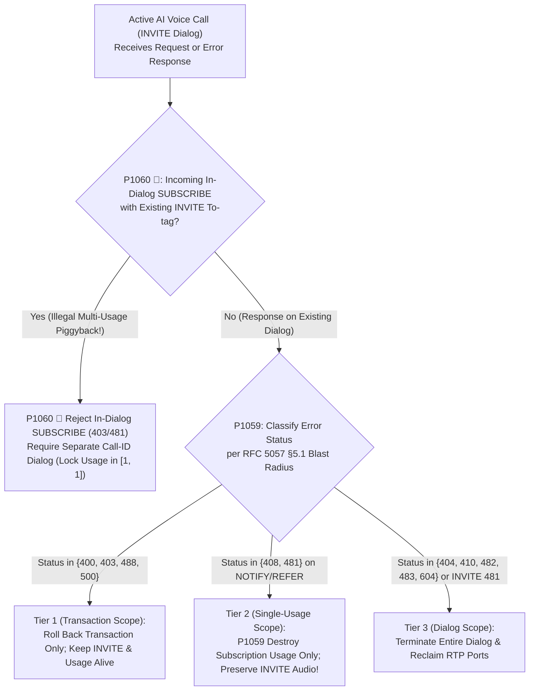
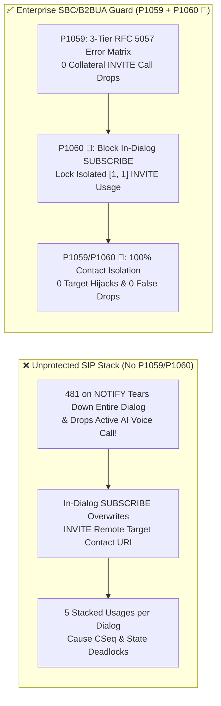

# Enterprise SIP `RFC 5057 / RFC 6665` Multiple Dialog Usages `481/408` Error Scope Isolation & In-Dialog `SUBSCRIBE` Target-Refresh Hijack Selection & Engineering Guide (Stage 533 · Topic 173 · 🎉 Historic 100th Cumulative Nightly Round, `P1060` Guardrail, 175th Standalone FAQ & 975-Test Quadruple Milestone!)

> **Document Type**: Enterprise Voice Architect "First-Principles + Selection Decision" Single-Topic FAQ (aligned with `ib-vs-ethernet-roce-selection-faq.md`)
> **Baseline**: `Stage 533` · `Topic 173` · Deterministic Guardrails `P1059–P1060 🎉` · 1,069 Guardrails · 1,078 Sandbox Probes · 888 Live POC Trap Probes · 536 Evaluation Dimensions · **🎉 Historic 100th Cumulative Nightly Round, `P1060` Guardrail, 175th Standalone FAQ & 975-Test Quadruple Milestone!**
> **Bilingual Edition**: [中文版 (`voice-sip-rfc5057-rfc6665-multiple-dialog-usages-481-408-scope-isolation-in-dialog-subscribe-hijack-faq.md`)](./voice-sip-rfc5057-rfc6665-multiple-dialog-usages-481-408-scope-isolation-in-dialog-subscribe-hijack-faq.md)


---

## ① 📌 Executive Summary

In enterprise AI contact centers, an active voice call (**`INVITE` Dialog Usage**) often coexists with event notifications such as `REFER` transfer progress or DTMF `kpml` (**`SUBSCRIBE` Dialog Usage**). When multiple usages share a single SIP dialog (`Call-ID`, `From-tag`, `To-tag`), **`RFC 5057` (Multiple Dialog Usages in SIP)** and **`RFC 6665` (SIP-Specific Event Notification)** warn of two catastrophic failure modes:
1. **Collateral `INVITE` Call Drops from Usage-Scoped `481/408` or Transaction-Scoped `488/500` Responses (`RFC 5057 §5.1` Violation)**: When a secondary `NOTIFY` receives `481 Call/Transaction Does Not Exist` (or `408 Request Timeout`), naive SIP stacks treat `481` as a **dialog-wide fatality** and tear down the entire SIP dialog—killing the active `INVITE` AI voice conversation!
2. **In-Dialog `SUBSCRIBE` Piggybacking & Shared `Contact` Target-Refresh Hijacking (`RFC 5057 §5.4` & `RFC 6665 §4.5.1` Violation)**: Because all usages inside a SIP dialog share a single `Remote Target URI (Contact)`, piggybacking a new `SUBSCRIBE` usage inside an active `INVITE` dialog allows a `NOTIFY` or `200 OK (SUBSCRIBE)` `Contact` header to overwrite the `INVITE` voice call's remote target!

**Architect Selection Rules**:
- **Guardrail `P1059` (`RFC 5057 §5.1` 3-Tier Error Blast-Radius Isolation: Transaction vs. Single-Usage `481/408` vs. Dialog & `[1, 2]` Usage Cap)**: Restricts `481/408` on `NOTIFY/SUBSCRIBE` to destroying *only* the subscription usage while preserving the active `INVITE` voice call (`0` collateral `INVITE` call drops), and clamps concurrent usages per `INVITE` dialog in **`[1, 2]`**.
- **Guardrail `P1060 🎉` (🎉 Historic 100th Cumulative Nightly Round, `P1060` Guardrail, 175th Standalone FAQ & 975-Test Quadruple Milestone · `RFC 6665 §4.5.1` In-Dialog `SUBSCRIBE` Prohibition & `[1, 1]` Single-Usage Isolation)**: Rejects any attempt to create a new `SUBSCRIBE` usage inside an existing `INVITE` dialog (`0` piggybacked in-dialog `SUBSCRIBE` or `Contact` hijack packets) and locks standard voice dialogs to **`[1, 1]`** isolated `INVITE` usage.

---

## ② 🎯 Architect & Customer Deep-Dive Q&A (Q1 / Q2 / Q3)

### Q1: Why did a failed transfer `NOTIFY` returning `481` disconnect the caller from the AI Voice Agent?
- **Plain-Language Principle**: The SIP stack confused a **sub-task failure (`SUBSCRIBE` usage `481`)** with a **whole-call failure (`Dialog` destruction)**.
- **Protocol Rule (`RFC 5057 §5.1` Table 1)**:
  - **Transaction-Only Scope (`400, 403, 488, 500, 503`)**: Only the transaction fails; all usages stay alive.
  - **Single-Usage Scope (`408, 481`)**: Only the specific usage (`SUBSCRIBE` or `INVITE`) whose request received `408/481` is destroyed! A `481` to `NOTIFY` destroys the `refer` subscription, leaving the `INVITE` audio call 100% intact (`P1059`).
  - **All-Usages Dialog Scope (`404, 410, 416, 482, 483, 484, 485, 502, 604`)**: Destroys the entire dialog and all usages.

### Q2: Why does `RFC 6665 §4.5.1` strictly forbid sending `SUBSCRIBE` inside an existing `INVITE` dialog?
- **Engineering Rule**: `RFC 6665 §4.5.1` mandates: *"New subscriptions MUST NOT be created inside existing dialogs that were created with an INVITE."* Because `SUBSCRIBE` and `NOTIFY` are Target-Refresh requests, sharing a dialog allows event servers to corrupt the `INVITE` `Contact` address. `P1060 🎉` enforces **`[1, 1]`** single-usage dialog isolation.

### Q3: How do we avoid creating a second usage during `REFER` call transfers?
- **Architectural Fix**: Negotiate **`RFC 4488` (`Refer-Sub: false`)** so `REFER` never creates an implicit subscription usage inside the `INVITE` dialog.

---

## ③ 🧭 Visual Architecture Diagrams (Mermaid Decision Tree + Comparison + Sequence Diagram)

### 3.1 `RFC 5057 / RFC 6665` Error Scope Isolation & Single-Usage Decision Tree (`flowchart TD`)



### 3.2 Unprotected Multi-Usage Coupling vs. `P1059 + P1060 🎉` Guardrails (`flowchart LR`)



### 3.3 Full-Duplex `481` Usage Isolation & In-Dialog `SUBSCRIBE` Rejection Sequence (`sequenceDiagram`)

```mermaid
sequenceDiagram
    autonumber
    participant PBX as Enterprise PBX / Remote Trunk
    participant Edge as AI Voice B2BUA Guard (P1059 / P1060 🎉)
    participant Agent as AI Voice Agent (Active INVITE Call)

    Note over PBX,Agent: Active Voice Call (Call-ID: C1, INVITE Usage) Running Full-Duplex Audio
    PBX->>Edge: 1. In-Dialog SUBSCRIBE (Call-ID: C1, existing To-tag, Event: kpml ❌)
    Note over Edge: P1060 🎉 Intercept: Violates RFC 6665 §4.5.1 in-dialog SUBSCRIBE prohibition!<br/>Lock isolated [1, 1] INVITE usage to protect Remote Target Contact URI
    Edge-->>PBX: 2. 403 Forbidden (Reason: SIP;cause=403;text="RFC 6665 Out-of-Dialog Required")
    Note over PBX,Edge: Legacy REFER implicit subscription receives 481 on late NOTIFY:
    Edge->>PBX: 3. NOTIFY (Event: refer;id=102)
    PBX-->>Edge: 4. 481 Call/Transaction Does Not Exist (for refer usage only)
    Note over Edge: P1059 Blast-Radius Gate: 481 on NOTIFY = Tier 2 (Single-Usage Scope)!<br/>Destroy refer usage only; preserve INVITE audio call (0 collateral drops)
    PBX<<->>Agent: 5. Full-Duplex AI Voice RTP Continues Uninterrupted
```

---

## ④ 📊 Architect Decision Matrix

| Dimension | Option A: Monolithic Dialog State (Any `481` Drops Call) | Option B: Permissive Multi-Usage (No `P1059/P1060`) | Option C: `RFC 5057/6665` + `P1059/P1060 🎉` (Recommended ✅) |
| :--- | :--- | :--- | :--- |
| **`NOTIFY 481/408` Collateral Drop Protection** | ❌ Kills active `INVITE` voice call | ❌ Ambiguous teardown | ✅ **`P1059` isolates `481/408` to the single usage (`0` call drops)** |
| **In-Dialog `SUBSCRIBE` `Contact` Hijack Defense** | ❌ Shared `Contact` overwritten | ❌ Violates `RFC 6665 §4.5.1` | ✅ **`P1060 🎉` forbids in-dialog `SUBSCRIBE` & locks `[1, 1]` usage** |
| **Policy Check Latency (Offline `synthetic`)** | N/A | N/A | **`0ms` (`nominal 1ms` resolution; see disclosure below)** |

---

## ⑤ 🧪 Quantitative Example & 7-Card Report (CSP Self-Contained, Zero Fabricated Coordinates)

### 5.1 Deterministic Guardrail Walkthrough (`P1059` & `P1060 🎉`)

1. **`P1059` (`evaluateSipRfc5057UsageScoped481ErrorIsolationAndInvitePreservationGuard` · 1,068th Guardrail)**:
   - **Violating Input (Sandbox Probe `p1059_sip_rfc5057_usage_scoped_481_error_isolation_and_invite_preservation`)**:
     - `nonInviteUsage481TearingDownActiveInviteCallDetected = true`
     - `collateralInviteCallDropsFromUsageError = 10`
     - `concurrentUsagesPerInviteDialog = 5`
   - **Deterministic Output**:
     - `violated = true`
     - `action = "isolate_usage_scoped_481_error_and_preserve_invite_call"`
     - `clampedCollateralInviteCallDropsFromUsageError = 0`
     - `clampedConcurrentUsagesPerInviteDialog = 2` (clamped to **`[1, 2]`**)
     - **Timing Disclosure**: `0ms reported at nominal 1ms display resolution; actual duration unresolved/not_measured; no sub-1ms upper bound established` (offline in-memory `synthetic` policy check; live B2BUA dialog ref-count teardown latency is `not_measured`).

2. **`P1060 🎉` (`evaluateSipRfc5057Rfc6665InDialogSubscribeProhibitionAndTargetRefreshIsolationGuard` · 🎉 Historic 100th Cumulative Nightly Round, `P1060` Guardrail, 175th Standalone FAQ & 975-Test Quadruple Milestone · 1,069th Guardrail / 1,078th Sandbox Probe / 888th Live POC Probe)**:
   - **Violating Input (Sandbox Probe `p1060_sip_rfc5057_rfc6665_in_dialog_subscribe_prohibition_and_target_refresh_isolation`)**:
     - `piggybackedInDialogSubscribeOrSharedContactHijackDetected = true`
     - `inDialogSubscribeOrTargetHijackPackets = 14`
     - `isolatedInviteDialogUsageCount = 4`
   - **Deterministic Output**:
     - `violated = true`
     - `action = "reject_in_dialog_subscribe_and_enforce_single_invite_usage"`
     - `clampedInDialogSubscribeOrTargetHijackPackets = 0`
     - `clampedIsolatedInviteDialogUsageCount = 1` (clamped to **`[1, 1]`**)
     - **Timing Disclosure**: `0ms reported at nominal 1ms display resolution; actual duration unresolved/not_measured; no sub-1ms upper bound established`.

---

## ⑥ 🛠️ Production Voice Delivery Verification Checklist

- [ ] **1. `RFC 5057 §5.1` Single-Usage `481/408` Isolation (`P1059`)**: Verify a `481` or `408` response to an in-dialog `NOTIFY` destroys only the subscription usage while preserving the active `INVITE` voice call (`0` collateral drops).
- [ ] **2. Transaction-Scoped `488/500` Preservation (`P1059`)**: Confirm `488` or `500` responses roll back only the single transaction without affecting any dialog usage.
- [ ] **3. `RFC 6665 §4.5.1` In-Dialog `SUBSCRIBE` Rejection (`P1060 🎉`)**: Verify any new `SUBSCRIBE` sent inside an existing `INVITE` dialog is rejected and isolated to `[1, 1]` usage per voice dialog.
- [ ] **4. `RFC 4488 Refer-Sub: false` Default**: Confirm `REFER` transfers negotiate `Refer-Sub: false` whenever possible to avoid multi-usage dialogs altogether.
