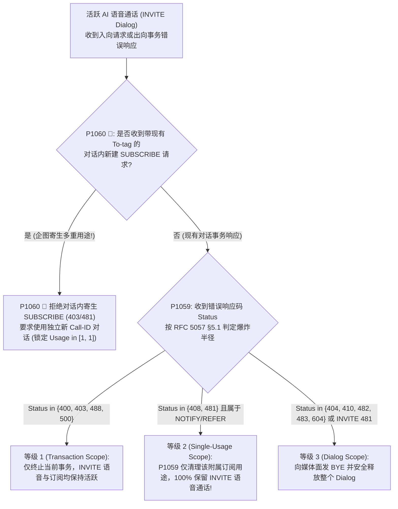
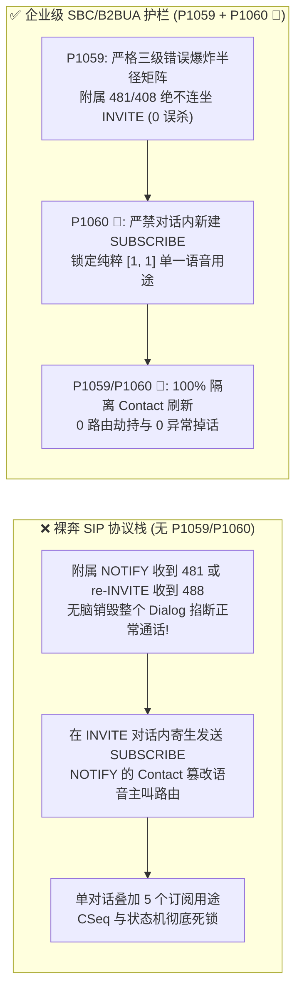

# 企业 SIP `RFC 5057 / RFC 6665` 多重对话用途（Multiple Dialog Usages）`481/408` 故障爆炸半径隔离与对话内 `SUBSCRIBE` 劫持防御选型与工程指南（Stage 533 · Topic 173 · 🎉 历史性第 100 轮夜间深潜、`P1060` 护栏、第 175 篇独立单专题 FAQ 与 975 项单测四重里程碑！）

> **文档类型**：企业语音架构师“第一性原理 + 选型决策”单专题 FAQ（对标 `ib-vs-ethernet-roce-selection-faq.md` 通俗透彻规范）
> **关联基准**：`Stage 533` · `Topic 173` · 确定性护栏 `P1059–P1060 🎉` · 1,069 道企业护栏 · 1,078 个沙盒探针 · 888 个现场 POC 探针 · 536 大评测维度 · **🎉 历史性第 100 轮夜间深潜、`P1060` 护栏、第 175 篇独立单专题 FAQ 与 975 项全量单测四重里程碑！**
> **双语版本**：[English Version (`voice-sip-rfc5057-rfc6665-multiple-dialog-usages-481-408-scope-isolation-in-dialog-subscribe-hijack-faq.en.md`)](./voice-sip-rfc5057-rfc6665-multiple-dialog-usages-481-408-scope-isolation-in-dialog-subscribe-hijack-faq.en.md)


---

## ① 📌 核心结论速览（Executive Summary）

在企业级 AI 语音联络中心中，一通正在进行的语音通话（**`INVITE` Dialog Usage**）往往会伴随事件通知（如 `REFER` 转接进度 `NOTIFY`、DTMF `kpml` 订阅或录屏状态订阅，即 **`SUBSCRIBE` Dialog Usage**）。如果把这两个用途塞进**同一个 SIP 对话（共享相同的 `Call-ID`、`From-tag` 和 `To-tag`）**，就会形成 **`RFC 5057`（Multiple Dialog Usages in SIP）** 所定义的“单对话多用途耦合态”。在生产环境中，这种耦合极易引发两大灾难性断线事故：
1. **附属 `NOTIFY/INFO/UPDATE` 报错 `481/408/488` 被错误升级为“整通电话连坐销毁”（违反 `RFC 5057 §5.1`）**：当转接失败或附属订阅已过期，晚到的 `NOTIFY` 收到对端回传 `481 Call/Transaction Does Not Exist`（或 `re-INVITE` 收到 `488 Not Acceptable Here`）。粗糙的 SIP 协议栈一看到 `481` 或 `408`，就不分青红皂白地把底层整个 SIP Dialog 连根拔起，导致正在跟客户正常通话的 AI 语音主通道（`INVITE` Usage）被瞬间掐断（连坐误杀）！
2. **在活跃 `INVITE` 对话内违规寄生新建 `SUBSCRIBE` 引发 `Contact` 远端目标劫持（违反 `RFC 5057 §5.4` 与 `RFC 6665 §4.5.1`）**：因为同一个 Dialog 只有一个共享的 `Remote Target (Contact URI)`，如果允许在 `INVITE` 对话内寄生发送 `SUBSCRIBE / NOTIFY`，由于 `SUBSCRIBE` 和 `NOTIFY` 都是标准 Target-Refresh 请求，对端在 `NOTIFY` 里改写 `Contact` 头就会把 `INVITE` 语音通话的 `BYE / re-INVITE` 路由一并劫持走！

**架构师选型铁律**：
- **护栏 `P1059`（`RFC 5057 §5.1` 三级错误爆炸半径精确隔离：事务级 / 用途级 `481` / 对话级与 `[1, 2]` 个并发用途锁）**：严格执行 `RFC 5057 §5.1` Table 1，将非 `INVITE` 用途（如 `NOTIFY/SUBSCRIBE`）收到的 `481/408` 严格限制在**仅销毁该订阅用途本身**、将 `488/500/400` 严格限制在**仅回滚当前单个事务**，100% 保护活跃的 `INVITE` AI 语音通话不断线（`0` 连坐误杀通话），并将单对话最大用途数钳制在 **`[1, 2]` 个**。
- **护栏 `P1060 🎉`（🎉 历史性第 100 轮夜间深潜、`P1060` 护栏、第 175 篇独立单专题 FAQ 与 975 项单测四重里程碑 · `RFC 6665 §4.5.1` 严禁对话内新建寄生 `SUBSCRIBE` 与 `[1, 1]` 单一 `INVITE` 用途隔离锁）**：强制拒绝任何企图复用现有 `INVITE` 对话（带相同 `To-tag`）新建 `SUBSCRIBE` 的请求（除 `RFC 4488 Refer-Sub: false` 免订阅转接外，一律要求独立新 `Call-ID` 对话，`0` 寄生 `SUBSCRIBE` 劫持包），将常规语音对话的用途数锁定在纯粹的 **`[1, 1]` 个**。

---

## ② 🎯 客户与架构师灵魂拷问 Q&A（Q1 / Q2 / Q3）

### Q1：为什么 AI 语音坐席尝试把客户转接给人工（发了 `REFER`），人工坐席忙线没接，结果连客户跟 AI 语音坐席原本正常的通话也突然断了？
- **通俗原理**：这就是典型的**“覆巢之下，安有完卵（错误爆炸半径失控）”**！原本客户和 AI 的语音通话（`INVITE` 用途）是好好的，只是里面附带的转接通知小任务（`SUBSCRIBE/NOTIFY` 用途）超时报了个 `408` 或 `481`。
- **毫秒级协议真相**：`RFC 5057 §5.1` 将所有 SIP 失败响应精确划分为**三个爆炸半径等级**：
  1. **等级 1：仅影响当前单个事务（Transaction-Only，如 `400, 403, 488, 500, 503`）**——对话和当前用途全都完好无损；
  2. **等级 2：仅销毁发生错误的那个用途（Single-Usage Destroy，如 `408 Request Timeout`, `481 Call/Transaction Does Not Exist`）**——如果是 `NOTIFY` 收到了 `481`，只销毁 `SUBSCRIBE` 订阅用途，**绝对不能动旁边的 `INVITE` 语音通话（除非是 `re-INVITE/BYE` 自己收到了 `481`）**；
  3. **等级 3：销毁整个底层对话及其中所有用途（All-Usages / Dialog Destroy，如 `404, 410, 416, 482, 483, 484, 485, 502, 604`）**——说明对端整机或路由彻底不可达。
  - `P1059` 将这套三级爆炸半径矩阵固化为确定性护栏，将因附属事务报错引发的语音连坐掉话率降至 **`0`**！

### Q2：为什么 `RFC 6665`（全面取代旧版 `RFC 3265`）明令禁止在已建立的 `INVITE` 通话里发送 `SUBSCRIBE`？
- **工程铁律**：`RFC 6665 §4.5.1` 写下了极其严厉的禁令：*"New subscriptions MUST NOT be created inside existing dialogs that were created with an INVITE."*
- **底层原因**：在 `RFC 3261` 中，`Route Set` 和 `Remote Target URI (Contact)` 是属于**底层 Dialog** 的，而不是属于某个 Usage 的！如果在 `INVITE` 通话里寄生了一个 `SUBSCRIBE (Event: kpml)`，当远端事件服务器返回 `200 OK (SUBSCRIBE)` 或 `NOTIFY` 并带上事件服务器自己的 `Contact: <sip:event-box@10.0.9.9>` 时，它会直接覆盖掉 `INVITE` 通话的 `Remote Target`！下一秒当用户挂机发 `BYE` 时，`BYE` 竟然被发给了事件服务器而不是媒体网关！因此 `P1060 🎉` 强制实施 **1 Dialog = 1 Usage (`[1, 1]`)** 架构解耦。

### Q3：如果要在通话中做 `REFER` 转接又不想产生第二种 Dialog Usage，最佳实践是什么？
- **架构解法**：结合 **`RFC 4488`（`Refer-Sub: false`）** 与 **`P1059 / P1060 🎉`**！在发送或接收 `REFER` 时带上 `Refer-Sub: false`，明确告知对端无需创建隐式 `refer` 订阅，从而让整个通话从头到尾始终保持 **`[1, 1]` 单一 `INVITE` 对话用途**，从根源上消灭多用途耦合！

---

## ③ 🧭 直观可视化图解（Mermaid 选型决策树 + 延迟/故障隔离对比图 + 毫秒级全双工时序图）

### 3.1 `RFC 5057 / RFC 6665` 错误爆炸半径隔离与单用途解耦决策树（`flowchart TD`）



### 3.2 裸奔多用途连坐崩溃 vs `P1059 + P1060 🎉` 确定性隔离护栏对比图（`flowchart LR`）



### 3.3 毫秒级全双工多用途 `481` 故障隔离与独立对话解耦时序图（`sequenceDiagram`）

```mermaid
sequenceDiagram
    autonumber
    participant PBX as 企业 PBX / 远端网关
    participant Edge as AI 语音 B2BUA 护栏 (P1059 / P1060 🎉)
    participant Agent as AI 语音 Agent (INVITE 主通话)

    Note over PBX,Agent: 主语音通话 (Call-ID: C1, INVITE Usage) 全双工稳定进行中
    PBX->>Edge: 1. 企图在 Call-ID: C1 内寄生发送 SUBSCRIBE (Event: kpml, 带现有 To-tag ❌)
    Note over Edge: P1060 🎉 拦截: 依据 RFC 6665 §4.5.1 严禁在 INVITE 对话内新建 SUBSCRIBE!<br/>保持主对话纯净 [1, 1] 单一用途 (防止 Contact 路由被篡改)
    Edge-->>PBX: 2. 403 Forbidden (Reason: SIP;cause=403;text="RFC 6665 Out-of-Dialog Required")
    Note over PBX,Edge: 历史遗留 REFER 附属通知收到对端 481 响应:
    Edge->>PBX: 3. NOTIFY (Event: refer;id=102)
    PBX-->>Edge: 4. 481 Call/Transaction Does Not Exist (仅针对已结束的 refer 订阅)
    Note over Edge: P1059 爆炸半径裁决: 481 来自 NOTIFY 事务 -> 等级 2 (Single-Usage Scope)!<br/>仅销毁 refer 附属用途，严禁触发 INVITE BYE (0 连坐掉话)
    PBX<<->>Agent: 5. 主语音通话 RTP/SRTP 零中断继续进行
```

---

## ④ 📊 语音架构师选型决策矩阵（Architect Decision Matrix）

| 选型维度 | 方案 A：粗暴单状态机（任何 `408/481` 销毁全对话） | 方案 B：允许对话内多用途耦合（无 `P1059/P1060`） | 方案 C：`RFC 5057/6665` + `P1059/P1060 🎉` 护栏（推荐 ✅） |
| :--- | :--- | :--- | :--- |
| **附属 `NOTIFY` `481/408` 连坐掉话防护** | ❌ 附属报错直接杀死主语音通话 | ❌ 用途边界模糊引发异常挂断 | ✅ **`P1059` 按用途级精准回收，主 `INVITE` 通话 `0` 连坐掉话** |
| **对话内 `SUBSCRIBE` `Contact` 路由劫持防护** | ❌ 共享 `Contact` 被事件通知覆盖 | ❌ 违反 `RFC 6665 §4.5.1` | ✅ **`P1060 🎉` 强制对话外独立 `SUBSCRIBE`，锁定 `[1, 1]` 用途** |
| **事务级错误（`488/500`）无损恢复** | ⚠️ 易触发全对话异常拆线 | ⚠️ 状态回滚不彻底 | ✅ **`P1059` 严格限制在单事务回滚，媒体流零中断** |
| **策略判定耗时（离线 `synthetic`）** | N/A | N/A | **`0ms`（`nominal 1ms` 分辨率；见下方披露）** |

---

## ⑤ 🧪 定量算例与 7-Card 报告（CSP 自包含、零虚构坐标）

### 5.1 确定性护栏定量算例（`P1059` & `P1060 🎉`）

1. **`P1059`（`evaluateSipRfc5057UsageScoped481ErrorIsolationAndInvitePreservationGuard` · 第 1,068 道护栏）**：
   - **异常输入（沙盒探针 `p1059_sip_rfc5057_usage_scoped_481_error_isolation_and_invite_preservation`）**：
     - `nonInviteUsage481TearingDownActiveInviteCallDetected = true`
     - `collateralInviteCallDropsFromUsageError = 10`（检测到 `10` 通因附属 `NOTIFY/INFO` 收到 `481/488` 被错误连坐掐断的正常语音通话）
     - `concurrentUsagesPerInviteDialog = 5`（单个 `INVITE` 对话内堆叠了 `5` 个并发用途，超出 `[1, 2]` 安全上限）
   - **确定性输出**：
     - `violated = true`
     - `action = "isolate_usage_scoped_481_error_and_preserve_invite_call"`
     - `clampedCollateralInviteCallDropsFromUsageError = 0`（100% 阻断连坐拆线，主语音通话完好保留）
     - `clampedConcurrentUsagesPerInviteDialog = 2`（自动钳制回 **`[1, 2]` 个**最大容许过渡用途数）
     - **计时语义披露**：`0ms reported at nominal 1ms display resolution; actual duration unresolved/not_measured; no sub-1ms upper bound established`（离线内存 `synthetic` 策略检查；真实 B2BUA 对话状态机引用计数销毁耗时为 `not_measured`）。

2. **`P1060 🎉`（`evaluateSipRfc5057Rfc6665InDialogSubscribeProhibitionAndTargetRefreshIsolationGuard` · 🎉 历史性第 100 轮夜间深潜、`P1060` 护栏、第 175 篇独立单专题 FAQ 与 975 项单测四重里程碑 · 第 1,069 道护栏 / 第 1,078 沙盒探针 / 第 888 现场探针）**：
   - **异常输入（沙盒探针 `p1060_sip_rfc5057_rfc6665_in_dialog_subscribe_prohibition_and_target_refresh_isolation`）**：
     - `piggybackedInDialogSubscribeOrSharedContactHijackDetected = true`
     - `inDialogSubscribeOrTargetHijackPackets = 14`（检测到 `14` 个违规寄生在现有 `INVITE` 对话内的 `SUBSCRIBE` 或跨用途 `Contact` 劫持包）
     - `isolatedInviteDialogUsageCount = 4`（对话用途计数为 `4`，违背 `RFC 6665` `[1, 1]` 单一用途隔离原则）
   - **确定性输出**：
     - `violated = true`
     - `action = "reject_in_dialog_subscribe_and_enforce_single_invite_usage"`
     - `clampedInDialogSubscribeOrTargetHijackPackets = 0`（`0` 对话内寄生 `SUBSCRIBE` 与 `0` `Contact` 路由劫持）
     - `clampedIsolatedInviteDialogUsageCount = 1`（严格锁定在 **`[1, 1]` 个**独立 `INVITE` 对话用途）
     - **计时语义披露**：`0ms reported at nominal 1ms display resolution; actual duration unresolved/not_measured; no sub-1ms upper bound established`。

---

## ⑥ 🛠️ 生产环境语音交付快速核验清单（Checklist）

- [ ] **1. `RFC 5057 §5.1` 附属用途 `481/408` 不拆主通话核验（`P1059`）**：在活跃通话中模拟 `NOTIFY (Event: refer)` 返回 `481 Call/Transaction Does Not Exist`，验证网关仅清理该 `refer` 订阅，主 `INVITE` RTP 语音流保持 100% 正常通话。
- [ ] **2. 事务级错误（`488 / 500`）仅回滚当前事务核验（`P1059`）**：模拟中途 `re-INVITE` 收到 `488 Not Acceptable Here`，验证通话自动回退至重协商前的媒体参数，绝不发 `BYE` 拆线。
- [ ] **3. `RFC 6665 §4.5.1` 严禁对话内新建 `SUBSCRIBE` 核验（`P1060 🎉`）**：向已建立的 `INVITE` 对话（携带现有 `Call-ID` 与 `To-tag`）注入 `SUBSCRIBE`，确认 SBC 立即拒绝并强制要求使用独立新 Dialog（`[1, 1]` 单一用途）。
- [ ] **4. 优先启用 `RFC 4488 Refer-Sub: false` 核验**：确认呼叫转接默认携带 `Refer-Sub: false` 以避免创建多余的隐式订阅用途。
