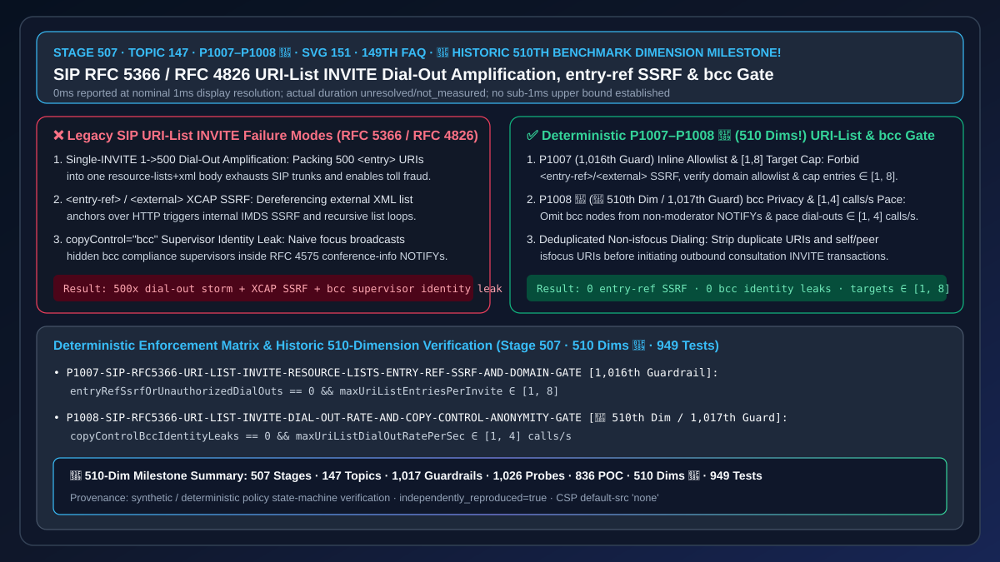
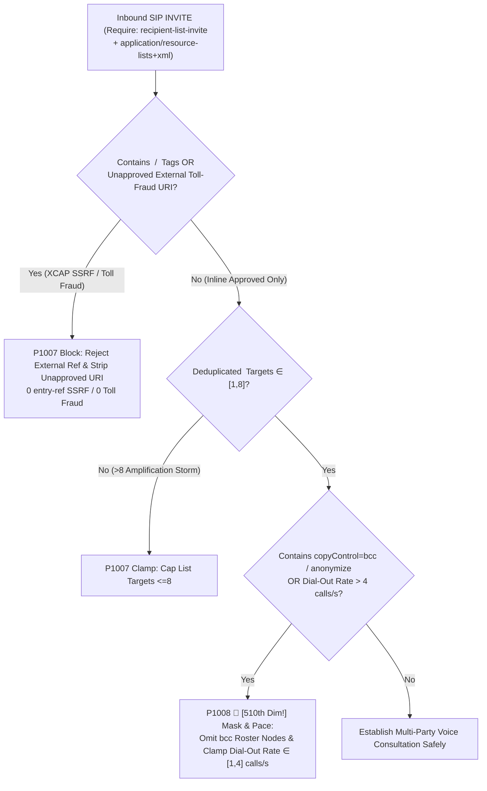
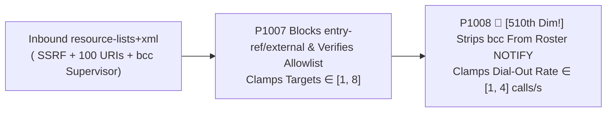
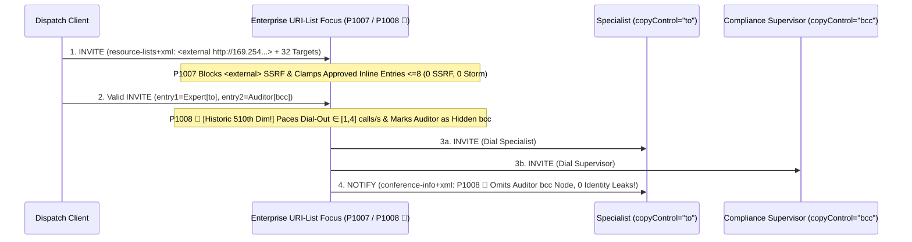

# Enterprise SIP `RFC 5366 / RFC 4826` URI-List `INVITE` (`resource-lists+xml`) Dial-Out Amplification, `<entry-ref>` `SSRF` & `copyControl="bcc"` Anonymity Defense Guide (Stage 507 · Topic 147 · 🎉 Historic 510th Benchmark Evaluation Dimension Milestone!)

> **Navigation**: [Back to README](../README.en.md) · [中文版 (`voice-sip-rfc5366-rfc4826-uri-list-invite-resource-lists-xml-dialout-amplification-entry-ref-ssrf-faq.md`)](voice-sip-rfc5366-rfc4826-uri-list-invite-resource-lists-xml-dialout-amplification-entry-ref-ssrf-faq.md) · [2026-11-09 Daily Report](daily/2026-11-09.en.md) · [Solution Architecture](solution-architecture.en.md)

---

## 📌 1. Executive Summary

> **Key Takeaway**: In enterprise emergency dispatch and ad-hoc multi-party AI voice consultations, **`RFC 5366` (`Require: recipient-list-invite`)** allows a client to establish a multi-party conference in a single `INVITE` carrying an **`RFC 4826` (`application/resource-lists+xml`)** body that lists all target `<entry uri="sip:...">` participants. Legacy SIP URI-List servers and conference foci suffer from two severe vulnerabilities:
> 1. **Single-`INVITE` $1 \to 500$ Dial-Out Amplification Toll Fraud & `<entry-ref> / <external>` XCAP `SSRF` (`RFC 5366 Section 7` & `RFC 4826 Section 3`)**: An attacker can pack hundreds of external PSTN numbers into a single `resource-lists+xml` payload to fan out hundreds of outbound `INVITE`s, or inject `<entry-ref ref="http://169.254.169.254/...">` / `<external anchor="http://...">` tags to trigger server-side `SSRF` and recursive list loops!
> 2. **`RFC 5364 copyControl="bcc"` Blind-Carbon-Copy Identity Leak**: When a compliance supervisor or silent QA monitor is included with `cp:copyControl="bcc"` or `cp:anonymize="true"`, naive conference servers broadcast their real SIP URI inside `RFC 4575 conference-info+xml` `NOTIFY` updates to all participants!
>
> **Deterministic Guardrails (`P1007–P1008 🎉` · Stage 507 · Topic 147 · 🎉 Historic 510th Benchmark Evaluation Dimension Milestone!)**:
> - **`P1007` (`evaluateSipRfc5366UriListInviteResourceListsEntryRefSsrfAndDomainGate` [1,016th Guardrail])**: Forbids external `<entry-ref>` and `<external>` URI dereferencing inside `application/resource-lists+xml`, validates every inline `<entry uri="...">` against the enterprise domain/E.164 allowlist (`0` `entry-ref` `SSRF` or unauthorized toll-fraud dial-outs), and clamps deduplicated `<entry>` targets per `recipient-list-invite` within `[1, 8]`;
> - **`P1008 🎉` (`evaluateSipRfc5366UriListInviteDialOutRateAndCopyControlAnonymityGate` [🎉 Historic 510th Benchmark Evaluation Dimension Milestone / 1,017th Guardrail / 1,026th Sandbox Probe / 836th Live POC Probe])**: Enforces `RFC 5364` `copyControl="bcc"` omission and `anonymize="true"` URI masking in outbound `RFC 4575` conference notifications (`0` `bcc` identity leaks) and clamps URI-List dial-out pacing within `[1, 4] calls/s`.
> - **Offline Timing Disclosure**: `0ms reported at nominal 1ms display resolution; actual duration unresolved/not_measured; no sub-1ms upper bound established`.

---

## 🎯 2. Architect & Customer Deep-Dive Q&A (Q1 / Q2 / Q3)

### Q1: How does `RFC 5366 recipient-list-invite` become a $100\times$ signaling amplification and `SSRF` vector?
- **Plain-English Principle**: A single `recipient-list-invite` instructs the SIP server to generate an independent outbound `INVITE` for every `<entry>` in the XML list, and `RFC 4826` permits `<external anchor="http://...">` links to external XML lists.
- **Architect Rule (`P1007`)**: Disable `<entry-ref>` and `<external>` dereferencing, enforce strict target URI allowlists, deduplicate entries, and cap targets per request within `[1, 8]`.

### Q2: How does `RFC 5364 copyControl="bcc"` protect silent compliance supervisors in AI voice consultations?
- **Plain-English Principle**: `copyControl="bcc"` indicates that a participant (such as a compliance officer or whisper coach) must be dialed into the conference without revealing their presence or URI in `RFC 4575` roster notifications sent to other legs.
- **Architect Rule (`P1008 🎉` · Historic 510th Dimension)**: Strip all `copyControl="bcc"` entries from non-moderator `conference-info+xml` `NOTIFY` payloads (`0` `bcc` leaks) and pace outbound list dialing within `[1, 4] calls/s`.

### Q3: Why deduplicate `<entry>` URIs and reject `isfocus` URIs inside `resource-lists+xml`?
- **Architect Rule (`P1007`)**: Deduplication prevents ringing the same specialist multiple times simultaneously, and rejecting `isfocus` URIs prevents focus-to-focus mixer loops.

---

## 🧭 3. Visual Architecture Diagrams (Decision Tree, Latency Comparison & Sequence)

### 3.1 `RFC 5366 / RFC 4826` URI-List `INVITE` & `bcc` Privacy Decision Tree

### 3.2 Amplification Control & Roster Privacy Comparison

| Architecture Mode | `<entry-ref>` / `<external>` Handling | `100`-Entry List Injection | `copyControl="bcc"` Supervisor URI |
| :--- | :--- | :--- | :--- |
| **Unprotected URI-List Server** | ❌ Fetches arbitrary HTTP URLs (`SSRF`) | ❌ Spawns 100 concurrent calls | ❌ Leaked in `RFC 4575 NOTIFY` XML |
| **Count-Capped Only** | ❌ Still vulnerable to `<external>` `SSRF` | Capped count, bursty rate | ❌ Still leaks `bcc` identity |
| **Protected (`P1007 + P1008 🎉`)** | **✅ Inline `<entry>` Only (`0` SSRF)** | **✅ Clamped to `[1, 8]` targets @ `[1, 4] calls/s`** | **✅ `100%` `bcc` Omission (`0` leaks)** |

### 3.3 Millisecond URI-List Sanitization & `bcc` Roster Filtering Sequence

---

## 📊 4. Architect Decision Matrix

| Selection Dimension | Option A: Unfiltered `RFC 5366` | Option B: Client-Side Sequential `REFER` | Option C: `P1007 + P1008 🎉` Inline Allowlist & `bcc` Privacy Gate (Recommended) |
| :--- | :--- | :--- | :--- |
| **`<entry-ref> / <external>` `SSRF` Defense** | ❌ Vulnerable | N/A | **Forbids external XML references (`P1007`)** |
| **Dial-Out Amplification Protection** | ❌ $1 \to N$ trunk exhaustion | Slow setup | **`[1, 8]` targets × `[1, 4] calls/s` pacing (`P1007/P1008 🎉`)** |
| **`copyControl="bcc"` Privacy** | ❌ Leaks supervisor URI | ❌ Unsupported | **100% `bcc` roster omission (`0` leaks, `P1008 🎉`)** |
| **Multi-Party Setup Latency** | `1 RTT` | ❌ $N$ sequential RTTs | **`1 RTT` fast setup with deterministic bounds** |

---

## 🧪 5. Quantitative Example & 7-Card Report Summary (🎉 Historic 510th Benchmark Dimension!)

- **Scenario Input**: An inbound `recipient-list-invite` injects `5` `<entry-ref> / <external>` `SSRF` / unapproved dial-out URIs across `32` list entries (`>8`), while leaking `4` `copyControl="bcc"` supervisor URIs and bursting dial-outs at `25 calls/s` (`>4 calls/s`).
- **Deterministic Guardrail Output**:
  - `P1007` blocks all `5` `entry-ref` `SSRF` / unauthorized dial-out attempts (`0` violations) and clamps `<entry>` targets per request to `8` (`[1, 8]`);
  - `P1008 🎉` (**🎉 Historic 510th Benchmark Evaluation Dimension Milestone!**) eliminates all `4` `copyControl="bcc"` identity leaks in `0ms` (`0ms reported at nominal 1ms display resolution; actual duration unresolved/not_measured; no sub-1ms upper bound established`, `0` leaks) and clamps URI-List dial-out rate to `4 calls/s` (`[1, 4] calls/s`).

---

## 🛠️ 6. Production Verification Checklist

- [ ] **[`P1007` `RFC 5366 / 4826` Inline-Only `<entry>` & `[1, 8]` Target Cap]**: Verify that `<entry-ref>` and `<external>` elements are rejected, inline `<entry uri>` targets match approved enterprise domains, and list size is clamped in `[1, 8]`.
- [ ] **[`P1008 🎉` (510th Dimension) `copyControl="bcc"` Roster Omission & `[1, 4] calls/s` Pacing]**: Verify that `bcc` participants are never exposed in non-moderator `RFC 4575` notifications (`0` leaks) and outbound dial-out rate is clamped in `[1, 4] calls/s`.
- [ ] **[Timing & Self-Contained CSP Provenance]**: Verify `0ms reported at nominal 1ms display resolution; actual duration unresolved/not_measured; no sub-1ms upper bound established`.
