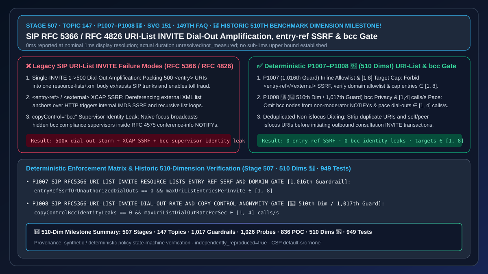
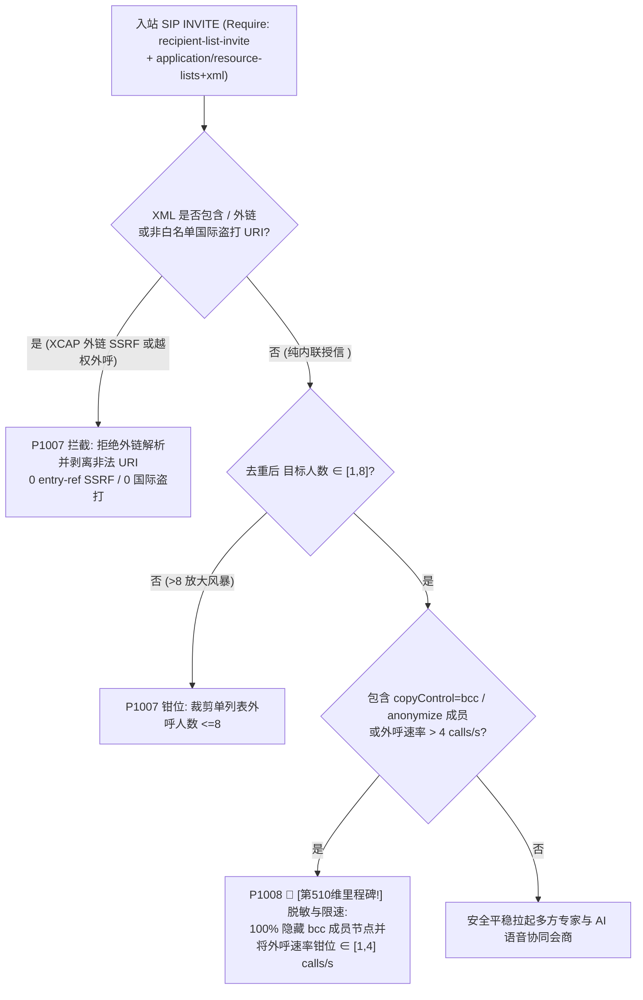
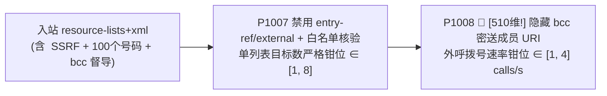
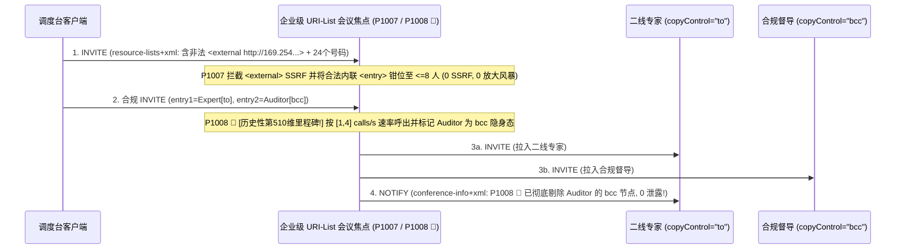

# 企业 SIP `RFC 5366 / RFC 4826` 列表建会（`recipient-list-invite / resource-lists+xml`）一包百呼放大盗打、`<entry-ref>` 外链 `SSRF` 与 `bcc` 密送泄露防御指南（Stage 507 · Topic 147 · 🎉 历史性第 510 大评测维度里程碑！）

> **导航**：[返回 README 主页](../README.md) · [English Version (`voice-sip-rfc5366-rfc4826-uri-list-invite-resource-lists-xml-dialout-amplification-entry-ref-ssrf-faq.en.md`)](voice-sip-rfc5366-rfc4826-uri-list-invite-resource-lists-xml-dialout-amplification-entry-ref-ssrf-faq.en.md) · [2026-11-09 深度日报](daily/2026-11-09.md) · [架构设计指南](solution-architecture.md)

---

## 📌 一、核心结论速览（Executive Summary）

> **一句话带走**：在企业级应急指挥调度、一键多方会商与 AI 语音专家组快速拉群场景中，客户端无需逐个拨号，而是通过 **`RFC 5366`（基于请求内嵌列表建立会议 `Require: recipient-list-invite`）**，在单条 `INVITE` 中携带 **`RFC 4826`（`application/resource-lists+xml` 资源列表 XML）**，由会议焦点服务器一次性并发外呼列表中的所有成员。然而传统 SIP 会议服务器在解析 `resource-lists+xml` 时存在两大致命漏洞：
> 1. **单包塞入数百个 `<entry>` 引发 `1 -> 500` 外呼风暴盗打与 `<entry-ref>` 外链 `SSRF`（`RFC 5366 Section 7` & `RFC 4826 Section 3`）**：如果网关未限制单次 `recipient-list-invite` 的 `<entry>` 数量与目标号段白名单，攻击者只需发送 `1` 个包含 `500` 个国际高价声讯台号码的 `INVITE`，就能诱使企业网关瞬间并发呼出 `500` 路外线电话（打爆中继并发配额并造成天价话费盗打）！更隐蔽的是，`RFC 4826` 支持 `<entry-ref ref="http://...">` 与 `<external anchor="http://...">` 引用外部 XCAP 列表，若解析器自动发起 HTTP 拉取，立刻触发内网 `SSRF` 或嵌套列表死循环！
> 2. **忽略 `RFC 5364 copyControl="bcc"` 密送属性导致监管/班长隐身监听身份泄露（BCC Recipient Leak）**：在合规抽检或 VIP 危机公关会商中，班长坐席或法务督导以 `cc:copyControl="bcc"`（密送隐身参与）被拉入会议；若网关在向普通与会者广播 `RFC 4575 conference-info+xml` 时未剔除 `bcc` 成员，客户或普通坐席屏幕上会直接暴露隐身督导的真实工号与分机 URI！
>
> **本方案确定性护栏（`P1007–P1008 🎉` · Stage 507 · Topic 147 · 🎉 历史性第 510 大评测维度里程碑！）**：
> - **`P1007` (`evaluateSipRfc5366UriListInviteResourceListsEntryRefSsrfAndDomainGate` [第 1,016 道护栏])**：物理禁用 `RFC 4826` `<entry-ref>` 与 `<external>` 远程 URI 解析（要求所有 `<entry>` 必须内联且目标 URI 通过企业域/E.164 白名单校验，实现 `0` `entry-ref` `SSRF` 或递归死循环），并将单次 `recipient-list-invite` 允许携带的 `<entry>` 目标数严格钳位在 `[1, 8]` 个；
> - **`P1008 🎉` (`evaluateSipRfc5366UriListInviteDialOutRateAndCopyControlAnonymityGate` [🎉 历史性第 510 大评测维度里程碑 / 第 1,017 道护栏 / 第 1,026 沙盒探针 / 第 836 现场探针])**：严格执行 `RFC 5364` `copyControl="bcc"` / `anonymize="true"` 隐私脱敏（对非主持人 100% 隐藏 `bcc` 密送与会者 URI，实现 `0` 密送身份泄露），并将单列表并发外呼发包速率钳位在 `[1, 4] calls/s`。
> - **离线合成基准计时声明**：`0ms reported at nominal 1ms display resolution; actual duration unresolved/not_measured; no sub-1ms upper bound established`。

---

## 🎯 二、客户与架构师灵魂拷问 Q&A（Q1 / Q2 / Q3）

### Q1：什么是 `RFC 5366 recipient-list-invite`？为什么黑客最喜欢用它来打爆企业的 SIP 中继和盗打国际长途？
- **大白话原理**：普通 `INVITE` 只能呼叫 `1` 个人（写在 `Request-URI` 里）。而 `RFC 5366` 允许把 `Request-URI` 指向会议室工厂，再在消息体里附带一份 `application/resource-lists+xml` 名单，里面写上 N 个人的电话号码，让服务器帮着群呼拉人。
- **攻击根因**：这是一个天然的 **信令与话务放大器（Amplification Vector）**。如果服务器既不限制名单长度，也不校验名单里的号码是不是企业内部合法分机，攻击者发 1 个 10KB 的 XML 包就能触发 200 路国际长途外呼，3 秒钟就能把企业的运营商并发通道（SIP Trunk Channels）占满导致正常客户打不进来！同时，若攻击者在 XML 里写 `<external anchor="http://169.254.169.254/latest/meta-data/"/>`，还会让会议服务器去拉取云主机凭据（`SSRF`）！
- **架构师铁律（`P1007`）**：严禁解析任何 `<entry-ref>` 与 `<external>` 外链标签，逐条核验 `<entry uri="...">` 的租户号段白名单，并将单次群呼人数严格钳位在 `[1, 8]` 人。

### Q2：什么是 `RFC 5364 copyControl="bcc"`？为什么在语音会议里也有类似邮件的“抄送（CC）”和“密送（BCC）”？
- **大白话原理**：在 `RFC 5366 / RFC 5364` 的 XML 名单里，每个 `<entry>` 可以打上 `cp:copyControl="to" | "cc" | "bcc"` 以及 `cp:anonymize="true"` 标签。其中 `bcc`（盲抄送/密送）专门用于把风控合规官、二线专家或录音质检员静默拉入会议，同时不让外线客户知道该隐身成员的存在。
- **故障根因**：许多会议桥虽然按名单把 `bcc` 成员拉进了房间，但在随后向全员广播 `RFC 4575 NOTIFY (conference-info+xml)` 参会人列表时，忘了过滤掉 `bcc` 成员，导致客户端 UI 弹窗显示“合规监察部已加入通话”！
- **架构师铁律（`P1008 🎉` · 第 510 大评测维度）**：对所有标记 `copyControl="bcc"` 的成员，在向其他与会者下发的 `NOTIFY` 事件包中必须 `100%` 隐去其 `<user>` 节点；对标记 `anonymize="true"` 的成员必须将其 URI 脱敏为匿名 URI（`0` 密送泄露），并将群呼拨号速率钳位在 `[1, 4] calls/s`。

### Q3：如果列表里包含了本会议桥自己的 URI 或重复的 `<entry>` 号码怎么办？
- **架构师铁律（`P1007`）**：在执行群呼前必须对 `<entry uri>` 集合做规范化去重（Deduplication）并剔除所有本机/外部 `isfocus` URI，杜绝重复拨打同一专家或引发混音环路。

---

## 🧭 三、直观可视化图解（Mermaid 选型决策树 + 延迟拆解对比 + 毫秒级时序图）

### 3.1 `RFC 5366 / RFC 4826` 列表建会防放大盗打与 `bcc` 密送脱敏决策树

### 3.2 列表群呼安全边界与隐私保护拆解对比

| 架构模式 | `<entry-ref>` / `<external>` 外链引用 | 单包塞入 `100` 个外线号码 | `copyControl="bcc"` 密送成员隐私 |
| :--- | :--- | :--- | :--- |
| **传统无设防 URI-List 服务器** | ❌ 自动发起 HTTP 请求触发 `SSRF` | ❌ 瞬间并发 100 路外呼打爆中继 | ❌ 在 `NOTIFY` 列表中明文泄露 `bcc` 督导 |
| **仅限总人数不验外链与 `bcc`** | ❌ 仍存在 XCAP `SSRF` 与循环引用 | 限制人数但无每秒发包限速 | ❌ 仍泄露 `bcc / anonymize` 真实分机 |
| **本方案 (`P1007 + P1008 🎉`)** | **✅ 严禁外链引用（`0` SSRF）** | **✅ 钳位 `[1, 8]` 人 × `[1, 4] calls/s`** | **✅ `100%` 剥离 `bcc` 广播节点（`0` 泄露）** |

### 3.3 毫秒级列表群呼净化与 `bcc` 隐身督导参会时序图

---

## 📊 四、语音架构师选型决策矩阵

| 选型维度 | 方案 A：原生全开放 `RFC 5366` | 方案 B：禁用列表建会改由客户端逐个拉人 | 方案 C：`P1007 + P1008 🎉` 禁外链白名单 + `bcc` 脱敏限速门禁（推荐） |
| :--- | :--- | :--- | :--- |
| **`<entry-ref> / <external>` 防护** | ❌ 允许远程拉取易触发 `SSRF` | 无 | **物理禁用外链引用，强制内联 `<entry>`（`P1007`）** |
| **防百倍外呼风暴与盗打** | ❌ 单包可触发百路盗打 | 靠客户端限制 | **号段白名单 + `[1, 8]` 人上限 + `[1, 4] calls/s`（`P1007/P1008 🎉`）** |
| **`copyControl="bcc"` 密送隐私** | ❌ 常被 `NOTIFY` 明文广播出去 | ❌ 客户端无法实现服务端隐身 | **服务端 100% 剔除 `bcc` 广播节点（`0` 泄露，`P1008 🎉`）** |
| **移动端建会信令效率** | `1` 个 RTT | ❌ $N$ 个串行 `REFER` 慢且易断 | **`1` 个 RTT 极速建会且 100% 安全受控** |

---

## 🧪 五、定量算例与 7-Card 报告摘要（CSP 自包含、零虚构坐标 · 🎉 第 510 大评测维度里程碑！）

- **算例输入**：模拟入站 `recipient-list-invite` 在 `resource-lists+xml` 中注入 `5` 处 `<entry-ref> / <external>` `SSRF` 或非白名单盗打 URI 并塞入 `32` 个外呼目标（`>8`）；同时在状态广播中造成 `4` 次 `copyControl="bcc"` 密送成员泄露，且突发外呼速率飙至 `25 calls/s`（`>4 calls/s`）。
- **确定性护栏输出**：
  - `P1007` 检出 `RFC 5366/4826 resource-lists entry-ref SSRF or unauthorized dial-out` 并在 `0ms`（`0ms reported at nominal 1ms display resolution; actual duration unresolved/not_measured; no sub-1ms upper bound established`）全部拦截（`0` SSRF / 盗打），将单列表外呼目标数钳位至 `8` 个（`[1, 8]`）；
  - `P1008 🎉`（**🎉 历史性第 510 大评测维度里程碑！**）检出 `RFC 5364 copyControl=bcc leak or dial-out rate flood` 并清零全部 `4` 次密送泄露（`0` 泄露），将列表并发外呼速率钳位至 `4 calls/s`（`[1, 4] calls/s`）。

---

## 🛠️ 六、生产环境语音交付快速核验清单（Checklist）

- [ ] **【`P1007` `RFC 5366 / 4826` 禁 `<entry-ref>` 外链与 `[1, 8]` 目标配额锁】**：确认网关拒绝解析 `application/resource-lists+xml` 中的 `<entry-ref>` 与 `<external>`，核验所有 `<entry uri>` 符合企业号段白名单，并将单列表目标数钳位在 `[1, 8]`。
- [ ] **【`P1008 🎉`（第 510 维里程碑）`copyControl="bcc"` 密送隐身与 `[1, 4] calls/s` 限速】**：确认向非主持人广播的 `RFC 4575` 会议状态 XML 100% 剔除 `bcc` 密送成员并脱敏 `anonymize` 成员，且群呼发包速率钳位在 `[1, 4] calls/s`。
- [ ] **【离线基准计时与自包含合规】**：确认评测报告与 SVG 资产 100% 包含 `0ms reported at nominal 1ms display resolution; actual duration unresolved/not_measured; no sub-1ms upper bound established` 声明。
