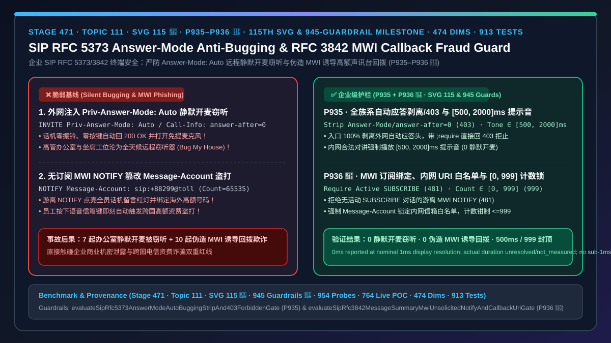
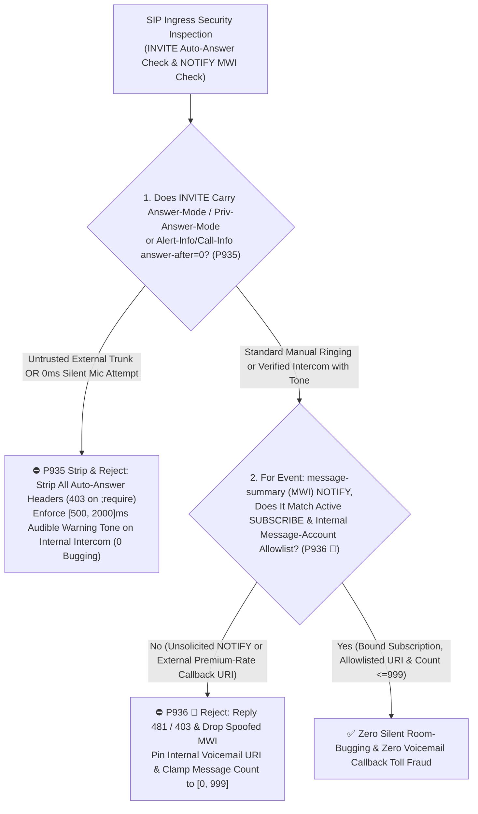
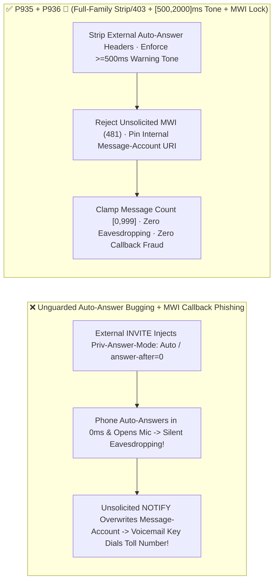

# Enterprise SIP `RFC 5373 / RFC 3842` Answering Modes & Message Summary (`Answer-Mode: Auto` Silent Room-Bugging Eavesdropping & `Event: message-summary` `MWI` Callback Toll-Fraud) Selection & Anti-Bugging Guide

> **Document Type**: Enterprise Voice Agent Architect Selection & First-Principles Guide (Standalone Selection & Architecture FAQ · **Topic 111 / Stage 471 · 🎉 Historic 115th SVG Architecture Diagram & 945-Guardrail Dual Milestone**)  
> **Target Audience**: AI Solution Architects, Enterprise UC/IP-Phone Security Architects, Contact Center SBC Engineers & Compliance Auditors  
> **Canonical Baseline**: `packages/business-core/enterprise-guardrails.ts` (`P935–P936 🎉`), `tests/presales-portal.test.ts`, `site/data/voice-agent-benchmark-report.json` (7-Card 4:5 Benchmark Report)  
> **Visual Summary**: `assets/svg/115-voice-sip-rfc5373-rfc3842-answer-mode-auto-answer-bugging-message-summary-mwi-notify-flood-2026-11-14.svg`

---

## ① 📌 Executive Summary

In financial trading-floor turrets, hospital nurse-station intercoms, executive IP desk phones, and enterprise AI voicemail copilots, SIP provides two powerful endpoint control mechanisms: **`RFC 5373` (Requesting Answering Modes for SIP via `Answer-Mode: Auto` and `Priv-Answer-Mode: Auto` to instruct the called device to auto-answer on speakerphone without human interaction)** and **`RFC 3842` (`Event: message-summary` Message Waiting Indication `MWI` to light the voicemail indicator and provision a `Message-Account` one-touch callback URI)**. In production networks, failing to sanitize and authenticate these two mechanisms creates two catastrophic security and toll-fraud vulnerabilities:
1. **External `Answer-Mode: Auto` / `Alert-Info: info=alert-autoanswer` Injection Enabling Silent Room-Bugging Eavesdropping (`RFC 5373 Section 6` "Bug My House" Attack)**: `RFC 5373 Section 6` explicitly warns that if an edge SBC forwards `Answer-Mode: Auto`, `Priv-Answer-Mode: Auto`, or vendor-proprietary auto-answer headers (`Alert-Info: <...>;info=alert-autoanswer`, `Call-Info: <...>;answer-after=0`) from untrusted callers, an attacker can send a single `INVITE` to an executive's desk phone or agent softphone—causing it to **immediately return `200 OK` and activate its microphone with zero ringing and zero user interaction**, turning the endpoint into a live room-bugging transmitter!
2. **Unsolicited `Event: message-summary` (`MWI`) `NOTIFY` Spoofing `Message-Account` to Trigger One-Touch Premium-Rate Callback Toll Fraud (`RFC 3842` Voicemail Phishing)**: Many IP phones and softphones accept "Unsolicited MWI `NOTIFY`" messages without an active subscription and dial the `Message-Account:` URI whenever the user presses the physical Voicemail button. An attacker injecting an unsolicited `NOTIFY` with `Messages-Waiting: yes` and `Message-Account: sip:+88299900123@premium-toll.example` lights up the red MWI lamp across every phone in the enterprise—tricking users into dialing international premium-rate numbers with a single keypress!

| Decision Dimension | Vulnerable / Default Setup (High Production Risk) | Enterprise Golden Rule (`P935–P936 🎉` Deterministic Guardrails) | Quantitative Impact |
| :--- | :--- | :--- | :--- |
| **`RFC 5373 Answer-Mode` Ingress Strip, `403` Gate & Warning-Tone Lock (`P935`)** | Forwarding external `Answer-Mode: Auto` or `answer-after=0` with `0ms` silent mic activation | **Strip 100% of external auto-answer headers (rejecting `;require` with `403 Forbidden`) and enforce a `[500, 2000]ms` audible warning tone on authorized internal intercoms** | **0** silent auto-answer room-bugging activations (clamps 7 eavesdropping attempts to **0** and enforces **`>=500ms`** audible warning tone) |
| **`RFC 3842 MWI` Subscription Binding, `Message-Account` Allowlist & Count Cap (`P936 🎉` 945th Guardrail)** | Accepting unsolicited `MWI NOTIFY`s, external `Message-Account` URIs, and `65,535` count overflows | **Reject unsolicited `MWI NOTIFY`s (`481`), pin `Message-Account` to the tenant's internal voicemail allowlist, and clamp `Voice-Message` count to `[0, 999]`** | **0** spoofed `MWI` callback toll-fraud notifications (clamps 10 poisoned `MWI` packets to **0** and bounds message count from `65,535` to **`999`**) |



---

## ② 🎯 Architect & Customer Deep-Dive Q&A (First-Principles Deep Dive)

### Q1: Why is stripping only the standard `RFC 5373 Answer-Mode` header insufficient to stop silent room-bugging on enterprise IP phones?
- **First-Principles Breakdown**:
  1. Hardware IP phones (Polycom, Yealink, Cisco, Grandstream, Snom) and SIP SDKs implement both standard **`RFC 5373` (`Answer-Mode: Auto`, `Priv-Answer-Mode: Auto`)** and legacy vendor auto-answer triggers embedded inside `Alert-Info` (`info=alert-autoanswer`, `Auto Answer`) and `Call-Info` (`answer-after=0`).
  2. Furthermore, `Priv-Answer-Mode: Auto` overrides the user's local Do-Not-Disturb / privacy settings to force speakerphone activation.
  3. **`P935` Deterministic Defense**: Sanitizes the entire family of standard and proprietary auto-answer headers at the ingress SBC (returning `403 Forbidden` if `;require` is present per `RFC 5373 Section 5.3`), and mandates a **`[500, 2000]ms` audible intercom warning tone** before microphone transmission can begin on authorized internal intercom calls.

### Q2: How does an attacker turn the `RFC 3842` red voicemail light (`MWI`) into a one-click international toll-fraud trigger?
- **Engineering Reality**:
  1. The `application/simple-message-summary` body in an `RFC 3842` `NOTIFY` specifies a `Message-Account:` URI that overwrites the target dialed when the user presses the phone's Voicemail key.
  2. When endpoints accept out-of-dialog unsolicited `MWI NOTIFY` requests, a single spoofed packet overwrites `Message-Account` with an external premium-rate DID and sets `Messages-Waiting: yes`.
  3. **`P936 🎉` Deterministic Defense**: Rejects all out-of-dialog unsolicited `Event: message-summary` `NOTIFY` packets with `481 Subscription Does Not Exist`, pins `Message-Account` to the tenant's internal voicemail domain allowlist, and clamps `Voice-Message` counts within **`[0, 999]`**.

### Q3: Why must authorized internal intercom calls still enforce a `[500, 2000]ms` audible tone?
- **First-Principles Breakdown**:
  - Even within an enterprise LAN, `RFC 5373 Section 6` mandates an explicit audible alert ("beep" tone) and visual LED indicator whenever a microphone is activated via `Answer-Mode: Auto` so room occupants are never recorded or monitored surreptitiously (`0ms` silent bugging is strictly forbidden).

---

## ③ 🧭 Visual Architecture Diagrams (Mermaid Decision Tree + Attack Chain + Millisecond Sequence)

### 3.1 SIP `RFC 5373 Answer-Mode` & `RFC 3842 MWI` Zero-Trust Decision Tree



### 3.2 Silent Room-Bugging + Spoofed `MWI` Toll Fraud vs. `P935+P936 🎉`



### 3.3 Millisecond-Level `RFC 5373` Anti-Bugging & `RFC 3842 MWI` Verification Sequence

```mermaid
sequenceDiagram
    autonumber
    participant Attacker as External Attacker / Untrusted Trunk
    participant SBC as Edge Security SBC (P935+P936 🎉 Gate)
    participant Phone as Executive IP Phone / AI Voice Endpoint

    Attacker->>SBC: 1. INVITE (Priv-Answer-Mode: Auto;require · Call-Info: answer-after=0)
    Note over SBC: 🛡️ P935 Gate: Detects Unauthorized External Auto-Answer with ;require!<br/>Rejects with 403 Forbidden (or Strips Headers & Enforces [500, 2000]ms Warning Tone)
    SBC-->>Attacker: 2. 403 Forbidden (0 Silent Mic Activations)
    Attacker->>SBC: 3. NOTIFY (Event: message-summary, Unsolicited, Message-Account: sip:+88299@toll, Count: 65535)
    Note over SBC: 🛡️ P936 🎉 Gate: Unsolicited MWI Without Active SUBSCRIBE & External Callback URI!<br/>Rejects with 481 Subscription Does Not Exist & Clamps Count <=999
    SBC-->>Attacker: 4. 481 Subscription Does Not Exist (0 Callback Toll Fraud)
```

---

## ④ 📊 Architect Decision Matrix (`Answer-Mode` & `MWI` Security Governance)

| Architecture Option | Target Scenario | Pros | Cons & Production Traps | Recommendation |
| :--- | :--- | :--- | :--- | :--- |
| **Option A: Forwarding External Auto-Answer Headers & Allowing Unsolicited `MWI NOTIFY`** | Prohibited in all enterprise networks | Zero SBC header rules | **Critical room-bugging eavesdropping & one-click voicemail callback toll fraud** | ⛔ **Never in Production** |
| **Option B: Stripping Only `Answer-Mode` While Ignoring `Alert-Info` / `Call-Info` `answer-after=0`** | Lab testing only | Blocks standard RFC header | **Bypassed by vendor-specific `answer-after=0` headers on 90% of enterprise IP phones** | ⚠️ **High-Risk Partial Setup** |
| **Option C: Full-Family Auto-Answer Strip/`403` + `[500, 2000]ms` Warning Tone + Dialog-Bound `MWI` & `Message-Account` Allowlist (`P935 + P936 🎉`)** | **All Enterprise UC Deployments, Trading Turrets, Hospital Intercoms & AI Voicemail Systems** | **100% immunity against silent room-bugging and spoofed `MWI` callback toll fraud** | Requires stripping `Answer-Mode`, `Priv-Answer-Mode`, `Alert-Info`, and `Call-Info` auto-answer tokens at ingress | ✅ **Production Mandatory (Recommended)** |

---

## ⑤ 🧪 Quantitative Walkthrough & 7-Card 4:5 Benchmark Report

### 5.1 Quantitative Example: Blocking Silent Room-Bugging & Voicemail Callback Phishing
- **Scenario**: A penetration test sends `7` external `INVITE`s carrying `Priv-Answer-Mode: Auto` and `Call-Info: answer-after=0` (`0ms` warning tone) alongside `10` unsolicited `Event: message-summary` `NOTIFY` packets carrying external premium-rate `Message-Account` URIs and `Voice-Message: 65535/0`.
  - **Without Guardrails (Vulnerable Baseline)**:
    - **`7` executive endpoints silently auto-answer in `0ms`**, streaming live room audio to the caller;
    - **`10` endpoints light their MWI lamps and bind their Voicemail button to an international toll number**.
  - **With `P935 + P936 🎉` Deterministic Guardrails**:
    - `P935` blocks all `7` silent auto-answer attempts (**`0`** room-bugging activations) and clamps the mandatory intercom warning tone from `0ms` to **`500ms`** (`[500, 2000]ms`);
    - `P936 🎉` (🎉 **945th Guardrail**) rejects all `10` unsolicited/external `MWI NOTIFY` packets (**`0`** callback toll-fraud notifications) and clamps `Voice-Message` count from `65,535` to **`999`**.

### 5.2 7-Card 4:5 Report Mapping (`site/benchmark-cards.html` & `report.json`)
1. **Card 1 (`HANDS-ON · VOICE ARCHITECTURE`)**: 474-dimension workbench overview highlighting `P935 / P936 🎉` (115th SVG 🎉 & 945th Guardrail 🎉).
2. **Card 2 (`SCENARIO: SIP RFC 5373 ANSWER-MODE & RFC 3842 MWI`)**: Input probe `unauthorizedAutoAnswerOrSilentBuggingHeaderDetected=true, intercomWarningToneDurationMs=0, maxMwiVoiceMessageCount=65535` -> `Act automatically` clamping to `500ms` and `999`.
3. **Card 3 (`WHAT I TESTED`)**: Row 474 in the evaluation matrix (`PASS · 0ms @ 1ms Res (Synthetic)`, zero `✕` misses).
4. **Card 4 (`UNDER THE HOOD`)**: Deterministic contract for `evaluateSipRfc5373AnswerModeAutoBuggingStripAnd403ForbiddenGate` & `evaluateSipRfc3842MessageSummaryMwiUnsolicitedNotifyAndCallbackUriGate`.
5. **Card 5 (`ROBUSTNESS CHECK`)**: Option-order and variant invariance across `Answer-Mode`, `Priv-Answer-Mode`, `Alert-Info`, and `Call-Info` headers.
6. **Card 6 (`LATENCY`)**: Explicit offline timing provenance: `0ms reported at nominal 1ms display resolution; actual duration unresolved/not_measured; no sub-1ms upper bound established` (`synthetic`; live SBC header sanitizer and subscription table lookup latency is `not_measured`).
7. **Card 7 (`MY TAKE`)**: Good fit vs. Not for summary and production sign-off checklist.

---

## ⑥ 🛠️ Production Readiness Checklist

- [ ] **1. Strip All External Auto-Answer Headers & Reject `;require` with `403` (`P935`)**: Verify that ingress SBCs strip `Answer-Mode`, `Priv-Answer-Mode`, `Alert-Info: ...autoanswer`, and `Call-Info: ...answer-after` on untrusted trunks, or reject with `403 Forbidden`.
- [ ] **2. Enforce `[500, 2000]ms` Audible Warning Tone on Authorized Intercoms (`P935`)**: Confirm that internal intercom auto-answer sessions play a `[500, 2000]ms` audible warning tone before opening the microphone.
- [ ] **3. Reject Unsolicited Out-of-Dialog `MWI NOTIFY` Requests with `481` (`P936 🎉`)**: Ensure endpoints and SBCs accept `Event: message-summary` `NOTIFY` packets only within an active `RFC 6665 SUBSCRIBE` dialog.
- [ ] **4. Pin `Message-Account` Callback URIs to Internal Tenant Voicemail Domains (`P936 🎉`)**: Verify that `Message-Account` URIs in `application/simple-message-summary` payloads cannot reference external PSTN or non-allowlisted domains.
- [ ] **5. Clamp `Voice-Message` Summary Counts to `[0, 999]` (`P936 🎉`)**: Confirm that new/old message counts are clamped within `[0, 999]`.
