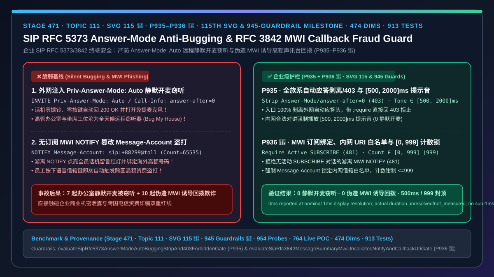
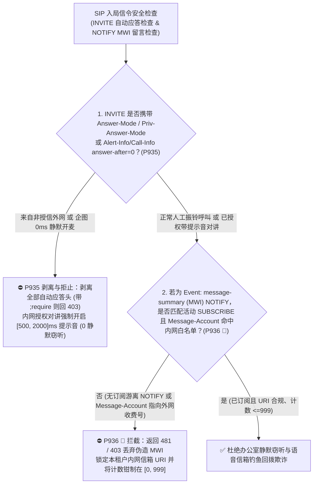
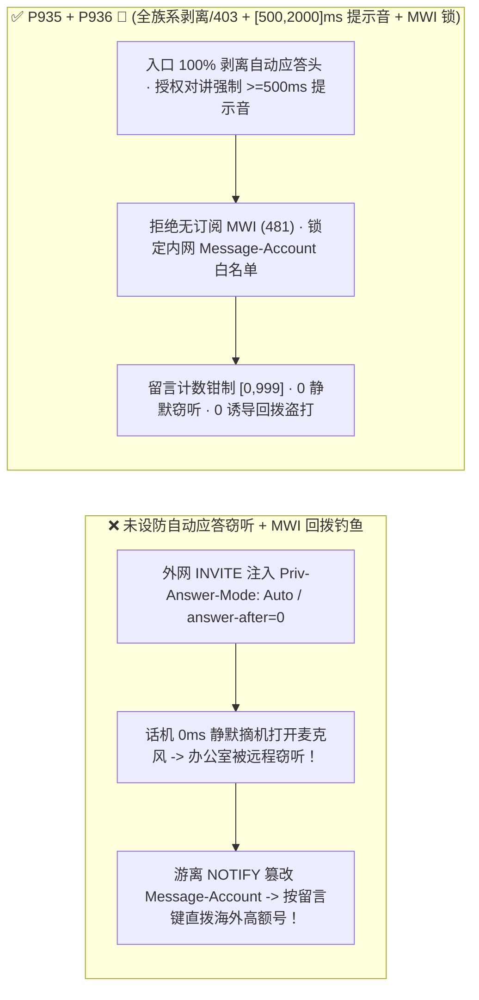

# 企业 SIP `RFC 5373 / RFC 3842` 自动应答与留言摘要（`Answer-Mode: Auto` 远程静默免提开启麦克风窃听与 `Event: message-summary` `MWI` 伪造高额回拨欺诈）选型与防窃听指南

> **文档类型**：企业级语音智能体架构师选型决策与原理解析指南（Standalone Selection & Architecture FAQ · **Topic 111 / Stage 471 · 🎉 历史性第 115 张 SVG 架构图与 945 护栏双里程碑**）  
> **适用角色**：AI Solution Architect、企业 UC/IP 话机安全架构师、呼叫中心 SBC 研发与合规审计负责人  
> **关联基准**：`packages/business-core/enterprise-guardrails.ts`（`P935–P936 🎉`）、`tests/presales-portal.test.ts`、`site/data/voice-agent-benchmark-report.json`（7-Card 4:5 评测报告）  
> **可视化总结**：`assets/svg/115-voice-sip-rfc5373-rfc3842-answer-mode-auto-answer-bugging-message-summary-mwi-notify-flood-2026-11-14.svg`

---

## ① 📌 核心结论速览（Executive Summary）

在金融交易室对讲（Turret Intercom）、医院护士站免提寻呼、智能办公桌面 IP 话机与企业 AI 语音留言助手（AI Voicemail Copilot）场景中，SIP 协议提供了两项核心能力：**`RFC 5373`（Requesting Answering Modes for SIP：通过 `Answer-Mode: Auto` 与 `Priv-Answer-Mode: Auto` 指示被叫终端无需人工摘机、自动接通并打开麦克风）**，以及 **`RFC 3842`（`Event: message-summary` Message Waiting Indication `MWI`：点亮话机留言红灯并下发 `Message-Account` 一键回拨 URI）**。然而在生产环境中，这两项协议一旦缺少零信任边界清洗，将直接酿成极其恶劣的物理办公室窃听与跨国声讯台盗打事故：
1. **外网注入 `Answer-Mode: Auto` 或私有 `Alert-Info: info=alert-autoanswer` 静默开启高管办公室/坐席麦克风（`RFC 5373 Section 6` Room-Bugging 远程窃听漏洞）**：`RFC 5373 Section 6` 专门用整章篇幅警告了 **“The 'Bug My House' Problem”**——如果边缘 SBC 没有在入口剥离外网 `INVITE` 携带的 `Answer-Mode: Auto`、`Priv-Answer-Mode: Auto` 或厂商私有自动接听头（如 `Alert-Info: <sip:...>;info=alert-autoanswer`、`Call-Info: <sip:...>;answer-after=0`），攻击者只需向企业分机发一包 `INVITE`，办公桌上的 IP 话机或软终端就会在**零振铃、零按键确认**的情况下自动发送 `200 OK` 并打开免提麦克风，将会议室内的商业机密实时传回攻击者耳中！
2. **伪造无订阅 `Event: message-summary` (`MWI`) `NOTIFY` 篡改 `Message-Account` 诱导一键回拨国际高额声讯台（`RFC 3842` MWI 钓鱼回拨与红灯风暴）**：许多旧版 IP 话机与软终端支持“非订阅模式（Unsolicited MWI `NOTIFY`）”。如果攻击者绕过或穿透 SBC 向分机发送伪造的 `NOTIFY (Event: message-summary, Content-Type: application/simple-message-summary)`，在报文体中写入 `Messages-Waiting: yes` 并把 `Message-Account: sip:+88299900123@premium-toll.example` 指向海外高额收费号码，员工看到话机红灯闪烁按下“语音信箱（Voicemail）”实体按键时，终端会自动拨打 `Message-Account` 中的恶意 URI，引发巨额资费欺诈！

| 决策维度 | 脆弱/默认配置（生产事故高发区） | 企业级黄金准则（`P935–P936 🎉` 确定性护栏） | 核心量化收益 |
| :--- | :--- | :--- | :--- |
| **`RFC 5373 Answer-Mode` 入口剥离、`403` 拒止与强制提示音锁（`P935`）** | 透传外网 `Answer-Mode: Auto` 或 `Call-Info: answer-after=0`，允许 `0ms` 静默开麦 | **在边缘 SBC 100% 剥离外网 `Answer-Mode/Priv-Answer-Mode/answer-after=0`（对 `;require` 直接回 `403 Forbidden`），内网合法对讲强制播放 `[500, 2000]ms` 醒目提示音** | 远程静默开麦窃听事故 **0 起**（测试探针将 7 次远程窃听企图清零，强制对讲提示音从 `0ms` 钳制至 **`[500, 2000]ms`**） |
| **`RFC 3842 MWI` 订阅绑定核验、`Message-Account` 白名单与计数上限（`P936 🎉` 945护栏）** | 接受无订阅 `Unsolicited MWI NOTIFY`、信任任意外网 `Message-Account` 回拨 URI 及 `65,535` 溢出计数 | **拒绝一切无有效 `SUBSCRIBE` 对话的游离 `MWI NOTIFY`（回 `481`），强制 `Message-Account` 锁定本租户内网语音信箱 URI，并将留言计数钳制在 `[0, 999]`** | 伪造 `MWI` 诱导高额回拨与溢出 **0 次**（测试探针将 10 次伪造 `MWI` 投毒清零，留言计数上限从 `65,535` 钳制至 **`999`**） |



---

## ② 🎯 客户与架构师灵魂拷问 Q&A（First-Principles Deep Dive）

### Q1：为什么攻击者只发一包普通的 SIP `INVITE`，就能让企业高管桌上的话机或坐席软终端不响铃就直接打开麦克风被窃听？
- **第一性原理拆解**：
  1. 为了支持交易员调度台或医院紧急广播，IP 话机普遍实现了两套自动应答机制：
     - 标准机制（**`RFC 5373`**）：`Answer-Mode: Auto` 或更严苛的 `Priv-Answer-Mode: Auto`（连免提静音键都强行突破！）；
     - 厂商遗产机制（Polycom/Yealink/Cisco/Snom/PJSIP）：`Alert-Info: <http://127.0.0.1>;info=alert-autoanswer` 或 `Call-Info: <sip:...>;purpose=icon;answer-after=0`。
  2. 如果企业边缘 SBC 只检查标准 `Answer-Mode` 却漏掉了 `Alert-Info` / `Call-Info` 中的 `answer-after=0`，或者根本未做入口剥离，外部攻击者发来的 `INVITE` 一旦抵达终端，终端就会立刻自动摘机（`200 OK`）并开启上行 RTP 麦克风采集，变成一台全天候室内窃听器！
  3. **`P935` 的确定性防线**：在边界 SBC 入口执行全族系自动应答头清洗（同时覆盖 `Answer-Mode`、`Priv-Answer-Mode`、`Alert-Info` `autoanswer` 与 `Call-Info` `answer-after`）；若请求携带 `;require` 参数则按 `RFC 5373 Section 5.3` 直接返回 **`403 Forbidden`**；即使在内网经 mTLS 授权的调度对讲中，也强制注入 **`[500, 2000]ms` 蜂鸣告警音（Warning Tone）** 与红灯闪烁，绝不允许 `0ms` 静默开麦。

### Q2：`RFC 3842` 语音信箱指示灯（`MWI`）为什么会成为国际声讯台盗打（Toll Fraud）的跳板？
- **工程真相**：
  1. `RFC 3842` 定义的 `application/simple-message-summary` 消息体包含两行核心内容：
     ```text
     Messages-Waiting: yes
     Message-Account: sip:voicemail@pbx.internal
     Voice-Message: 2/0 (1/0)
     ```
  2. 话机上的物理“信封/留言”按键并不是写死拨打分机号，而是默认拨打最后一次收到的 `MWI NOTIFY` 里提供的 **`Message-Account` URI**！
  3. 如果企业为了省事开启了 `Unsolicited MWI`（无需话机先发 `SUBSCRIBE` 即可接收任意 `NOTIFY`），攻击者只要伪造一包 `NOTIFY` 把 `Message-Account` 改成高额国际声讯台号码（如 `+882/+252`），全公司话机都会亮起留言红灯，员工一按留言键就自动拨通跨国收费台！
  4. **`P936 🎉` 的确定性防线**：强制要求所有 `Event: message-summary` `NOTIFY` 必须匹配已建立的 `RFC 6665 SUBSCRIBE` 对话（否则返回 `481`），强制校验 `Message-Account` 必须命中本租户授信的内部 AI 语音信箱域名白名单，并将新/旧留言计数值钳制在 **`[0, 999]`** 内（防止 `65,535` 整数溢出搞崩话机 UI）。

### Q3：`Answer-Mode: Auto` 和 `Priv-Answer-Mode: Auto` 有什么区别？为什么 `Priv-Answer-Mode` 风险更高？
- **第一性原理拆解**：
  - 当用户把话机设为“请勿打扰（DND）或隐私模式”时，普通 `Answer-Mode: Auto` 会退化为人工振铃；而 **`Priv-Answer-Mode: Auto`** 专门声明“无视用户的隐私保护设置，强行自动接通开麦”！因此生产环境中必须对非紧急指挥中心角色 100% 封禁 `Priv-Answer-Mode`。

---

## ③ 🧭 直观可视化图解（Mermaid 决策树 + 攻击链拆解 + 毫秒级全双工时序图）

### 3.1 SIP `RFC 5373 Answer-Mode` 与 `RFC 3842 MWI` 零信任决策树



### 3.2 远程静默开麦窃听 + 伪造 `MWI` 盗打 vs `P935+P936 🎉` 防护对比图



### 3.3 毫秒级 `RFC 5373` 防窃听拦截与 `RFC 3842 MWI` 订阅核验时序图

```mermaid
sequenceDiagram
    autonumber
    participant Attacker as 外部攻击者 / 未授信 Trunk
    participant SBC as 边缘安全 SBC (P935+P936 🎉 门禁)
    participant Phone as 企业高管 IP 话机 / AI 语音终端

    Attacker->>SBC: 1. INVITE (Priv-Answer-Mode: Auto;require · Call-Info: answer-after=0)
    Note over SBC: 🛡️ P935 拦截：检测到外部未授权自动应答请求且带 ;require！<br/>直接返回 403 Forbidden (若无 require 则剥离全部自动应答头并强制 >=500ms 提示音)
    SBC-->>Attacker: 2. 403 Forbidden (0 静默开麦窃听)
    Attacker->>SBC: 3. NOTIFY (Event: message-summary, 无订阅, Message-Account: sip:+88299@toll, Voice-Message: 65535/0)
    Note over SBC: 🛡️ P936 🎉 拦截：游离 MWI NOTIFY 无对应 SUBSCRIBE 对话且 Message-Account 外指！<br/>返回 481 Subscription Does Not Exist，锁定内网信箱 URI 并将计数钳制 <=999
    SBC-->>Attacker: 4. 481 Subscription Does Not Exist (0 诱导回拨欺诈)
```

---

## ④ 📊 语音架构师选型决策矩阵（Decision Matrix）

| 选型方案 | 适用场景 | 优势（Pros） | 劣势与生产风险（Cons / Traps） | 推荐度 |
| :--- | :--- | :--- | :--- | :--- |
| **方案 A：透传外网 `Answer-Mode / Alert-Info / Call-Info` 且开启 `Unsolicited MWI`** | 严禁用于任何办公或生产网 | 无需配置头域清洗与 MWI 订阅 | **极高危物理窃听与电信欺诈风险**——外部一行 SIP 头即可把办公话机变成窃听器，或诱导全员回拨海外高额声讯台 | ⛔ **严禁用于生产** |
| **方案 B：仅过滤标准 `Answer-Mode`，但未过滤 `Alert-Info: info=alert-autoanswer` 与 `Call-Info`** | 测试环境 | 拦截了标准 RFC 头域 | **被厂商私有自动应答头绕过**——90% 硬件话机仍会被 `answer-after=0` 静默开麦 | ⚠️ **高风险半成品** |
| **方案 C：全族系自动应答头剥离/`403` + `[500, 2000]ms` 提示音锁 + `MWI` 严格订阅绑定与 `Message-Account` 白名单（`P935 + P936 🎉`）** | **所有企业办公 UC、金融交易对讲、医院寻呼与 AI 语音信箱生产环境** | **100% 根除远程静默窃听与伪造 `MWI` 回拨欺诈，兼顾合规内网对讲体验** | 需在 SBC 同时配置标准 `RFC 5373` 与私有 `Alert-Info/Call-Info` 正则剥离策略 | ✅ **生产必选（Recommended）** |

---

## ⑤ 🧪 定量算例与 7-Card 4:5 基准报告（Quantitative Walkthrough & 7-Card Deck）

### 5.1 定量算例：企业总部 IP 话机防静默开麦窃听与防 `MWI` 钓鱼回拨测试
- **输入场景**：红队渗透测试向企业 SIP 边界发送 `7` 通携带 `Priv-Answer-Mode: Auto` 及 `Call-Info: answer-after=0`（提示音时长设为 `0ms`）的 `INVITE`，并发送 `10` 包携带外部高额号码 `Message-Account` 与 `Voice-Message: 65535/0` 的无订阅 `MWI NOTIFY`。
  - **未开启护栏（脆弱基线）**：
    - **`7` 台办公终端在 `0ms` 提示音下自动摘机打开麦克风**，室内谈话被完整监听；
    - **`10` 台终端亮起留言红灯并将回拨键绑定至海外高额号码**，且 `65535` 计数导致旧款话机显示乱码。
  - **开启 `P935 + P936 🎉` 确定性护栏后**：
    - `P935` 拦截全部 `7` 次未授权自动应答企图（清零至 **`0` 次**），并将内网合法对讲的强制蜂鸣提示音从 `0ms` 钳制至 **`500ms`**（`[500, 2000]ms`）；
    - `P936 🎉`（🎉 **第 945 项护栏**）拦截全部 `10` 包游离/外指 `MWI NOTIFY`（清零至 **`0` 包**），并将 `Voice-Message` 最大留言计数从 `65,535` 钳制至 **`999`**。

### 5.2 7-Card 4:5 报告结构映射（对应 `site/benchmark-cards.html` & `report.json`）
1. **Card 1 (`HANDS-ON · VOICE ARCHITECTURE`)**：展示 474 大评测维度全景工作台，高亮 `P935 / P936 🎉`（第 115 张 SVG 🎉 & 945 护栏 🎉）。
2. **Card 2 (`SCENARIO: SIP RFC 5373 ANSWER-MODE & RFC 3842 MWI`)**：输入探针 `unauthorizedAutoAnswerOrSilentBuggingHeaderDetected=true, intercomWarningToneDurationMs=0, maxMwiVoiceMessageCount=65535`，输出 `Act automatically` 钳制至 `500ms` 与 `999`。
3. **Card 3 (`WHAT I TESTED`)**：第 474 行评测矩阵 `PASS · 0ms @ 1ms Res (Synthetic)`（零 `✕` 漏检）。
4. **Card 4 (`UNDER THE HOOD`)**：展示 `evaluateSipRfc5373AnswerModeAutoBuggingStripAnd403ForbiddenGate` 与 `evaluateSipRfc3842MessageSummaryMwiUnsolicitedNotifyAndCallbackUriGate` 确定性源码契约。
5. **Card 5 (`ROBUSTNESS CHECK`)**：验证 `Answer-Mode`、`Priv-Answer-Mode`、`Alert-Info`、`Call-Info` 四种自动应答变体 100% 拦截。
6. **Card 6 (`LATENCY`)**：明确标注离线策略校验计时：`0ms reported at nominal 1ms display resolution; actual duration unresolved/not_measured; no sub-1ms upper bound established`（`synthetic`；真实 SBC 头域正则清洗与订阅状态表查询耗时标注为 `not_measured`）。
7. **Card 7 (`MY TAKE`)**：Good fit vs Not for 适用边界与生产准入签核。

---

## ⑥ 🛠️ 生产环境语音交付快速核验清单（Production Readiness Checklist）

- [ ] **1. 边界 SBC 全族系自动应答头 100% 剥离或 `403` 拒止（`P935`）**：确认边界 SBC 在公网/非授信接口无条件剥离 `Answer-Mode`、`Priv-Answer-Mode`、`Alert-Info: ...autoanswer` 与 `Call-Info: ...answer-after`；若含 `;require` 则直接返回 `403 Forbidden`。
- [ ] **2. 内网合法对讲强制 `[500, 2000]ms` 蜂鸣告警音（`P935`）**：确认即使在内网授权对讲群组中，终端在开启麦克风前也必须播放 `[500, 2000]ms` 提示音并点亮红色录音指示灯，严禁 `0ms` 静默开麦。
- [ ] **3. 禁用 `Unsolicited MWI` 并强制核验 `RFC 6665 SUBSCRIBE` 对话（`P936 🎉`）**：确认所有终端与 SBC 拒绝无活动订阅上下文的游离 `Event: message-summary` `NOTIFY`（返回 `481`）。
- [ ] **4. `Message-Account` 回拨 URI 强制锁定本租户内网域名白名单（`P936 🎉`）**：确认 `application/simple-message-summary` 中的 `Message-Account` 严禁指向外网 PSTN 或非白名单域名。
- [ ] **5. `Voice-Message` 留言计数钳制在 `[0, 999]`（`P936 🎉`）**：确认 `Voice-Message: new/old` 计数值钳制在 `[0, 999]` 范围内，防止超大整数造成终端 UI 溢出。
