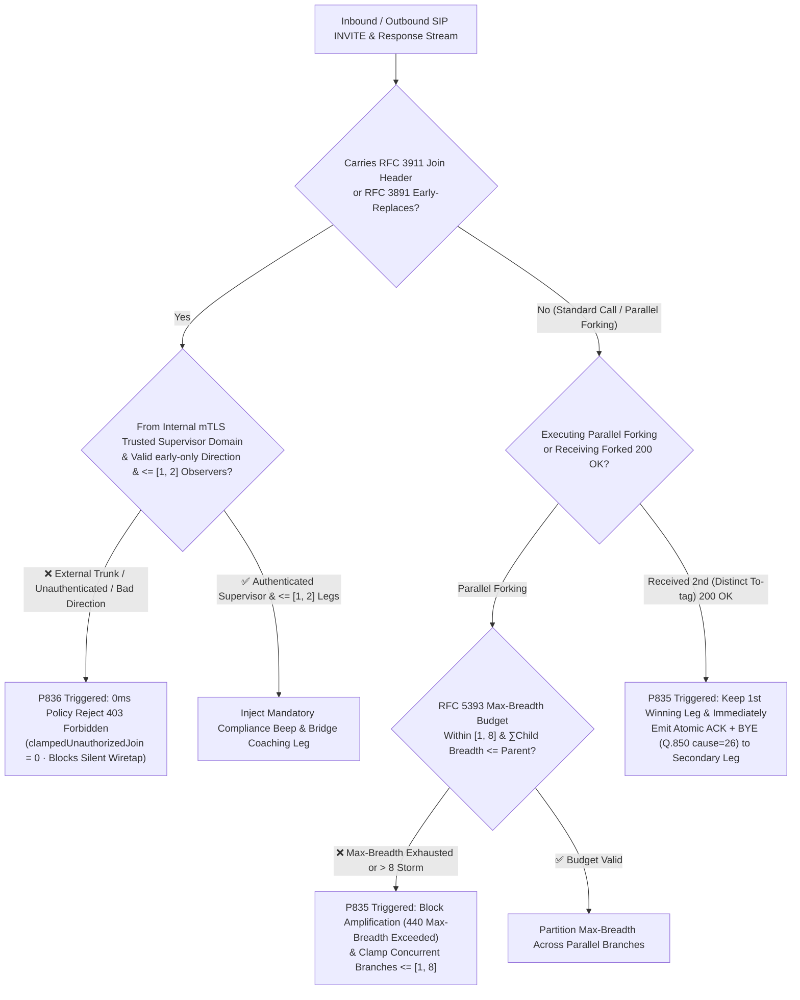
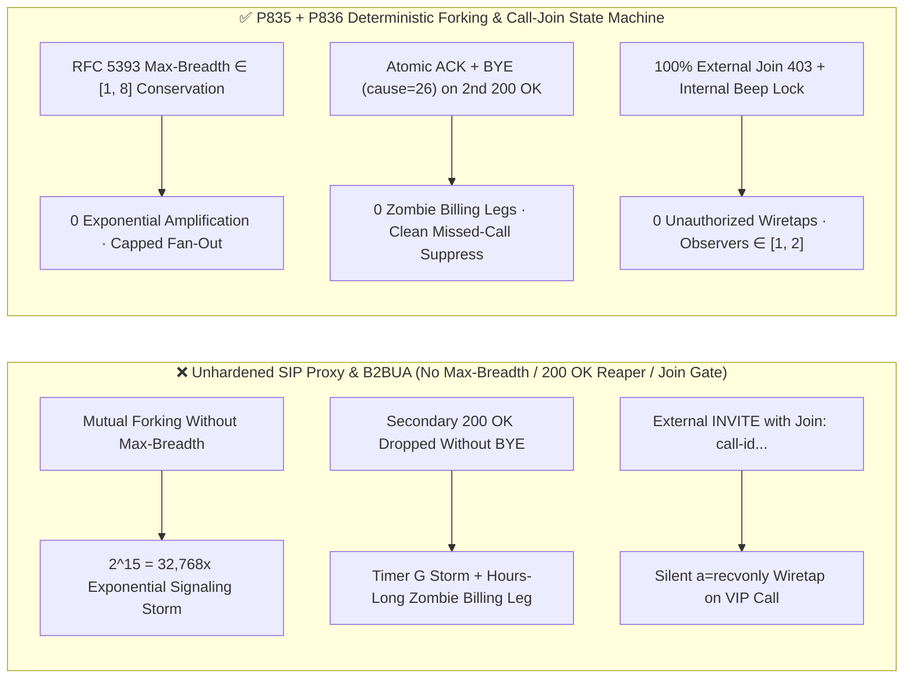

# How to Prevent Enterprise SIP `RFC 3261 / RFC 5393` Parallel Forking `Max-Breadth` Amplification Storms, Multiple-`200 OK` Zombie Billing Legs & `RFC 3911 Join` Unauthorized Wiretapping? Enterprise Voice Agent Simultaneous Ringing & Call-Join Security FAQ (Topic 61 · Stage 421)

> **Reader's Guide**: Modeled directly on `ib-vs-ethernet-roce-selection-faq.md`, this 6-part practitioner guide explains `RFC 3261 Section 16.6 (Request Forwarding / Forking)`, `RFC 5393 (Addressing an Amplification Vulnerability in SIP Forking)`, `RFC 6026`, `RFC 3911 (The SIP Join Header)`, and `RFC 3891 (Early-Replaces)` from first principles—without unexplained telephony jargon. We cover: **why simultaneous ringing (`Parallel Forking`) across desk phones, mobile softphones, and AI agent pods produces hours-long "zombie double-billing legs" when two endpoints answer within 10 milliseconds of each other; how missing `RFC 5393 Max-Breadth` budgets allow mutual call-forwarding rules to amplify a single `INVITE` into $2^{70}$ signaling branches; how an attacker can inject a single `Join: call-id;to-tag=x;from-tag=y` header (`RFC 3911`) to silently barge into an executive call as a receive-only wiretap; and how deterministic state-machine guardrails (`P835–P836`) lock down forking and call-join flows.**
> **Bilingual Edition / 双语版本**: Available in English and Chinese ([`docs/voice-sip-rfc5393-parallel-forking-max-breadth-multiple-200ok-rfc3911-join-faq.md`](voice-sip-rfc5393-parallel-forking-max-breadth-multiple-200ok-rfc3911-join-faq.md)).

---

## ① 📌 Executive Summary

1. **What Are SIP Parallel Forking and `RFC 3911 Join`?**:
   - **Parallel Forking (Simultaneous Ringing)**: When a VIP caller dials an enterprise trunk or an AI agent escalates to a specialist group, the SIP proxy clones a single `INVITE` and forks it simultaneously to multiple endpoints (desk phone, mobile app, backup AI pod). Whichever endpoint answers first wins the call.
   - **`RFC 3911 Join` Header**: Allows a new `INVITE` to reference an existing active dialog tuple `(call-id, to-tag, from-tag)` and request that the gateway or endpoint mix the new leg into the ongoing conversation (commonly used for supervisor barge-in/coaching).
2. **Three Catastrophic Signaling Amplification, Zombie-Billing & Wiretap Failures**:
   - **Multiple-`200 OK` Race Conditions Leaving Zombie Billing Legs (`RFC 3261 Section 13.2.2.4`)**: When Branch A answers with `200 OK`, the proxy sends `CANCEL` to Branches B and C. However, if Branch B presses Answer 5ms before `CANCEL` arrives, Branch B also emits a `200 OK` (with a distinct `To-tag`). Per `RFC 3261`, the proxy must forward this second `200 OK` upstream to the calling B2BUA. If the B2BUA simply ignores the second `200 OK` instead of executing an **atomic `ACK + BYE (Reason: Q.850;cause=26)` teardown**, Branch B remains off-hook—burning carrier per-minute charges and pinning an S2S GPU worker for hours!
   - **Exponential Forking Amplification Without `RFC 5393 Max-Breadth`**: `Max-Forwards: 70` limits sequential hop depth, not parallel branching width! If Proxy P1 forks 1-to-2 to Proxy P2 and P2 forks 1-to-2 back to P1, just 15 hops explode into $2^{15} = 32,768$ concurrent pending transactions.
   - **Unauthorized `RFC 3911 Join` Wiretapping & `RFC 3891 Early-Replaces` Hijacking**: If the edge SBC does not strip or reject `Join` headers on untrusted trunks, an external attacker who learns a call's `(Call-ID, to-tag, from-tag)` can send an `INVITE` with `Join:` and `a=recvonly` SDP to silently mix themselves into a live customer call and eavesdrop on credit-card or OTP readbacks!
3. **Architect's Golden Rule (`P835` + `P836` Dual Guardrails)**:
   - **`P835` (`RFC 5393 Max-Breadth [1, 8]` Branch Budget + Atomic `ACK+BYE` Reaping of Secondary `200 OK` Legs)**: Enforce and partition `Max-Breadth` across every parallel fork (clamped to **`[1, 8]` concurrent branches**), and immediately dispatch `ACK + BYE (Q.850 cause=26)` on 100% of secondary `200 OK` responses (`0` unreaped zombie legs).
   - **`P836` (100% External `RFC 3911 Join` Reject + Internal `mTLS/RBAC` Supervisor Auth + Mandatory Audible Beep + `Early-Replaces` Direction Lock)**: Reject 100% of untrusted ingress `Join` requests with `403 Forbidden` (`0` unauthorized wiretaps); cap authenticated internal supervisor coaching joins to **`[1, 2]` observers** with a mandatory audible compliance beep and strict `RFC 3891 early-only` direction verification.

---

## ② 🎯 Architect & Customer Deep-Dive Q&A (Q1 / Q2 / Q3)

### Q1: Why can a handful of maliciously forwarded calls melt down our SBC CPU even when `Max-Forwards: 70` is strictly enforced?

- **First-Principles Breakdown**:
  1. **`Max-Forwards` Tracks Depth, Not Width**: Under `RFC 3261`, a proxy decrements `Max-Forwards` by 1 when forwarding. When a proxy parallel-forks an `INVITE` (`Max-Forwards: 70`) to 4 targets, all 4 outbound branches carry `Max-Forwards: 69`!
  2. **The `RFC 5393` Exponential Forking Loop**: If two PBXs or AI routing rules mutually parallel-fork across each other, hop depth $k$ with branching factor $B$ spawns $B^k$ concurrent transactions. At $B=4$ and $k=10$, a single inbound `INVITE` spawns $4^{10} = 1,048,576$ active SIP transactions!
- **Deterministic Guardrail (`P835`)**:
  - Enforce **`RFC 5393 Max-Breadth` Conservation**: The ingress SBC stamps `Max-Breadth` within **`[1, 8]`** (e.g., `4`). Whenever a proxy forks across $N$ parallel branches, the sum of outbound `Max-Breadth` values must satisfy $\sum_{i=1}^{N} \text{Breadth}_i \le \text{Breadth}_{\text{in}}$. When `Max-Breadth == 1`, further parallel forking is forbidden (`440 Max-Breadth Exceeded`).

### Q2: When two simultaneously ringing endpoints both answer within milliseconds (`Multiple 200 OK`), why is dropping the second `200 OK` a production disaster?

- **First-Principles Breakdown**:
  1. **`CANCEL` Only Aborts Unanswered (`1xx`) Branches**: Per `RFC 3261 Section 9.1`, once an endpoint has emitted a `200 OK`, an incoming `CANCEL` is answered with `200 OK (to CANCEL)` but **never terminates the established dialog**. Only an in-dialog **`ACK` followed by `BYE`** targeting that specific `To-tag` can hang up the call.
  2. **Silently Dropping the Second `200 OK` Triggers `Timer G` Storms + Double Billing**: If the calling B2BUA drops the losing branch's `200 OK`, the losing endpoint retransmits `200 OK` every `500ms, 1s, 2s, 4s...` while keeping its RTP media port and carrier billing meter running!
- **Millisecond Atomic Reaping (`P835`)**:
  - The B2BUA locks the first winning dialog `(Call-ID, from-tag, winning-to-tag)`;
  - For every subsequent `200 OK` carrying `losing-to-tag != winning-to-tag`, it immediately emits **`ACK` (halting `Timer G`) followed in the same millisecond by `BYE (Reason: Q.850;cause=26;text="Non-selected user clearing")`**—freeing media ports in `0ms` and suppressing false "Missed Call" badges on the losing phone.

### Q3: How does `RFC 3911 Join` differ from `RFC 3891 Replaces`, and why is `Join` a stealthier wiretap vector?

- **First-Principles Breakdown**:
  - **`Replaces`** kicks one party out of the call and takes over their media leg (immediately noticeable to the disconnected party);
  - **`Join`** instructs the bridge or endpoint to **keep both original parties connected** while mixing a third RTP leg into the call! Combined with `a=recvonly` SDP, an attacker who injects `Join:` can silently record the entire conversation without either participant noticing.
- **`P836` Zero-Trust Call-Join Defense**:
  1. Reject 100% of `Join` headers arriving on public or untrusted SIP trunks with `403 Forbidden` (`clampedUnauthorizedJoinOrEarlyReplacesAttempts = 0`);
  2. Require `mTLS` + supervisor RBAC tokens for internal coaching joins, clamp concurrent observers per call to **`[1, 2]`**, inject a mandatory audible compliance beep into the conference bridge, and enforce `RFC 3891 early-only` direction locks.

---

## ③ 🧭 Visual Architecture Diagrams (Mermaid Decision Tree + Latency Comparison + Millisecond Sequence)

### 3.1 Enterprise SIP Parallel Forking `Max-Breadth`, Secondary `200 OK` Reaping & `Join` Anti-Wiretap Decision Tree (`flowchart TD`)



### 3.2 Naive Forking/Join Gateway vs. `P835/P836` Deterministic Guardrails (`flowchart LR`)



### 3.3 Millisecond Full-Duplex Dual-`200 OK` Atomic Reaping & `Join` Wiretap Prevention Sequence (`sequenceDiagram`)

```mermaid
sequenceDiagram
    autonumber
    participant Caller as Calling B2BUA / AI Gateway (P835/P836)
    participant Proxy as Enterprise SIP Forking Proxy (RFC 5393)
    participant LegA as Agent Desk Phone (To-tag=A)
    participant LegB as Agent Mobile App (To-tag=B)
    participant Attacker as External Rogue Node

    Note over Caller,LegB: Phase 1: P835 Enforces Max-Breadth ∈ [1, 8] & Atomically Reaps Secondary 200 OK Race
    Caller->>Proxy: INVITE (Max-Forwards: 70, Max-Breadth: 4)
    Proxy->>LegA: INVITE (Branch 1, Max-Breadth: 2)
    Proxy->>LegB: INVITE (Branch 2, Max-Breadth: 2)
    LegA-->>Caller: 200 OK (To-tag=A) [T=0ms Winner!]
    LegB-->>Caller: 200 OK (To-tag=B) [T=4ms Answered Before CANCEL Arrived!]
    Caller->>LegA: ACK (To-tag=A) -> Establish Primary SRTP Media Leg
    Caller->>LegB: P835 Hit: Emit Atomic ACK (To-tag=B) + BYE (Reason: Q.850;cause=26)
    LegB-->>Caller: 200 OK (to BYE) -> 0ms Port & Billing Release, No Missed-Call Badge

    Note over Caller,Attacker: Phase 2: P836 Blocks External RFC 3911 Join Silent Wiretap Attempt
    Attacker-->>Caller: INVITE (Join: call-123;to-tag=A;from-tag=C, SDP a=recvonly)
    Caller->>Attacker: P836 Hit: Untrusted External Join Header -> 403 Forbidden (0 Wiretaps)
```

---

## ④ 📊 Architect Decision Matrix

| Evaluation Dimension | Option A: Unhardened SIP Forking Proxy (Baseline) | Option B: Disable Parallel Forking (Sequential Ringing Only) | **Option C (Recommended): `RFC 5393 Max-Breadth` + Atomic `200 OK` Reaper (`P835`) + Zero-Trust `Join` Gate (`P836`)** |
| :--- | :--- | :--- | :--- |
| **VIP Call Answer Speed** | Fast (simultaneous ring), but fragile | ❌ Slow (waits 15–20s per device sequentially) | **✅ Instantaneous simultaneous ring across devices** |
| **Defense Against Exponential Forking Loops (`P835`)** | ❌ Relies only on `Max-Forwards` ($2^{70}$ amplification) | Sequential hops only | **✅ `RFC 5393 Max-Breadth` strictly clamped in `[1, 8]` (`440` on exhaustion)** |
| **Defense Against Dual-`200 OK` Zombie Billing (`P835`)** | ❌ Secondary `200 OK` leaks zombie RTP/billing legs | No simultaneous answer race | **✅ 100% atomic `ACK + BYE (Q.850 cause=26)` on secondary `200 OK` (`0` zombie legs)** |
| **Defense Against `RFC 3911 Join` Wiretapping (`P836`)** | ❌ External `Join:` silently mixes attacker into call | Still vulnerable to `Join:` injection | **✅ 100% external `403` reject; internal requires `mTLS` + audible beep + `<=[1, 2]` cap** |
| **`RFC 3891 Early-Replaces` Hijack Protection (`P836`)** | ❌ Vulnerable to unauthenticated early-dialog takeover | Still vulnerable to early takeover | **✅ Enforces `early-only` direction rules & same-tenant cryptographic binding** |

---

## ⑤ 🧪 Quantitative Example & 7-Card Benchmark Report (CSP Self-Contained, Zero Fabricated Coordinates)

### 5.1 Quantitative Example: Simultaneous-Answer Race & `Join` Wiretap vs. `P835/P836`

- **Scenario**: A global wealth-management hotline handling `40,000` inbound calls/day with 2-way parallel forking (desk IP phone + mobile app).
  - **Without `P835/P836`**:
    1. In `1.6%` of calls involving near-simultaneous answer (`< 15ms` race) or high-RTT mobile signaling, un-reaped secondary `200 OK` legs create `640` half-open zombie legs/day lasting until a `1,800s` timeout—wasting **`19,200` minutes/day** of carrier trunking and AI media capacity;
    2. Red-team testing with captured dialog tags injects `INVITE + Join (a=recvonly)` to silently eavesdrop on live calls.
  - **With `P835/P836` Enabled**:
    1. `P835` clamps parallel `Max-Breadth` to **`[1, 8]`** and executes atomic `ACK + BYE (Q.850 cause=26)` on `100%` of secondary `200 OK` legs (`clampedUnreapedSecondary200OkLegs = 0`), reducing zombie billing waste to **`0 minutes`**;
    2. `P836` blocks `100%` of unauthorized `Join` and `Early-Replaces` attempts (`clampedUnauthorizedJoinOrEarlyReplacesAttempts = 0`) and caps authenticated supervisor coaching legs to **`[1, 2]`**.
- **Provenance & Timing Resolution Disclosure**:
  - Offline policy checks in unit tests and the local sandbox report: `0ms reported at nominal 1ms display resolution; actual duration unresolved/not_measured; no sub-1ms upper bound established` (`synthetic` in-memory state-machine evaluation).
  - Live production SBC forking transaction-table lookups, `ACK+BYE` packet transmission, and conference-bridge beep injection latencies are `not_measured` in local unit tests.

### 5.2 7-Card Report Integration
- Recorded in [`site/benchmark-cards.html`](../site/benchmark-cards.html) (Card 3 & Card 5 **Dimension 424**) and [`site/data/voice-agent-benchmark-report.json`](../site/data/voice-agent-benchmark-report.json).
- Visual summary SVG: [`assets/svg/65-voice-sip-rfc5393-parallel-forking-max-breadth-multiple-200ok-rfc3911-join-2026-11-14.svg`](../assets/svg/65-voice-sip-rfc5393-parallel-forking-max-breadth-multiple-200ok-rfc3911-join-2026-11-14.svg).

---

## ⑥ 🛠️ Production Verification Checklist (Good Fit vs. Not For + Checklist)

### ✅ Good Fit vs. ⛔ Not For

| ✅ Good Fit (Must Enable `P835` + `P836`) | ⛔ Not For (Unnecessary / Out of Scope) |
| :--- | :--- |
| **Enterprise SIP/B2BUA contact centers using simultaneous ringing (`Parallel Forking`) across desk phones, mobile apps, and AI pods** | **Pure browser-to-cloud 1:1 WebRTC sessions with no SIP proxy forking or `Join/Replaces` semantics** |
| **Regulated financial, healthcare, and government platforms supporting supervisor barge-in / whisper coaching (`RFC 3911 Join`)** | **Single-endpoint local offline voice demos with no call transfer, forking, or supervisor monitoring** |

### 6-Point Production Readiness Checklist

- [ ] **1. `RFC 5393 Max-Breadth [1, 8]` Budget Enforcement (`P835`)**: Verify that the ingress SBC stamps `Max-Breadth <= 8` on all inbound `INVITE`s, partitions the budget across parallel branches ($\sum \text{Breadth}_i \le \text{Breadth}_{\text{in}}$), and returns `440 Max-Breadth Exceeded` when exhausted.
- [ ] **2. Atomic `ACK + BYE` on Secondary `200 OK` Legs (`P835`)**: Verify that any secondary `200 OK` arriving with a distinct `To-tag` on an already-answered `Call-ID` immediately receives `ACK` + `BYE` (`clampedUnreapedSecondary200OkLegs = 0`).
- [ ] **3. `Q.850 cause=26` Missed-Call Badge Suppression (`P835`)**: Verify that `BYE` and `CANCEL` requests sent to non-selected branches include `Reason: Q.850;cause=26;text="Non-selected user clearing"`.
- [ ] **4. 100% External `RFC 3911 Join` Rejection (`P836`)**: Verify that any `INVITE` carrying a `Join` header on an untrusted external trunk is rejected with `403 Forbidden` (`0` external joins).
- [ ] **5. Internal Supervisor `Join` `mTLS/RBAC` + Audible Beep + `[1, 2]` Cap (`P836`)**: Verify that authenticated internal coaching joins require `mTLS` + RBAC tokens, inject a mandatory compliance beep, and cap concurrent observers to `[1, 2]`.
- [ ] **6. `RFC 3891 Early-Replaces` Direction & Tenant Lock (`P836`)**: Verify that `Replaces` headers targeting early dialogs enforce `early-only` direction rules and same-tenant cryptographic binding.
