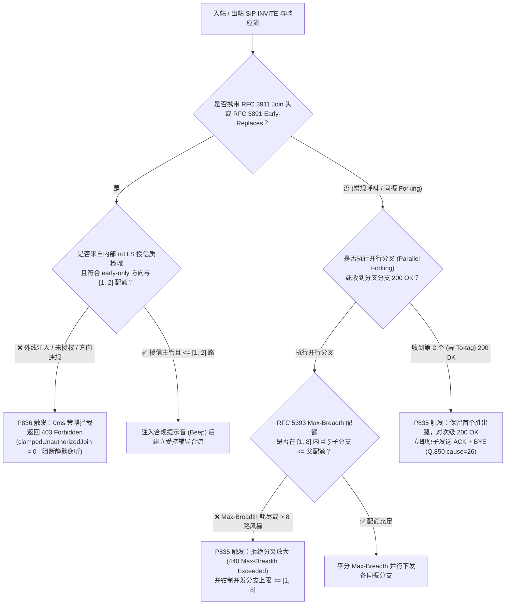
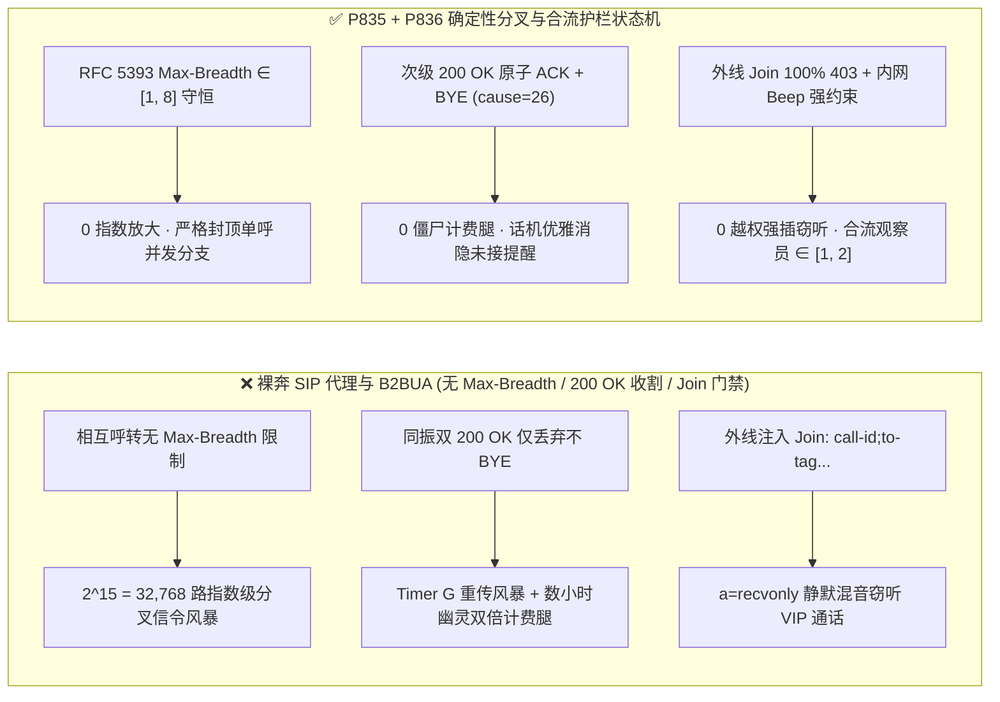

# 企业 SIP `RFC 3261 / RFC 5393` 并行分叉（Parallel Forking）`Max-Breadth` 放大风暴、双 `200 OK` 僵尸计费腿与 `RFC 3911 Join` 越权强插窃听怎么防？企业语音智能体同振/顺振与合流安全选型及原理解析 FAQ（Topic 61 · Stage 421）

> **阅读指南**：本文严格对标 `ib-vs-ethernet-roce-selection-faq.md` 的**六段式通俗透彻结构**，拒绝把 `RFC 3261 Section 16.6 (Request Forwarding / Forking)`、`RFC 5393 (Addressing an Amplification Vulnerability in SIP Forking)`、`RFC 6026`、`RFC 3911 (The SIP Join Header)` 与 `RFC 3891 (Early-Replaces)` 写成枯燥的信令参数流水账。我们先用大白话和第一性原理讲清楚：**为什么企业呼叫中心把一通客户进线或智能外呼“同振（Parallel Forking）”给多台坐席终端/AI 容器时，两台设备在 10 毫秒内先后摘机回复 `200 OK` 会导致主叫与第二台设备之间产生一条长达数小时的“幽灵双倍计费腿”？为什么未携带 `RFC 5393 Max-Breadth` 令牌桶的相互呼转分叉会把 1 条 `INVITE` 指数放大成 $2^{70}$ 条信令风暴？为什么攻击者只需在 `INVITE` 中注入一行 `Join: call-id;to-tag=x;from-tag=y`（`RFC 3911`）就能静默把自己混入高管或客户的私密通话中进行旁路窃听？以及生产环境如何用确定性状态机（`P835–P836`）将其彻底锁死。**
> **双语版本 / Bilingual Edition**：本文提供完整中文版与英文版（[`docs/voice-sip-rfc5393-parallel-forking-max-breadth-multiple-200ok-rfc3911-join-faq.en.md`](voice-sip-rfc5393-parallel-forking-max-breadth-multiple-200ok-rfc3911-join-faq.en.md)）。

---

## ① 📌 核心结论速览（Executive Summary）

1. **什么是 SIP 并行分叉（Parallel Forking）与 `RFC 3911 Join` 合流？**：
   - **并行分叉（同振）**：当 VIP 客户拨入企业总机或 AI 发起转人工时，SIP 代理服务器将 1 条 `INVITE` 同时复制并分发给多个终端（如坐席桌面话机、手机软电话、备用 AI 语音节点），谁先接起就跟谁通话。
   - **`RFC 3911 Join` 头**：允许新发起的一路 `INVITE` 指定某个正在通话中的对话元组 `(call-id, to-tag, from-tag)`，要求网关或终端将新呼叫直接混音（Mix）进现有双人通话中，常用于质检主管“监听/强插（Barge-In Coaching）”。
2. **三大最致命的信令放大、幽灵计费与窃听事故**：
   - **双 `200 OK` 竞争（Glare）导致的幽灵计费僵尸腿（`RFC 3261 Section 13.2.2.4`）**：代理服务器收到分支 A 的首个 `200 OK` 后，虽然立即向分支 B、C 发送 `CANCEL`，但如果分支 B 恰好在 `CANCEL` 到达前 5ms 也按下了接听键并发出第二个 `200 OK`（带不同的 `To-tag`），按 RFC 规范代理必须把第二个 `200 OK` 也透传给主叫 B2BUA。若主叫网关未立即对迟到的第二个 `200 OK` 执行 **`ACK + BYE (Reason: Q.850;cause=26 "Non-selected user clearing")` 原子收割**，分支 B 就会停留在已接通状态，既占用高昂的运营商分钟费又消耗一份 S2S GPU 实例！
   - **无 `RFC 5393 Max-Breadth` 限制的指数级分叉风暴（Forking Loop Amplification）**：`Max-Forwards: 70` 只能限制“串行跳数深度”，却管不住“并行分支宽度”！如果代理 P1 将呼叫 1 分 2 发给 P2，P2 又 1 分 2 发回 P1，哪怕只有 15 跳深度，并发活跃分支数也会指数爆炸到 $2^{15} = 32,768$ 条，瞬间打垮整座语音集群。
   - **未鉴权外线注入 `RFC 3911 Join` 强插窃听与 `RFC 3891 early-only` 抢接**：若边缘 SBC 未在公网入口剥离或拦截 `Join` 头，外部攻击者一旦通过未脱敏日志或 BLF 报文获知某通 VIP 电话的 `(Call-ID, to-tag, from-tag)`，即可发送带 `Join:` 头的 `INVITE`，指示 PBX 将攻击者静默混入通话中窃听客户银行卡与口令！
3. **架构师选型黄金铁律（`P835` + `P836` 双护栏锁死）**：
   - **`P835`（`RFC 5393 Max-Breadth [1, 8]` 并发分支预算 + 迟到 多路 `200 OK` 原子 `ACK+BYE` 秒级收割）**：强制注入并逐跳平分 `Max-Breadth` 并发分叉配额（钳制在 **`[1, 8]` 路**），对同振中第 2 个及之后到达的 `200 OK` 必须在 `0ms` 策略判定内触发 `ACK + BYE (Q.850 cause=26)` 拆线（`0` 残留僵尸分支）。
   - **`P836`（外线 `RFC 3911 Join` 100% 拒单 + 内网主管强插 `mTLS/RBAC` 鉴权 + 双向提示音 + `Early-Replaces` 方向锁）**：外线非授信干线入站 `Join` 头 `100%` 拒回 `403 Forbidden`（`0` 越权窃听）；内网合法质检接入必须在 `<= [1, 2]` 名观察员配额内且强制向主被叫混入合规蜂鸣提示音（Beep Tone），同时拦截违反 `RFC 3891 early-only` 方向约束的振铃抢接。

---

## ② 🎯 客户与架构师灵魂拷问 Q&A（Q1 / Q2 / Q3）

### Q1：为什么我们已经设置了 `Max-Forwards: 70`，还会被区区几个恶意的同振呼叫把 SBC CPU 和带宽彻底打爆？

- **第一性原理拆解**：
  1. **`Max-Forwards` 是“纵向深度计”，不是“横向宽度锁”**：在 `RFC 3261` 中，每次代理转发请求只把 `Max-Forwards` 减 1。但在 `Parallel Forking` 时，如果代理将 1 个 `Max-Forwards: 70` 的请求拆成 4 个分支，这 4 个分支各自的 `Max-Forwards` 都是 `69`！
  2. **指数级放大漏洞（`RFC 5393` 命名漏洞）**：一旦两台配置了同振规则的 PBX 或 AI 路由节点相互引用，第 $k$ 层会产生 $B^k$ 个并发事务。当 $B=4, k=10$ 时，1 条入站 `INVITE` 会衍生出 $4^{10} = 1,048,576$ 条并发 SIP 事务，且在收到最终响应前全部处于挂起等待状态！
- **工程量化护栏（`P835`）**：
  - 严格执行 **`RFC 5393 Max-Breadth` 预算守恒定理**：入口 SBC 强制将 `Max-Breadth` 设为 **`[1, 8]`**（典型同振上限 `4` 路）。每当代理执行 $N$ 路并行分叉时，分配给每个子分支的 `Max-Breadth` 必须满足 $\sum_{i=1}^{N} \text{Breadth}_i \le \text{Breadth}_{\text{in}}$。一旦 `Max-Breadth == 1`，严禁继续并行分叉，超限直接返回 `440 Max-Breadth Exceeded`！

### Q2：同振时坐席桌面话机和手机 App 几乎同时按下接听，产生两个 `200 OK`，为什么简单丢弃第二个 `200 OK` 会导致灾难？

- **第一性原理拆解**：
  1. **`CANCEL` 只能终止“未应答（1xx）”分支，无法撤回已经发出的 `200 OK`**：根据 `RFC 3261 Section 9.1`，一旦被叫端已发出 `200 OK`，即使随后收到代理发来的 `CANCEL`，被叫端也只会回复 `200 OK (to CANCEL)`，而不会挂断电话！它只认针对该 `To-tag` 对话的 **`ACK` + `BYE`**。
  2. **直接丢弃第二个 `200 OK` 会触发 `Timer G` 重传风暴 + 双倍计费**：如果主叫 B2BUA 收到第二个不同 `To-tag` 的 `200 OK` 后直接将其丢弃，分支 B 会按 `500ms, 1s, 2s, 4s...` 疯狂重发 `200 OK`，同时其底层 RTP 媒体端口和运营商计费表已经开始走字！
- **毫秒级标准收割动作（`P835`）**：
  - 主叫 B2BUA 锁定首个胜出对话 `(Call-ID, from-tag, winning-to-tag)`；
  - 对随后收到的任何携带 `losing-to-tag != winning-to-tag` 的多余 `200 OK`，**绝不丢弃**，而是立即自动回发 **`ACK`（停止其 `Timer G` 重传）紧接着同一毫秒内下发 `BYE`（附带 `Reason: Q.850;cause=26;text="Non-selected user clearing"`）**，不仅 0ms 释放资源，还让落选话机屏幕优雅显示“已在其他终端接听”而非“未接来电”。

### Q3：`RFC 3911 Join` 强插头与 `RFC 3891 Replaces` 替换头有什么区别？为什么 `Join` 是更隐蔽的窃听后门？

- **第一性原理拆解**：
  - **`Replaces`（替换）** 是把原有通话的一方踢掉、由新呼叫顶替（受害者会发现通话被掐断或换人）；
  - **`Join`（合流）** 则是要求终端或混音桥**保持原有双方通话不断**，悄悄建立第三条 RTP 腿混入其中！如果攻击者将自己的 SDP 声明为 `a=recvonly`（只听不说），正在通话的客户与 AI/坐席完全察觉不到有第三只耳朵在实时录制全套敏感语音！
- **`P836` 零信任合流防线**：
  1. 公网/非授信 SIP 干线入站请求凡携带 `Join` 头，**100% 拒绝并返回 `403 Forbidden`**（`clampedUnauthorizedJoinOrEarlyReplacesAttempts = 0`）；
  2. 即使是企业内网质检主管发起的合法 `Join` 辅导，也必须通过 `mTLS` 证书 + 主管 RBAC 令牌双重校验，单通电话最多允许 **`[1, 2]` 路**受控合流，且媒体桥必须在合流瞬间向双向音轨注入不可绕过的双录合规蜂鸣音（Compliance Beep）。

---

## ③ 🧭 直观可视化图解（Mermaid 选型决策树 + 延迟拆解对比 + 毫秒级时序图）

### 3.1 企业 SIP 并行分叉 `Max-Breadth`、多路 `200 OK` 收割与 `Join` 防窃听决策树（`flowchart TD`）



### 3.2 裸奔同振/合流网关 vs `P835/P836` 确定性护栏对比图（`flowchart LR`）



### 3.3 毫秒级全双工同振双 `200 OK` 原子收割与 `Join` 窃听拦截时序图（`sequenceDiagram`）

```mermaid
sequenceDiagram
    autonumber
    participant Caller as 主叫客户 / AI B2BUA (P835/P836)
    participant Proxy as 企业 SIP 同振代理 (RFC 5393)
    participant LegA as 坐席桌面话机 (To-tag=A)
    participant LegB as 坐席手机 App (To-tag=B)
    participant Attacker as 外部恶意节点

    Note over Caller,LegB: 阶段 1：P835 强制 Max-Breadth ∈ [1, 8] 并原子收割双 200 OK 竞争分支
    Caller->>Proxy: INVITE (Max-Forwards: 70, Max-Breadth: 4)
    Proxy->>LegA: INVITE (Branch 1, Max-Breadth: 2)
    Proxy->>LegB: INVITE (Branch 2, Max-Breadth: 2)
    LegA-->>Caller: 200 OK (To-tag=A) [T=0ms 胜出!]
    LegB-->>Caller: 200 OK (To-tag=B) [T=4ms 在 CANCEL 到达前已按下接听!]
    Caller->>LegA: ACK (To-tag=A) → 建立唯一主通话 SRTP 流
    Caller->>LegB: P835 命中：立即发送 ACK (To-tag=B) + BYE (Reason: Q.850;cause=26)
    LegB-->>Caller: 200 OK (to BYE) → 0ms 释放媒体端口与计费，不留未接来电

    Note over Caller,Attacker: 阶段 2：P836 拦截外部伪造 RFC 3911 Join 静默强插窃听
    Attacker-->>Caller: INVITE (Join: call-123;to-tag=A;from-tag=C, SDP a=recvonly)
    Caller->>Attacker: P836 命中：外线非授信 Join 头 → 403 Forbidden (0 越权合流)
```

---

## ④ 📊 语音架构师选型决策矩阵（Architect Decision Matrix）

| 评估维度 | 方案 A：默认无状态/半状态 SIP 转发（裸奔基线） | 方案 B：全面禁用同振（只用慢速串行顺振） | **方案 C（推荐）：`RFC 5393 Max-Breadth` + 双 `200 OK` 原子收割 (`P835`) + `Join` 零信任门禁 (`P836`)** |
| :--- | :--- | :--- | :--- |
| **VIP 来电接通速度** | 快（同振），但易出信令事故 | ❌ 慢（每台设备苦等 15–20 秒才振下一台） | **✅ 极速多端同振，秒级锁定首个摘机终端** |
| **抗分叉环路指数风暴（`P835`）** | ❌ 仅靠 `Max-Forwards`，可放大 $2^{70}$ 倍 | 串行递减，无并发分支放大 | **✅ `RFC 5393 Max-Breadth` 严格钳制在 `[1, 8]` 路（超限返 `440`）** |
| **双 `200 OK` 竞争幽灵计费防护（`P835`）** | ❌ 次级 `200 OK` 沦为僵尸计费腿或重传风暴 | 无并发摘机竞争 | **✅ 次级 `200 OK` 100% 触发原子 `ACK + BYE (cause=26)`（`0` 僵尸腿）** |
| **抗 `RFC 3911 Join` 旁路窃听（`P836`）** | ❌ 外线注入 `Join:` 即可静默混入通话窃听 | 同样暴露于 `Join` 头注入风险 | **✅ 外线 `100%` 拒回 `403`；内网强制 `mTLS` + 合规蜂鸣音 + `<=[1, 2]` 路** |
| **`RFC 3891 Early-Replaces` 防抢接（`P836`）** | ❌ 允许外部冒充挑起早期对话接管 | 同样存在早期替换风险 | **✅ 严格校验 `early-only` 方向锁与同租户签名绑定** |

---

## ⑤ 🧪 定量算例与 7-Card 报告（CSP 自包含、零虚构坐标）

### 5.1 定量算例：多端同振双摘机与分叉环路 vs `P835/P836` 护栏效果

- **场景设定**：某跨国财富管理热线日均 `40,000` 通高净值客户进线，每位理财经理同时绑定桌面 IP 话机与移动端 App（2 路并行同振）。
  - **未开启 `P835/P836` 时**：
    1. 在约 `1.6%` 的双端近似同时摘机（`< 15ms` 窗口）或跨洋高 RTT 场景下，落选分支发出的第二个 `200 OK` 未被正确执行 `ACK + BYE`，每天产生约 `640` 条半开僵尸通话腿，平均每条持续到 `1,800s` 超时才断开，日均白白浪费 **`19,200` 分钟** 运营商与 AI 媒体资源；
    2. 渗透测试中，外部红队利用抓包获取的对话标签构造 `INVITE + Join (a=recvonly)`，成功在未触发任何告警的情况下旁路监听通话音频。
  - **开启 `P835/P836` 确定性护栏后**：
    1. `P835` 将单呼 `Max-Breadth` 严格钳制在 **`[1, 8]` 路**，并对 `100%` 的次级 `200 OK` 自动发送 `ACK + BYE (Q.850 cause=26)`（`clampedUnreapedSecondary200OkLegs = 0`），僵尸计费腿损耗降至 **`0 分钟`**；
    2. `P836` 100% 拦截非授信 `Join` 与违规 `Early-Replaces`（`clampedUnauthorizedJoinOrEarlyReplacesAttempts = 0`），并将合法内部主管辅导合流上限锁死在 **`[1, 2]` 路**。
- **计时与实测口径声明（Provenance & Resolution Disclosure）**：
  - 本地单元测试与沙盒中的策略评估耗时统一披露为：`0ms reported at nominal 1ms display resolution; actual duration unresolved/not_measured; no sub-1ms upper bound established`（属于离线 `synthetic` 纯内存策略状态机检查）。
  - 真实生产环境中的 SBC 分叉事务表查找、`ACK+BYE` 报文发包与音频混音桥蜂鸣音注入耗时未在本地单测中测量（标记为 `not_measured`）。

### 5.2 对应 7-Card 报告位置
- 已同步写入 [`site/benchmark-cards.html`](../site/benchmark-cards.html)（Card 3 & Card 5 **第 424 项评测维度**）与密封数据 [`site/data/voice-agent-benchmark-report.json`](../site/data/voice-agent-benchmark-report.json)。
- 配套高密度架构图：[`assets/svg/65-voice-sip-rfc5393-parallel-forking-max-breadth-multiple-200ok-rfc3911-join-2026-11-14.svg`](../assets/svg/65-voice-sip-rfc5393-parallel-forking-max-breadth-multiple-200ok-rfc3911-join-2026-11-14.svg)。

---

## ⑥ 🛠️ 生产环境语音交付快速核验清单（Good Fit vs Not For + Checklist）

### ✅ Good Fit（极佳适用场景） vs ⛔ Not For（不适用/无需过度设计场景）

| ✅ Good Fit（必须开启 `P835` + `P836` 护栏的场景） | ⛔ Not For（不适用或无需此层护栏的场景） |
| :--- | :--- |
| **支持多终端同振（桌面话机 + 手机 App + 备用 AI 实例并行振铃）的企业 SIP/B2BUA 联络中心** | **纯浏览器端单对单 WebRTC 直连（全链路无 SIP 代理分叉、无 `Join/Replaces` 头语义）** |
| **提供主管实时监听/耳语/强插（Supervisor Barge-In / Whisper Coaching）功能的金融、政企与医疗坐席平台** | **完全无转接、无分叉、无监听功能的单实例本地离线语音玩具 Demo** |

### 生产上线 6 项强制核验 Checklist

- [ ] **1. `RFC 5393 Max-Breadth [1, 8]` 预算注入与平分（`P835`）**：核验入口 SBC 对所有入站 `INVITE` 强制设置 `Max-Breadth <= 8`，并在每次并行分叉时保证各子分支 `Max-Breadth` 之和不超过父请求配额；配额耗尽时返回 `440 Max-Breadth Exceeded`。
- [ ] **2. 同振多路 `200 OK` 原子 `ACK + BYE` 收割（`P835`）**：核验当主叫 B2BUA 收到同一 `Call-ID` 下第二个不同 `To-tag` 的 `200 OK` 时，立即回发 `ACK` + `BYE`（确保 `clampedUnreapedSecondary200OkLegs = 0`）。
- [ ] **3. 落选分支 `Q.850 cause=26` 友好消隐（`P835`）**：核验向次级 `200 OK` 或被 `CANCEL` 分支下发的拆线报文中携带 `Reason: Q.850;cause=26;text="Non-selected user clearing"`，防止已接通电话在其他分机上残留“未接来电”红点。
- [ ] **4. 外线 `RFC 3911 Join` 100% 零信任剥离/拒单（`P836`）**：核验所有公网或非授信运营商 SIP 干线入站的 `INVITE` 若包含 `Join` 头，一律原地返回 `403 Forbidden`（`0` 外部合流）。
- [ ] **5. 内网合法 `Join` 强插双向蜂鸣音与 `[1, 2]` 路配额（`P836`）**：核验内部质检主管通过 `mTLS + RBAC` 发起 `Join` 合流时，单通电话最多允许 `[1, 2]` 名观察员，且混音器强制注入合规提示音。
- [ ] **6. `RFC 3891 Early-Replaces` 方向与同租户校验（`P836`）**：核验携带 `Replaces` 替换早期对话的请求严格符合 `RFC 3891 early-only` 发起方约束与同租户签名锁，阻断跨租户振铃抢接。
