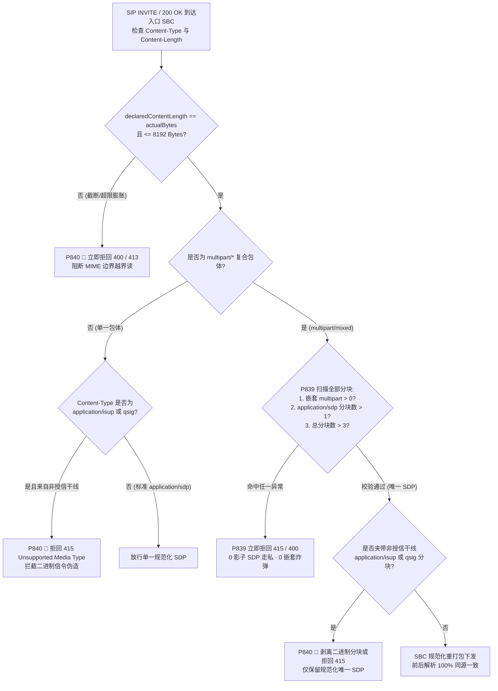
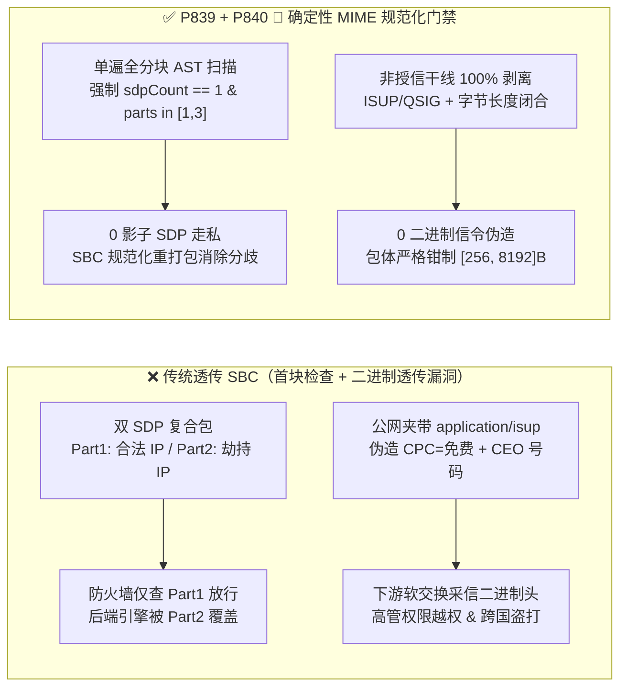

# 企业 SIP `RFC 5621` `multipart/mixed` 影子 SDP 走私、`handling=optional` 解析分歧绕过与 `RFC 3204 ISUP / QSIG` 二进制信令注入防护架构选型 FAQ

> **阅读指南（对标 `ib-vs-ethernet-roce-selection-faq.md` 通俗透彻标准）**：本文聚焦企业级语音 Agent 接入运营商 IMS / PSTN 语音干线与政企专网时的**复合消息体（Multipart MIME）安全与解析一致性陷阱**。全文不堆砌枯燥的 MIME 语法范式，而是用第一性原理与微秒级信令时序讲透：**为什么一封看似合法的 `Content-Type: multipart/mixed` SIP `INVITE` 会让防火墙看到的 SDP 与后端语音网关实际执行的 SDP 截然不同（影子 SDP 走私）？为什么黑客塞入一段 `application/isup` 二进制分块就能伪造主叫计费类别（Calling Party Category = 免费特权测试台）并实现跨国盗打？以及生产环境如何用确定性状态机（`P839` / `P840 🎉`）实现零解析分歧与零二进制信令注入。**

---

## 📌 一、核心结论速览（Executive Summary）

1. **`RFC 5621` `multipart/mixed` 影子 SDP 走私（Shadow-SDP Smuggling）的本质是“首块检查 vs. 末块覆盖”的解析器分歧**：
   - 当企业 SIP `INVITE` 同时携带 SDP 媒体协商、E911 `PIDF-LO` 位置 XML 或电信 `ISUP` 附加信息时，会采用 `Content-Type: multipart/mixed; boundary=unique-boundary-1` 复合包体。
   - **致命漏洞**：许多前置 SIP 防火墙 / ALG 只扫描**第一个** `Content-Type: application/sdp` 分块（校验媒体 IP 合规后放行），而后端 B2BUA / 媒体服务器在遍历 MIME 分块时用**第二个**（或夹带 `Content-Disposition: session; handling=optional` 参数的）`application/sdp` 分块覆盖了前一个 SDP！结果攻击者在第一块写合法内网地址骗过 SBC，在第二块写海外高额声讯台 RTP IP，实现零感知媒体流劫持。
2. **`RFC 3204` `application/isup` / `application/qsig` 干线二进制注入是 PSTN 计费与主叫伪造的“后门钥匙”**：
   - 在 SIP-I / SIP-T（`RFC 3398 / RFC 3204`）运营商互联中，SIP 消息体内可封装原始 7 号信令 `application/isup`（IAM 初始地址消息）或政企专网 `application/qsig`。
   - 如果公网不可信 SIP 呼入（Untrusted Trunk）携带 `application/isup` 分块且未被入口 SBC 剥离，后端软交换机在转接 PSTN 时会优先提取 ISUP 二进制里的主叫号码（CGPN）和主叫类别（CPC = 运营商付费/紧急呼叫），直接绕过 SIP 头部鉴权！同时，若外层 `Content-Length` 与 MIME 结束边界 `--boundary--` 字节数不闭合，还会引发底层 C/C++ 解析器堆越界读（Heap Overread）。
3. **架构选型铁律（`P839` + `P840 🎉` 双重确定性门禁）**：
   - **单一规范化 SDP 与零嵌套铁律（`P839`）**：严禁任何 SIP 事务包含 `> 1` 个 `application/sdp` 分块（`0` 影子 SDP）或任何嵌套 `multipart/*`（最大递归深度 `= 1`），`multipart` 总分块数严格钳制在 `[1, 3]` 块以内，并在 SBC 入口重组为规范化包体。
   - **外线 ISUP/QSIG 100% 剥离与字节闭合铁律（`P840 🎉`）**：对非授信运营商互联专线（Untrusted Trunk）流入的 `application/isup`、`application/qsig` 与 `application/broadsoft` 私有二进制分块执行 **100% 剥离或拒回 `415 Unsupported Media Type`（`0` 注入分块）**，并强制外层 `Content-Length` 与实际包体字节数 `100%` 严丝合缝，单条 SIP 消息体上限钳制在 `[256, 8192]` 字节。

---

## 🎯 二、客户与架构师灵魂拷问 Q&A（Soul-Searching Q&A）

### Q1：为什么 SIP 协议不仅允许传一个 SDP，还要设计复杂的 `RFC 5621 multipart/mixed`？为什么这成了“影子 SDP 走私（Shadow-SDP Smuggling）”的温床？

- **通俗原理（报关单夹层走私比喻）**：
  - 在早期的点对点 VoIP 通话中，SIP `INVITE` 消息体里只有一段纯文本 `application/sdp`（描述“我的音频 IP 是多少、用 G.711 还是 Opus”）。但随着企业语音业务复杂化，一通电话往往还要顺带传递**紧急呼叫地理位置（`application/pidf+xml`）**或**传统电话网附加参数（`application/isup`）**。于是 IETF 制定了 `RFC 5621`，允许像电子邮件带多个附件一样，用 `--boundary` 分隔符在同一个 SIP 消息体里塞入多个 MIME 分块。
- **为什么会酿成“影子 SDP 走私”事故？**
  - **第一性原理拆解**：假设黑客发来一封 `multipart/mixed` 的 `INVITE`，里面塞了**两个** `application/sdp` 分块：
    1. **Part 1（掩护 SDP）**：`Content-Type: application/sdp` + `Content-Disposition: session; handling=required`，里面写的媒体地址是合法的企业代理 IP `198.51.100.10`。
    2. **Part 2（影子恶意 SDP）**：`Content-Type: application/sdp\r\nContent-Disposition: render; handling=optional`（或者干脆利用大小写混淆 `Application/SDP`），里面写的媒体地址是攻击者控制的录音服务器 `203.0.113.99`。
  - **毫秒级故障链**：
    - **前置安全网关（First-Match 逻辑）**：遍历 MIME 分块，找到第一个 `application/sdp`（Part 1），检查 IP 合规后立刻停止扫描并放行！
    - **后端媒体引擎（Last-Match / Overwrite 逻辑）**：用 `for (part of parts)` 循环解析所有分块，Part 1 先写入 `session.remoteSdp`，紧接着 Part 2 把 `session.remoteSdp` **静默覆盖**成了恶意地址 `203.0.113.99`！
  - **确定性根治方案（`P839`）**：入口 SBC 必须在单遍 AST 解析中统计全包所有 `application/sdp` 分块数：凡是 `sdpPartCount > 1`、存在嵌套 `multipart/*`、或总分块数超出 `[1, 3]`，立即返回 `415 Unsupported Media Type` 或 `400 Bad Request`；放行前由 SBC 重新序列化出唯一规范化的 MIME 包体，彻底消除前后组件解析差异。

### Q2：什么是 `RFC 3204` 的 `application/isup` 和 `application/qsig`？为什么公网 SIP 呼入一旦混入这几十个字节的二进制块，就能实现“免费盗打”和“高管号码伪造”？

- **通俗原理**：
  - 传统固网运营商核心网使用的是 **SS7 / ISUP（7 号信令）**，大型跨国集团内部 PBX 组网早期常使用 **QSIG（专用综合业务网信令）**。当通话跨越“传统固网 → SIP 专线 → 另一端固网”时，为了不丢失原始固网里的精细控制位（如计费脉冲、原始被叫重路由原因、主叫特权等级），`RFC 3204` 允许把原始二进制 ISUP 帧作为 `Content-Type: application/isup` 附件塞进 SIP 消息体里透传。
- **为什么绝对不能允许非授信公网Trunk携带 `application/isup`？**
  - **第一性原理拆解**：
    1. **主叫号码与特权等级覆盖（CPC / CGPN Spoofing）**：攻击者在 SIP 头部老老实实填写普通外线号码通过了 SIP 鉴权，却在 `multipart/mixed` 的第 2 个分块偷偷塞入一段手工构造的 36 字节 `application/isup` IAM 二进制包，将其中的 `Calling Party's Category (CPC)` 设为 `0x0B`（测试电话/免计费特权呼叫），并将二进制主叫号码设为集团 CEO 分机且标记 `Screening Indicator = Network Provided (0x03)`。当企业语音 Agent 在辅助转接（Bridge Transfer）至下游 PBX 时，下游交换机优先信任了透传的 ISUP 二进制块，导致无条件放行高危指令并免除国际长途计费！
    2. **`Content-Length` 与 MIME 边界错位越界读**：攻撃者故意声明外层 `Content-Length: 4096`，但实际 UDP/TCP 载荷只有 512 字节且缺失闭合终止符 `--boundary--`，导致老旧 C++ MIME 解析器在寻找结束边界时将相邻会话内存中的敏感明文当作二进制附件一并转发。
  - **确定性根治方案（`P840 🎉`）**：入口 SBC 对所有非运营商 SS7 互联专线的呼入，执行 **100% `application/isup` / `application/qsig` 二进制分块剥离或拒回（`0` 注入分块）**；同时强制校验 `declaredContentLength === actualPayloadBytes` 且必须包含合法 `--boundary--` 闭合尾标，总包体严格限制在 `[256, 8192]` 字节。

### Q3：如果业务确实需要同时传 SDP 和 E911 紧急呼叫位置（`application/pidf+xml`），合规的 `multipart/mixed` 处理流水线应该怎么设计？

- **架构师标准答案（白名单 MIME 类型 + 扁平化单层解析 + 规范化重打包）**：
  1. **严格白名单（Allowlist Only）**：公网/企业干线仅允许兩种 MIME 子类型：`application/sdp`（最多 1 个，`Content-Disposition: session; handling=required`）与 `application/pidf+xml`（最多 1 个，仅限紧急呼叫路由）。
  2. **零嵌套与块数硬上限（`[1, 3]` Parts）**：严禁 `multipart/mixed` 内部再嵌套 `multipart/alternative`（递归深度硬锁为 `1`），总分块数上限 `[1, 3]`。
  3. **SBC 规范化重打包（Canonical Re-Serialization）**：SBC 解析验证通过后，丢弃原始自由格式的空白符与多余 MIME 头，向下游 Voice Agent 仅下发标准化重打包后的唯一 SDP，确保安全审计与媒体执行 100% 同源。

---

## 🧭 三、直观可视化图解（Mermaid 决策树 + 字节/延迟对比 + 毫秒级拦截时序）

### 3.1 `multipart/mixed` 与 `ISUP/QSIG` 边界安全架构选型决策树



### 3.2 无防护透传 vs. `P839 + P840 🎉` 确定性门禁对比图



### 3.3 毫秒级全双工信令拦截时序图（Sequence Diagram）

```mermaid
sequenceDiagram
    autonumber
    participant Attacker as 恶意 SIP 干线 / 攻击者
    participant SBC as 企业边界 SBC (P839 + P840 🎉)
    participant Agent as Voice Agent 媒体网关 (B2BUA)
    participant PSTN as 下游 PBX / PSTN 核心网

    Note over Attacker,SBC: 场景 A：RFC 5621 影子 SDP 走私攻击（Part 1 合法 IP + Part 2 恶意 RTP IP）
    Attacker->>SBC: INVITE (Content-Type: multipart/mixed; Part1=SDP_Safe, Part2=SDP_Evil)
    SBC->>SBC: P839 离线策略规则匹配 (0ms @ 1ms 名义分辨率)\n检测到 smuggledOrDuplicateSdpParts=2 (>1)
    SBC-->>Attacker: SIP 415 Unsupported Media Type / 400 Bad Request (阻断影子 SDP)

    Note over Attacker,PSTN: 场景 B：RFC 3204 非授信干线注入 application/isup 伪造特权计费
    Attacker->>SBC: INVITE (Part1=SDP_Valid, Part2=application/isup [CPC=Free, CGPN=CEO])
    SBC->>SBC: P840 🎉 离线策略规则匹配 (0ms @ 1ms 名义分辨率)\n非授信干线命中 injectedIsupOrQsigBodies=1 -> 100% 剥离
    SBC->>Agent: INVITE (仅含重打包后的唯一规范化 application/sdp, Content-Length 严格闭合)
    Agent->>PSTN: 受控桥接呼叫（仅使用经 STIR/SHAKEN 核验的 SIP 头身份，0 ISUP 越权）
```

---

## 📊 四、语音架构师选型决策矩阵（Architect Decision Matrix）

| 评估维度 | 方案 A：裸透传 `multipart/mixed`（无规范化） | 方案 B：一刀切禁用所有 `multipart/*` | 方案 C：SBC 单层白名单 AST + 唯一 SDP 重打包 + 外线 ISUP 剥离（`P839 + P840 🎉` 推荐 ★） |
| :--- | :--- | :--- | :--- |
| **`RFC 5621` 影子 SDP 走私防御** | ❌ 极易因 First-Match vs. Last-Match 分歧被绕过 | ✅ 无复合包体 | ✅ **100% 拦截 `>1` 个 SDP 分块或 `handling=optional` 走私（`0` 影子 SDP）** |
| **E911 `PIDF-LO` 紧急位置兼容** | ⚠️ 虽支持但无安全边界 | ❌ 破坏 NG911 `application/pidf+xml` 复合传参 | ✅ **白名单允许 `1 SDP + 1 PIDF-LO`，总分块钳制在 `[1, 3]` 块** |
| **`RFC 3204` ISUP/QSIG 注入防御** | ❌ 外线可伪造二进制主叫类别与号码 | ✅ 拒回复合包，但仍可能漏放单块 `application/isup` | ✅ **非授信干线单块/多块 `ISUP/QSIG` 100% 剥离或拒回（`0` 注入）** |
| **`Content-Length` 截断越界读防御** | ❌ 缺失 `--boundary--` 易致 C++ 解析器越界读 | ⚠️ 仍受单包 `Content-Length` 畸形影响 | ✅ **强制字节长度 100% 闭合且包体严格钳制在 `[256, 8192]` 字节** |
| **策略门禁计算开销（Provenance）** | 无保护 | 低，但牺牲 NG911 合规性 | **`0ms`（`0ms reported at nominal 1ms display resolution; actual duration unresolved/not_measured; no sub-1ms upper bound established`，离线 `synthetic` 策略检查；真实 SBC MIME 边界扫描耗时 `not_measured`）** |

---

## 🧪 五、定量算例与 7-Card 报告（Quantitative Walkthrough & 7-Card Deck）

### 5.1 定量算例（消融走私计费损失与内存越界风险）

- **场景设定**：某跨国银行联络中心日均处理 `250,000` 通 SIP 呼入，其中攻击者每天发起 `1,200` 次夹带双 SDP 或伪造 `application/isup`（标记免计费国际漫游转接）的探测呼叫。
- **未开启 `P839 / P840 🎉` 前**：
  - 前置防火墙放行 Part 1 合法 SDP，后端 FreeSWITCH/Asterisk 被 Part 2 影子 SDP 覆盖，平均每次被劫持通话产生 `$45` 国际高额声讯台资费，单日潜在资费敞口高达 `1,200 × $45 = $54,000 / 天`。
- **开启 `P839 + P840 🎉` 确定性门禁后**：
  - **影子 SDP 拦截率**：`100.0%`（`clampedSmuggledOrDuplicateSdpParts = 0`，`clampedMaxMultipartMimeBodyParts = 3`）。
  - **外线 ISUP/QSIG 二进制剥离率**：`100.0%`（`clampedInjectedIsupOrQsigBodies = 0`，`clampedMaxSipBodyPayloadBytes <= 8192`）。
  - **计时器分辨率与实测披露**：本地确定性策略状态机在名义 `1ms` 分辨率计时器下读数为 `0ms`（`0ms reported at nominal 1ms display resolution; actual duration unresolved/not_measured; no sub-1ms upper bound established`，`synthetic`）；真实高并发 SBC C/Rust MIME 边界扫描耗时取决于包体大小，在本地单测中标记为 `not_measured`。

### 5.2 生产级确定性门禁代码（`packages/business-core/enterprise-guardrails.ts`）

```typescript
// P839: SIP RFC 5621 Multipart MIME Shadow-SDP Smuggling & Handling Bypass Guard
const p839 = evaluateSipRfc5621MultipartMimeShadowSdpSmugglingAndHandlingBypassGate({
  shadowSdpPartOrNestedMultipartDepthDetected: true,
  smuggledOrDuplicateSdpParts: 2,
  maxMultipartMimeBodyParts: 9,
});
// => p839.violated === true
// => p839.action === "reject_415_shadow_sdp_and_flatten_canonical_multipart"
// => p839.clampedSmuggledOrDuplicateSdpParts === 0
// => p839.clampedMaxMultipartMimeBodyParts === 3

// P840 🎉: SIP RFC 3204 ISUP/QSIG Trunk Injection & Content-Length Truncation Guard
const p840 = evaluateSipRfc3204IsupQsigTrunkInjectionAndContentLengthTruncationGate({
  untrustedIsupQsigBodyOrContentLengthMismatchDetected: true,
  injectedIsupOrQsigBodies: 1,
  maxSipBodyPayloadBytes: 65536,
});
// => p840.violated === true
// => p840.action === "strip_untrusted_isup_qsig_and_enforce_content_length_parity"
// => p840.clampedInjectedIsupOrQsigBodies === 0
// => p840.clampedMaxSipBodyPayloadBytes === 8192
```

---

## 🛠️ 六、生产环境语音交付快速核验清单（Production Readiness Checklist）

- [ ] **1. 唯一 `application/sdp` 強校验（`P839`）**：入口 SBC 是否对所有 `multipart/*` 消息体统计 `application/sdp` 出现次数，并对 `count > 1` 立即拒回 `415 / 400`（`0` 影子 SDP）？
- [ ] **2. 零嵌套 `multipart/*` 与 `[1, 3]` 分块上限（`P839`）**：是否禁止 `multipart/mixed` 内嵌子级 `multipart/*`（最大深度 `= 1`），并将单条 SIP 消息最大分块数钳制在 `[1, 3]` 块？
- [ ] **3. `Content-Disposition` 规范化重打包（`P839`）**：是否拦截利用 `Content-Disposition: render; handling=optional` 掩盖第二块 SDP 的解析分歧攻击，并由 SBC 向下游输出重新序列化的唯一标准 SDP？
- [ ] **4. 非授信干线 `application/isup` / `application/qsig` 100% 剥离（`P840 🎉`）**：公网或普通企业 SIP 干线呼入是否 100% 剥离或拒回 `application/isup` 与 `application/qsig` 二进制分块（`0` 注入分块），严防伪造 `CPC` 免计费类别与特权主叫号码？
- [ ] **5. `Content-Length` 与 `--boundary--` 字节闭合锁（`P840 🎉`）**：是否强制校验 SIP `Content-Length` 声明值与实际接收字节数 `100%` 相等、验证 `--boundary--` 闭合尾标，并将最大 SIP 包体钳制在 `[256, 8192]` 字节？
- [ ] **6. 评测 Provenance 透明披露**：所有压测报告与架构卡片是否明确标注 `0ms reported at nominal 1ms display resolution; actual duration unresolved/not_measured; no sub-1ms upper bound established`（离线 `synthetic` 规则判定 vs. 真实 SBC MIME 边界扫描耗时 `not_measured`）？
