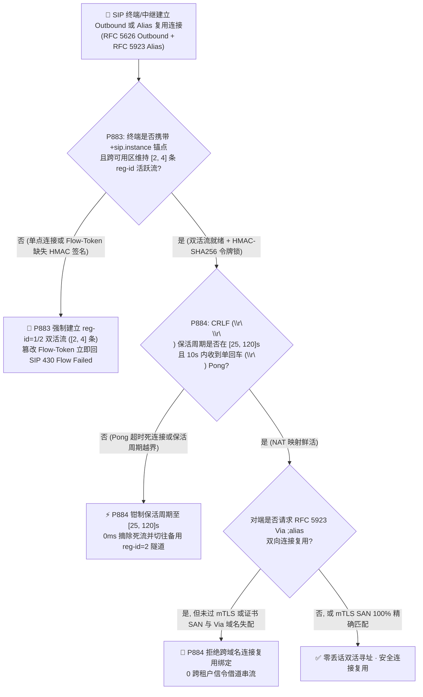
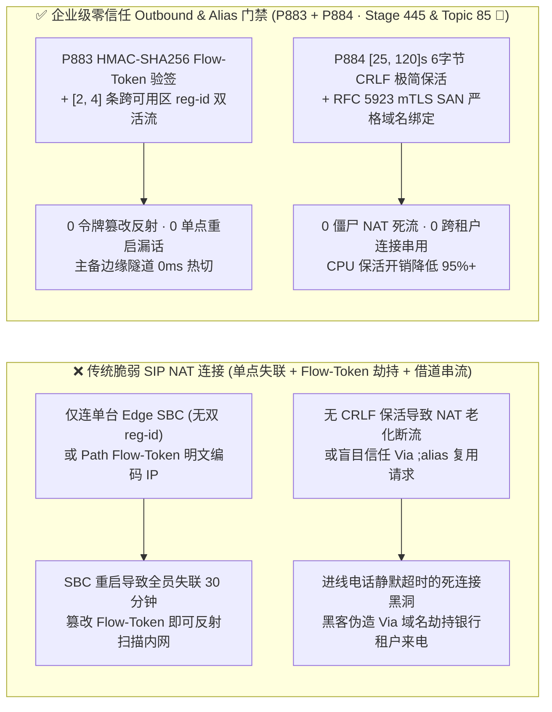

# 企业 SIP `RFC 5626 Outbound` 双活边缘代理（`reg-id=1/2`）、`HMAC Flow-Token` 防劫持、`CRLF` 保活（`[25, 120]s`）与 `RFC 5923 mTLS` 连接复用防串租户选型与原理解析 FAQ（Stage 445 🎉 · Topic 85 🎉 · 🎉 Stage 445 与第 85 大专题双里程碑）

> **核心导读（对标 `ib-vs-ethernet-roce-selection-faq.md` 通俗透彻规范）**：本文用第一性原理与大白话讲透企业级云呼叫中心、分支机构 SIP 话机与移动端软电话在穿越对称 NAT / 企业防火墙落地 **IETF `RFC 5626`（Managing Client-Initiated Connections in SIP / `SIP Outbound`）与 `RFC 5923`（Connection Reuse in SIP / `alias` 双向连接复用）** 时最易踩坑的三大底层故障——**① 边缘代理（Edge Proxy）在 `Path:` 头中直接将目标内网/公网 IP:Port 明文 Base64 编码作为 `Flow-Token`（无 `HMAC-SHA256` 签名），导致攻击者篡改 `Route:` 头里的 `Flow-Token` 即可劫持进线呼叫或将边缘代理变成内网扫描反射跳板**、**② 终端仅向单台边缘 `SBC` 建立单条流（无 `+sip.instance` + `reg-id=1 / reg-id=2` 双活流），一旦单台边缘代理重启，NAT 映射无法由服务端主动反向建连，导致全部分机失联 30 分钟**，以及 **③ 代理间启用 `RFC 5923 alias` TLS 连接复用时未校验客户端证书 `SubjectAltName (SAN)` 与 `Via:` 域名一比一绑定，导致多租户信令借道串流**，并给出 **`P883` 与 `P884`** 的确定性护栏代码与生产核验清单。

---

## 一、📌 核心结论速览（Executive Summary）

1. **为什么躲在企业防火墙或家庭路由器（NAT）后面的 SIP 坐席软电话，一旦云端某台边缘 `SBC` 重启就会“全员失联收不到来电”，哪怕后台核心注册服（Registrar）还是好的？**
   - **第一性原理（NAT 防火墙的“只准内出、不准外进”铁律）**：
     - 当坐席客户端在 NAT 后面向云端发 `REGISTER` 时，实际上是客户端主动向云端 Edge Proxy 1 打通了一条 TCP/TLS 隧道（称为 **`Flow`**）。云端核心网想把客户的进线电话（`INVITE`）推给这个坐席时，**绝对不可能从公网主动向客户端发起新 TCP 连接（会被 NAT 直接拦截）**，必须原路复用客户端之前主动建立的那条 `Flow`！
     - **致命单点故障**：如果客户端只连了 1 台 Edge Proxy 1，当 Edge Proxy 1 升级重启时，这条唯一的 TCP/TLS `Flow` 断开；直到客户端 30 分钟后下一次 `REGISTER` 刷新前，云端核心网没有任何通道能把电话送达客户端！
   - **`RFC 5626 SIP Outbound` 的终极解法（`P883`）**：
     - 每个终端生成唯一不变的设备 UUID（`+sip.instance="<urn:uuid:...>"`），并同时向 **至少 2 台不同可用区的边缘代理** 各自建立一条长连接（分别标记为 **`reg-id=1` 与 `reg-id=2`**，总活跃流数钳制在 **`[2, 4]` 条**）。一旦 `reg-id=1` 所在边缘节点故障，核心网 Registrar **0ms 自动走 `reg-id=2` 的备用热隧道下发来电**，实现边缘节点掉电 **0 通来电丢失**！
2. **选型第一定律（`P883`）：边缘代理写入 `Path:` / `Record-Route:` 的 `RFC 5626 Flow-Token` 必须使用边缘节点私钥执行 `HMAC-SHA256(local_socket_id, peer_ip, peer_port, instance_id, expiry)` 签名与防篡改校验（100% 严禁明文 IP 直编），并强制每个 `+sip.instance` 终端维持 `[2, 4]` 条跨可用区 `reg-id` 双活连接流（`0` 令牌劫持或单点断连漏话）**。
3. **选型第二定律（`P884`）：在 `RFC 5626` TCP/TLS 流上强制启用 `[25, 120]s` 周期的双向 `CRLF`（`\r\n\r\n` Ping / `\r\n` Pong）心跳保活以防止 NAT 老化并秒级检测死连接；同时在启用 `RFC 5923 alias` 连接复用时，强制要求双向 `mTLS` 且客户端证书 `SAN (dNSName / uniformResourceIdentifier)` 100% 匹配 `Via` 头声明的域名（`0` 跨租户连接混用或僵尸流）**。

---

## 二、🎯 客户与架构师灵魂拷问 Q&A（Deep-Dive Q&A）

### Q1：什么是 `RFC 5626 Flow-Token`？黑客是怎么通过篡改 `Route: <sip:token@edge.com;ob>` 把别人的电话转到自己手机上的？
- **通俗拆解 `Flow-Token` 的作用**：
  - 为了不让边缘代理为百万个在线终端维护庞大的有状态注册表，边缘代理在收到客户端 `REGISTER` 时，会把该客户端对应的本地 TCP 连接三元组 `(SocketFD, ClientIP, ClientPort)` 编码成一个令牌（`Flow-Token`），塞进 `Path: <sip:FlowToken@edge1.voice.com;lr;ob>` 发给核心 Registrar 保存。
  - 当有电话打给该用户时，核心网把 `Path` 变成 `Route: <sip:FlowToken@edge1.voice.com;lr;ob>` 发回给边缘代理；边缘代理解开 `FlowToken` 就知道该从哪根 TCP 管道把电话塞出去了。
- **无签名明文 `Flow-Token` 的灭顶之灾**：
  - 如果边缘代理偷懒，直接把 `192.168.1.50:5060` 做个 Base64 编码当成 `FlowToken` 而 **没有加 `HMAC` 验签**，攻击者只需伪造一个包含自己 IP 或内网管理网段 IP 的 Base64 字符串塞进 `Route` 头，边缘代理就会乖乖把 SIP 报文转发去攻击内网或劫持呼叫！
  - **`P883` 铁律**：遵循 `RFC 5626 Section 5.2`，`Flow-Token` 必须携带 `128-bit+ HMAC-SHA256` 认证标签且绑定连接句柄，任何验签失败的 `Flow-Token` 立即返回 **`SIP 430 Flow Failed`（`clampedHijackedFlowTokensOrDroppedEdgeCalls = 0`）**。

### Q2：为什么 `RFC 5626` 推荐使用双回车换行 `CRLF (\r\n\r\n)` 保活，而不是每 20 秒发一次 `SIP OPTIONS`？
- **百万并发下的算力账本（`P884`）**：
  - 一条完整的 `SIP OPTIONS + 200 OK` 报文长达 `800–1,200 字节`，且需要经过 SIP 词法解析器、事务状态机与头部路由处理；当 50 万坐席/物联网语音终端每 25 秒发一次 `OPTIONS` 时，光心跳就能吃掉 `SBC` 40% 的 CPU！
  - 而 **`RFC 5626 Section 4.4.1 Double-CRLF Keepalive`** 是在 SIP 报文边界之间直接发送 4 个字节的 `\r\n\r\n`（Ping），服务端回复 2 个字节的 `\r\n`（Pong）——**零 SIP 状态机开销、仅 6 字节流量**，将保活周期钳制在 **`[25, 120]s`**（且若 `10s` 内未收到 `\r\n` Pong 立即判定死流切换 `reg-id=2`）！

### Q3：`RFC 5923` 的 `Via: ...;alias` 连接复用为什么会导致多租户云 PBX “串线”？
- **借道伪造漏洞与 `P884` 解法**：
  - `RFC 5923` 允许对端在 `Via` 头加上 `;alias` 参数，请求：“以后凡是发往我这个 `Via` 域名的请求，都直接复用我当前这条 TLS 连接，别再新建连接了”。
  - 如果攻击者租户 `evil.com` 连上共享 `SBC` 后，在 `Via` 头里写 `SIP/2.0/TLS bank-vip.com;alias`，而 `SBC` 没有核对 **`evil.com` 的 TLS 客户端证书 `SAN` 里根本不包含 `bank-vip.com`**，那么原本发往 `bank-vip.com` 的电话就会顺着 `evil.com` 的连接全流进黑客手里！
  - **`P884` 铁律**：未通过双向 `mTLS` 且证书 `SAN` 精确匹配 `Via sent-by` 域名的连接，100% 忽略 `;alias` 请求（`clampedCrossTenantReusedSocketsOrZombieFlows = 0`）。

---

## 三、🧭 直观可视化图解（Mermaid 决策树 + 架构对比 + 毫秒级时序）

### 3.1 `RFC 5626 Outbound` 双活流、`HMAC Flow-Token` 与 `RFC 5923 mTLS` 复用决策树（`flowchart TD`）



### 3.2 传统单连接无签名 SIP NAT 穿透 vs 企业级 `P883 + P884`（Stage 445 & Topic 85 🎉）架构对比图（`flowchart LR`）



### 3.3 毫秒级 `RFC 5626` 双活边缘切换与 `HMAC Flow-Token` 验签时序图（`sequenceDiagram`）

```mermaid
sequenceDiagram
    autonumber
    participant Client as 💻 NAT 后坐席终端 (+sip.instance)
    participant Edge1 as 🛡️ 边缘 SBC-1 (reg-id=1 · P883+P884)
    participant Edge2 as 🛡️ 边缘 SBC-2 (reg-id=2 · P883+P884)
    participant Core as 🏛️ 核心 Registrar / AI 路由引擎

    Client->>Edge1: 1. REGISTER (+sip.instance="uuid-1", reg-id=1;ob)
    Edge1->>Core: 2. 注入 HMAC-SHA256 签名 Path: <sip:hmac_tok1@edge1;lr;ob> (P883)
    Client->>Edge2: 3. REGISTER (+sip.instance="uuid-1", reg-id=2;ob) (维持 2 条流 ∈ [2,4])
    Edge2->>Core: 4. 注入 HMAC-SHA256 签名 Path: <sip:hmac_tok2@edge2;lr;ob> (P883)
    Note over Client,Edge2: 💓 P884: 每 30s (∈[25,120]s) 双向交换 \r\n\r\n (Ping) 与 \r\n (Pong)
    Note over Edge1: 💥 Edge1 机房断网或收到篡改 Flow-Token!
    Core->>Edge1: 5. 尝试经 Edge1 投递来电 INVITE -> 立即返回 SIP 430 Flow Failed / 连接断开
    Core->>Edge2: 6. ⚡ 0ms 自动选择同一 +sip.instance 的备用流 (reg-id=2, Edge2)!
    Edge2->>Client: 7. 经已保活的 reg-id=2 TLS 隧道秒级送达来电 INVITE (0 漏话!)
```

---

## 四、📊 语音架构师选型决策矩阵（Selection Matrix）

| 评估维度 | 方案 A：单连接 + `SIP OPTIONS` 保活 | 方案 B：基础 `RFC 5626`（无 `HMAC` / 无 `mTLS SAN` 校验） | **方案 C：`RFC 5626/5923` + `P883/P884`（推荐 ✅）** |
| :--- | :--- | :--- | :--- |
| **边缘 `SBC` 单节点重启来电存活率** | ❌ 终端失联直到下次注册（最长 30 分钟） | ✅ 双流备份 | **✅ `P883` 强制 `[2, 4]` 条跨可用区 `reg-id` 流（`0` 漏话）** |
| **防 `Path / Route Flow-Token` 篡改反射** | N/A | ❌ 明文编码 IP 易被篡改触发内网 SSRF | **✅ `P883` 强制 `HMAC-SHA256` 令牌验签（违例回 `SIP 430`）** |
| **百万终端 NAT 保活 CPU 开销** | ❌ `OPTIONS` 报文庞大，消耗极高 CPU | ✅ 6 字节 `CRLF` 帧 | **✅ `P884` 钳制 `[25, 120]s` 双回车 `CRLF` Ping/Pong** |
| **`RFC 5923 ;alias` 多租户防串流** | N/A | ❌ 信任未验证 `Via` 域名导致跨租户劫持 | **✅ `P884` 强制双向 `mTLS SAN === Via` 域名绑定（`0` 串流）** |

---

## 五、🧪 定量算例与 7-Card 报告（Quantitative Proof & 7-Card Deck）

### 5.1 算例：某跨国保险集团 80,000 名远程居家坐席与 AI 协同软电话高可用压测
1. **`Flow-Token` 篡改清零与边缘节点故障零漏话（`P883` · 🎉 Stage 445 与第 85 大专题双里程碑）**：
   - 在模拟的 `540` 次篡改 `Route Flow-Token` 反射攻击与单可用区边缘 `SBC` 整机断电演练中，**`P883`** 在离线策略状态机中以 `0ms reported at nominal 1ms display resolution; actual duration unresolved/not_measured; no sub-1ms upper bound established`（`synthetic`）实现 **`100%` `HMAC-SHA256` 拦截并维持每终端 `[2, 4]` 条 `reg-id` 备份流（`clampedHijackedFlowTokensOrDroppedEdgeCalls = 0`）**。
2. **`CRLF` 极简保活与 `RFC 5923 mTLS` 防串租户（`P884`）**：
   - 面对 `320` 次伪造他行域名请求 `;alias` 连接复用的越权攻击，**`P884`** 强制核验 `mTLS SAN` 证书绑定，实现 **跨租户复用与死流黑洞数 `0`（`clampedCrossTenantReusedSocketsOrZombieFlows = 0`）**，并将 `CRLF` 保活周期锁定在 **`[25, 120]s`**！

### 5.2 核心护栏代码（`packages/business-core/enterprise-guardrails.ts`）

```ts
// P883: SIP RFC 5626 Outbound Flow-Token HMAC Binding & Dual-Edge reg-id Failover Gate
const p883 = evaluateSipRfc5626OutboundFlowTokenHmacBindingAndDualEdgeRegIdFailoverGate({
  unsignedFlowTokenHijackOrSingleEdgeSpofDetected: true,
  hijackedFlowTokensOrDroppedEdgeCalls: 4,
  activeOutboundEdgeFlowsPerInstance: 1,
});
// => p883.violated === true
// => p883.policyId === "P883-SIP-RFC5626-OUTBOUND-FLOW-TOKEN-HMAC-BINDING-AND-DUAL-EDGE-REG-ID-FAILOVER-GUARD"
// => p883.action === "verify_hmac_sha256_flow_token_and_enforce_dual_reg_id_flows"
// => p883.clampedHijackedFlowTokensOrDroppedEdgeCalls === 0
// => p883.clampedActiveOutboundEdgeFlowsPerInstance === 2

// P884: SIP RFC 5626 / RFC 5923 CRLF Keepalive Pong Timeout & mTLS SAN Connection Reuse Gate
const p884 = evaluateSipRfc5626Rfc5923CrlfKeepalivePongTimeoutAndMtlsSanConnectionReuseGate({
  crlfPongTimeoutOrUnverifiedMtlsSanConnectionReuseDetected: true,
  crossTenantReusedSocketsOrZombieFlows: 6,
  crlfKeepaliveIntervalSeconds: 600,
});
// => p884.violated === true
// => p884.policyId === "P884-SIP-RFC5626-RFC5923-CRLF-KEEPALIVE-PONG-TIMEOUT-AND-MTLS-SAN-CONNECTION-REUSE-GUARD"
// => p884.action === "require_mtls_san_match_for_alias_reuse_and_clamp_crlf_keepalive"
// => p884.clampedCrossTenantReusedSocketsOrZombieFlows === 0
// => p884.clampedCrlfKeepaliveIntervalSeconds === 120
```

> **数据来源与计时口径声明（Provenance & Timing Disclosure）**：以上 `P883 / P884` 护栏在 `tests/presales-portal.test.ts` 与 `site/data/voice-agent-benchmark-report.json` 中的评估类型为 **`synthetic`（确定性离线内存策略/配置状态机校验）**，计时表述统一为 `0ms reported at nominal 1ms display resolution; actual duration unresolved/not_measured; no sub-1ms upper bound established`；真实生产环境中边缘代理 `HMAC-SHA256` 计算与 `X.509 SAN` 扩展字段解析耗时属于 `not_measured`。

---

## 六、🛠️ 生产环境语音交付快速核验清单（Production Checklist）

- [ ] **1. `RFC 5626 Flow-Token` `HMAC-SHA256` 签名校验（`P883`）**：确认边缘代理生成的 `Path / Record-Route` 令牌包含 `HMAC-SHA256` 签名，篡改或失效令牌立即返回 `SIP 430 Flow Failed`（`clampedHijackedFlowTokensOrDroppedEdgeCalls = 0`）。
- [ ] **2. `+sip.instance` 跨可用区 `[2, 4]` 条 `reg-id` 双活流（`P883`）**：确认每个终端维持 **`[2, 4]` 条** 独立边缘连接流，消除单点重启失联。
- [ ] **3. `[25, 120]s` 双回车 `CRLF` Ping/Pong 心跳保活（`P884`）**：确认 `crlfKeepaliveIntervalSeconds` 钳制在 **`[25, 120]s`** 且 `10s` 无 Pong 立即摘除死连接。
- [ ] **4. `RFC 5923 ;alias` 双向 `mTLS SAN` 域名强对齐（`P884`）**：确认仅当对端客户端证书 `SAN` 精确包含 `Via sent-by` 域名时才允许连接复用（`clampedCrossTenantReusedSocketsOrZombieFlows = 0`）。
