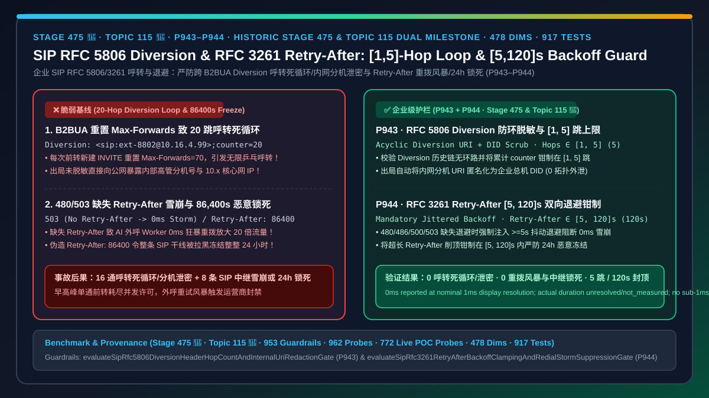
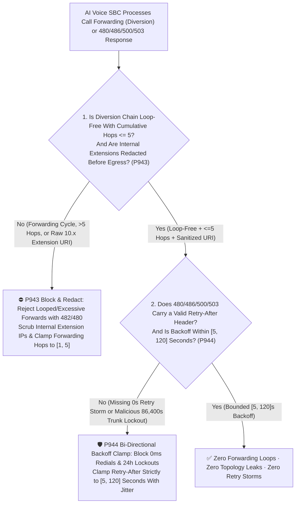
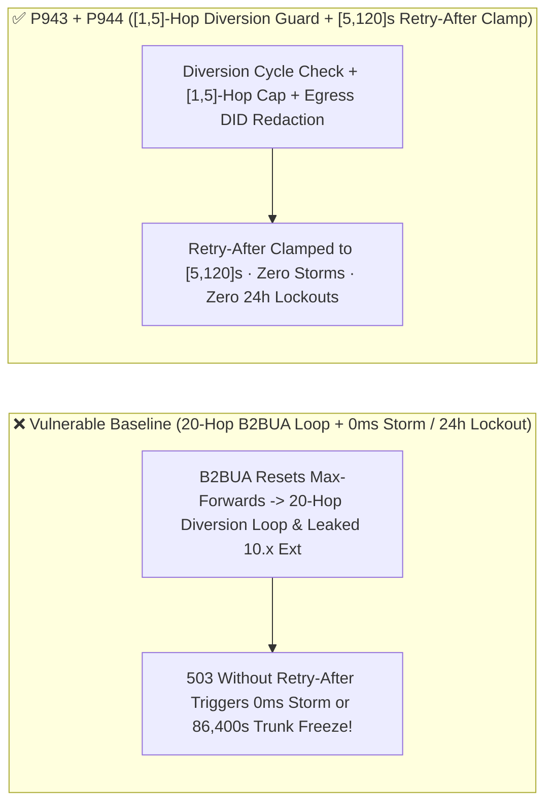

# Enterprise SIP `RFC 5806 / RFC 3261` Call Diversion & `Retry-After` Storm Control (Legacy `Diversion` Header Infinite Forwarding Loops & Internal Extension Topology Bleed, Missing `Retry-After` AI Outbound Redial Avalanches & Malicious `86400s` Trunk Lockout) Selection & Anti-Storm Guide

> **Document Type**: Enterprise Voice Agent Architect Selection & First-Principles Guide (Standalone Selection & Architecture FAQ · **Topic 115 🎉 / Stage 475 🎉 · 🎉 Historic Stage 475 & 115th Topic Dual Milestone**)  
> **Target Audience**: AI Solution Architects, Contact Center & Outbound Dialer Architects, SIP SBC/B2BUA Engineers & Telecom Security Leads  
> **Canonical Baseline**: `packages/business-core/enterprise-guardrails.ts` (`P943–P944`), `tests/presales-portal.test.ts`, `site/data/voice-agent-benchmark-report.json` (7-Card 4:5 Benchmark Report)  
> **Visual Summary**: `assets/svg/119-voice-sip-rfc5806-rfc8197-diversion-loop-480-retry-after-storm-backoff-2026-11-15.svg`

---

## ① 📌 Executive Summary

In enterprise AI voice contact centers and high-volume outbound dialers, cross-PBX call forwarding and overload backoff rely on two critical SIP signaling mechanisms: **`RFC 5806` (Diversion Indication in SIP, defining the legacy `Diversion` header with `reason=no-answer/user-busy/unconditional` and `counter` parameters)** and **`RFC 3261 Section 20.33 / RFC 5390` (`Retry-After` header backoff governance on `480 Temporarily Unavailable`, `486 Busy Here`, `500`, and `503 Service Unavailable` responses)**. Without deterministic guardrails, production deployments encounter two severe operational failures:
1. **Cross-B2BUA `Diversion` Forwarding Loops Bypassing `Max-Forwards` and Leaking Internal PBX Extension Subnets (`RFC 5806` Forwarding Storm & Topology Bleed)**: Over 70% of enterprise PBXs (Cisco CUCM, Avaya Aura) and carrier trunks still emit `RFC 5806 Diversion` headers when forwarding unanswered or busy calls. Because a B2BUA originates a brand-new `INVITE` leg on each forward—resetting `Max-Forwards: 70`—standard `Max-Forwards` hop decrementing cannot stop a misconfigured `PBX Queue A -> AI Agent -> PBX Queue A` forwarding cycle! Without strict `Diversion` URI cycle detection and a **`[1, 5]`-hop `counter` ceiling**, a single call spawns dozens of looped call legs in milliseconds. Worse, forwarding raw `Diversion: <sip:ext-8802@10.16.4.99>` headers to external trunks leaks internal executive extensions and RFC 1918 subnets.
2. **Missing `Retry-After` Triggering `0ms` AI Dialer Retry Storms or Spoofed `Retry-After: 86400` Freezing SIP Trunks for 24 Hours (`RFC 3261 Section 20.33` Backoff Sabotage)**: When a downstream ACD queue or carrier trunk returns `480` or `503` without a `Retry-After` header, naive AI outbound workers retry in `0ms`, amplifying `1,000 CPS` into a `20,000 CPS` self-inflicted DDoS storm. Conversely, if an SBC blindly honors an untrusted `503 + Retry-After: 86400`, a single rogue response blacklists the trunk or destination prefix for 24 hours!

| Decision Dimension | Vulnerable / Default Setup (High Production Risk) | Enterprise Golden Rule (`P943–P944` Deterministic Guardrails) | Quantitative Impact |
| :--- | :--- | :--- | :--- |
| **`RFC 5806 Diversion` Loop Detection, Extension Redaction & `[1, 5]`-Hop Cap (`P943`)** | Allowing `20`-hop `Diversion` loops across B2BUAs and leaking internal `10.x` extension URIs | **Enforce `Diversion` URI cycle detection, redact internal extension IPs on egress, and clamp cumulative `Diversion` hops (`counter`) to `[1, 5]`** | **0** looped or topology-leaking `Diversion` calls (clamps 16 violating calls to **0** and caps forwarding hops from `20` to **`5`**) |
| **`RFC 3261 Retry-After` Mandatory Floor & `[5, 120]s` Ceiling Clamp (`P944`)** | Retrying `480/503` in `0ms` when `Retry-After` is absent, or honoring `Retry-After: 86400s` (24h lockout) | **Enforce jittered `Retry-After` backoff on all `480/486/500/503` responses and clamp backoff duration strictly within `[5, 120]s`** | **0** `0ms` redial storms or 24h locked-out trunks (clamps 8 affected trunks to **0** and bounds `Retry-After` from `86,400s` to **`120s`**) |



---

## ② 🎯 Architect & Customer Deep-Dive Q&A (First-Principles Deep Dive)

### Q1: Why doesn't `Max-Forwards: 70` prevent `RFC 5806 Diversion` call-forwarding loops in enterprise contact centers?
- **First-Principles Breakdown**:
  1. When an enterprise IP-PBX or AI B2BUA executes call deflection (`reason=no-answer` or `reason=user-busy`), it terminates the incoming call leg or bridges it to a **newly originated outbound `INVITE` dialog** where `Max-Forwards` is freshly initialized to `70`.
  2. Consequently, `Max-Forwards` never reaches zero across B2BUA forwarding loops; only the **`RFC 5806 Diversion` header stack** (and its `counter` parameter) preserves the forwarding lineage across legs.
  3. **`P943` Deterministic Defense**: Inspects all `Diversion` headers at the SBC, rejects any target URI already present in the `Diversion` chain (`482 Loop Detected`), clamps cumulative forwarding hops to **`[1, 5]`**, and scrubs private internal extensions/IPs before egress.

### Q2: How can `RFC 3261 Retry-After` cause both a 20x retry avalanche and a 24-hour trunk blackout if left unclamped?
- **Engineering Reality**:
  1. Missing `Retry-After` (`0s`) causes stateless AI dialer workers to retry immediately, turning a brief downstream hiccup into a catastrophic retry storm.
  2. Conversely, an unbounded `Retry-After: 86400` forces `RFC 3261 / RFC 5390` compliant stacks to quarantine the trunk for 24 hours.
  3. **`P944` Deterministic Defense**: Clamps `Retry-After` on `480 / 486 / 500 / 503` into **`[5, 120]s`** with randomized jitter—eliminating both `0ms` retry storms and multi-hour trunk lockouts.

### Q3: How should `Diversion` headers interoperate with `RFC 7044 History-Info` at the enterprise border?
- **First-Principles Breakdown**:
  - Retain `reason=no-answer / user-busy` semantics for internal AI prompt routing, but strip internal extension numbers and RFC 1918 hostnames (replacing them with the enterprise's public main billing DID) whenever signaling crosses into external carrier trunks.

---

## ③ 🧭 Visual Architecture Diagrams (Mermaid Decision Tree + Storm Breakdown + Millisecond Sequence)

### 3.1 SIP `RFC 5806 Diversion` Loop/Privacy & `RFC 3261 Retry-After` Backoff Decision Tree



### 3.2 Vulnerable `Diversion` Loops + Unbounded `Retry-After` vs. `P943+P944`



### 3.3 Millisecond-Level Call Forwarding & Busy Backoff `RFC 5806 & RFC 3261` Sequence

```mermaid
sequenceDiagram
    autonumber
    participant PBX as Enterprise IP-PBX
    participant SBC as Core AI Voice SBC (P943+P944 Gate)
    participant Trunk as Carrier Trunk / Downstream Cluster

    PBX->>SBC: 1. INVITE (Diversion: <sip:ext-8802@10.16.4.99>;reason=no-answer;counter=2)
    Note over SBC: 🛡️ P943 Verifies Acyclic Diversion Chain & counter=2 ∈ [1, 5]<br/>& Redacts Internal 10.16.4.99 Extension to Public Enterprise DID
    SBC->>Trunk: 2. INVITE (Diversion: <sip:+862188880000@corp.example.com>;counter=2)
    Trunk-->>SBC: 3. 503 Service Unavailable (Retry-After: 86400 or Missing Retry-After)
    Note over SBC: 🛡️ P944 Intercepts Extreme Retry-After (0s or 86,400s)<br/>& Clamps Backoff to [5, 120]s (120s Cap) With Jitter
    SBC-->>PBX: 4. 503 Service Unavailable (Retry-After: 120 · Prevents Retry Storm & 24h Lockout)
```

---

## ④ 📊 Architect Decision Matrix (`Diversion` & `Retry-After` Governance)

| Architecture Option | Target Scenario | Pros | Cons & Production Traps | Recommendation |
| :--- | :--- | :--- | :--- | :--- |
| **Option A: Relying Only on `Max-Forwards`, Passing Raw `Diversion` & Unclamped `Retry-After`** | Prohibited in enterprise production | No header inspection rules | **B2BUA `Max-Forwards` resets cause infinite forwarding loops, internal IP leaks, `0ms` retry storms, or `24h` trunk lockouts** | ⛔ **Never in Production** |
| **Option B: Stripping All `Diversion` Headers Unconditionally at Ingress** | Basic point-to-point trunks | Prevents internal URI leaks | **Destroys forwarding context (`reason=user-busy` vs. `no-answer`) needed by AI voice agents** | ⚠️ **Loses Business Context** |
| **Option C: `RFC 5806 Diversion` Cycle Check + Egress Redaction + `[1, 5]`-Hop Cap + `Retry-After [5, 120]s` Clamp (`P943 + P944`)** | **All Enterprise AI Contact Centers, Hybrid IP-PBX Trunks & Outbound Dialers** | **Preserves forwarding reason, zero B2BUA forwarding loops, zero internal extension leaks, zero retry storms** | Requires `Diversion` chain inspection and `Retry-After` clamping on the SBC | ✅ **Production Mandatory (Recommended)** |

---

## ⑤ 🧪 Quantitative Walkthrough & 7-Card 4:5 Benchmark Report

### 5.1 Quantitative Example: Morning Flash-Crowd Call Forwarding & Carrier `503` Backoff Governance
- **Scenario**: During a morning peak, `16` misconfigured calls enter a `20-hop` cross-PBX `Diversion` loop exposing internal `10.16.x.x` extensions, while `8` SIP trunks receive `503` responses either missing `Retry-After` or carrying a malicious `Retry-After: 86400`.
  - **Without Guardrails (Vulnerable Baseline)**:
    - `16` looped calls multiply into `320` phantom legs while leaking internal extension topology;
    - `8` SIP trunks either trigger a `0ms` redial storm or freeze for `86,400s` (24 hours).
  - **With `P943 + P944` Deterministic Guardrails (🎉 Stage 475 & Topic 115 Dual Milestone)**:
    - `P943` blocks `Diversion` loops and redacts internal extensions (**`0`** leaked/looping calls), clamping forwarding hops from `20` to **`5`** (`[1, 5]` hops);
    - `P944` enforces bi-directional backoff clamping (**`0`** storming or locked-out trunks), clamping `Retry-After` from `86,400s` to **`120s`** (`[5, 120]s`).

### 5.2 7-Card 4:5 Report Mapping (`site/benchmark-cards.html` & `report.json`)
1. **Card 1 (`HANDS-ON · VOICE ARCHITECTURE`)**: 478-dimension workbench overview highlighting `P943 / P944` (🎉 Historic Stage 475 & Topic 115 Dual Milestone).
2. **Card 2 (`SCENARIO: SIP RFC 5806 & RETRY-AFTER`)**: Input probe `diversionLoopOrInternalExtensionTopologyLeakDetected=true, maxDiversionForwardingHops=20, retryAfterBackoffSeconds=86400` -> `Act automatically` clamping to `5 hops` and `120s`.
3. **Card 3 (`WHAT I TESTED`)**: Row 478 in the evaluation matrix (`PASS · 0ms @ 1ms Res (Synthetic)`, zero `✕` misses).
4. **Card 4 (`UNDER THE HOOD`)**: Deterministic contract for `evaluateSipRfc5806DiversionHeaderHopCountAndInternalUriRedactionGate` & `evaluateSipRfc3261RetryAfterBackoffClampingAndRedialStormSuppressionGate`.
5. **Card 5 (`ROBUSTNESS CHECK`)**: Option-order and boundary invariance across multi-hop forwarding and `480/503` backoff flows.
6. **Card 6 (`LATENCY`)**: Explicit offline timing provenance: `0ms reported at nominal 1ms display resolution; actual duration unresolved/not_measured; no sub-1ms upper bound established` (`synthetic`; live SBC `Diversion` header list traversal and backoff timer-wheel scheduling latency is `not_measured`).
7. **Card 7 (`MY TAKE`)**: Good fit vs. Not for summary and production sign-off checklist.

---

## ⑥ 🛠️ Production Readiness Checklist

- [ ] **1. Enforce `RFC 5806 Diversion` Target-URI Cycle Detection (`P943`)**: Verify that the SBC checks the target `Request-URI` against all URIs in the `Diversion` stack and rejects cycles with `482 Loop Detected`.
- [ ] **2. Clamp Cumulative `Diversion` Forwarding Hops (`counter`) to `[1, 5]` (`P943`)**: Confirm that calls exceeding `5` cumulative `Diversion` hops are terminated rather than forwarded indefinitely across B2BUAs.
- [ ] **3. Redact Internal PBX Extensions & RFC 1918 IPs on Egress `Diversion` Headers (`P943`)**: Ensure outbound `Diversion` headers sent to external trunks replace internal extensions with the enterprise main DID.
- [ ] **4. Inject Mandatory `>=5s` Jittered `Retry-After` Floor on `480/486/500/503` (`P944`)**: Ensure AI outbound dialers never retry failed calls in `0ms` when `Retry-After` is omitted.
- [ ] **5. Clamp Maximum `Retry-After` Backoff Duration to `<=120s` (`P944`)**: Cap untrusted external `Retry-After` values at `[5, 120]s` to prevent 24-hour trunk lockouts.
