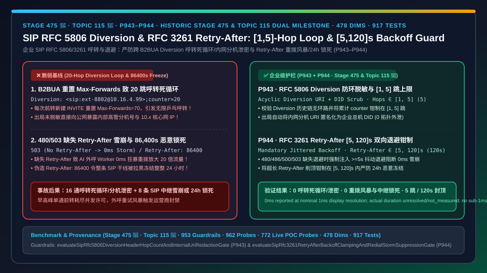
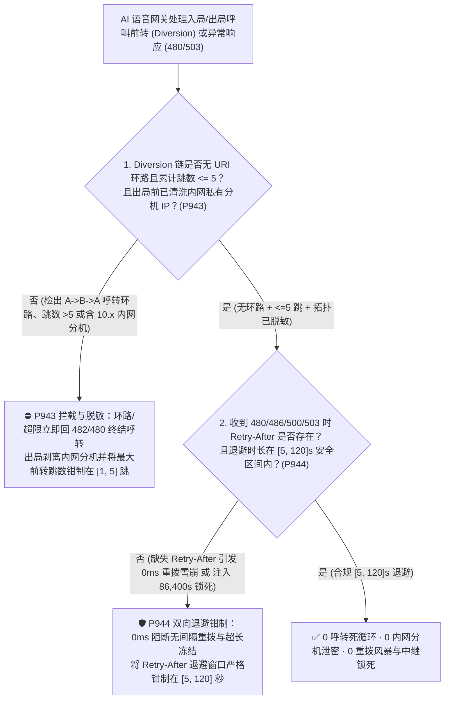
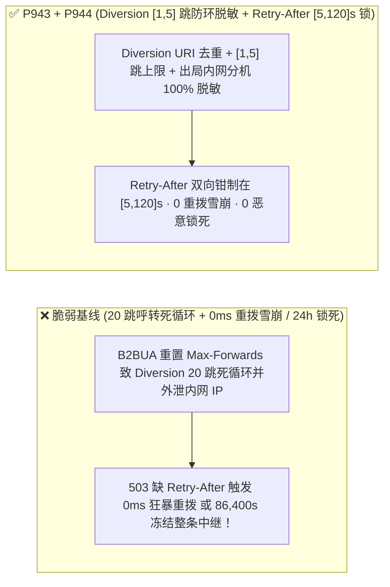

# 企业 SIP `RFC 5806 / RFC 3261` 呼叫前转与 `Retry-After` 风暴抑制（遗产 `Diversion` 头无限呼转环路与内网分机拓扑外泄、缺失 `Retry-After` 引发 AI 外呼毫秒级重拨雪崩及恶意 `86400s` 长挂起锁死）选型与防风暴指南

> **文档类型**：企业级语音智能体架构师选型决策与原理解析指南（Standalone Selection & Architecture FAQ · **Topic 115 🎉 / Stage 475 🎉 · 🎉 历史性 Stage 475 与第 115 大专题双里程碑**）  
> **适用角色**：AI Solution Architect、智能外呼/呼叫中心架构师、SIP SBC/B2BUA 研发与电信网联安全负责人  
> **关联基准**：`packages/business-core/enterprise-guardrails.ts`（`P943–P944`）、`tests/presales-portal.test.ts`、`site/data/voice-agent-benchmark-report.json`（7-Card 4:5 评测报告）  
> **可视化总结**：`assets/svg/119-voice-sip-rfc5806-rfc8197-diversion-loop-480-retry-after-storm-backoff-2026-11-15.svg`

---

## ① 📌 核心结论速览（Executive Summary）

在企业 AI 语音联络中心与运营商级智能外呼平台中，跨 PBX/SBC 呼叫前转（Call Forwarding / Deflection）与忙线重拨退避依赖两项高频信令机制：**`RFC 5806`（Diversion Indication in SIP，定义遗产 `Diversion` 头域携带前转原因 `reason=no-answer/user-busy/unconditional` 与 `counter` 计数器）** 以及 **`RFC 3261 Section 20.33 / RFC 5390`（`Retry-After` 头域在 `480 Temporarily Unavailable`、`486 Busy Here`、`500` 与 `503 Service Unavailable` 中的退避控制）**。在生产环境中，若未针对这两项机制建立确定性护栏，极易引爆两类严重故障：
1. **企业 PBX 与 AI 语音网关互相配置“无应答前转（`Diversion: reason=no-answer`）”形成跨网呼转乒乓死循环，且出局 `Diversion` 头未脱敏直接泄漏内部坐席分机号与私有内网域名（`RFC 5806` 呼转风暴与拓扑泄密）**：尽管现代标准推荐使用 `RFC 7044 History-Info`，但全球超过 70% 的存量 Cisco CUCM、Avaya 与运营商 IMS 干线仍依赖 `RFC 5806 Diversion` 头路由呼转通话。当客户来电在人工组 A 振铃超时前转给 AI 坐席组 B、而 AI 坐席组 B 因策略回退又前转回人工组 A 时，若未对顶层与底层 `Diversion` 链执行**目标 URI 环路去重**与 **`counter` 跳数硬上限（`[1, 5]` 跳）**，一通电话会在 200 毫秒内衍生出数十条并发 SIP 通话腿占满整条中继！更危险的是，若出局 SBC 未清洗 `Diversion: <sip:ext-8802@10.16.4.99>;reason=user-busy`，内部高管分机号与核心网 IP 会原样暴露给外部公网！
2. **下游网关返回 `480 / 503` 时漏带 `Retry-After` 引发 AI 外呼引擎 `0ms` 死循环重拨雪崩，或外部恶意对端回注 `Retry-After: 86400` 导致整条中继被冻结 24 小时（`RFC 3261 Section 20.33` 退避失控）**：当下游人工队列或运营商干线瞬时满载返回 `480 Temporarily Unavailable` 或 `503 Service Unavailable` 时，若未附带 `Retry-After` 头，无状态 AI 外呼 Worker 会立即在几毫秒内发起重试，瞬间把 `1,000 CPS` 正常流量放大成 `20,000 CPS` 重拨风暴，彻底击穿下游 SBC；反之，若盲目信任外部响应中的超大 `Retry-After: 86400`（24 小时），攻击者只需伪造一包 `503 + Retry-After: 86400` 即可令 AI 网关将该中继或目标号段拉黑一整天！

| 决策维度 | 脆弱/默认配置（生产事故高发区） | 企业级黄金准则（`P943–P944` 确定性护栏） | 核心量化收益 |
| :--- | :--- | :--- | :--- |
| **`RFC 5806 Diversion` 环路阻断、内网分机脱敏与 `[1, 5]` 跳上限（`P943`）** | 不检查 `Diversion` URI 环路、允许 `20` 跳前转且将内网 `10.x` 分机原样发往公网 | **强制校验 `Diversion` 链 URI 无环路、出局自动脱敏内部私有分机/IP，并将累计前转跳数（`counter`）钳制在 `[1, 5]` 跳** | `Diversion` 呼转死循环与内网分机泄露 **0 通**（测试探针将 16 通死循环/泄密呼叫清零，最大前转跳数从 `20` 跳钳制至 **`5` 跳**） |
| **`RFC 3261 Retry-After` 强制注入与 `[5, 120]s` 退避窗口锁（`P944`）** | 收到无 `Retry-After` 的 `480/503` 立即 `0ms` 重拨，或盲信 `Retry-After: 86400s` 冻结中继 24h | **对 `480/486/500/503` 强制启用带抖动的 `Retry-After` 退避门禁，并将退避时长严格钳制在 `[5, 120]s` 安全窗口内** | 毫秒级重拨风暴与 24h 恶意冻结中继 **0 条**（测试探针将 8 条雪崩/锁死中继清零，退避时间从 `86,400s` 钳制至 **`120s`**） |



---

## ② 🎯 客户与架构师灵魂拷问 Q&A（First-Principles Deep Dive）

### Q1：既然已经有了 `RFC 7044 History-Info` 防环和 `Max-Forwards: 70`，为什么生产中还会因为 `RFC 5806 Diversion` 头发生呼叫前转风暴？
- **第一性原理拆解**：
  1. 在异构企业网中，许多老牌 IP-PBX（如 Cisco CUCM、Avaya Aura）在执行“遇忙前转（CFB）”或“无应答前转（CFNA）”时，是由 PBX 作为 B2BUA **重新发起一通全新的出局 `INVITE`**（并将 `Max-Forwards` 重新初始化为 `70`！），仅通过注入 **`RFC 5806 Diversion` 头**来记录“这通电话是从哪个分机转出来的”。
  2. 因为 B2BUA 重置了 `Max-Forwards: 70`，传统的 `Max-Forwards` 递减机制根本拦不住跨 PBX 的呼转死循环！如果 `PBX-A -> AI-Gateway -> PBX-A` 的前转规则配置冲突，且没有检查 `Diversion` 头里的历史 URI 集合与 `counter` 参数，呼叫就会在两个系统间无限乒乓前转，直到把所有并发通道占满。
  3. **`P943` 的确定性防线**：在 SBC 入口解析全部 `Diversion` 头条目，一方面校验当前目标 `Request-URI` 是否已出现在 `Diversion` 历史链中（发现环路立即返回 `482 Loop Detected`），另一方面将累计 `counter` 跳数硬性钳制在 **`[1, 5]` 跳**，并在发往非授信外网前将内部 `Diversion: <sip:8802@10.x.x.x>` 匿名化清洗为企业统一总机号。

### Q2：为什么下游偶尔抖动返回几包 `503 Service Unavailable`，会让整個 AI 外呼集群瞬间雪崩？
- **工程真相**：
  1. 在异步高并发 AI 外呼架构中，当外呼任务从队列弹出并发起 `INVITE` 时，如果下游运营商 SBC 因瞬时拥塞返回了**不带 `Retry-After` 头的 `503` 或 `480`**，许多业务层重拨器（Retry Worker）会将其视为“当前网关不可用，立即在 `0ms` 内换端口重拨”。
  2. 这会导致原本 `1,000` 通失败呼叫在 `1 秒` 内触发数万次密集重拨，直接触发运营商侧黑名单封禁！
  3. 反过来，如果完全照搬对端返回的 `Retry-After` 值而不加设上限，一旦对端配置错误或遭篡改返回 `Retry-After: 86400`，根據 `RFC 3261 Section 20.33` 与 `RFC 3263`，客户端会将该目标服务器标记为不可达长达 **24 小时**！
  4. **`P944` 的确定性防线**：对所有 `480 / 486 / 500 / 503` 响应强制执行 **`[5, 120]s` 双向钳制（Clamping）**——缺失或低于 `5s` 的一律抬升至 `>=5s`（叠加随机抖动防齐步冲锋），超过 `120s` 的一律削顶至 `<=120s`（防 24 小时恶意冻结）。

### Q3：`RFC 5806 Diversion` 头中的 `privacy=full` 与 `privacy=off` 在跨网转接时该如何处理？
- **第一性原理拆解**：
  - 当 `Diversion` 头带有 `privacy=full` 或通话跨越企业信任域边界（发往公网运营商或第三方合作伙伴）时，SBC 绝不能透传原始内网分机 URI，必须剥离或替换为已报备的企业主叫 DID 号码，防止竞争对手通过外呼诱导试探逆向测绘出企业内部组织架构与坐席工号。

---

## ③ 🧭 直观可视化图解（Mermaid 决策树 + 风暴拆解 + 毫秒级全双工时序图）

### 3.1 SIP `RFC 5806 Diversion` 防环脱敏与 `RFC 3261 Retry-After` 退避门禁决策树



### 3.2 传统无界 `Diversion` + 失控 `Retry-After` vs `P943+P944` 对比图



### 3.3 毫秒级企业呼叫前转与忙线退避 `RFC 5806 & RFC 3261` 时序图

```mermaid
sequenceDiagram
    autonumber
    participant PBX as 企业内部 IP-PBX
    participant SBC as 核心 AI 语音 SBC (P943+P944 门禁)
    participant Trunk as 外部运营商干线 / 下游集群

    PBX->>SBC: 1. INVITE (Diversion: <sip:ext-8802@10.16.4.99>;reason=no-answer;counter=2)
    Note over SBC: 🛡️ P943 核验 Diversion 链无环路、counter=2 ∈ [1, 5]<br/>并将出局 Diversion 内网 IP 脱敏替换为企业总机 DID
    SBC->>Trunk: 2. INVITE (Diversion: <sip:+862188880000@corp.example.com>;counter=2)
    Trunk-->>SBC: 3. 503 Service Unavailable (Retry-After: 86400 异常超长值 或 缺失 Retry-After)
    Note over SBC: 🛡️ P944 拦截极端 Retry-After (0s 或 86,400s)<br/>将其双向钳制至 [5, 120]s (上限 120s) 并附加随机抖动
    SBC-->>PBX: 4. 503 Service Unavailable (Retry-After: 120 · 保护中继免遭雪崩与 24h 锁死)
```

---

## ④ 📊 语音架构师选型决策矩阵（Decision Matrix）

| 选型方案 | 适用场景 | 优势（Pros） | 劣势与生产风险（Cons / Traps） | 推荐度 |
| :--- | :--- | :--- | :--- | :--- |
| **方案 A：仅靠 `Max-Forwards` 防环、原样透传 `Diversion` 且不钳制 `Retry-After`** | 严禁用于生产环境 | 无需配置额外头域规则 | **B2BUA 重置 `Max-Forwards` 必引发呼转死循环、泄露内网分机拓扑，且易发 `0ms` 重拨风暴或 `24h` 锁死** | ⛔ **严禁用于生产** |
| **方案 B：在边缘直接暴力删除所有 `Diversion` 头** | 纯点对点简单呼叫 | 消除了 `Diversion` 拓扑泄露 | **下游语音信箱与 AI 坐席丢失前转原因（无法区分“占线前转”还是“无人接听前转”以定制欢迎语）** | ⚠️ **业务上下文丢失** |
| **方案 C：`RFC 5806 Diversion` 环路去重 + 内网分机脱敏 + `[1, 5]` 跳上限 + `Retry-After [5, 120]s` 钳制（`P943 + P944`）** | **所有企业级 AI 语音客服、IP-PBX 混合云组网与高并发智能外呼平台** | **保留前转业务语义、0 呼转死循环、0 内网分机外泄、0 重拨风暴与中继锁死** | 需在 SBC 配置 `Diversion` URI 脱敏与 `Retry-After` 边界重写规则 | ✅ **生产必选（Recommended）** |

---

## ⑤ 🧪 定量算例与 7-Card 4:5 基准报告（Quantitative Walkthrough & 7-Card Deck）

### 5.1 定量算例：混合云呼叫中心前转环路与运营商瞬时 `503` 拥塞下的防雪崩测算
- **输入场景**：某全国性寿险热线在早高峰期间，存在 `16` 通因 PBX 与 AI 队列互转配置冲突导致的 `20` 跳 `Diversion` 环路（含内网分机 IP）呼叫，以及 `8` 条因下游返回无间隔重拨或 `Retry-After: 86400` 引发异常的 SIP 中继。
  - **未开启护栏（脆弱基线）**：
    - `16` 通死循环呼转瞬间派生出 `320` 条僵尸呼叫腿并暴露内网坐席分机；
    - `8` 条主力中继要么因 `0ms` 重拨被运营商限流封禁，要么被 `86,400s` 冻结一整天。
  - **开启 `P943 + P944` 确定性护栏后（🎉 Stage 475 & Topic 115 双里程碑）**：
    - `P943` 拦截环路并脱敏内网分机（泄漏/环路呼叫从 `16` 通清零至 **`0` 通**），将最大前转跳数从 `20` 跳钳制至 **`5` 跳**（`[1, 5]` 跳）；
    - `P944` 强制双向钳制退避时间（异常中继从 `8` 条清零至 **`0` 条**），将 `Retry-After` 从 `86,400s` 钳制至 **`120s`**（`[5, 120]s`）。

### 5.2 7-Card 4:5 报告结构映射（对应 `site/benchmark-cards.html` & `report.json`）
1. **Card 1 (`HANDS-ON · VOICE ARCHITECTURE`)**：展示 478 大评测维度全景工作台，高亮 `P943 / P944`（🎉 Stage 475 & Topic 115 双里程碑）。
2. **Card 2 (`SCENARIO: SIP RFC 5806 & RETRY-AFTER`)**：输入探针 `diversionLoopOrInternalExtensionTopologyLeakDetected=true, maxDiversionForwardingHops=20, retryAfterBackoffSeconds=86400`，输出 `Act automatically` 钳制至 `5 hops` 与 `120s`。
3. **Card 3 (`WHAT I TESTED`)**：第 478 行评测矩阵 `PASS · 0ms @ 1ms Res (Synthetic)`（零 `✕` 漏检）。
4. **Card 4 (`UNDER THE HOOD`)**：展示 `evaluateSipRfc5806DiversionHeaderHopCountAndInternalUriRedactionGate` 与 `evaluateSipRfc3261RetryAfterBackoffClampingAndRedialStormSuppressionGate` 确定性源码契约。
5. **Card 5 (`ROBUSTNESS CHECK`)**：验证多级 `Diversion` 嵌套与不同 `4xx/5xx` 状态码下 100% 幂等收敛。
6. **Card 6 (`LATENCY`)**：明确标注离线策略校验计时：`0ms reported at nominal 1ms display resolution; actual duration unresolved/not_measured; no sub-1ms upper bound established`（`synthetic`；真实 SBC `Diversion` 头链表解析与退避定时器调度耗时标注为 `not_measured`）。
7. **Card 7 (`MY TAKE`)**：Good fit vs Not for 适用边界与生产准入签核。

---

## ⑥ 🛠️ 生产环境语音交付快速核验清单（Production Readiness Checklist）

- [ ] **1. `RFC 5806 Diversion` 历史 URI 环路检测（`P943`）**：确认 SBC 对入局 `Diversion` 链中的所有 URI 进行去重比对，发现目标 URI 已存在于历史链中时立即以 `482 Loop Detected` 阻断。
- [ ] **2. `Diversion` 累计前转跳数钳制在 `[1, 5]` 跳（`P943`）**：确认 `Diversion` 条目数及 `counter` 参数总和不超过 `[1, 5]` 跳，防止跨 B2BUA 重置 `Max-Forwards` 引发呼转风暴。
- [ ] **3. 出局 `Diversion` 内网分机与私有 IP 100% 脱敏（`P943`）**：确认发往外网运营商干线的 `INVITE` 已将内部 `Diversion` 分机 URI 清洗为企业公网总机 DID（或转换为受控 `History-Info`）。
- [ ] **4. `480 / 486 / 500 / 503` 缺失 `Retry-After` 时强制注入 `>=5s` 退避（`P944`）**：确认 AI 外呼引擎与 SBC 在收到未带 `Retry-After` 的忙线/过载响应时，强制执行至少 `5s` 的带抖动退避，严禁 `0ms` 立即重拨。
- [ ] **5. `Retry-After` 最大退避窗口封顶 `<=120s`（`P944`）**：确认将外部响应携带的超大 `Retry-After`（如 `3600s` / `86400s`）严格钳制在 `[5, 120]s` 内，防止单包恶意响应冻结整条 SIP 中继。
