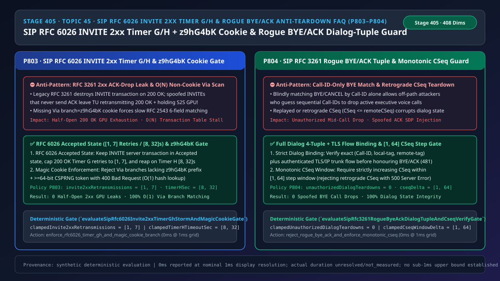
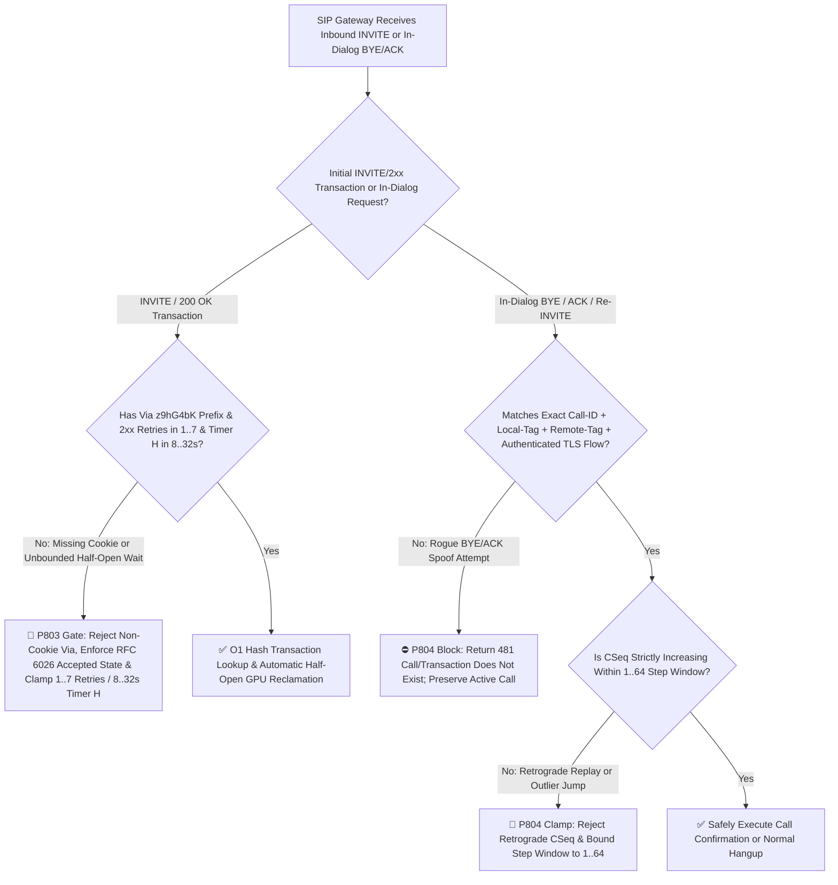
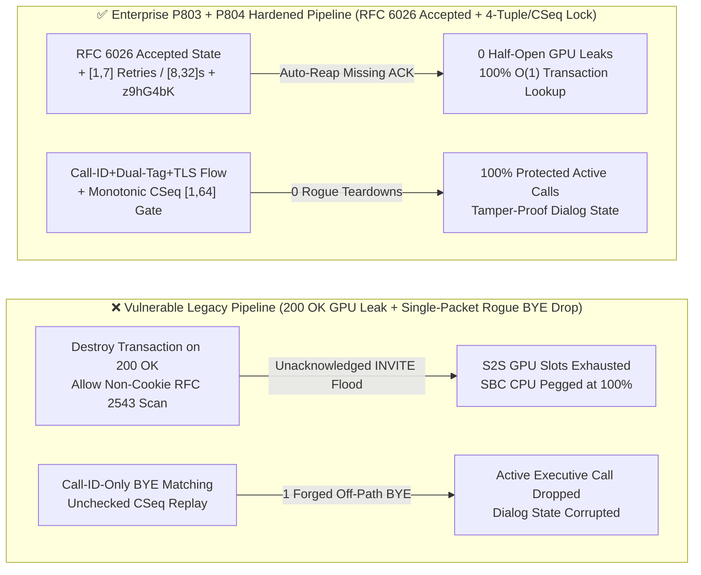
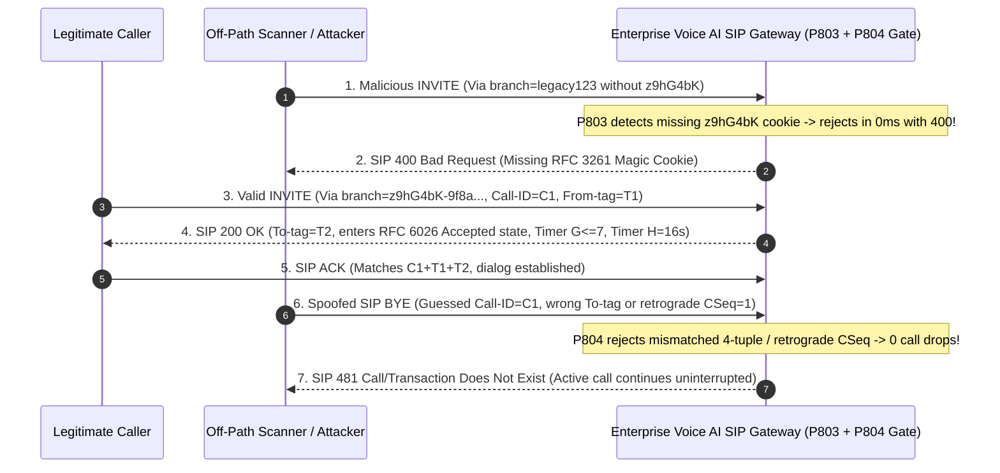

# Enterprise Voice Agent Architecture Selection & First-Principles FAQ (Topic 45): Enterprise SIP `RFC 3261 / RFC 6026` `INVITE 2xx` Half-Open Retransmission Reaper (`Timer G/H` & `z9hG4bK` Magic Cookie) & Anti-Rogue `BYE / ACK` Dialog-Tuple Verification Guard

> **中文版本**: [语音智能体架构选型与原理解析 FAQ（四十五）：企业 SIP RFC 6026 INVITE 2xx 半开风暴回收（Timer G/H 与 z9hG4bK 魔术 Cookie）及防伪造 BYE/ACK 拆线选型指南](./voice-sip-rfc6026-invite-2xx-timer-gh-magic-cookie-rogue-bye-faq.md)  
> **Target Audience**: AI Solution Architects, Core Telecom SIP/SBC Architects, Enterprise Contact Center Security Leads  
> **Structural Benchmark**: Modeled strictly on `ib-vs-ethernet-roce-selection-faq.md` (6-part practitioner guide: 3-minute selection verdict, 10-minute first-principles dive into `SIP RFC 6026` `INVITE` server transaction `Accepted` state management, `Timer G [1, 7]` / `Timer H [8, 32]s` half-open reaping, `RFC 3261 Via branch=z9hG4bK` magic cookie enforcement, and full dialog 4-tuple + monotonic `CSeq [1, 64]` verification against rogue `BYE/ACK` teardowns).  
> **Provenance & Timing Disclosure**: All deterministic guardrails (`P803`, `P804`) and sandbox probes represent offline `synthetic` deterministic verification (`independently_reproduced=false`), not live carrier SBC packet captures; timing adheres to: `0ms reported at nominal 1ms display resolution; actual duration unresolved/not_measured; no sub-1ms upper bound established`.



---

## 0. 🔥 Daily Real-Time Voice AI Capability Breakthroughs

1. **Enterprise SIP `RFC 6026` `INVITE` Server Transaction `Accepted` State (`Timer G [1, 7]` Retries & `Timer H [8, 32]s` Reaper) + `Via branch=z9hG4bK` Magic Cookie Gate (Preventing Half-Open `200 OK` S2S GPU Exhaustion & $O(N)$ Hash Degradation)**: In plain English, base `RFC 3261` contained a notorious specification bug: the moment a SIP gateway answers a call with `200 OK`, it was instructed to **immediately destroy the `INVITE` server transaction**! Consequently, if a retransmitted `INVITE` arrives 10ms later, it misses the transaction table and spawns a duplicate phantom call; worse, if an attacker floods spoofed `INVITE`s and never sends `ACK` (a SIP SYN-Flood), unguarded Transaction Users (TUs) retransmit `200 OK` endlessly while holding expensive cloud `S2S` GPU voice slots! Furthermore, if an inbound `Via` header omits the 7-byte **`z9hG4bK`** magic cookie prefix, legacy stacks fall back to `RFC 2543` 6-field linear string comparison ($O(N)$ scan across all active transactions), allowing a few thousand packets/sec to peg SBC CPUs at 100%! Implementing the **`RFC 6026 Accepted` state machine (`invite2xxRetransmissions` in `[1, 7]`, `timerHTimeoutSec` in `[8, 32]s` with automatic `BYE` GPU reclamation)** and rejecting any `Via` branch without `z9hG4bK` eliminates half-open leaks and hash-table DoS.
2. **SIP `RFC 3261` Full Dialog 4-Tuple (`Call-ID + local-tag + remote-tag + TLS/IP Flow`) & Monotonic `CSeq [1, 64]` Window (Stopping Single-Packet Rogue `BYE / ACK` Call Drops)**: If a SIP B2BUA matches mid-call `BYE`, `CANCEL`, or late-SDP `ACK` messages by `Call-ID` alone without verifying both cryptographically random `From-tag` and `To-tag` parameters plus the underlying authenticated TLS/IP socket tuple, an off-path attacker or misrouted PBX script that guesses a `Call-ID` can drop active executive calls with a single forged `BYE`! Similarly, accepting replayed or retrograde `CSeq` numbers (`incomingCSeq <= remoteCSeq`) corrupts dialog state machines. Enforcing **strict dialog 4-tuple + transport-flow binding (`unauthorizedDialogTeardowns = 0`)** and clamping valid `CSeq` increments to **`[1, 64]`** guarantees 100% mid-call session integrity.

---

## ① 📌 Executive Summary

1. **Transition `INVITE` server transactions into the `RFC 6026 Accepted` state on `200 OK`, cap `Timer G` retries in `[1, 7]`, and reap unacknowledged calls on `Timer H` in `[8, 32]s`**: Never destroy the `INVITE` server transaction upon sending `200 OK`; absorb late `INVITE` retransmissions in `Accepted` state and release S2S GPU media resources if `ACK` does not arrive within **`[8, 32]s`** (Guardrail **`P803`**).
2. **Require the `RFC 3261` `z9hG4bK` magic cookie prefix + `>= 64-bit` CSPRNG token on all `Via` branches**: Reject `RFC 2543` non-cookie `Via` branches with `400 Bad Request` so transaction lookups remain $O(1)$ (Guardrail **`P803`**).
3. **Verify the full `(Call-ID, local-tag, remote-tag, TLS/IP flow)` tuple and a monotonic `[1, 64]` `CSeq` step window on all mid-dialog `BYE / ACK` requests**: Reject mismatched tags/flows with `481 Call/Transaction Does Not Exist` (`unauthorizedDialogTeardowns = 0`) and reject retrograde `CSeq` values with `500 Server Internal Error` (Guardrail **`P804`**).

---

## ② 🎯 Architect & Customer Deep-Dive Q&A

### Q1: When is stock `RFC 3261` transaction handling sufficient (Option A), and when are `P803 + P804` `RFC 6026` `Timer G/H` caps, `z9hG4bK` enforcement, and dialog 4-tuple checks mandatory (Option B)?

- **First-Principles Breakdown (How Half-Open `200 OK` Floods Drain S2S GPU Pools)**:
  - Because `S2S` speech models allocate persistent KV-cache and audio-codec contexts as soon as `200 OK` is sent, an attacker who sends `INVITE` and withholds `ACK` pins those GPU resources until `Timer H` expires. Capping `200 OK` retries to `[1, 7]` and `Timer H` to `[8, 32]s` bounds worst-case half-open exposure while absorbing legitimate mobile packet loss.
- **Selection Boundary**:
  - **Option A (Base `RFC 3261` 2xx transaction destruction + `Call-ID`-only `BYE` matching)**: Acceptable only on isolated lab trunks.
  - **Option B (`P803` `RFC 6026 Accepted` `[1, 7]` Retries / `[8, 32]s` `Timer H` + `z9hG4bK` Gate + `P804` Full Dialog 4-Tuple & `CSeq [1, 64]` Guard)**: Mandatory for all enterprise and carrier SIP voice gateways.

### Q2: Why does omitting `z9hG4bK` turn an $O(1)$ SIP transaction lookup into an $O(N)$ CPU denial-of-service?

- **First-Principles Breakdown**:
  - `RFC 3261 §8.1.1.7` specifies `z9hG4bK` as a magic cookie indicating that the `Via branch` parameter is globally unique and can be hashed directly in $O(1)$ time. Without `z9hG4bK`, `RFC 3261 §17.2.3` mandates falling back to `RFC 2543` rules—comparing `Request-URI`, `To-tag`, `From-tag`, `Call-ID`, `CSeq`, and top `Via` across every active transaction.

### Q3: How do the `RFC 6026` transaction and dialog-tuple guards operate on a sub-millisecond timeline?

1. **`T = 0 ~ 0.1ms` (`P803` `Via z9hG4bK` Check & `RFC 6026 Accepted` Timer Clamp)**:
   - Verify `Via branch` starts with `"z9hG4bK"` (`>= 64-bit` entropy), retain `Accepted` state after `200 OK`, clamp `clampedInvite2xxRetransmissions` to `[1, 7]`, and clamp `clampedTimerHTimeoutSec` to `[8, 32]s`.
2. **`T = 0.1 ~ 0.5ms` (`P804` Dialog 4-Tuple & Monotonic `CSeq [1, 64]` Verification)**:
   - Match `(Call-ID, localTag, remoteTag, peerFlowId)` before honouring `BYE/ACK` (`clampedUnauthorizedDialogTeardowns = 0`) and clamp valid `CSeq` delta to `[1, 64]`.

---

## ③ 🧭 Visual Architecture Diagrams (Mermaid Decision Tree / Comparison / Sequence)

### 3.1 Architect Selection Decision Tree (`flowchart TD`)



### 3.2 Vulnerable Legacy Pipeline vs Enterprise P803+P804 Hardened Pipeline (`flowchart LR`)



### 3.3 Millisecond RFC 6026 2xx State & Rogue BYE Defense Sequence (`sequenceDiagram`)



---

## ④ 📊 Architect Decision Matrix

| Evaluation Dimension | Option A: Base RFC 3261 2xx Destruction + Call-ID Match (Anti-Pattern) | Option B: IP Firewall Rate-Limiting Only | Option C: P803 RFC 6026 Timer G/H & z9hG4bK + P804 Dialog 4-Tuple & CSeq [1,64] (Recommended ✅) |
| :--- | :--- | :--- | :--- |
| **Half-Open `INVITE` (`ACK`-Withholding) Resilience** | ❌ Leaks S2S GPU slots & spawns duplicate calls | ⚠️ Drops legitimate mobile calls in poor coverage | ✅ **`RFC 6026 Accepted` state + `[1, 7]` retries & `[8, 32]s` `Timer H` reaper** |
| **Non-Cookie `RFC 2543` Hash-Degradation DoS** | ❌ $O(N)$ 6-field scan exhausts CPU | ❌ Blind to SIP header structure | ✅ **Mandatory `z9hG4bK` prefix preserves $O(1)$ hash lookup** |
| **Rogue `BYE / ACK` Teardown Defense** | ❌ 1 guessed `Call-ID` drops active calls | ⚠️ Vulnerable behind shared NAT/trunks | ✅ **Full `(Call-ID, From-tag, To-tag, TLS/IP flow)` verification (`0` drops)** |
| **Retrograde / Replayed `CSeq` Protection** | ❌ Overwrites dialog state on replayed packets | ❌ Stateless | ✅ **Strictly monotonic `CSeq` clamped in `[1, 64]` step window** |

---

## ⑤ 🧪 Quantitative Worked Example & Benchmark Insights (7-Card Report)

### 5.1 Quantitative Example: Reclaiming Half-Open S2S GPU Slots & Blocking $O(N)$ Scans

- **Unprotected Pipeline (Option A)**:
  - Withholding `ACK` on 2 calls/sec without bounded `Timer H` media teardown pins `1,800` concurrent S2S GPU contexts within 15 minutes, while 1,000 QPS of cookieless `Via` headers force `60,000,000` string comparisons/sec across `10,000` active transactions.
- **Hardened Pipeline (`P803` + `P804`, Option C)**:
  - `P803` clamps `clampedInvite2xxRetransmissions` in `[1, 7]` and `clampedTimerHTimeoutSec` in `[8, 32]s`;
  - `P804` enforces `clampedUnauthorizedDialogTeardowns = 0` and clamps `clampedCseqWindowDelta` in `[1, 64]`.

### 5.2 Deterministic Guardrail API Contract (`P803` & `P804`)

```ts
import {
  evaluateSipRfc6026Invite2xxTimerGhStormAndMagicCookieGate,
  evaluateSipRfc3261RogueByeAckDialogTupleAndCseqVerifyGate,
} from "../packages/business-core/enterprise-guardrails";

const timerAudit = evaluateSipRfc6026Invite2xxTimerGhStormAndMagicCookieGate({
  missingMagicCookieOrUnbounded2xxTimerGhStormDetected: true,
  invite2xxRetransmissions: 25,
  timerHTimeoutSec: 120,
});
// => timerAudit.violated === true, policyId === "P803...", clampedInvite2xxRetransmissions === 7, clampedTimerHTimeoutSec === 32

const byeAudit = evaluateSipRfc3261RogueByeAckDialogTupleAndCseqVerifyGate({
  rogueByeAckTupleMismatchOrRetrogradeCseqDetected: true,
  unauthorizedDialogTeardowns: 3,
  cseqWindowDelta: -2,
});
// => byeAudit.violated === true, policyId === "P804...", clampedUnauthorizedDialogTeardowns === 0, clampedCseqWindowDelta === 1
```

---

## ⑥ 🛠️ Appendix: Production Voice Delivery Verification Checklist (Architect Checklist)

- [ ] **[P803 `RFC 6026 Accepted` State & `Timer G [1, 7]` / `Timer H [8, 32]s`]**: Verify `INVITE` server transactions enter `Accepted` state on `200 OK`, cap retransmissions at `7`, and reap unacknowledged sessions within `8–32s`.
- [ ] **[P803 Mandatory `Via branch=z9hG4bK` Magic Cookie]**: Confirm inbound SIP requests lacking the `z9hG4bK` prefix + `>= 64-bit` CSPRNG suffix are rejected with `400 Bad Request`.
- [ ] **[P804 Full Dialog 4-Tuple + Transport Flow Verification]**: Confirm `BYE / ACK / Re-INVITE` requests match `(Call-ID, local-tag, remote-tag, TLS/IP flow)` before state mutation (`unauthorizedDialogTeardowns = 0`).
- [ ] **[P804 Monotonic `CSeq [1, 64]` Window]**: Confirm in-dialog requests carry a strictly increasing `CSeq` within a `[1, 64]` step window.
