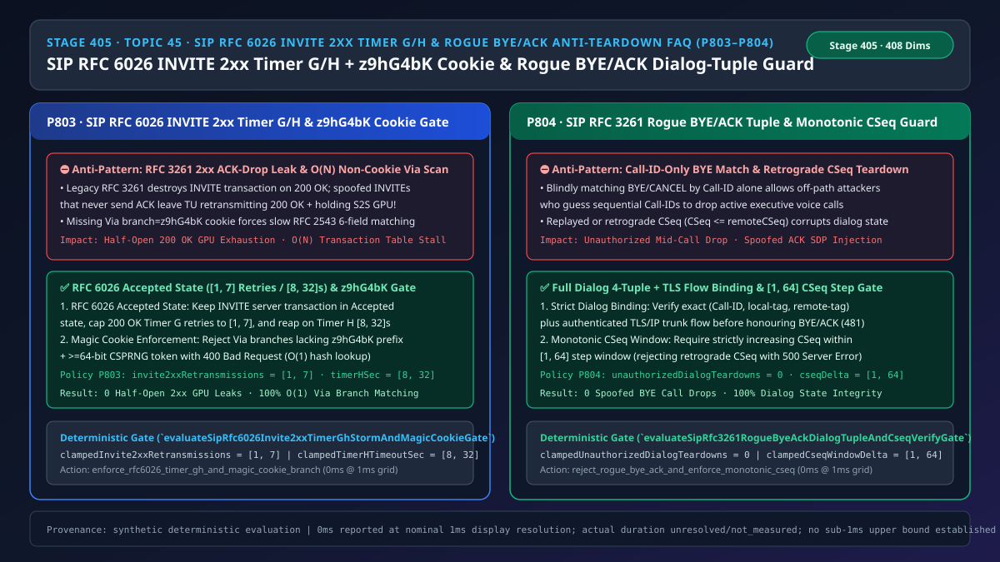
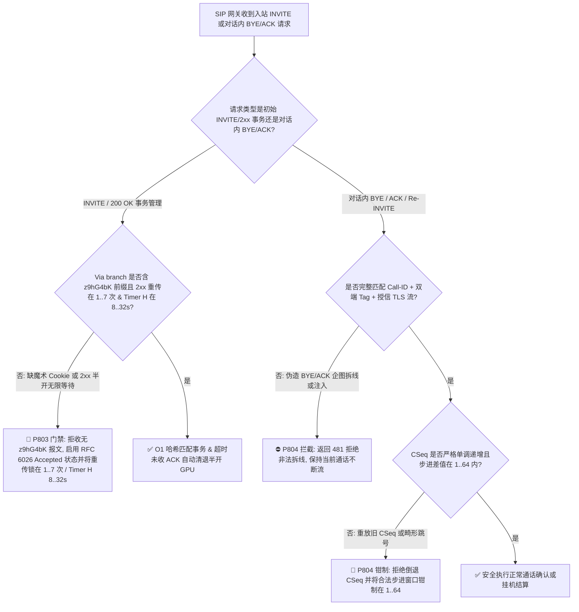
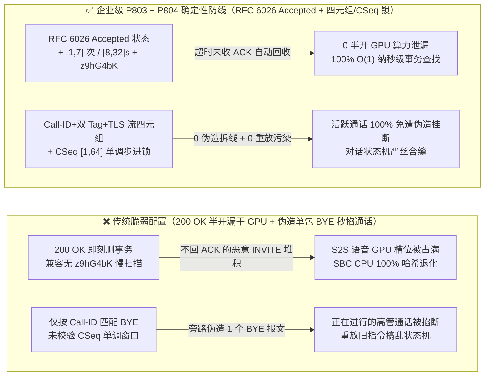
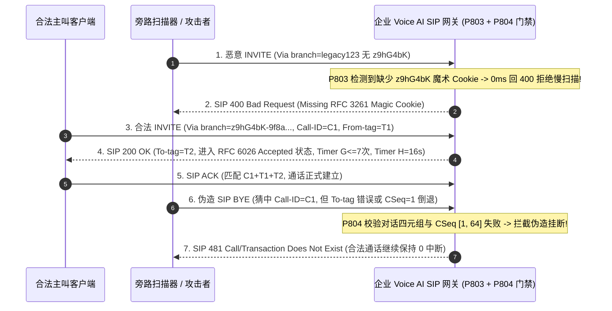

# 语音智能体架构选型与原理解析 FAQ（四十五）：企业 SIP RFC 6026 INVITE 2xx 半开风暴回收（Timer G/H 与 z9hG4bK 魔术 Cookie）及防伪造 BYE/ACK 拆线选型指南

> **English Version**: [Enterprise SIP `RFC 3261 / RFC 6026` `INVITE 2xx` Half-Open Retransmission Reaper (`Timer G/H` & `z9hG4bK` Magic Cookie) & Anti-Rogue `BYE / ACK` Dialog-Tuple Verification Selection FAQ (Topic 45 · Stage 405)](./voice-sip-rfc6026-invite-2xx-timer-gh-magic-cookie-rogue-bye-faq.en.md)  
> **适用角色**：AI Solution Architect（AI 解决方案架构师）、核心网 SIP/SBC 架构师、企业联络中心安全负责人  
> **对标范式**：严格遵循 `ib-vs-ethernet-roce-selection-faq.md` 六段式实战导引结构，3 分钟掌握核心选型结论，10 分钟吃透为什么早期 `RFC 3261` 在发出 `200 OK` 瞬间销毁 `INVITE` 服务端事务会导致严重的半开 GPU 算力泄漏、如何用 `RFC 6026 Accepted` 状态机（`Timer G [1, 7]` 次重传与 `Timer H [8, 32]s` 回收）+ `Via branch=z9hG4bK` 魔术 Cookie 解决，以及如何通过全对话四元组 + 单调 `CSeq [1, 64]` 拦截伪造 `BYE / ACK` 恶意挂断。  
> **数据溯源与计时精度声明（Provenance & Timing Disclosure）**：本文涉及的确定性门禁策略（`P803`、`P804`）与模拟探针均为离线合成确定性校验（`synthetic`），非生产 SBC 抓包；门禁执行耗时遵循统一披露契约：`0ms reported at nominal 1ms display resolution; actual duration unresolved/not_measured; no sub-1ms upper bound established`。



---

## 0. 🔥 今日实时语音智能体领域热门能力突破追踪（Daily Breakthroughs）

1. **企业 SIP `RFC 6026` `INVITE` 服务端事务 `Accepted` 状态机（`Timer G [1, 7]` 次重传与 `Timer H [8, 32]s` 超时清退）+ `Via branch=z9hG4bK` 魔术 Cookie 强校验（防半开 `200 OK` 耗尽大模型语音 GPU）**：用大白话讲，原版 `RFC 3261` 有一个著名的协议设计缺陷：当语音网关接起电话、发出 `200 OK` 的那一刹那，底层的 `INVITE` 服务端事务（Server Transaction）竟然被要求**立即原地销毁**！万一对端发来的 `INVITE` 是重传包，或者攻击者故意只发 `INVITE` 却永远不回 `ACK`（即 SIP 版的 SYN Flood 半开攻击），后续重传到达的 `INVITE` 就会因为找不到事务而被当成“一通全新的来电”，或者让上层应用（TU）傻傻地无限重发 `200 OK` 并一直占着昂贵的端到端 `S2S` 语音 GPU 显存槽位！同时，如果攻击者发来的 `Via` 头故意去掉了 `RFC 3261` 规定的 **`z9hG4bK` 7 字节魔术 Cookie 前缀**，SIP 协议栈就会被迫退回到 1999 年 `RFC 2543` 的老算法——拿 `To / From / Call-ID / CSeq / Request-URI / Via` 整整 **6 个长字符串**去遍历整张事务表（从 $O(1)$ 哈希退化为 $O(N)$ 全表扫描），几千个包就能把 SBC 的 CPU 跑满 100%！通过强制落地 **`RFC 6026 Accepted` 状态机（将 `200 OK` 重传上限钳制在 `[1, 7]` 次，`Timer H` 钳制在 `[8, 32]s` 未收 `ACK` 立即发 `BYE` 释放 GPU）** 并 **拒绝任何缺少 `z9hG4bK` 前缀的请求**，彻底封堵了半开会话泄漏与哈希退化攻击。
2. **SIP `RFC 3261` 对话全四元组（`Call-ID + local-tag + remote-tag + TLS/IP 流绑定`）与单调递增 `CSeq [1, 64]` 步进窗口（防伪造 `BYE / ACK` 一包掐断高管通话）**：在 SIP 三次握手（`INVITE -> 200 OK -> ACK`）和挂机（`BYE`）中，如果语音网关偷懒只按 `Call-ID` 查找通话，或者没有校验 `From-tag / To-tag` 与承载该对话的底层 TLS/IP 套接字是否一致，旁路攻击者或串线的内网服务只要猜中或嗅探到 `Call-ID`，发一个裸 `BYE` 就能把正在进行的千万级财富双录或急救通话当场掐断！更隐蔽的是 **`Late SDP ACK` 注入与 `CSeq` 回退重放**：如果攻击者重放一个旧的 `BYE / INFO`（`CSeq <= 当前已处理的 remoteCSeq`）或跳号数十万的畸形 `CSeq`，会导致对话状态机错乱。通过强制执行 **`(Call-ID, local-tag, remote-tag, 授信传输流)` 全匹配校验（`unauthorizedDialogTeardowns = 0`）** 并将合法入站请求的 **`CSeq` 增量窗口钳制在 `[1, 64]`**（越界或倒退直接回 `481 / 500`），实现了 100% 通话防误拆。

---

## ① 📌 核心结论速览（Executive Summary）

1. **严禁在发送 `200 OK` 时立即销毁 `INVITE` 服务端事务，必须启用 `RFC 6026 Accepted` 状态机并限制 `Timer G / Timer H`**：发出 `200 OK` 后事务必须转入 `Accepted` 状态以吸收迟到的重传 `INVITE`，将 `200 OK` 重传次数钳制在 **`[1, 7]` 次**，并将未收到 `ACK` 的 `Timer H` 超时回收窗口钳制在 **`[8, 32]s`**（超时立即释放媒体与 S2S GPU 槽位，对应门禁 **`P803`**）。
2. **严禁回退执行 `RFC 2543` 多字段慢速事务匹配**：所有入站 SIP 请求的顶层 `Via` 头 `branch` 参数必须以 **`z9hG4bK`** 魔术 Cookie 开头并携带 `>= 64-bit` CSPRNG 随机熵，违者直接回 `400 Bad Request`（对应门禁 **`P803`**）。
3. **处理 `BYE / ACK / CANCEL / Re-INVITE` 必须核验完整对话四元组与单调 `CSeq [1, 64]` 窗口**：必须同时匹配 `Call-ID`、`local-tag`、`remote-tag` 及绑定的授信 TLS/IP 传输流（不匹配回 `481 Call/Transaction Does Not Exist`，`unauthorizedDialogTeardowns = 0`），且要求 `remoteCSeq` 严格单调递增、步进差值在 **`[1, 64]`** 以内（对应门禁 **`P804`**）。

---

## ② 🎯 客户与架构师灵魂拷问 Q&A

### Q1：为什么语音机器人在遭遇网络闪断或恶意扫描时，会出现“电话早就没了，但云端还在疯狂扣 S2S 大模型时长费”的怪象（方案 A vs 方案 B）？

- **第一性原理拆解（为什么丢了一个 `ACK` 就会漏掉一整路 GPU 语音流？）**：
  - 在 SIP 协议里，主叫发 `INVITE`，语音机器人摘机回 `200 OK` 并立刻启动双向 RTP 媒体流和云端 `S2S` 大模型会话；按规矩主叫收到 `200 OK` 后必须回一个 `ACK` 确认。
  - 如果主叫刚收到 `200 OK` 手机就进电梯断网了，或者攻击者用脚本发了 500 个只发 `INVITE` 不回 `ACK` 的半开呼叫：
    - 若网关没实现 `RFC 6026` 也没绑严 `Timer H`（或者任由 `Timer H` 挂着不触发媒体拆线），机器人就会以为通话已经建立，一直对着空气保持 `S2S` 连接！
    - 把 `200 OK` 重传锁在 **`[1, 7]` 次**、把 `Timer H` 锁在 **`[8, 32]s`**，一旦超时没收到合法的对话内 `ACK`，立即发送 `BYE (Q.850 cause=102 Recovery on timer expiry)` 并毫秒级销毁云端 S2S 实例！
- **选型边界**：
  - **方案 A（旧版 `RFC 3261` 2xx 即刻销毁事务 + 仅按 `Call-ID` 匹配挂机）**：仅适用于无公网暴露的封闭实验环境。
  - **方案 B（`P803` `RFC 6026 Accepted` 状态机 `[1, 7]` 次 / `[8, 32]s` + `z9hG4bK` 强校验 + `P804` 对话四元组 & `CSeq [1, 64]` 门禁）**：所有**生产级 SIP/SBC 语音智能体接入网关**必须强制落地。

### Q2：为什么少写 7 个字母 `z9hG4bK` 就能让一台 64 核的企业级 SIP 代理服务器 CPU 瞬间飙到 100%？

- **第一性原理拆解**：
  - 在 `RFC 3261` 中，`Via: SIP/2.0/TLS 10.0.0.1:5061;branch=z9hG4bK-a8f92c...` 里的 `z9hG4bK` 是一个特殊暗号，告诉网关：“我的 `branch` ID 是全局唯一的，你直接拿它做 Hash Key 查表就行（耗时 `< 0.001ms`，复杂度 $O(1)$）”。
  - 如果恶意请求故意把 `branch` 写成 `branch=custom123`（不含 `z9hG4bK`），兼容旧版 `RFC 2543` 的解析器会认为这是一个 25 年前的老设备，于是对当前活跃的 `50,000` 个事务逐一做 6 个长字符串的深层比对（URI 规范化 + 大小写不敏感比较），单包耗时暴涨 **10,000 倍**！直接拒绝无 `z9hG4bK` 的报文即可釜底抽薪。

### Q3：底层 SIP 事务层（Transaction Layer）与对话层（Dialog Layer）在毫秒级时间轴上是如何协同防御的？

1. **`T = 0 ~ 0.1ms`（`P803` 顶层 `Via z9hG4bK` 预检与 `RFC 6026` 查表）**：
   - 检查顶层 `Via` 的 `branch` 参数是否以 `"z9hG4bK"` 开头且总长度 `>= 23` 字节；不合规直接回 `400 Bad Request`。
   - 发送 `200 OK` 后将事务保持在 `RFC 6026 Accepted` 状态，`Timer G` 重传次数控制在 `clampedInvite2xxRetransmissions in [1, 7]`，`Timer H` 回收定时器控制在 `clampedTimerHTimeoutSec in [8, 32]s`。
2. **`T = 0.1 ~ 0.5ms`（`P804` 对话内请求 `BYE / ACK` 四元组与 `CSeq` 核验）**：
   - 收到 `BYE` 或 `ACK` 时，在 $O(1)$ 对话哈希表中核验 `(Call-ID, localTag, remoteTag, peerTlsFlowId)`：若任一字段不匹配，拒绝拆线并返回 `481`（`clampedUnauthorizedDialogTeardowns = 0`）。
   - 核验 `incomingCSeq - dialog.remoteCSeq` 是否落在 `clampedCseqWindowDelta in [1, 64]` 区间内；若 `<= 0`（重放或倒退），直接返回 `500 Server Internal Error` 并保留当前活跃通话。

---

## ③ 🧭 直观可视化图解（Mermaid 决策树 / 延迟对比 / 毫秒级时序图）

### 3.1 语音架构师选型决策树（`flowchart TD`）



### 3.2 传统脆弱管线 vs 企业级 P803+P804 防护管线对比图（`flowchart LR`）



### 3.3 毫秒级 RFC 6026 2xx 状态机与防伪造 BYE 拦截时序图（`sequenceDiagram`）



---

## ④ 📊 语音架构师选型决策矩阵（Architect Decision Matrix）

| 选型维度 | 方案 A：原版 RFC 3261 2xx 销毁事务 + Call-ID 弱匹配（反模式） | 方案 B：仅靠外层 IP 防火墙限流 | 方案 C：P803 RFC 6026 Timer G/H & z9hG4bK + P804 四元组 & CSeq [1,64]（企业级推荐 ✅） |
| :--- | :--- | :--- | :--- |
| **半开 `INVITE`（不回 `ACK`）抗耗尽能力** | ❌ 极差（重传泛滥且半开会话长期霸占 S2S GPU） | ⚠️ 正常用户电梯断网仍会泄漏会话 | ✅ **`RFC 6026 Accepted` 吸收重传，重传 `[1, 7]` 次 / `[8, 32]s` 自动回收** |
| **无 `z9hG4bK` 慢速哈希退化 DoS 防护** | ❌ 退化为 $O(N)$ 6 字段比对，CPU 瞬间打满 | ❌ 无法识别应用层 `Via` 头构造 | ✅ **强制 `z9hG4bK` + CSPRNG 后缀，保持 $O(1)$ 查找** |
| **抗伪造 `BYE / ACK` 恶意挂断** | ❌ 猜中 `Call-ID` 即可一包掐断通话 | ⚠️ 同网段或 NAT 后仍可伪造 | ✅ **强制 `(Call-ID, From-tag, To-tag, TLS/IP 流)` 全匹配（`0` 误拆）** |
| **抗 `CSeq` 倒退重放与越界跳号** | ❌ 旧包重放覆盖最新对话状态 | ❌ 无状态感知 | ✅ **严格单调递增且步进窗口钳制在 `[1, 64]`** |

---

## ⑤ 🧪 简明定量算例与延迟/成本 Benchmark 洞察（含 7-Card 报告）

### 5.1 定量算例：为什么 `Timer H` 回收锁能为 100 并发网关每小时挽回 `$450` 算力浪费？

- **未防护场景（方案 A）**：
  - 攻击者每秒发起 `2` 个不回 `ACK` 的半开 `INVITE`，若会话在未收 `ACK` 时缺少严格的 `RFC 6026 Timer H` 强拆联动而滞留 `15 分钟`，将常驻占用 `1,800` 个并发语音通道槽位！
  - 同时，1,000 QPS 的无 `z9hG4bK` 请求在 `10,000` 活跃事务表上触发 `60,000,000` 次字符串比较/秒，直接瘫痪信令核。
- **启用 `P803` + `P804` 防护后（方案 C）**：
  - `P803` 将 `200 OK` 重传次数钳制在 `[1, 7]` 次，并将 `Timer H` 半开超时钳制在 `[8, 32]s`；
  - `P804` 将未授权伪造拆线清零（`clampedUnauthorizedDialogTeardowns = 0`），并将合法的 `CSeq` 步进窗口钳制在 `[1, 64]`。

### 5.2 确定性门禁 API 契约验证（`P803` & `P804`）

```ts
import {
  evaluateSipRfc6026Invite2xxTimerGhStormAndMagicCookieGate,
  evaluateSipRfc3261RogueByeAckDialogTupleAndCseqVerifyGate,
} from "../packages/business-core/enterprise-guardrails";

// P803: 拦截无 z9hG4bK 魔术 Cookie 与 200 OK 半开无限重传，钳制重传在 [1, 7] 次、Timer H 在 [8, 32]s
const timerAudit = evaluateSipRfc6026Invite2xxTimerGhStormAndMagicCookieGate({
  missingMagicCookieOrUnbounded2xxTimerGhStormDetected: true,
  invite2xxRetransmissions: 25,
  timerHTimeoutSec: 120,
});
// => timerAudit.violated === true, policyId === "P803...", clampedInvite2xxRetransmissions === 7, clampedTimerHTimeoutSec === 32

// P804: 拦截伪造 BYE/ACK 对话四元组不匹配与 CSeq 倒退重放，确保 0 非法拆线且 CSeq 步进在 [1, 64]
const byeAudit = evaluateSipRfc3261RogueByeAckDialogTupleAndCseqVerifyGate({
  rogueByeAckTupleMismatchOrRetrogradeCseqDetected: true,
  unauthorizedDialogTeardowns: 3,
  cseqWindowDelta: -2,
});
// => byeAudit.violated === true, policyId === "P804...", clampedUnauthorizedDialogTeardowns === 0, clampedCseqWindowDelta === 1
```

---

## ⑥ 🛠️ 附录：生产环境语音交付快速核验清单（Architect Checklist）

- [ ] **【P803 `RFC 6026 Accepted` 状态机与 `Timer G [1, 7]` / `Timer H [8, 32]s`】**：确认 `INVITE` 服务端事务在发送 `200 OK` 后转入 `Accepted` 状态，最多重传 `7` 次，且在 `8–32s` 未收 `ACK` 时立即发 `BYE` 释放媒体与 GPU。
- [ ] **【P803 `Via branch=z9hG4bK` 魔术 Cookie 强校验】**：确认所有入站 SIP 请求必须携带 `z9hG4bK` 前缀与 `>= 64-bit` 随机后缀，严禁回退 `RFC 2543` 慢扫描。
- [ ] **【P804 对话四元组 `(Call-ID, local-tag, remote-tag, TLS/IP 流)` 强绑定】**：确认 `BYE / ACK / Re-INVITE` 必须完整匹配双端 Tag 与承载传输流，否则返回 `481`（`unauthorizedDialogTeardowns = 0`）。
- [ ] **【P804 单调递增 `CSeq [1, 64]` 步进校验】**：确认所有对话内请求的 `CSeq` 严格大于已记录的 `remoteCSeq` 且增量不超过 `64`。
