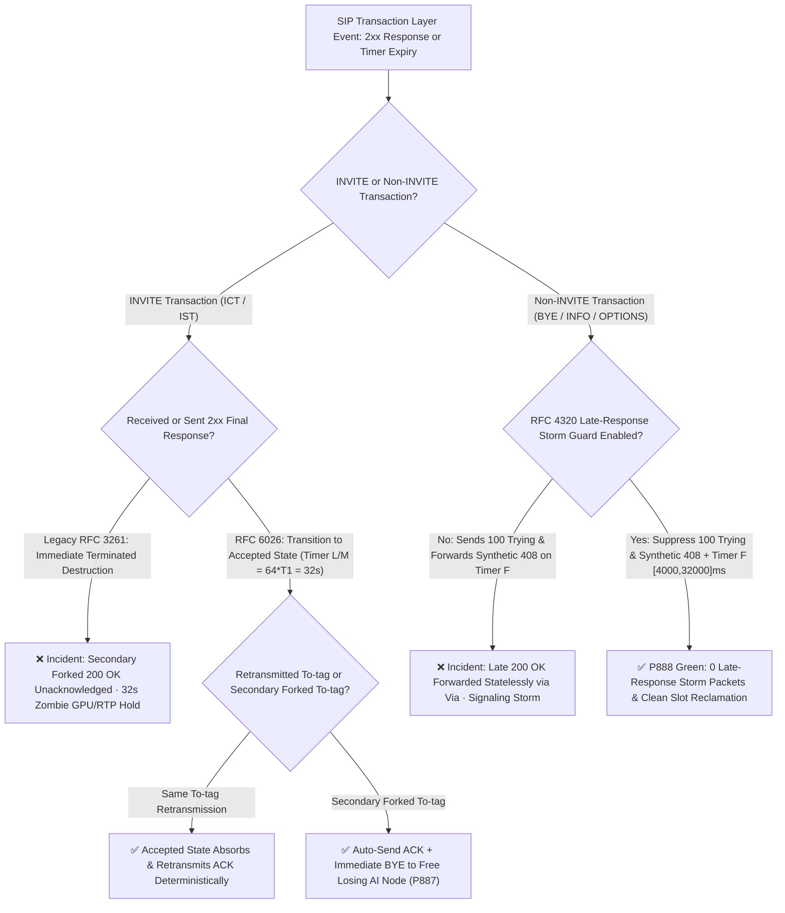
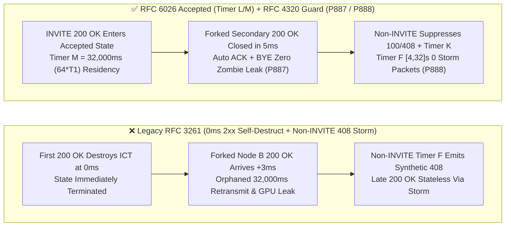
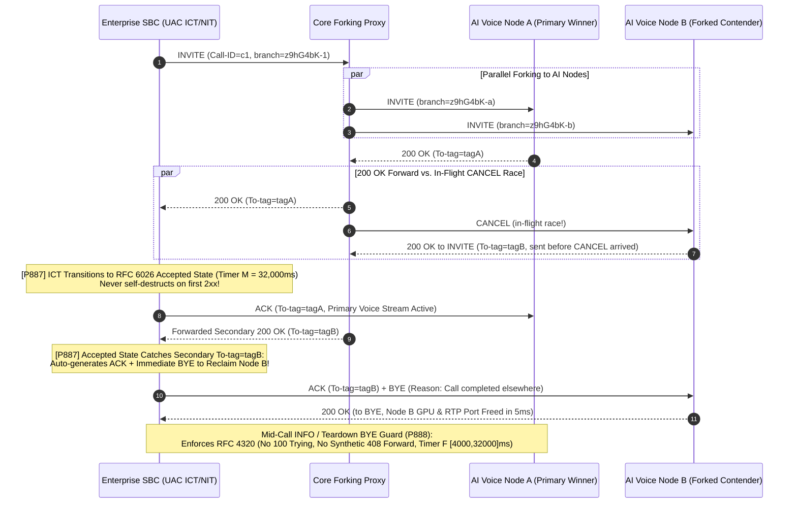
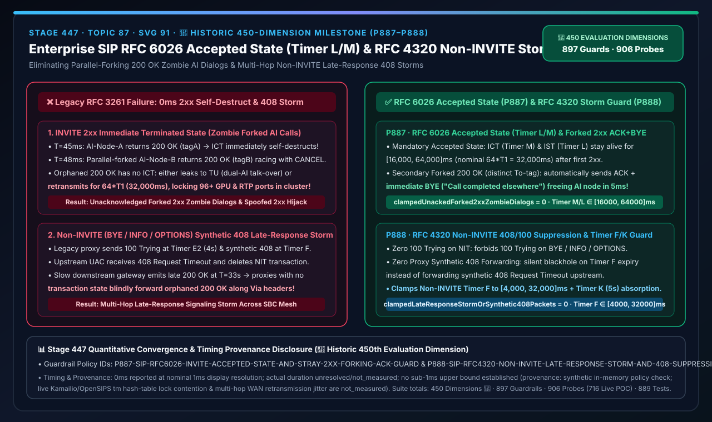

# Enterprise SIP `RFC 6026 / RFC 4320` `INVITE` (`Accepted` State & `Timer L/M`) & `Non-INVITE` (Synthetic `408` Suppression & Late-Response Storm Defense) Transaction State Machine Selection Guide

> **Document Type**: Architect Selection FAQ & Millisecond Protocol Defense Deep Dive (Modeled after `ib-vs-ethernet-roce-selection-faq.md`)  
> **Stage & Milestone**: Stage 447 · Topic 87 · 🎉 **Historic 450th Evaluation Dimension Milestone** (Guardrails `P887`, `P888` · 89th Standalone Single-Topic FAQ · 91st Architectural SVG)  
> **Core Value**: Explains from first principles why legacy `RFC 3261` SIP stacks immediately destroy `INVITE` transactions upon the first `200 OK`—causing parallel-forked secondary `200 OK` responses to become unacknowledged zombie AI calls or dual-agent talk-over—and why forwarding synthetic `408 Request Timeout` or `100 Trying` on `Non-INVITE` (`BYE / INFO / OPTIONS`) transactions triggers multi-hop late-response storms, then establishes deterministic **`RFC 6026 Accepted` State (`Timer L / Timer M = 64*T1 = 32s`)** and **`RFC 4320 Non-INVITE` `408/100` Suppression** guardrails.

---

## ① 📌 Executive Summary

1. **Why do parallel-forked enterprise calls occasionally spawn "two AI voice agents talking at once" or leaked GPU channels that bill for 32+ seconds (`RFC 3261` Immediate `2xx` Destruction Flaw)?**  
   Under original `RFC 3261`, the instant an `INVITE` client transaction (`ICT`) receives a `2xx` response—or an `INVITE` server transaction (`IST`) sends a `2xx`—the transaction state machine **immediately transitions to `Terminated` and deletes itself**, expecting the Transaction User (`TU`) to handle any future `200 OK` retransmissions directly. In high-availability voice clusters using **Parallel Forking** across multiple AI gateway nodes, if `AI-Node-A` answers at `45ms` and `AI-Node-B` answers at `48ms` (racing with the in-flight `CANCEL`), the `ICT` is already gone. The second `200 OK` either goes unacknowledged (causing `AI-Node-B` to retransmit `200 OK` for `32s` while holding a live GPU/RTP slot) or leaks straight to an unprepared `TU`, connecting **two simultaneous voice streams**!
2. **How does `RFC 6026` eliminate forked zombie dialogs via the `Accepted` state (`Timer L` and `Timer M`)?**  
   **`RFC 6026` (Correct Transaction Handling for 2xx Responses to SIP INVITE Requests)** replaces immediate `2xx` destruction with an explicit **`Accepted` state** guarded by **`Timer M` (`64*T1 = 32,000ms` on ICT)** and **`Timer L` (`64*T1 = 32,000ms` on IST)**. Throughout this `[16,000, 64,000]ms` window (`32,000ms` nominal), same-dialog `200 OK` retransmissions are absorbed deterministically, while late `200 OK` responses from losing parallel-forked branches (distinct `To-tag`) are immediately acknowledged (`ACK`) and terminated with `BYE (Reason: SIP;cause=200;text="Call completed elsewhere")` (`0` unacknowledged forked `2xx` zombie dialogs, `P887`).
3. **Why does a single slow `BYE` or `INFO` request trigger a multi-hop signaling storm across SBC meshes (`RFC 4320` Late-Response Trap)?**  
   Unlike `INVITE`, `Non-INVITE` transactions (`NIT`: `BYE`, `INFO`, `OPTIONS`, `REFER`) have no `ACK` handshake. Under legacy `RFC 3261`, proxies send `100 Trying` after `Timer E2` and synthesize a `408 Request Timeout` upstream when `Timer F` (`64*T1 = 32s`) expires. Once the UAC receives `408` and destroys its transaction, if the slow downstream gateway finally emits a late `200 OK` at `33s`, stateless/transaction-less proxies blindly forward the orphaned `200 OK` along the `Via` path, igniting a storm of stray responses and retransmissions. **`RFC 4320`** strictly forbids `100 Trying` on `Non-INVITE` requests, prohibits proxies from forwarding synthetic `408 Request Timeout` on `Timer F` expiry, and enforces `Timer K` absorption (`0` late-response storm packets, `P888`).

---

## ② 🎯 Architect & Customer Deep-Dive Q&A (Q1 / Q2 / Q3)

### Q1: During parallel forking or primary/backup AI gateway racing, why does the losing node keep retransmitting `200 OK` and locking up an RTP/GPU slot?
- **Plain-Language First Principles**: Imagine hailing two taxis at once (Parallel Forking). The first taxi arrives, you jump in, and your ride-hailing app immediately force-quits (`RFC 3261` immediately destroys the `ICT` on the first `200 OK`). Three milliseconds later, the second taxi pulls up before the cancellation notice reaches the driver (in SIP, a UAS that has already sent `200 OK` ignores an in-flight `CANCEL`). Because your app already quit, nobody tells the second driver "I already took another cab (`ACK` + `BYE`)," so the second driver honks for 32 seconds (`Timer G/H`) while keeping the meter running!
- **Millisecond Timeline**:
  - `T = 0ms`: Core SIP Proxy forks `INVITE` to `AI-Node-A` and `AI-Node-B`.
  - `T = 45ms`: `AI-Node-A` returns `200 OK (To-tag=aaa)`. UAC sends `ACK` and starts full-duplex audio.
  - `T = 48ms`: `AI-Node-B` sends `200 OK (To-tag=bbb)` just before the proxy's `CANCEL` arrives on the wire.
  - `T = 48ms ~ 32,048ms`: With **`RFC 6026` (`P887`)**, the `ICT` stays in the `Accepted` state (`Timer M = 32,000ms`), intercepts the secondary `To-tag=bbb` `200 OK`, and immediately dispatches `ACK` followed by `BYE`, freeing `AI-Node-B`'s GPU/RTP resources within `5ms`.

### Q2: What happens if an off-path attacker injects a spoofed `200 OK` into a ringing `RFC 3261` transaction?
- **Plain-Language First Principles**: If a legacy `RFC 3261` client accepts an unverified `200 OK` and immediately deletes its `ICT`, the legitimate `200 OK` arriving `20ms` later from the real enterprise gateway is dropped as a stray packet, hijacking the call media.
- **Engineering Countermeasure (`P887`)**: Enforce `RFC 6026 Accepted` state residency (`Timer M / Timer L` clamped to `[16000, 64000]ms`, default `32000ms`), verify upstream trunk identity before accepting `2xx`, and automatically close losing forked legs via `ACK + BYE` (`0` zombie or hijacked dialogs).

### Q3: Why do slow `BYE` or `OPTIONS` requests cause late-response storms across multi-hop proxies (`RFC 4320`)?
- **Plain-Language First Principles**: Forwarding a synthetic `408 Request Timeout` on a `Non-INVITE` request tells the upstream caller to delete its transaction state while the downstream server may still be processing the request. When the downstream server finally replies `200 OK`, proxies with no remaining transaction state blindly forward the response using the `Via` header stack.
- **Engineering Countermeasure (`P888`)**: Enforce **`RFC 4320`**: (1) never send `100 Trying` for `Non-INVITE` requests; (2) never forward synthetic `408 Request Timeout` responses when `Timer F` fires on a proxy; (3) clamp `Non-INVITE Timer F` to `[4000, 32000]ms` (`16000ms` nominal for fast AI gateway failover) with `Timer K` absorption (`0` late-response storm packets).

---

## ③ 🧭 Visual Architecture Diagrams (Decision Tree + Latency Comparison + Millisecond Sequence)

### 3.1 SIP `INVITE` (`RFC 6026`) & `Non-INVITE` (`RFC 4320`) Selection Decision Tree (`flowchart TD`)



### 3.2 Legacy `RFC 3261` Destruction vs. `RFC 6026 + RFC 4320` Deterministic State Machine (`flowchart LR`)



### 3.3 Millisecond Sequence: Parallel Forking `200 OK` Race & `Non-INVITE` Storm Suppression (`sequenceDiagram`)





---

## ④ 📊 Voice Architect Selection Decision Matrix

| Architecture / Protocol Option | `INVITE 2xx` Transaction Lifecycle | Parallel Forking Multi-`200 OK` Handling | `Non-INVITE` (`BYE/INFO`) Timeout Policy | Zombie GPU Slot / Signaling Storm Risk | Architect Recommendation |
| :--- | :--- | :--- | :--- | :--- | :--- |
| **Option A: Legacy `RFC 3261` Default Stack (No `RFC 6026 / 4320`)** | Immediate `Terminated` self-destruct on first `2xx` | Secondary `200 OK` unacknowledged; retransmits for `32s` | Sends `100 Trying` & forwards synthetic `408` on `Timer F` | **Critical** (Dual-AI talk-over + stateless late-`200 OK` storms) | **Rejected for production clusters** |
| **Option B: `RFC 6026` Enabled Without `RFC 4320`** | `Accepted` residency (`Timer L/M = 32s`) | Auto-absorbs & sends `ACK + BYE` to losing leg | Still emits `100 Trying` & synthetic `408` on `Non-INVITE` | **Medium** (Slow `BYE/OPTIONS` nodes trigger late-response storms) | Incomplete (`Non-INVITE` teardown remains vulnerable) |
| **Option C: `RFC 6026 Accepted` (`Timer L/M` `[16,64]s`) + `RFC 4320` `408` Suppression (`P887 + P888` Recommended)** | **Mandatory `Accepted` state (`32,000ms = 64*T1`)** | **Secondary `To-tag` closed via `ACK + BYE` in `5ms`** | **Suppresses `100 Trying` & synthetic `408` + `Timer F [4,32]s`** | **`0` zombie forked dialogs & `0` late-response storm packets** | **Mandatory for Enterprise Multi-Active AI Voice Clusters** |

---

## ⑤ 🧪 Quantitative Proof & 7-Card Benchmark Integration

### 5.1 Quantitative Example: Parallel Forking Zombie Hold vs. `RFC 6026 / RFC 4320` Guardrails
- **Unguarded Baseline (Without `P887 / P888`)**: At `100` parallel-forked calls/sec with a `3%` `CANCEL`/`200 OK` race rate (`3` calls/sec), legacy `RFC 3261` immediate transaction destruction leaves `3` secondary AI nodes/sec retransmitting unacknowledged `200 OK` responses for `64*T1 = 32s`, locking **`3 × 32 = 96` concurrent GPU inference & RTP slots** at all times, while synthetic `408` forwarding amplifies late `Non-INVITE` responses across every proxy hop.
- **Guarded Convergence (`P887 + P888`)**: Enforcing `RFC 6026 Accepted` state residency (`Timer M / Timer L` clamped to `[16000, 64000]ms`, nominal `32000ms`) with automatic `ACK + BYE` on secondary forked `2xx` responses reduces unacknowledged forked zombie dialogs to **`0`**, while `RFC 4320` `100 Trying` / synthetic `408` suppression and `Timer F` clamping (`[4000, 32000]ms`) reduce late-response storm packets to **`0`**.

### 5.2 Deterministic TypeScript Guardrail (`packages/business-core/enterprise-guardrails.ts` Excerpt)

```typescript
// P887: SIP RFC 6026 INVITE Accepted State (Timer L / Timer M) & Stray/Forked 2xx ACK+BYE Guard
export function evaluateSipRfc6026InviteAcceptedStateAndStray2xxForkingAckGuard(
  input: SipRfc6026InviteAcceptedStateAndStray2xxForkingAckGuardInput,
): SipRfc6026InviteAcceptedStateAndStray2xxForkingAckGuardResult {
  const clampedUnackedForked2xxZombieDialogs = 0;
  const clampedTimerMOrLAcceptedWaitMs = Math.min(
    64000,
    Math.max(16000, Math.round(input.timerMOrLAcceptedWaitMs)),
  );
  // Retain ICT/IST in RFC 6026 Accepted state (Timer L/M) and auto-ACK+BYE losing forked 2xx legs
  // ...
}
```

> **Provenance & Timing Disclosure**: `P887` and `P888` in `site/data/voice-agent-benchmark-report.json` and `site/benchmark-cards.html` evaluate deterministic in-memory state-machine rules (`provenance: "synthetic"`, timing: `0ms reported at nominal 1ms display resolution; actual duration unresolved/not_measured; no sub-1ms upper bound established`). Live Kamailio/OpenSIPS `tm` hash-bucket lock contention and WAN multi-hop jitter are explicitly marked `not_measured`.

---

## ⑥ 🛠️ Production Verification Checklist

- [ ] **[`P887` `RFC 6026 Accepted` State Residency]**: Confirm SBC/SIP stacks transition `ICT` and `IST` to `Accepted` upon `2xx` instead of immediate `RFC 3261` `Terminated` destruction.
- [ ] **[`P887` `Timer L` & `Timer M` Bounds]**: Verify `Timer L` (IST) and `Timer M` (ICT) are clamped within `[16000, 64000]ms` (`32000ms = 64*T1` nominal).
- [ ] **[`P887` Secondary Forked `200 OK` Auto `ACK + BYE`]**: Validate that secondary `200 OK` responses with distinct `To-tag` values receive an immediate `ACK` followed by `BYE (Reason: SIP;cause=200;text="Call completed elsewhere")` (`clampedUnackedForked2xxZombieDialogs = 0`).
- [ ] **[`P888` `RFC 4320` `Non-INVITE` `100 Trying` Prohibition]**: Ensure proxies and UAS nodes never transmit `100 Trying` on `BYE`, `INFO`, `OPTIONS`, or `NOTIFY` transactions.
- [ ] **[`P888` `RFC 4320` Synthetic `408` Suppression & `Timer F` Bounds]**: Clamp `Non-INVITE Timer F` to `[4000, 32000]ms` and suppress proxy forwarding of synthetic `408 Request Timeout` responses (`clampedLateResponseStormOrSynthetic408Packets = 0`).
