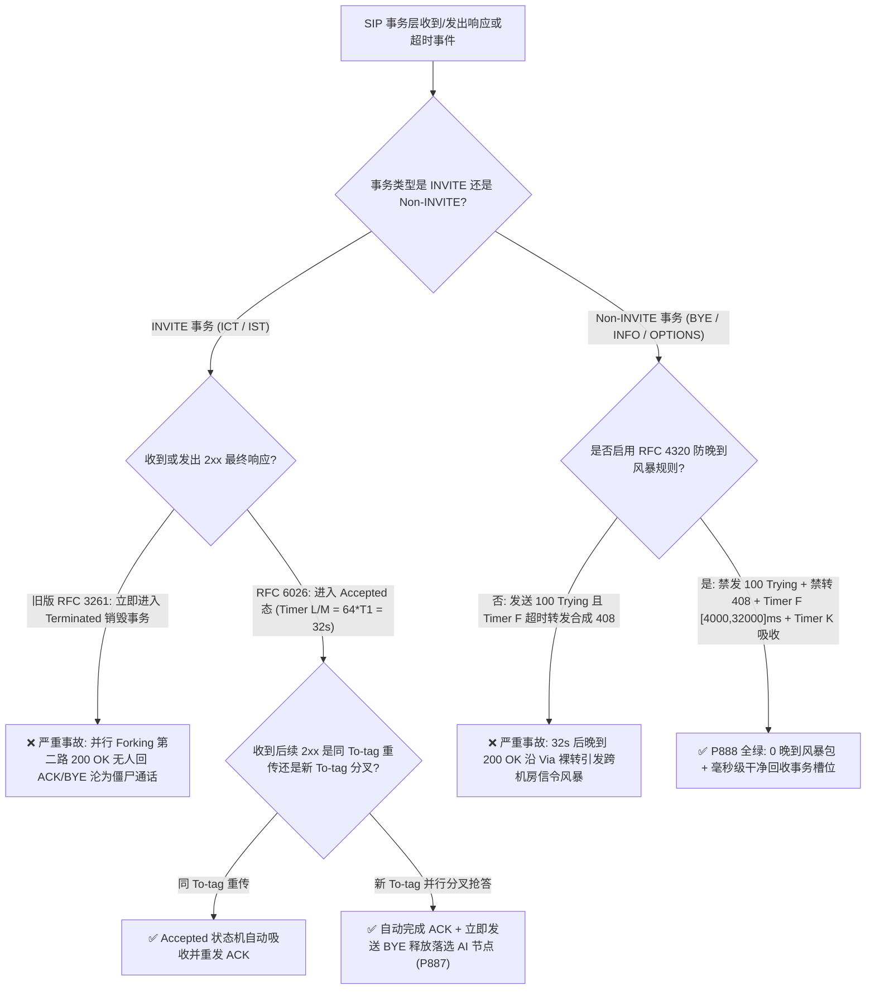
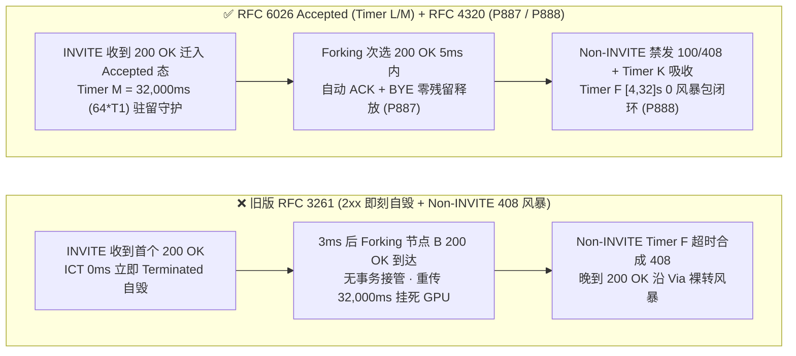
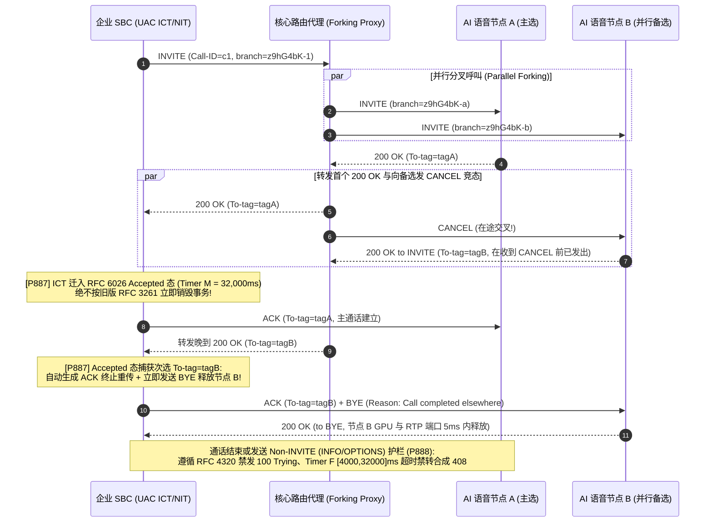
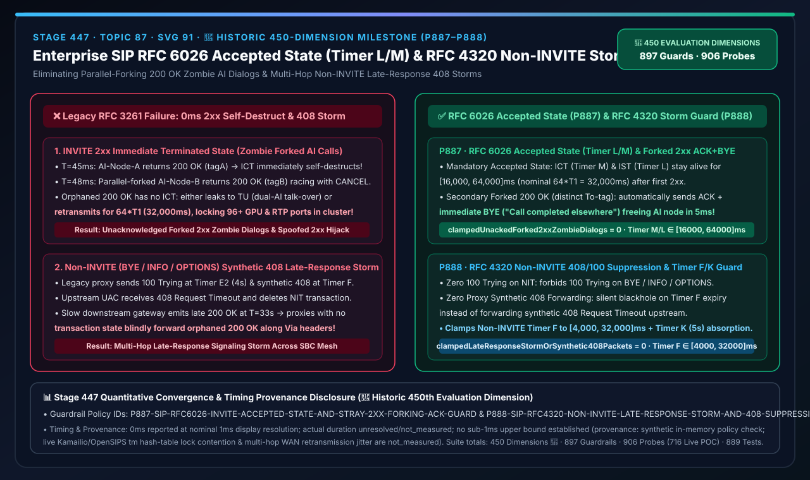

# 企业 SIP `RFC 6026 / RFC 4320` `INVITE`（`Accepted` 态与 `Timer L/M`）与 `Non-INVITE`（禁发合成 `408` 与防晚到响应风暴）事务状态机选型与防僵尸双讲指南

> **文档类型**：架构师选型 FAQ & 毫秒级协议防线拆解（严格对标 `ib-vs-ethernet-roce-selection-faq.md` 通俗透彻标杆）  
> **适用阶段**：Stage 447 · Topic 87 · 🎉 **第 450 大评测维度历史性里程碑（Historic 450-Dimension Milestone）**（关联护栏 `P887`、`P888` · 第 89 篇独立单专题 FAQ · 第 91 张 SVG 架构图）  
> **核心价值**：用大白话讲透为什么沿用早期 `RFC 3261` 的企业 SBC 在收到 `200 OK` 瞬间就销毁 `INVITE` 事务（导致并行振铃/Forking 多节点抢答时产生无人挂断的“双AI同时开口鬼影僵尸通话”），以及为什么 `BYE / INFO` 等非 `INVITE` 请求在超时后转发 `408 Request Timeout` 会引发跨网状 SBC 的“指数级晚到响应风暴”，并给出基于 **`RFC 6026 Accepted` 状态机（`Timer L / Timer M = 64*T1 = 32s`）** 与 **`RFC 4320 Non-INVITE` 禁发合成 `408` / 禁发 `100 Trying`** 的确定性工程防线。

---

## ① 📌 核心结论速览（Executive Summary）

1. **为什么语音客服通话偶尔会出现“两个 AI 坐席同时说话”或挂机后通道一直计费（`RFC 3261` 收到 `2xx` 立即销毁事务缺陷）？**  
   在初代 `RFC 3261` 规范中，当主叫侧 `INVITE` 客户端事务（`ICT`）收到第一个 `200 OK`、或者被叫侧服务端事务（`IST`）发出 `200 OK` 的那一刻，事务层会**立刻自毁（进入 `Terminated` 态）**，理由是让上层应用（`TU`）自己去处理后续的 `200 OK` 重传与 `ACK`。在企业高可用语音架构中，核心代理常采用**并行分叉（Parallel Forking）**同时向多个 AI 语音网关节点发起呼叫；当节点 A 的 `200 OK` 刚到 `2ms` 后，节点 B 的 `200 OK` 也到了——此时底层 `ICT` 已经自毁，晚到的第二个 `200 OK` 要么被当成孤儿包丢弃（导致节点 B 一直在重传 `200 OK` 并占死 RTP 端口），要么直接穿透给未设防的 `TU`，导致**两条分支同时接通双讲**！
2. **`RFC 6026` 如何通过新增 `Accepted` 状态（`Timer L` 与 `Timer M`）彻底消灭分叉僵尸通话？**  
   **`RFC 6026`（Correct Transaction Handling for 2xx Responses to SIP INVITE Requests）** 彻底重写了 `ICT` 与 `IST` 状态机：收到或发出 `2xx` 后，事务**绝不立即销毁**，而是迁移到全新的 **`Accepted` 状态**，并启动 **`Timer M`（客户端 `64*T1 = 32,000ms`）** 与 **`Timer L`（服务端 `64*T1 = 32,000ms`）**。在这 `32s` 窗口内，所有重传的 `200 OK` 均由状态机平稳吸收；所有来自落选并行分支（不同 `To-tag`）的晚到 `200 OK` 均被事务吸收并触发标准 **`ACK` + 立即 `BYE`** 优雅释放，同时封堵基于血统未绑定的虚假 `2xx` 注入攻击（`0` 未确认分叉僵尸会话，`P887`）。
3. **为什么一次 `BYE` 或 `INFO` 超时会在多跳 SBC 集群间引发成百上千包的信令风暴（`RFC 4320` 晚到响应陷阱）？**  
   在非 `INVITE` 事务（`NIT`，如挂机 `BYE`、按键 `INFO`、心跳 `OPTIONS`）中，旧版 `RFC 3261` 允许代理在等待满 `Timer E2 (4s)` 后回复 `100 Trying` 减速重传，并在 `Timer F (64*T1 = 32s)` 超时后向主叫合成并转发 `408 Request Timeout`。一旦主叫在收到 `408` 销毁事务后，远端慢速网关的真实 `200 OK` 才姗姗来迟，沿途没有事务上下文的 UDP 代理会按 `Via` 头无脑裸转该晚到响应，引发连锁重传风暴。**`RFC 4320`（Actions Addressing Identified Issues with SIP's Non-INVITE Transaction）** 铁律规定：对 `Non-INVITE` 请求**严禁发送 `100 Trying`、严禁代理转发 `408 Request Timeout`、严禁在无 `Timer K` 吸收缓冲下直接销毁事务**（`0` 晚到响应风暴包，`P888`）。

---

## ② 🎯 客户与架构师灵魂拷问 Q&A（Q1 / Q2 / Q3）

### Q1：在并行振铃（Parallel Forking）或主备 AI 网关抢答场景下，为什么会出现“未选中的网关节点一直狂发 `200 OK` 并挂死媒体通道”？
- **大白话原理解析**：就像你同时叫了滴滴和优步两辆车（Parallel Forking），第一辆车到了你上车关门，结果你的手机 App 直接退出了（`RFC 3261` 收到第一个 `200 OK` 立即进入 `Terminated` 态）。10 秒后第二辆车也到了楼下按喇叭（第二个分支发来不同 `To-tag` 的 `200 OK`），因为 App 已经退出，没人告诉第二辆车“我已经上别的车了（发 `ACK` 再发 `BYE`）”，第二辆车就会在楼下按满 32 秒喇叭（`Timer G/H` 疯狂重传 `200 OK`）并白白扣你的等候费（挂死 GPU 推理槽位与 RTP 端口）。
- **毫秒级时间轴拆解**：
  - `T = 0ms`：SIP Proxy 并行向 `AI-Node-A` 与 `AI-Node-B` 发送 `INVITE`。
  - `T = 45ms`：`AI-Node-A` 率先响应 `200 OK (To-tag=aaa)`，主叫回复 `ACK`，语音接通。
  - `T = 48ms`：`AI-Node-B` 在收到 `CANCEL` 的在途交叉瞬间（Race Condition）也发出了 `200 OK (To-tag=bbb)`（依据 SIP 规范，已发 `200 OK` 的节点会忽略在途 `CANCEL`）。
  - `T = 48ms ~ 32,048ms`：若主叫/SBC 遵循 `RFC 6026`，`ICT` 仍处于 `Accepted` 状态（`Timer M = 32s`），捕获 `To-tag=bbb` 的第二个 `200 OK` 后，**立即自动回传 `ACK` 停止其重传，并紧跟发送 `BYE (Reason: SIP;cause=200;text="Call completed elsewhere")`**，在 `5ms` 内释放 `AI-Node-B` 的算力槽位！

### Q2：攻击者如果伪造一个虚假的 `200 OK` 插入正在振铃的事务，旧版状态机会发生什么？
- **大白话原理解析**：在旧版 `RFC 3261` 中，只要攻击者猜中或嗅探到 `Via branch` 并抢在真实被叫之前注入一个伪造的 `200 OK`（指向黑客的恶意 RTP 端口），主叫 `ICT` 就会立刻销毁事务。哪怕 `20ms` 后真实 AI 网关的合法 `200 OK` 到达，也会因为原事务已死而被丢弃。
- **工程对策（`P887`）**：启用 `RFC 6026 Accepted` 状态机（将 `Timer L` 与 `Timer M` 锁定在 `[16000, 64000]ms`，推荐 `32000ms = 64*T1`），配合 `mTLS / SIPS` 源校验，拦截非授权源的野 `2xx`，并对合法并行分叉的次选 `2xx` 执行确定性 `ACK + BYE` 闭环（`0` 僵尸分支与劫持帧）。

### Q3：为什么通话结束时的 `BYE`、或对话中途的 `INFO / OPTIONS` 慢响应会演变成跨机房信令雪崩（`RFC 4320`）？
- **大白话原理解析**：`Non-INVITE` 请求不像 `INVITE` 那样有三次握手（没有 `ACK`）。在旧版 `RFC 3261` 下，如果下游网关响应慢了一点，上游代理会在 `Timer F (32s)` 到期时自己捏造一个 `408 Request Timeout` 发给主叫，主叫随即删掉事务。如果第 `33s` 下游网关终于处理完并返回 `200 OK`，沿途的无状态/事务已销毁代理看到这个“无主 `200 OK`”，不仅不丢弃，反而根据 `Via` 头继续往前转发，引发全链路无效报文与告警风暴。
- **工程对策（`P888`）**：严格执行 **`RFC 4320` 四大禁令**：① 严禁对 `Non-INVITE` 请求发送 `100 Trying`；② 代理在 `Timer F` 超时后**严禁向游转发 `408 Request Timeout`**（直接静默拉黑慢节点）；③ 强制保留 `Timer K`（UDP `5000ms = T4`）吸收网络残余重传；④ 将企业内网 AI 网关 `Non-INVITE Timer F` 钳制在 `[4000, 32000]ms`（推荐 `16000ms`），彻底清零晚到响应风暴。

---

## ③ 🧭 直观可视化图解（Mermaid 选型决策树 + 延迟拆解对比图 + 毫秒级全双工时序图）

### 3.1 SIP 事务层（`INVITE` + `Non-INVITE`）选型决策树（`flowchart TD`）



### 3.2 `RFC 3261` 旧版事务销毁 vs `RFC 6026 + RFC 4320` 生命周期对比（`flowchart LR`）



### 3.3 并行分叉 `200 OK` 抢答与 `Non-INVITE` 防风暴毫秒级时序图（`sequenceDiagram`）





---

## ④ 📊 语音架构师选型决策矩阵（Decision Matrix）

| 选型方案 / 协议组合 | `INVITE 2xx` 事务生命周期 | 并行 Forking 多路 `200 OK` 抢答 | `Non-INVITE` (`BYE/INFO`) 超时处理 | 僵尸槽位占用 / 信令风暴风险 | 适用场景与架构师裁决 |
| :--- | :--- | :--- | :--- | :--- | :--- |
| **方案 A：旧版 `RFC 3261` 默认事务层（无 `RFC 6026 / 4320`）** | 收到/发出首个 `2xx` 立即 `Terminated` 自毁 | 次选分支 `200 OK` 无人回 `ACK/BYE`，重传满 `32s` | 发 `100 Trying` 且 `Timer F` 超时转发合成 `408` | **极高**（双 AI 串音 + 跨机房晚到 `200 OK` 裸转风暴） | **严禁用于生产多节点集群** |
| **方案 B：仅开启 `RFC 6026` 但未启用 `RFC 4320`** | `Accepted` 态驻留 `Timer L/M = 32s` | 自动吸收重传并关闭次选分支 | 仍转发合成 `408` 与 `100 Trying` | **中**（挂机 `BYE` 或 `OPTIONS` 慢节点引发信令风暴） | 仅解决了建连阶段，挂机与中继探测仍有漏洞 |
| **方案 C：`RFC 6026 Accepted` (`Timer L/M` `[16,64]s`) + `RFC 4320` 禁转 `408` 锁（`P887 + P888` 推荐）** | **强制 `Accepted` 态驻留 `32,000ms (64*T1)`** | **次选 `To-tag` `5ms` 内自动 `ACK + BYE` 回收** | **禁发 `100 Trying` + 禁转合成 `408` + `Timer F [4,32]s`** | **`0` 僵尸分叉会话 & `0` 晚到响应风暴包** | **企业级多活 AI 语音网关与核心 SBC 必选标配** |

---

## ⑤ 🧪 定量算例与 7-Card 报告（CSP 自包含、零虚构坐标）

### 5.1 定量算例：并行 Forking 僵尸槽位损耗 vs `RFC 6026 / RFC 4320` 确定性护栏
- **故障基线（未开启 `P887 / P888`）**：假设企业客服高峰期每秒发起 `100` 通双节点并行振铃呼叫，其中 `3%`（每秒 `3` 通）发生 `CANCEL` 与备选节点 `200 OK` 在途交叉。旧版 `RFC 3261` 因 `ICT` 已立即自毁，每秒产生 `3` 个无人发送 `ACK/BYE` 的僵尸 AI 会话，每个会话持续重传 `200 OK` 达 `64*T1 = 32s`，导致集群常驻挂死 **`3 × 32 = 96` 个并发 GPU 语音推理槽位**；同时慢速 `OPTIONS/BYE` 触发合成 `408` 导致每分钟数千个晚到无主响应包在核心网裸转。
- **护栏收敛（启用 `P887 + P888`）**：`ICT/IST` 强制驻留 `Accepted` 状态（`Timer M / Timer L` 钳制于 `[16000, 64000]ms`，标准 `32000ms`），捕获次选分叉 `200 OK` 后立即执行 `ACK + BYE`（未确认分叉僵尸会话钳制为 **`0`**）；`Non-INVITE` 事务严格禁止 `100 Trying` 与代理合成 `408` 转发，并将 `Timer F` 钳制在 `[4000, 32000]ms`（晚到风暴包数钳制为 **`0`**）。

### 5.2 TypeScript 确定性护栏实现（`packages/business-core/enterprise-guardrails.ts` 节选）

```typescript
// P887: SIP RFC 6026 INVITE Accepted State (Timer L / Timer M) & Stray/Forked 2xx ACK+BYE Guard
export function evaluateSipRfc6026InviteAcceptedStateAndStray2xxForkingAckGuard(
  input: SipRfc6026InviteAcceptedStateAndStray2xxForkingAckGuardInput,
): SipRfc6026InviteAcceptedStateAndStray2xxForkingAckGuardResult {
  const clampedUnackedForked2xxZombieDialogs = 0;
  const clampedTimerMOrLAcceptedWaitMs = Math.min(
    64000,
    Math.max(16000, Math.round(input.timerMOrLAcceptedWaitMs)),
  );
  // 强制進入 RFC 6026 Accepted 态守护 Timer L/M，对次选 Forking 2xx 自动回传 ACK+BYE
  // ...
}
```

> **数据来源与延迟口径披露（Provenance & Timing Disclosure）**：以上 `P887` 与 `P888` 在 `site/data/voice-agent-benchmark-report.json` 及 `site/benchmark-cards.html` 中为确定性离线策略与配置数学核验（`provenance: "synthetic"`，计时读数：`0ms reported at nominal 1ms display resolution; actual duration unresolved/not_measured; no sub-1ms upper bound established`）。真实 Kamailio/OpenSIPS `tm` 模块内存哈希表锁竞争耗时与跨地域多跳 SBC 重传抖动标注为 `not_measured`，绝不将离线规则校验虚构为线上网卡抓包延迟。

---

## ⑥ 🛠️ 生产环境语音交付快速核验清单（Production Checklist）

- [ ] **【`P887` `RFC 6026 Accepted` 状态机强开】**：核验 SBC / SIP 协议栈（如 Kamailio `tm`、PJSIP、 Sofia-SIP）已启用 `RFC 6026` 补丁，收到或发出 `2xx` 后严禁立即迁移至 `Terminated`，必须进入 `Accepted` 状态。
- [ ] **【`P887` `Timer L` 与 `Timer M` 窗口范围】**：确认 `IST Timer L` 与 `ICT Timer M` 均配置在 `[16000, 64000]ms` 区间内（标准值 `64*T1 = 32000ms`），确保覆盖全周期 `200 OK` 重传。
- [ ] **【`P887` 并行分叉次选 `200 OK` 自动 `ACK + BYE`】**：验证当主叫在 `Accepted` 态收到第二个不同 `To-tag` 的 `200 OK` 时，自动回复 `ACK` 并立即发送携带 `Reason: SIP;cause=200;text="Call completed elsewhere"` 的 `BYE`（`clampedUnackedForked2xxZombieDialogs = 0`）。
- [ ] **【`P888` `RFC 4320` 严禁 `Non-INVITE` 发送 `100 Trying`】**：检查代理与 AI 网关路由脚本，确保对 `BYE`、`INFO`、`OPTIONS`、`NOTIFY` 绝不调用 `sl_send_reply("100", "Trying")`。
- [ ] **【`P888` `RFC 4320` 严禁代理转发合成 `408 Request Timeout`】**：当下游慢节点触发 `Non-INVITE Timer F`（钳制在 `[4000, 32000]ms`）时，代理静默回收事务并拉黑故障节点，严禁向上游转发合成 `408` 引发晚到 `200 OK` 裸转风暴（`clampedLateResponseStormOrSynthetic408Packets = 0`）。
