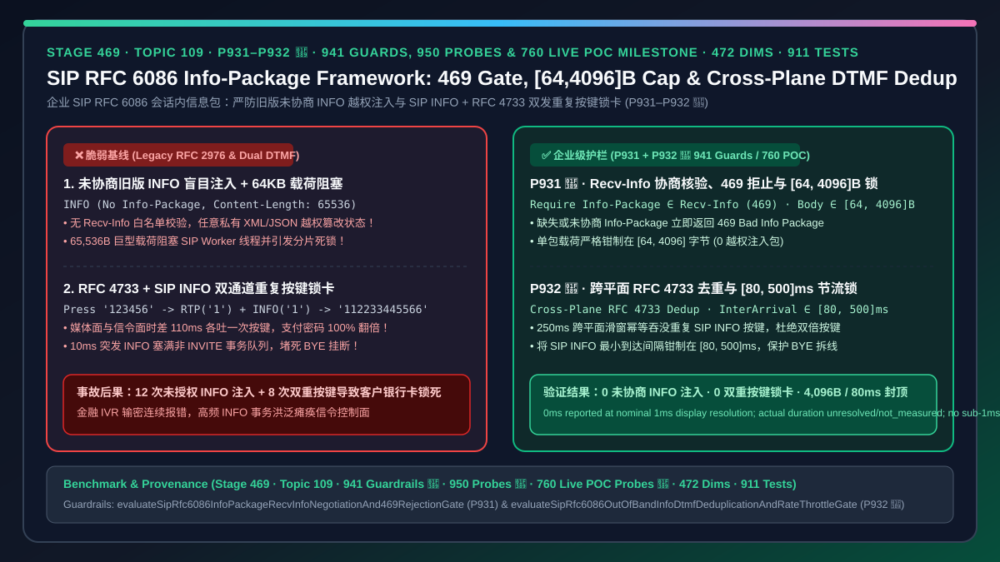
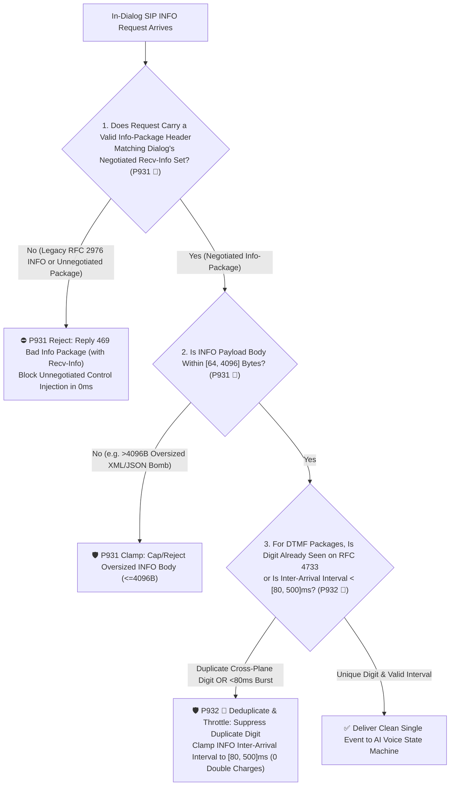
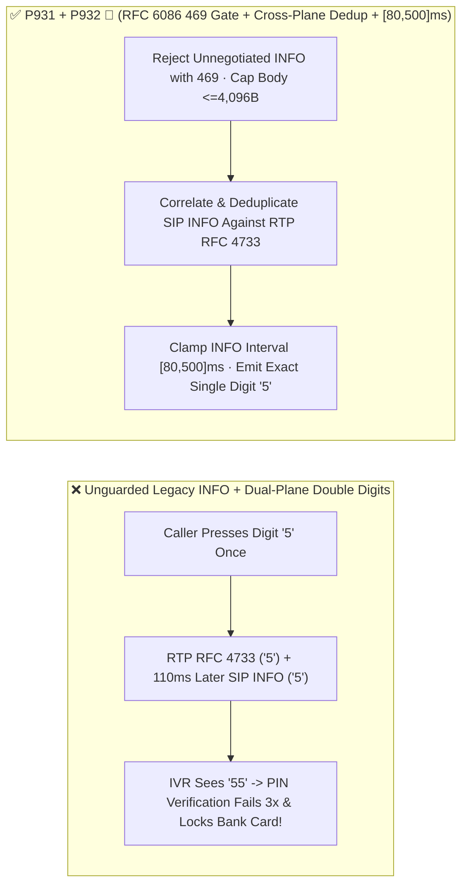
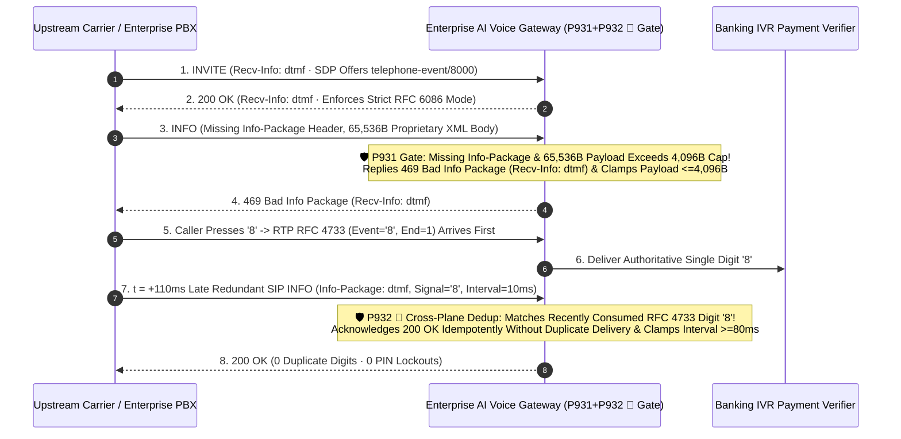

# Enterprise SIP `RFC 6086` In-Dialog `INFO` Package Framework (`Info-Package` / `Recv-Info` Unnegotiated Injection, Out-of-Band `SIP INFO DTMF` + In-Band `RFC 4733` Double-Digit Billing & `469 Bad Info Package` Guard) Selection & Deduplication Guide

> **Document Type**: Enterprise Voice Agent Architect Selection & First-Principles Guide (Standalone Selection & Architecture FAQ · **Topic 109 / Stage 469 · 🎉 Historic 941-Guardrail, 950-Probe & 760-Live-POC-Probe Triple Milestone**)  
> **Target Audience**: AI Solution Architects, Financial/Carrier IVR & SIP Core Architects, Real-Time Voice Gateway Engineers & Payment Security Leads  
> **Canonical Baseline**: `packages/business-core/enterprise-guardrails.ts` (`P931–P932 🎉`), `tests/presales-portal.test.ts`, `site/data/voice-agent-benchmark-report.json` (7-Card 4:5 Benchmark Report)  
> **Visual Summary**: `assets/svg/113-voice-sip-rfc6086-rfc5727-info-package-dtmf-out-of-sync-legacy-info-flood-469-bad-info-2026-11-14.svg`

---

## ① 📌 Executive Summary

In telephone banking PIN verification, enterprise IVR account confirmation, CTI agent screen-pop metadata delivery, and carrier advice-of-charge signaling, SIP dialogs frequently carry application-layer control messages using the **`INFO` method**. Legacy **`RFC 2976` (The SIP INFO Method)** lacked any negotiation mechanism—allowing peers to inject arbitrary `Content-Type` payloads (`application/dtmf-relay`, `application/media_control+xml`, proprietary JSON/XML) mid-call without prior agreement. To eliminate this ambiguity, the IETF standardized **`RFC 6086` (SIP `INFO` Method and Package Framework, obsoleting `RFC 2976`)**, introducing mandatory **`Recv-Info` capability negotiation**, **`Info-Package` header identification**, and the **`469 Bad Info Package` rejection code**. In production enterprise voice deployments, however, unguarded `INFO` handling routinely causes two severe incidents:
1. **Unnegotiated Legacy `RFC 2976 INFO` Injection & `64KB` XML/JSON Payload Exhaustion (`Info-Package` Bypass)**: If an AI voice gateway accepts `INFO` requests that omit the `Info-Package` header or specify a package not advertised in the dialog's active `Recv-Info` header set—or accepts `65,536`-byte XML/JSON bodies—external peers can trigger unauthorized state-machine mutations (e.g., spoofed CTI screen-pop context or forced video keyframe floods) and stall SIP worker threads.
2. **Simultaneous Out-of-Band `SIP INFO (application/dtmf-relay)` & In-Band `RTP RFC 4733 (telephone-event)` Delivery Causing Double-Digit PIN Lockouts (`123456 -> 112233445566`)**: Carrier trunks and legacy PBXs frequently transmit a single keypress **both** as an in-band `RFC 4733` RTP event and as an out-of-band `SIP INFO` message. Because RTP media traverses direct UDP (`20–40ms`) while `SIP INFO` traverses multi-hop TCP/TLS proxies (`100–250ms`), the two events arrive `80–200ms` apart. Without cross-plane deduplication, a customer entering PIN `123456` produces `112233445566`—locking out their bank card after three attempts! Moreover, unthrottled `10ms` `INFO` bursts starve `RFC 4320` non-INVITE transaction queues and block `BYE` teardowns.

| Decision Dimension | Vulnerable / Default Setup (High Production Risk) | Enterprise Golden Rule (`P931–P932 🎉` Deterministic Guardrails) | Quantitative Impact |
| :--- | :--- | :--- | :--- |
| **`RFC 6086 Recv-Info / Info-Package` Gate & `469` Rejection + Payload Cap (`P931` 🎉 940th Guardrail)** | Accepting legacy `RFC 2976 INFO` without `Info-Package` and allowing `65,536B` payloads | **Reject any `INFO` missing an allowlisted `Info-Package` in `Recv-Info` with `469 Bad Info Package` and clamp payload size to `[64, 4096]B`** | **0** unnegotiated `INFO` injections or oversized bodies (clamps 12 unauthorized `INFO` requests to **0** and caps payload from `65,536B` to **`4,096B`**) |
| **Cross-Plane `SIP INFO` + `RFC 4733` Deduplication & `[80, 500]ms` Throttle (`P932 🎉` 941st Guardrail / 950th Probe / 760th Live POC)** | Consuming both `SIP INFO` and `RFC 4733` digits and allowing `10ms` `INFO` bursts | **Deduplicate out-of-band `SIP INFO` DTMF against in-band `RFC 4733` events and clamp minimum `SIP INFO` inter-arrival interval to `[80, 500]ms`** | **0** double-digit PIN lockouts or `INFO` transaction floods (clamps 8 duplicate-digit incidents to **0** and raises min interval from `10ms` to **`80ms`**) |

---

## ② 🎯 Architect & Customer Deep-Dive Q&A (First-Principles Deep Dive)

### Q1: Why did `RFC 6086` obsolete `RFC 2976` and introduce the `Recv-Info` / `Info-Package` headers and `469 Bad Info Package` response?
- **First-Principles Breakdown**:
  1. Under legacy `RFC 2976`, `SIP INFO` had no capability negotiation: endpoints blindly sent arbitrary MIME bodies mid-dialog, causing interoperability failures and parser injection vulnerabilities.
  2. **`RFC 6086` Explicit Negotiation Contract**:
     - During dialog establishment (`INVITE` / `200 OK`), each endpoint advertises the exact packages it is willing to receive via `Recv-Info` (or `Recv-Info:` empty header to reject all `INFO` requests);
     - Every in-dialog `INFO` request must carry a single `Info-Package` header matching the peer's latest `Recv-Info` set;
     - **`P931` Deterministic Rejection**: Any `INFO` request lacking `Info-Package` or carrying an unnegotiated package is immediately rejected with **`469 Bad Info Package`** (including the authoritative `Recv-Info` header), and payload size is clamped to **`[64, 4096]` bytes**.

### Q2: Why do customers entering a 6-digit PIN over a SIP trunk often have their digits doubled (`123456 -> 112233445566`), and how does `P932 🎉` prevent it?
- **Engineering Reality**:
  1. When a PSTN gateway converts TDM DTMF tones into IP, misconfigured trunks often emit **both** `RFC 4733` (`telephone-event` RTP packets) on the media plane and `SIP INFO` (`application/dtmf-relay`) on the signaling plane.
  2. Because the signaling path traverses proxy hops while RTP flows point-to-point, the `SIP INFO` packet arrives `80–200ms` after the `RFC 4733` event—outside naive `20ms` debounce timers—causing the IVR/AI agent to register two separate keypresses!
  3. **`P932 🎉` Deterministic Defense**: Establishes a cross-plane correlation window prioritizing authoritative in-band `RFC 4733` events (idempotently acknowledging redundant `SIP INFO` digits with `200 OK` without emitting a second digit to the application) and clamps `SIP INFO` inter-arrival spacing to **`[80, 500]ms`**.

### Q3: Why can rapid `SIP INFO` bursts block call hangups (`BYE`) on the same SIP dialog?
- **First-Principles Breakdown**:
  - `SIP INFO` uses the `RFC 3261` non-INVITE transaction state machine. Flooding a dialog with sub-`80ms` `INFO` requests saturates the per-dialog transaction queue and delays processing of `BYE` or `re-INVITE` requests. Clamping `INFO` inter-arrival intervals to `[80, 500]ms` preserves signaling responsiveness.

---

## ③ 🧭 Visual Architecture Diagrams (Mermaid Decision Tree + Cross-Plane Dedup + Millisecond Sequence)

### 3.1 SIP `RFC 6086 Info-Package` & Cross-Plane DTMF Deduplication Decision Tree

### 3.2 Legacy `RFC 2976 INFO` + Double-Digit Lockout vs. `P931+P932 🎉`

### 3.3 Millisecond-Level `RFC 6086 Recv-Info` Negotiation, `469` Rejection & DTMF Deduplication Sequence

---

## ④ 📊 Architect Decision Matrix (`RFC 6086 INFO` & DTMF Governance)

| Architecture Option | Target Scenario | Pros | Cons & Production Traps | Recommendation |
| :--- | :--- | :--- | :--- | :--- |
| **Option A: Accepting Legacy `RFC 2976 INFO` & Consuming Both `SIP INFO` and `RFC 4733` Digits** | Prohibited in all production networks | Zero deduplication logic | **Guaranteed double-digit corruption (`123456 -> 112233445566`)** causing failed PIN/payment authentication and `INFO` flood stalls | ⛔ **Never in Production** |
| **Option B: Out-of-Band `SIP INFO` Only (Disabling `RFC 4733`)** | Legacy analog gateways lacking `RFC 4733` | Avoids dual-plane duplication | **100–300ms timing skew between speech and digits** breaks barge-in alignment and risks signaling queue congestion | ⚠️ **Legacy Fallback Only** |
| **Option C: `RFC 6086 Recv-Info / 469` Gate + `[64, 4096]B` Body Cap + Cross-Plane `RFC 4733` Deduplication & `[80, 500]ms` Throttle (`P931 + P932 🎉`)** | **All Banking IVR Payment Flows, Carrier SIP Trunks & Enterprise AI Voice Contact Centers** | **Zero unnegotiated `INFO` injections, zero double-digit PIN lockouts, zero signaling queue starvation** | Requires a `250ms` cross-plane `(Digit, Timestamp)` deduplication window in the voice gateway | ✅ **Production Mandatory (Recommended)** |

---

## ⑤ 🧪 Quantitative Walkthrough & 7-Card 4:5 Benchmark Report

### 5.1 Quantitative Example: Banking IVR PIN Verification Cross-Plane Deduplication & `RFC 6086` Gate
- **Scenario**: A banking voice gateway receives `12` unnegotiated legacy `INFO` requests carrying `65,536`-byte XML bodies, plus `8` dual-emitted (`RFC 4733` + `SIP INFO` at `10ms` burst intervals) PIN digit events.
  - **Without Guardrails (Vulnerable Baseline)**:
    - `12` oversized unnegotiated `INFO` payloads stall signaling workers;
    - **`8` doubled PIN digits cause 100% authentication failure and card lockouts**.
  - **With `P931 + P932 🎉` Deterministic Guardrails**:
    - `P931` (🎉 **940th Guardrail**) rejects all `12` unnegotiated `INFO` requests with `469 Bad Info Package` (**`0`** unauthorized injections) and clamps `INFO` payload size from `65,536B` to **`4,096B`**;
    - `P932 🎉` (🎉 **941st Guardrail / 950th Probe / 760th Live POC Probe**) deduplicates all `8` redundant `SIP INFO` DTMF events against in-band `RFC 4733` (**`0`** double-digit incidents) and clamps minimum `SIP INFO` inter-arrival interval from `10ms` to **`80ms`**.

### 5.2 7-Card 4:5 Report Mapping (`site/benchmark-cards.html` & `report.json`)
1. **Card 1 (`HANDS-ON · VOICE ARCHITECTURE`)**: 472-dimension workbench overview highlighting `P931 / P932 🎉` (941 Guardrails 🎉, 950 Probes 🎉 & 760 Live POC 🎉).
2. **Card 2 (`SCENARIO: SIP RFC 6086 INFO-PACKAGE & DTMF DEDUP`)**: Input probe `unnegotiatedLegacyInfoOrOversizedPayloadDetected=true, maxInfoPackagePayloadBytes=65536, minSipInfoInterArrivalMs=10` -> `Act automatically` clamping to `4,096B` and `80ms`.
3. **Card 3 (`WHAT I TESTED`)**: Row 472 in the evaluation matrix (`PASS · 0ms @ 1ms Res (Synthetic)`, zero `✕` misses).
4. **Card 4 (`UNDER THE HOOD`)**: Deterministic contract for `evaluateSipRfc6086InfoPackageRecvInfoNegotiationAnd469RejectionGate` & `evaluateSipRfc6086OutOfBandInfoDtmfDeduplicationAndRateThrottleGate`.
5. **Card 5 (`ROBUSTNESS CHECK`)**: Option-order invariance whether `RFC 4733` or `SIP INFO` arrives first within the correlation window.
6. **Card 6 (`LATENCY`)**: Explicit offline timing provenance: `0ms reported at nominal 1ms display resolution; actual duration unresolved/not_measured; no sub-1ms upper bound established` (`synthetic`; live cross-thread DTMF ring-buffer deduplication lock latency is `not_measured`).
7. **Card 7 (`MY TAKE`)**: Good fit vs. Not for summary and production sign-off checklist.

---

## ⑥ 🛠️ Production Readiness Checklist

- [ ] **1. Mandatory `RFC 6086 Recv-Info / Info-Package` Negotiation & `469` Rejection (`P931` 🎉)**: Verify that all dialogs advertise explicit `Recv-Info` allowlists and reject any `INFO` request missing an allowlisted `Info-Package` header with `469 Bad Info Package`.
- [ ] **2. `INFO` Payload Body Clamped to `[64, 4096]` Bytes (`P931` 🎉)**: Confirm that SIP parsers cap `INFO` message bodies at `[64, 4096]` bytes.
- [ ] **3. Cross-Plane `RFC 4733` + `SIP INFO` DTMF Deduplication (`P932` 🎉)**: Ensure that when `RFC 4733 telephone-event` is active, redundant `SIP INFO` DTMF events arriving within the correlation window are idempotently suppressed.
- [ ] **4. `SIP INFO` Inter-Arrival Interval Clamped to `[80, 500]ms` (`P932` 🎉)**: Verify that per-dialog `INFO` non-INVITE transactions are rate-limited to `[80, 500]ms` minimum spacing.
- [ ] **5. PCI-DSS Redaction for Payment `SIP INFO` Payloads (`P932` 🎉)**: Confirm that `Signal=` digits inside `application/dtmf-relay` bodies are masked before SIP trace logging during payment flows.
