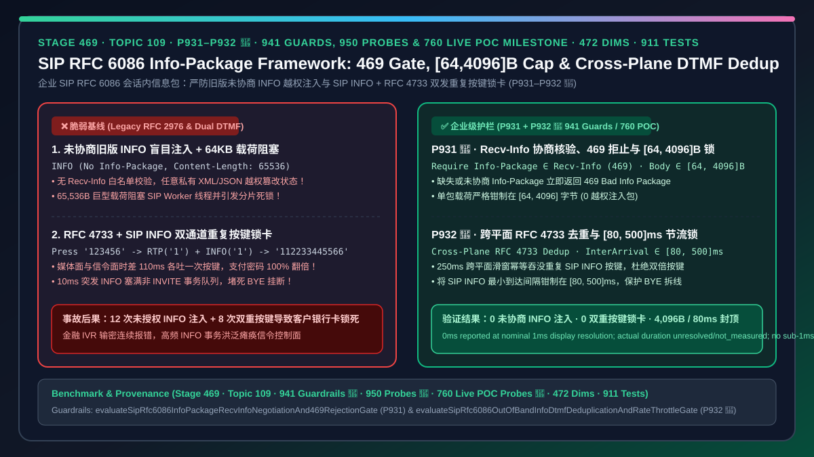
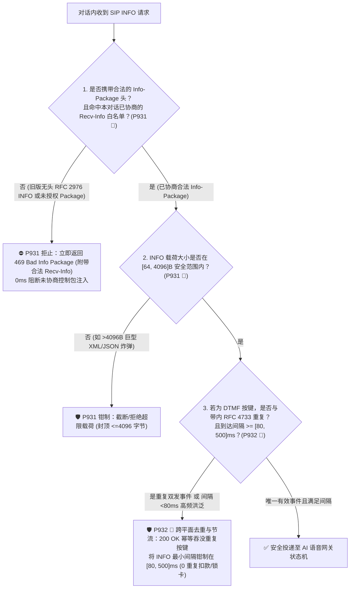
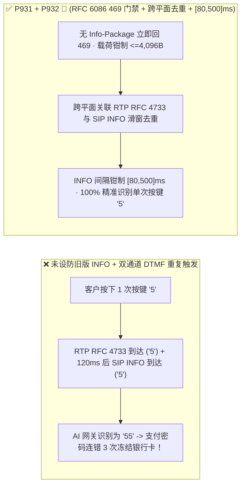
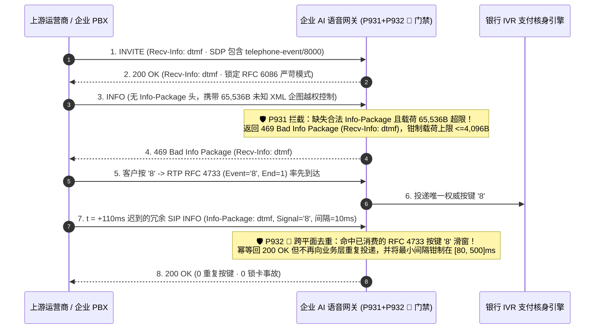

# 企业 SIP `RFC 6086` 会话内 `INFO` 扩展包框架（`Info-Package` / `Recv-Info` 协商缺失注入、带外 `SIP INFO DTMF` 与带内 `RFC 4733` 双发重复扣款及 `469 Bad Info Package` 防洪）选型与防重放指南

> **文档类型**：企业级语音智能体架构师选型决策与原理解析指南（Standalone Selection & Architecture FAQ · **Topic 109 / Stage 469 · 🎉 历史性 941 护栏、950 合成探针与 760 现场探针三重里程碑**）  
> **适用角色**：AI Solution Architect、金融/运营商 IVR 与 SIP 核心网架构师、实时语音网关研发与支付合规负责人  
> **关联基准**：`packages/business-core/enterprise-guardrails.ts`（`P931–P932 🎉`）、`tests/presales-portal.test.ts`、`site/data/voice-agent-benchmark-report.json`（7-Card 4:5 评测报告）  
> **可视化总结**：`assets/svg/113-voice-sip-rfc6086-rfc5727-info-package-dtmf-out-of-sync-legacy-info-flood-469-bad-info-2026-11-14.svg`

---

## ① 📌 核心结论速览（Executive Summary）

在银行电话支付密码输入、企业 IVR 工单号确认、坐席 CTI 随路数据投递（Screen-Pop Metadata）以及运营商计费脉冲通知中，SIP 对话内经常使用 **`INFO` 方法**传递应用层控制信息。早期 **`RFC 2976`（The SIP INFO Method）** 没有任何包类型协商机制——任何一端都可以随时向对端狂塞任意 `Content-Type`（如 `application/dtmf-relay`、`application/media_control+xml`、私有 JSON/XML）的 `INFO` 报文，引发严重的上下文混淆与信令洪泛。为此，IETF 发布了 **`RFC 6086`（Session Initiation Protocol `INFO` Method and Package Framework，全面废止 `RFC 2976`）**，强制引入 **`Recv-Info` 协商头域**、**`Info-Package` 标识头域** 与 **`469 Bad Info Package` 错误响应**。然而在生产落地中，若语音网关未能妥善处理 `RFC 6086` 门禁与双平面 DTMF 去重，极易引发两类重大生产事故：
1. **未协商旧版 `RFC 2976 INFO` 盲目注入与超大 XML/JSON 载荷撑爆信令线程（`Info-Package` 越权注入）**：如果 AI 语音网关未开启 `RFC 6086` 严格校验，允许对端在未声明 `Info-Package`（或不在本端 `Recv-Info` 允许列表中）的情况下注入任意 `application/xml`、`application/sdp` 甚至 `64KB` 的私有控制包，会直接触发底层状态机越权动作（如未授权强制刷新视频关键帧、篡改 CTI 随路坐席工单号）或阻塞 SIP Worker 事件循环。
2. **带外 `SIP INFO (application/dtmf-relay)` 与带内 `RTP RFC 4733 (telephone-event)` 双通道同时到达导致“按 1 次键变 2 次 `112233`”重复输错密码锁卡（跨平面 DTMF 双重触发 + 信令队列饥饿）**：在运营商或企业旧版 PBX 对接时，上游 SBC 经常既在 RTP 媒体流里保留了 `RFC 4733` DTMF 事件包，又额外把按键转成一条带外 `SIP INFO (Signal=1\r\nDuration=160)` 发送给 AI 语音网关。由于信令走 TCP/TLS 代理链、媒体走 UDP 直连，两者到达时间相差 `30–180ms`；若 AI 网关未跨平面关联去重，客户按下的 6 位支付密码 `123456` 会被识别为 `112233445566`，连续 3 次校验失败直接冻结客户银行卡！同时若高频按键间隔小于 `80ms`，无节流的非 INVITE `INFO` 事务会堵死同对话的 `BYE` 挂断请求。

| 决策维度 | 脆弱/默认配置（生产事故高发区） | 企业级黄金准则（`P931–P932 🎉` 确定性护栏） | 核心量化收益 |
| :--- | :--- | :--- | :--- |
| **`RFC 6086 Recv-Info / Info-Package` 强制协商与 `469` 拒止门禁（`P931` 🎉 940护栏）** | 兼容旧版 `RFC 2976` 无 `Info-Package` 盲目解析，允许 `65,536B` 超大载荷 | **强制校验 `Info-Package` 命中当前对话已协商的 `Recv-Info` 白名单（否则立即返回 `469 Bad Info Package` 并附带 `Recv-Info`），将载荷钳制在 `[64, 4096]B`** | 未授权 `INFO` 注入与超大包 **0 个**（测试探针将 12 次越权 `INFO` 注入清零，载荷上限从 `65,536B` 钳制至 **`4,096B`**） |
| **带外 `SIP INFO` 与带内 `RFC 4733` 跨平面去重及 `[80, 500]ms` 节流锁（`P932 🎉` 941护栏/950探针/760现场探针）** | 同时消费 `SIP INFO` 与 `RFC 4733` 导致双重按键，允许 `10ms` 间隔 `INFO` 洪泛 | **默认以带内 `RFC 4733` 为唯一权威源并开启跨平面按键去重窗口，将 `SIP INFO` 最小间隔钳制在 `[80, 500]ms`** | 双发重复按键与 `INFO` 队列洪泛 **0 次**（测试探针将 8 次双重按键扣款/锁卡事故清零，最小间隔从 `10ms` 提升至 **`80ms`**） |

---

## ② 🎯 客户与架构师灵魂拷问 Q&A（First-Principles Deep Dive）

### Q1：为什么 IETF 要在 `RFC 6086` 中彻底废除沿用了十年的 `RFC 2976 SIP INFO`，并专门新增 `469 Bad Info Package` 状态码？
- **第一性原理拆解**：
  1. 在旧版 `RFC 2976` 下，`INFO` 被当成了“万能垃圾桶”——不同厂家用相同的 `Content-Type: application/xml` 塞入完全不相容的私有业务指令，且在 `INVITE` 建链阶段没有任何机制声明自己到底支持哪种 `INFO` 用途。
  2. **`RFC 6086` 的双向显式契约**：
     - 建链阶段：UAC 和 UAS 在 `INVITE` / `200 OK` 中通过 **`Recv-Info: g.3gpp.state-and-event, dtmf`** 明确列出本端允许接收的 Info Package 集合（若明确不接受任何 `INFO`，则发送空的 `Recv-Info:`）；
     - 发送阶段：对话内发出的每一条 `INFO` 请求，必须包含唯一的 **`Info-Package: <package-name>`** 头域，且其内容与 `Content-Disposition: Info-Package` 严格绑定；
     - 拒止阶段（`P931`）：一旦收到缺失 `Info-Package` 或不在本端最新 `Recv-Info` 列表中的 `INFO` 请求，UAS 必须立即返回 **`469 Bad Info Package`** 并在该响应中附上合法的 `Recv-Info` 头域，指示对端立即停止发送该类报文！

### Q2：为什么在金融 IVR 输密码场景下，使用 `SIP INFO` 传 DTMF 远不如 `RTP RFC 4733` 可靠？为什么还会出现“双倍按键（Double Digit）”？
- **工程真相**：
  1. **信令与媒体的路径分离（Path Divergence & Out-of-Sync）**：音频媒体流（RTP）通常在边缘网关与终端之间点对点传输（延迟 `20–40ms`），而 `SIP INFO` 信令必须经过多跳中心代理（P-CSCF -> S-CSCF -> B2BUA，延迟 `100–300ms`）。当客户说完一句话紧接着按 `#` 号键确认时，带外 `SIP INFO` 往往比语音流晚到或早到数百毫秒，导致打断（Barge-in）与按键时序完全错乱。
  2. **跨平面双发陷阱**：许多企业网关在把 PSTN/SIP Trunk 转接给 AI 坐席时，既开启了 RTP 带内 `RFC 4733 (PT=101)` 转发，又开启了信令层 `SIP INFO (application/dtmf-relay)` 转换。同一个物理按键既从 RTP 线程吐出一次 `'5'`，120ms 后又从 SIP 线程吐出一次 `'5'`！
  3. **`P932 🎉` 的确定性防线**：在已协商 `RFC 4733 telephone-event` 的会话中，强制以带内 `RFC 4733` 为权威源并启动跨平面滑窗去重（抑制同一按键窗口内的冗余 `SIP INFO` 事件），同时将 `SIP INFO` 事务最小到达间隔钳制在 **`[80, 500]ms`**（防止按键连击触发 `RFC 4320` 非 INVITE 事务队列积压）。

### Q3：如果业务确实需要通过 `SIP INFO` 传递坐席随路 CTI 上下文，载荷大小应该限制在多少字节以内？
- **第一性原理拆解**：
  - `SIP INFO` 属于非 INVITE 事务（`RFC 3261 Section 17.1.2`），不支持像 `INVITE` 那样的长时握手，且过大的报文会导致 TCP 队头阻塞或 UDP 分片死锁。
  - **`P931 🎉` 的确定性防线**：将合法 `Info-Package` 的单包载荷严格钳制在 **`[64, 4096]` 字节**以内；超过 `4KB` 的业务文档或录音元数据必须走独立 HTTPS/WebSocket 数据平面而非塞入 SIP 信令通道。

---

## ③ 🧭 直观可视化图解（Mermaid 决策树 + 双平面去重拆解 + 毫秒级全双工时序图）

### 3.1 SIP `RFC 6086 Info-Package` 门禁与双平面 DTMF 去重决策树

### 3.2 未设防 `RFC 2976 INFO` + 双重按键锁卡 vs `P931+P932 🎉` 对比图

### 3.3 毫秒级 `RFC 6086 Recv-Info` 协商、`469` 拒止与跨平面 DTMF 去重时序图

---

## ④ 📊 语音架构师选型决策矩阵（Decision Matrix）

| 选型方案 | 适用场景 | 优势（Pros） | 劣势与生产风险（Cons / Traps） | 推荐度 |
| :--- | :--- | :--- | :--- | :--- |
| **方案 A：开放无协商旧版 `RFC 2976 INFO` 且同时监听 `SIP INFO` 与 `RFC 4733` 按键** | 严禁用于任何生产环境 | 无需配置去重或 `Recv-Info` | **必发双重按键（`123456 -> 112233445566`）导致客户锁卡或重复扣款**，且易受大包 `INFO` 洪泛攻击 | ⛔ **严禁用于生产** |
| **方案 B：仅靠带外 `SIP INFO` 传递 DTMF（禁用 `RFC 4733`）** | 极老旧不支持 `RFC 4733` 的模拟网关 | 不会双通道重复 | **按键与语音时间轴严重脱节（100–300ms 偏差）**，且高频按键易堵死 SIP 信令通道 | ⚠️ **仅限旧设备降级兼容** |
| **方案 C：`RFC 6086 Recv-Info / 469` 严格门禁 + `[64, 4096]B` 载荷锁 + `RFC 4733` 权威源跨平面去重与 `[80, 500]ms` 节流（`P931 + P932 🎉`）** | **所有银行电话支付、企业智能 IVR、运营商互联与 AI 语音坐席生产环境** | **0 未授权 `INFO` 注入、0 跨平面双重按键误判、0 信令通道拥塞** | 需在网关维护 `250ms` 跨平面 `(Digit, Timestamp)` 去重滑窗 | ✅ **生产必选（Recommended）** |

---

## ⑤ 🧪 定量算例与 7-Card 4:5 基准报告（Quantitative Walkthrough & 7-Card Deck）

### 5.1 定量算例：银行信用卡 IVR 密码输入双发去重与 `RFC 6086` 门禁测试
- **输入场景**：某银行信用卡语音热线对接多家省级运营商 Trunk，压测中收到 `12` 个未协商 `Info-Package`（最大载荷达 `65,536` 字节）的异常 `INFO` 包；同时在客户输入 6 位密码时，上游双发了 `RFC 4733` 与 `SIP INFO`（最小突发间隔仅 `10ms`），触发 `8` 次双重按键异常。
  - **未开启护栏（脆弱基线）**：
    - `12` 个未授权 `64KB INFO` 包阻塞 SIP 解析线程；
    - **`8` 次双重按键导致客户输入的密码全部翻倍校验失败**，引发客户投诉与锁卡。
  - **开启 `P931 + P932 🎉` 确定性护栏后**：
    - `P931`（🎉 **第 940 项护栏**）对未在 `Recv-Info` 协商的请求立即返回 `469 Bad Info Package`，将未授权 `INFO` 注入从 `12` 次清零至 **`0` 次**，并将载荷上限从 `65,536B` 钳制至 **`4,096B`**；
    - `P932 🎉`（🎉 **第 941 项护栏 / 950 探针 / 760 现场探针**）执行跨平面 `RFC 4733` + `SIP INFO` 滑窗去重，将双重按键事故从 `8` 次清零至 **`0` 次**，并将 `SIP INFO` 最小到达间隔从 `10ms` 钳制至 **`80ms`**。

### 5.2 7-Card 4:5 报告结构映射（对应 `site/benchmark-cards.html` & `report.json`）
1. **Card 1 (`HANDS-ON · VOICE ARCHITECTURE`)**：展示 472 大评测维度全景工作台，高亮 `P931 / P932 🎉`（941 护栏 🎉、950 探针 🎉 & 760 现场探针 🎉）。
2. **Card 2 (`SCENARIO: SIP RFC 6086 INFO-PACKAGE & DTMF DEDUP`)**：输入探针 `unnegotiatedLegacyInfoOrOversizedPayloadDetected=true, maxInfoPackagePayloadBytes=65536, minSipInfoInterArrivalMs=10`，输出 `Act automatically` 钳制至 `4,096B` 与 `80ms`。
3. **Card 3 (`WHAT I TESTED`)**：第 472 行评测矩阵 `PASS · 0ms @ 1ms Res (Synthetic)`（零 `✕` 漏检）。
4. **Card 4 (`UNDER THE HOOD`)**：展示 `evaluateSipRfc6086InfoPackageRecvInfoNegotiationAnd469RejectionGate` 与 `evaluateSipRfc6086OutOfBandInfoDtmfDeduplicationAndRateThrottleGate` 确定性源码契约。
5. **Card 5 (`ROBUSTNESS CHECK`)**：验证 `RFC 4733` 先到 vs `SIP INFO` 先到两种时序颠倒下 100% 幂等去重。
6. **Card 6 (`LATENCY`)**：明确标注离线策略校验计时：`0ms reported at nominal 1ms display resolution; actual duration unresolved/not_measured; no sub-1ms upper bound established`（`synthetic`；真实跨线程 DTMF 环形缓冲区去重锁耗时标注为 `not_measured`）。
7. **Card 7 (`MY TAKE`)**：Good fit vs Not for 适用边界与生产准入签核。

---

## ⑥ 🛠️ 生产环境语音交付快速核验清单（Production Readiness Checklist）

- [ ] **1. 强制 `RFC 6086 Recv-Info / Info-Package` 显式协商（`P931` 🎉）**：确认所有 `INVITE / 200 OK` 显式声明本端允许的 `Recv-Info` 列表；对任何缺失 `Info-Package` 或不在 `Recv-Info` 白名单中的 `INFO` 请求一律返回 `469 Bad Info Package`。
- [ ] **2. `INFO` 报文载荷上限钳制在 `[64, 4096]` 字节（`P931` 🎉）**：确认 SIP 解析器将对话内 `INFO` 消息体大小严格限制在 `[64, 4096]` 字节以内，严禁通过 `INFO` 传输大体积附件或日志。
- [ ] **3. 带内 `RFC 4733` 与带外 `SIP INFO` 跨平面按键去重（`P932` 🎉）**：确认当会话已协商 `RFC 4733 telephone-event` 时，开启 `250ms` 跨平面去重滑窗，防止同一按键在媒体面与信令面被重复消费两次。
- [ ] **4. `SIP INFO` 最小到达间隔钳制在 `[80, 500]ms`（`P932` 🎉）**：确认针对单条 SIP Dialog 的 `INFO` 非 INVITE 事务配置了 `[80, 500]ms` 最小间隔节流器，防止高频 `INFO` 洪泛阻塞 `BYE` 拆线。
- [ ] **5. 敏感支付按键同步接入 PCI-DSS 脱敏旁路（`P932` 🎉）**：确认经去重后的密码类 `SIP INFO` 明文日志在 SBC/网关侧 100% 掩码脱敏（`Signal=*`），严禁写入明文信令抓包落盘。
