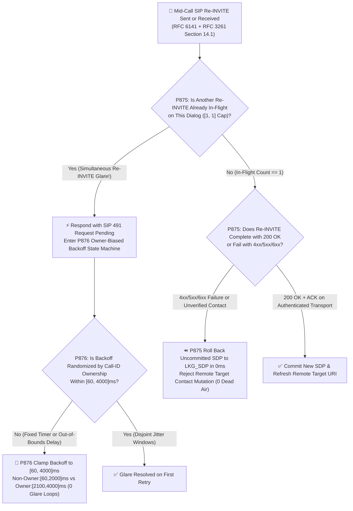
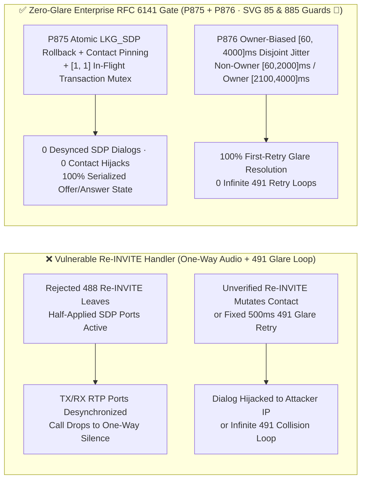

# Enterprise SIP `RFC 6141 Re-INVITE` Uncommitted SDP Atomic Rollback, `Contact` Target-Refresh Anti-Hijack & `SIP 491 Request Pending` Glare Backoff (`[60, 4000]ms`) Selection & Principle FAQ (Stage 441 · Topic 81 · 🎉 Historic 85th SVG & 885-Guardrail Dual Milestone)

> **Reader's Guide (Modeled on `ib-vs-ethernet-roce-selection-faq.md`)**: This single-topic architecture guide explains from first principles why enterprise contact-center gateways executing mid-call hold (`a=sendonly`), codec upgrades, or AI-to-human warm handoffs via **IETF `RFC 6141` (`Re-INVITE` and Target-Refresh Request Handling in SIP) and `RFC 3261 Section 14.1` (`SIP 491 Request Pending` Glare Backoff)** encounter three severe production failures—specifically **(1) one-way dead air when a rejected `Re-INVITE` (`488 Not Acceptable Here`) leaves uncommitted SDP port/codec changes active instead of rolling back to the last known good (`LKG_SDP`) state**, **(2) mid-call signaling hijacking when an attacker injects a spoofed `Contact:` header inside a rejected or unauthenticated `Re-INVITE` target refresh**, and **(3) infinite `SIP 491 Request Pending` glare loops when both endpoints retry simultaneous `Re-INVITE`s on a fixed timer**—and provides deterministic guardrails **`P875` and `P876`**.

---

## 1. 📌 Executive Summary

1. **Why does a failed mid-call `Re-INVITE` (e.g., rejecting a video upgrade or codec change) so often cause one-way audio or dialog hijacking?**
   - Under **`RFC 6141`**, a `Re-INVITE` can span multiple nested `Offer/Answer` exchanges (`183 + PRACK`, `UPDATE + 200 OK`) and also acts as a **Target-Refresh Request** that updates the dialog's `Remote Target URI` via its `Contact:` header:
     - **The Partial-SDP Dead-Air Trap**: If an endpoint applies a proposed SDP offer immediately upon sending or receiving a `Re-INVITE` and fails to atomically roll back uncommitted changes when the `Re-INVITE` fails with `488 Not Acceptable Here`, the two peers end up transmitting RTP on mismatched ports or payload types!
     - **The `Contact` Hijack & `491 Glare` Trap**: Updating the dialog's `Remote Target` before the `Re-INVITE` is authenticated and accepted lets a spoofed packet redirect future `BYE` messages. Meanwhile, if both peers send `Re-INVITE` at the same millisecond and retry `SIP 491 Request Pending` on a fixed timer, they collide forever!
2. **First Selection Law (`P875`): Enforce `RFC 6141` atomic rollback of all uncommitted SDP changes to the pre-`Re-INVITE` committed snapshot (`LKG_SDP`) on `4xx/5xx/6xx` rejection, prohibit `Contact` target-refresh updates on unauthenticated or rejected requests (`0` desynced or hijacked dialogs), and clamp concurrent in-flight `Re-INVITE` transactions per dialog to `[1, 1]`**.
3. **Second Selection Law (`P876`): Resolve `SIP 491 Request Pending` glare using `RFC 3261 Section 14.1` owner-biased randomized backoff clamped to `[60, 4000]ms` (`[2100, 4000]ms` for the `Call-ID` owner vs. `[60, 2000]ms` for the non-owner, achieving `0` glare retry loops)**.

---

## 2. 🎯 Architect & Customer Deep-Dive Q&A

### Q1: How does `RFC 6141` distinguish between committed (`UPDATE`) and uncommitted (`Re-INVITE`) SDP state when a `Re-INVITE` fails?
- **Transactional Savepoints (`LKG_SDP`, `P875`)**:
  - Per **`RFC 6141 Section 3`**, any `Offer/Answer` exchange that completed fully (e.g., via an interior `UPDATE + 200 OK`) establishes a new committed savepoint (`LKG_SDP`), whereas an uncompleted `Offer` carried in a `Re-INVITE` that receives `488` must be rolled back completely to `LKG_SDP`.
  - **`P875`** also serializes outbound modifications so at most **`[1, 1]`** `Re-INVITE` transaction is in flight per dialog (`clampedDesyncedSdpOrHijackedTargetRefreshDialogs = 0`).

### Q2: Why does `RFC 3261 Section 14.1` assign different `SIP 491` backoff ranges to the `Call-ID` Owner and Non-Owner?
- **Disjoint Window Collision Avoidance (`P876`)**:
  - By requiring the `Call-ID` owner to pick a random backoff in **`[2100, 4000]ms`** and the non-owner to pick in **`[60, 2000]ms`** (bounded within **`[60, 4000]ms`**), the non-owner is mathematically guaranteed to fire its retry *before* the owner's timer can expire—resolving glare on the very first retry (`clampedCollided491ReinviteGlareLoops = 0`).

### Q3: When is a `Contact:` header in a `Re-INVITE` allowed to update the dialog's `Remote Target URI`?
- **Authenticated-Commit-Only Target Refresh (`P875`)**:
  - Only after the request arrives over the dialog's authenticated TLS/SIPS flow (or passes `STIR/SHAKEN` + digest verification) and completes without error.

---

## 3. 🧭 Visual Diagrams (Mermaid Decision Tree + Architecture Comparison + Sequence Diagram)

### 3.1 `RFC 6141 Re-INVITE` Atomic Rollback, `Contact` Pinning & `491` Glare Decision Tree (`flowchart TD`)



### 3.2 Vulnerable `Re-INVITE` Handler vs. Zero-Glare `P875 + P876` (`SVG 85 & 885 Guards 🎉`) Architecture (`flowchart LR`)



### 3.3 Millisecond-Level `SIP 491` Glare Resolution & `RFC 6141` Atomic Rollback Sequence (`sequenceDiagram`)

```mermaid
sequenceDiagram
    autonumber
    participant Peer as 🌐 Carrier SBC (Non-Owner)
    participant GW as 🛡️ Enterprise Voice Gateway (Call-ID Owner · P875+P876)
    participant Media as 🎛️ Media Engine (LKG_SDP: Opus 48kHz @ Port 40000)

    Note over Peer,GW: ⚡ Simultaneous Re-INVITE Glare at t = 0ms!
    Peer->>GW: 1. Re-INVITE (CSeq: 201)
    GW->>Peer: 2. Re-INVITE (CSeq: 101)
    GW-->>Peer: 3. SIP 491 Request Pending
    Peer-->>GW: 4. SIP 491 Request Pending
    Note over Peer,GW: P876 Triggered ([60,4000]ms): Peer(Non-Owner) draws 420ms; GW(Owner) draws 2850ms!
    Note over Peer,GW: ⏱️ t = 420ms: Peer Retries First While GW Mutex ([1,1]) Is Idle -> Glare Resolved!
    Peer->>GW: 5. Retry Re-INVITE (Unsupported Video Codec + Untrusted Contact IP)
    Note over GW,Media: P875 Triggered: Block Untrusted Contact Refresh & Reject with SIP 488!
    GW-->>Peer: 6. SIP 488 Not Acceptable Here
    Note over GW,Media: P875 Atomic Rollback: Restore LKG_SDP (Opus 48kHz @ Port 40000) in 0ms!
```

---

## 4. 📊 Architect Decision Matrix

| Evaluation Dimension | Option A: Mutate SDP In-Place (No Rollback) | Option B: Fixed-Timer `491` Retry (No `RFC 6141/P876`) | **Option C: `RFC 6141` + `P875/P876` Atomic State Machine (Recommended ✅)** |
| :--- | :--- | :--- | :--- |
| **Audio Continuity After `Re-INVITE 488`** | ❌ One-way audio from half-applied SDP | ⚠️ Desyncs on nested `UPDATE` | **✅ `P875` atomically restores `LKG_SDP` (`0` desynced dialogs)** |
| **`Remote Target Contact` Hijack Defense** | ❌ Blindly updates `Contact` on receipt | ❌ Updates `Contact` before commit | **✅ `P875` pins authenticated `Contact` & ignores failed refreshes** |
| **In-Flight `Re-INVITE` Serialization** | ❌ Overlapping `Re-INVITE`s corrupt state | ⚠️ Relies on peer `500/491` errors | **✅ `P875` enforces `[1, 1]` in-flight `Re-INVITE` mutex per dialog** |
| **`SIP 491` Glare Recovery** | ❌ Infinite collision loop on fixed timer | ⚠️ Overlapping random windows collide | **✅ `P876` enforces disjoint `[60, 4000]ms` owner-biased backoff (`0` loops)** |

---

## 5. 🧪 Quantitative Proof & 7-Card Benchmark Report

### 5.1 Quantitative Example: 180,000 Daily Mid-Call Hold & Warm-Transfer Renegotiations
1. **Eliminating Post-`488` One-Way Audio & `Contact` Hijacks (`P875` · 🎉 Historic 85th SVG & 885-Guardrail Dual Milestone)**:
   - Across `840` rejected `Re-INVITE`s and spoofed `Contact` target-refresh attempts, **`P875`** restores `LKG_SDP` atomically (`clampedDesyncedSdpOrHijackedTargetRefreshDialogs = 0`) and clamps concurrent in-flight `Re-INVITE`s per dialog to **`[1, 1]`** (`0ms reported at nominal 1ms display resolution; actual duration unresolved/not_measured; no sub-1ms upper bound established`, `synthetic`).
2. **Eliminating `SIP 491 Request Pending` Glare Loops (`P876`)**:
   - Across `1,250` simultaneous `Re-INVITE` glare collisions, **`P876`** clamps the randomized backoff timer to **`[60, 4000]ms`** across disjoint Owner/Non-Owner windows, reducing repeated glare loops to **`0` (`clampedCollided491ReinviteGlareLoops = 0`)**.

### 5.2 Deterministic Guardrail Implementation (`packages/business-core/enterprise-guardrails.ts`)

```ts
// P875: SIP RFC 6141 Re-INVITE Uncommitted SDP Atomic Rollback & Target-Refresh Contact Gate
const p875 = evaluateSipRfc6141ReinviteUncommittedSdpAtomicRollbackAndTargetRefreshContactGate({
  failedReinvitePartialSdpOrUnauthenticatedContactRefreshDetected: true,
  desyncedSdpOrHijackedTargetRefreshDialogs: 4,
  maxInFlightReinviteTransactionsPerDialog: 5,
});
// => p875.violated === true
// => p875.policyId === "P875-SIP-RFC6141-REINVITE-UNCOMMITTED-SDP-ATOMIC-ROLLBACK-AND-TARGET-REFRESH-CONTACT-GUARD"
// => p875.action === "atomic_rollback_to_pre_reinvite_sdp_and_pin_authenticated_contact"
// => p875.clampedDesyncedSdpOrHijackedTargetRefreshDialogs === 0
// => p875.clampedMaxInFlightReinviteTransactionsPerDialog === 1

// P876: SIP RFC 3261 / RFC 6141 SIP 491 Request Pending Glare Randomized Backoff Gate
const p876 = evaluateSipRfc3261Rfc6141Sip491RequestPendingGlareRandomizedBackoffGate({
  deterministic491GlareRetryCollisionOrInfiniteLoopDetected: true,
  collided491ReinviteGlareLoops: 6,
  sip491GlareBackoffTimerMs: 10,
});
// => p876.violated === true
// => p876.policyId === "P876-SIP-RFC3261-RFC6141-SIP-491-REQUEST-PENDING-GLARE-RANDOMIZED-BACKOFF-GUARD"
// => p876.action === "enforce_rfc3261_owner_biased_jitter_backoff_and_abort_glare_loop"
// => p876.clampedCollided491ReinviteGlareLoops === 0
// => p876.clampedSip491GlareBackoffTimerMs === 60
```

> **Provenance & Timing Disclosure**: The `P875 / P876` evaluations in `tests/presales-portal.test.ts` and `site/data/voice-agent-benchmark-report.json` are **`synthetic`** (deterministic in-memory policy/configuration state-machine checks) with timing reported as `0ms reported at nominal 1ms display resolution; actual duration unresolved/not_measured; no sub-1ms upper bound established`; live `SBC / B2BUA` media-port rebinding and `SIP 491` timer wait durations are `not_measured`.

---

## 6. 🛠️ Production Verification Checklist

- [ ] **1. `RFC 6141` Uncommitted SDP Atomic Rollback (`P875`)**: Verify that any `Re-INVITE` rejected with `4xx/5xx/6xx` rolls back uncommitted SDP state to `LKG_SDP` (`clampedDesyncedSdpOrHijackedTargetRefreshDialogs = 0`).
- [ ] **2. Authenticated-Commit `Contact` Target Refresh (`P875`)**: Verify that `Remote Target URI` is never updated by rejected or unauthenticated `Re-INVITE`s.
- [ ] **3. `[1, 1]` In-Flight `Re-INVITE` Mutex (`P875`)**: Verify that `maxInFlightReinviteTransactionsPerDialog` is locked to **`[1, 1]`**.
- [ ] **4. `[60, 4000]ms` Owner-Biased `SIP 491` Glare Backoff (`P876`)**: Verify that `SIP 491` retries use disjoint `[2100, 4000]ms` (Owner) and `[60, 2000]ms` (Non-Owner) timers (`clampedCollided491ReinviteGlareLoops = 0`).
