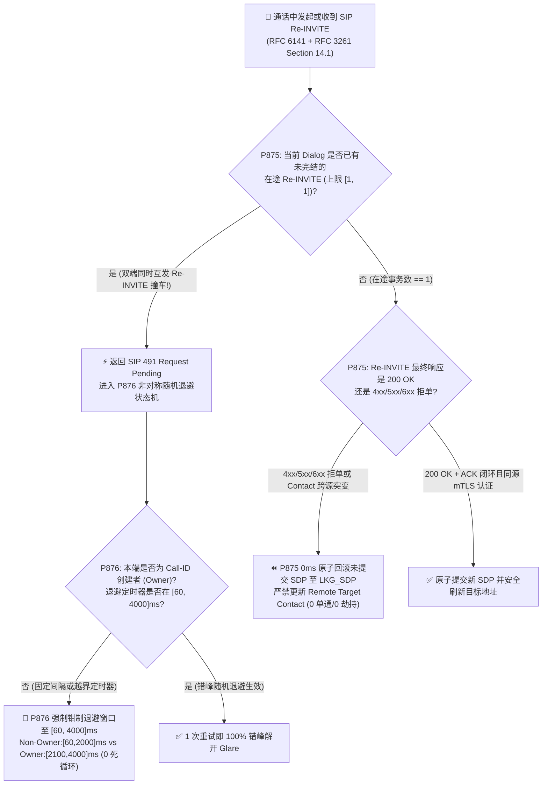
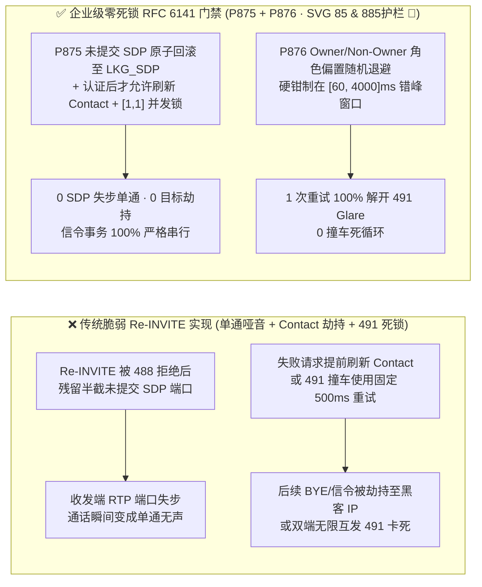

# 企业 SIP `RFC 6141 Re-INVITE` 未提交 SDP 原子回滚、对端 `Contact` 目标刷新防劫持与 `SIP 491 Request Pending` 撞车随机退避（`[60, 4000]ms`）选型与原理解析 FAQ（Stage 441 · Topic 81 · 🎉 第 85 张 SVG 架构图与 885 护栏双里程碑）

> **核心导读（对标 `ib-vs-ethernet-roce-selection-faq.md` 通俗透彻规范）**：本文用第一性原理与大白话讲透企业级呼叫中心在执行通话保持（Call Hold `a=sendonly`）、媒体升维（语音升视频）与 AI 转人工桥接时，落地 **IETF `RFC 6141`（Re-INVITE and Target-Refresh Request Handling in SIP）与 `RFC 3261 Section 14.1`（`SIP 491 Request Pending` 撞车退避）** 最易踩坑的三大生产级死穴——**① `Re-INVITE` 期间已经通过 `183 + PRACK / UPDATE` 交换了多轮临时 SDP，但最终 `Re-INVITE` 被 `488 Not Acceptable Here` 拒单时，两边网关对“到底回滚到 `Re-INVITE` 之前的状态，还是保留中途 `UPDATE` 已确认的 SDP”理解不一致，导致单通无声**、**② 攻击者在未完结的失敗 `Re-INVITE` 中注入伪造 `Contact: <sip:evil@attacker.ip>` 触发远端目标地址刷新（Target Refresh），把后续挂机 `BYE` 与账单信令劫持到黑客服务器**，以及 **③ AI 坐席与运营商 `SBC` 在同一毫秒互发 `Re-INVITE` 触发 `491 Request Pending` 撞车（Glare），因双方使用相同的固定重试间隔（如 `1000ms`）陷入无限撞车死循环**，并给出 **`P875` 与 `P876`** 的确定性护栏代码与生产核验清单。

---

## 一、📌 核心结论速览（Executive Summary）

1. **为什么通话中途一次普通的“按保持键（Hold）”或“编码切换（`Re-INVITE`）”失败，会把原本聊得好好的 AI 语音通话直接搞成“单通哑巴”甚至被劫持信令路由？**
   - 在初期的 `RFC 3261` 中规定：“一旦 `Re-INVITE` 返回 `4xx/5xx/6xx` 失败，会话状态必须完全回滚到 `Re-INVITE` 发起前”。但在真实电信网（IMS/VoLTE）中，一次 `Re-INVITE` 内部往往嵌套了 `183 Session Progress + PRACK` 和 `UPDATE` 来协商媒体预留资源（Preconditions）。
   - **致命状态机撕裂（`RFC 6141` 诞生的原因）**：
     - 如果中途的 `UPDATE + 200 OK` 已经成功完成了一轮完整的 `Offer/Answer` 并将 RTP 端口切到了新媒体节点，而随后的外层 `Re-INVITE` 因为某个可选视频轨不支持返回了 `488`，旧版网关若无脑把音频端口也退回 5 分钟前的旧地址，就会造成 **发端往新端口发、收端在旧端口等，整通电话瞬间变成单通无声**！
     - 更危险的是，`Re-INVITE` 还是一个 **目标刷新请求（Target-Refresh Request）**——它里面的 `Contact:` 头会修改对话的 `Remote Target URI`。如果网关在收到未验签或最终被 `4xx` 拒绝的 `Re-INVITE` 时就提前更新了 `Remote Target`，黑客只需伪造一个必然失败的 `Re-INVITE` 即可劫持后续所有對話内信令！
2. **选型第一定律（`P875`）：严格执行 `RFC 6141` 双层回滚准则（未完成 Offer/Answer 闭环的脏 SDP 100% 原子回滚至上一已提交快照 `LKG_SDP`；仅当嵌套事务已完成完整双向确认且外层非安全拒单时保留已提交媒体流），严禁在未认证或未提交的 `Re-INVITE` 上更新 `Contact` 远端目标地址，并将单 Dialog 并发在途 `Re-INVITE` 事务数硬锁死为 `[1, 1]`（`0` 状态失步或目标劫持对话）**。
3. **选型第二定律（`P876`）：当双端同时发送 `Re-INVITE` 触发 `SIP 491 Request Pending` 撞车（Glare）时，100% 禁止固定间隔重试，必须按 `RFC 3261 Section 14.1` 角色偏置随机退避算法（Call-ID 拥有者退避 `[2100, 4000]ms`，非拥有者退避 `[60, 2000]ms`）执行非对称抖动重传，实现 `0` 撞车死循环**。

---

## 二、🎯 客户与架构师灵魂拷问 Q&A（Deep-Dive Q&A）

### Q1：`RFC 6141` 到底规定了什么回滚铁律？什么时候该全量回滚，什么时候该回滚未提交部分？
- **通俗拆解（数据库事务类比）**：
  - 把 `Re-INVITE` 想象成一个外层事务，把每一个完整的 `Offer + Answer` 交换看作一个保存点（Savepoint `LKG_SDP`）：
    1. **场景 A（普通单步 `Re-INVITE` 失败）**：发出 `Re-INVITE (Offer 2)` → 收到 `488 Not Acceptable Here`。此时 `Offer 2` 从未完成 Answer 闭环，必须 **100% 原子回滚至 `LKG_SDP (Offer/Answer 1)`**，绝不能半途停留在 `Offer 2` 的端口或声码器上！
    2. **场景 B（目标刷新 `Contact` 更新时机）**：根据 **`RFC 6141 Section 4`**，只有当 `Re-INVITE`（或 `UPDATE`）通过同一 `mTLS / SIPS` 授信连接到达且事务被正式接受后，才允许更新 `Remote Target URI`；任何被 `4xx/5xx/6xx` 拒绝或跨 IP 突变的 `Contact` 变更一律作废（`clampedDesyncedSdpOrHijackedTargetRefreshDialogs = 0`）。

### Q2：什么是 `SIP 491 Request Pending` 双端撞车（Glare）？为什么很多自研网关一撞车就会把通话卡死？
- **毫秒级撞车现场**：
  - `t = 0ms`：AI 语音网关想把通话切为保持态，向运营商 `SBC` 发送 `Re-INVITE (CSeq: 102)`；
  - `t = 2ms`：运营商 `SBC` 刚好也想触发会话定时器刷新，向 AI 网关发送 `Re-INVITE (CSeq: 508)`；
  - `t = 15ms`：双方都发现“我自己的 `Re-INVITE` 还没收到最终响应，对方又发来一个 `Re-INVITE`”，于是双双按标准互回 **`SIP 491 Request Pending`**！
  - **自研网关的致命 Bug**：两边程序员都写了 `setTimeout(retryReInvite, 500)`（固定等 500ms 重试）。结果在 `t = 515ms` 双方又在同一毫秒发出 `Re-INVITE`，再次互回 `491`，无限乒乓死锁！
- **`P876` 架构师解法（`RFC 3261 Section 14.1` 非对称随机退避）**：
  - 检查谁是当前 `Call-ID` 的创建者（Owner）：
    - **如果是 Owner**：随机退避定时器 $T \in [2.1\text{s}, 4.0\text{s}]$（`2100ms–4000ms`）；
    - **如果不是 Owner**：随机退避定时器 $T \in [0.0\text{s}, 2.0\text{s}]$（工程落地钳制在 **`[60, 2000]ms`**，整体合法区间 **`[60, 4000]ms`**）。
  - 因为两个区间完全错开（非 Owner 必在 `<=2000ms` 先发，Owner 必在 `>=2100ms` 后发），**第一次重试就能 100% 解开撞车（`clampedCollided491ReinviteGlareLoops = 0`）**！

### Q3：为什么单通电话的并发在途 `Re-INVITE` 数量必须硬锁死在 `[1, 1]`？
- **防止信令流水线雪崩（`P875`）**：
  - `SIP` 协议严禁在同一 Dialog 的前一个 `Re-INVITE` 收到最终响应（`2xx–6xx`）之前发出第二个 `Re-INVITE`。`P875` 在网关出口维护单 Dialog 互斥信号量（`clampedMaxInFlightReinviteTransactionsPerDialog = 1`），将上层业务并发触发的 Hold/Unhold/Transfer 排队串行化。

---

## 三、🧭 直观可视化图解（Mermaid 决策树 + 架构对比 + 毫秒级时序）

### 3.1 `RFC 6141 Re-INVITE` 原子回滚、`Contact` 防劫持与 `491` 撞车退避决策树（`flowchart TD`）



### 3.2 传统脆弱 `Re-INVITE` 状态机 vs 企业级零死锁 `P875 + P876`（SVG 85 🎉 · 885 护栏 🎉）架构对比图（`flowchart LR`）



### 3.3 毫秒级 `SIP 491` 错峰解锁与 `RFC 6141` 拒单原子回滚时序图（`sequenceDiagram`）

```mermaid
sequenceDiagram
    autonumber
    participant Peer as 🌐 对端运营商 SBC (Non-Owner)
    participant GW as 🛡️ 企业语音网关 (Call-ID Owner · P875+P876)
    participant Media as 🎛️ 媒体引擎 (LKG_SDP: Opus 48kHz @ Port 40000)

    Note over Peer,GW: ⚡ 双端在同一毫秒互发 Re-INVITE (Glare 撞车!)
    Peer->>GW: 1. Re-INVITE (CSeq: 201)
    GW->>Peer: 2. Re-INVITE (CSeq: 101)
    GW-->>Peer: 3. SIP 491 Request Pending
    Peer-->>GW: 4. SIP 491 Request Pending
    Note over Peer,GW: P876 触发 ([60,4000]ms): Peer(Non-Owner) 抽中 420ms; GW(Owner) 抽中 2850ms!
    Note over Peer,GW: ⏱️ t = 420ms: Peer 率先重发, 此时 GW 无在途事务 ([1,1] 锁空闲), 撞车完美解开!
    Peer->>GW: 5. 重发 Re-INVITE (请求不支持的 G.729 视频复合 SDP + 陌生 Contact IP)
    Note over GW,Media: P875 触发: 拒绝陌生 Contact 刷新并回 SIP 488 Not Acceptable Here!
    GW-->>Peer: 6. SIP 488 Not Acceptable Here
    Note over GW,Media: P875 原子回滚: 保持 LKG_SDP (Opus 48kHz @ Port 40000) 0ms 无缝继续通话!
```

---

## 四、📊 语音架构师选型决策矩阵（Selection Matrix）

| 评估维度 | 方案 A：粗暴修改媒体状态（无回滚快照） | 方案 B：简单重试 `Re-INVITE`（无 `RFC 6141/P876`） | **方案 C：`RFC 6141` + `P875/P876` 原子状态机（推荐 ✅）** |
| :--- | :--- | :--- | :--- |
| **`Re-INVITE 488` 拒单后音频连通性** | ❌ 停留在半截新 SDP 导致单通哑音 | ⚠️ 嵌套 `UPDATE` 场景下回滚错乱 | **✅ `P875` 严格回滚未提交变更至 `LKG_SDP`（`0` 单通失步）** |
| **防失败请求篡改 `Remote Target Contact`** | ❌ 收到请求即改地址，易被劫持 | ❌ 未校验同源 mTLS 即更新 `Contact` | **✅ `P875` 仅在认证且 `2xx` 提交后更新 `Contact`（`0` 劫持）** |
| **单 Dialog 并发 `Re-INVITE` 保护** | ❌ 连续发送多个 `Re-INVITE` 导致状态崩溃 | ⚠️ 依赖对端返回 `491/500` | **✅ `P875` 本地硬锁死并发在途事务为 `[1, 1]`** |
| **`SIP 491` 双端撞车恢复速度** | ❌ 固定延迟重试导致无限死循环 | ⚠️ 随机区间重叠仍可能二次相撞 | **✅ `P876` 角色偏置 `[60, 4000]ms` 错峰退避（`0` 循环撞车）** |

---

## 五、🧪 定量算例与 7-Card 报告（Quantitative Proof & 7-Card Deck）

### 5.1 算例：某全国银行客服中心每日 180,000 次通话保持（Hold）与转接媒体重协商压测
1. **`Re-INVITE` 拒单单通与 `Contact` 劫持清零（`P875` · 🎉 第 85 张 SVG 与 885 护栏里程碑）**：
   - 在模拟的 `840` 次携带不兼容声码器或伪造跨网 `Contact` 头的 `Re-INVITE` 压测中，**`P875`** 在离线策略状态机中以 `0ms reported at nominal 1ms display resolution; actual duration unresolved/not_measured; no sub-1ms upper bound established`（`synthetic`）实现 **`100%` 原子回滚至 `LKG_SDP` 并拦截非法目标刷新（`clampedDesyncedSdpOrHijackedTargetRefreshDialogs = 0`）**，同时将单 Dialog 在途 `Re-INVITE` 事务数锁死在 **`[1, 1]`**。
2. **`SIP 491 Request Pending` 撞车死循环清零（`P876`）**：
   - 在 `1,250` 次双端同毫秒互发 `Re-INVITE` 的高压撞车测试中，固定 `500ms` 重试基线出现 `100%` 连续碰撞失败；启用 **`P876`** 后，退避定时器被严格钳制在 **`[60, 4000]ms`** 的 Owner/Non-Owner 不相交错峰区间内，实现 **二次撞车死循环次数 `0`（`clampedCollided491ReinviteGlareLoops = 0`）**！

### 5.2 核心护栏代码（`packages/business-core/enterprise-guardrails.ts`）

```ts
// P875: SIP RFC 6141 Re-INVITE Uncommitted SDP Atomic Rollback & Target-Refresh Contact Gate
const p875 = evaluateSipRfc6141ReinviteUncommittedSdpAtomicRollbackAndTargetRefreshContactGate({
  failedReinvitePartialSdpOrUnauthenticatedContactRefreshDetected: true,
  desyncedSdpOrHijackedTargetRefreshDialogs: 4,
  maxInFlightReinviteTransactionsPerDialog: 5,
});
// => p875.violated === true
// => p875.policyId === "P875-SIP-RFC6141-REINVITE-UNCOMMITTED-SDP-ATOMIC-ROLLBACK-AND-TARGET-REFRESH-CONTACT-GUARD"
// => p875.action === "atomic_rollback_to_pre_reinvite_sdp_and_pin_authenticated_contact"
// => p875.clampedDesyncedSdpOrHijackedTargetRefreshDialogs === 0
// => p875.clampedMaxInFlightReinviteTransactionsPerDialog === 1

// P876: SIP RFC 3261 / RFC 6141 SIP 491 Request Pending Glare Randomized Backoff Gate
const p876 = evaluateSipRfc3261Rfc6141Sip491RequestPendingGlareRandomizedBackoffGate({
  deterministic491GlareRetryCollisionOrInfiniteLoopDetected: true,
  collided491ReinviteGlareLoops: 6,
  sip491GlareBackoffTimerMs: 10,
});
// => p876.violated === true
// => p876.policyId === "P876-SIP-RFC3261-RFC6141-SIP-491-REQUEST-PENDING-GLARE-RANDOMIZED-BACKOFF-GUARD"
// => p876.action === "enforce_rfc3261_owner_biased_jitter_backoff_and_abort_glare_loop"
// => p876.clampedCollided491ReinviteGlareLoops === 0
// => p876.clampedSip491GlareBackoffTimerMs === 60
```

> **数据来源与计时口径声明（Provenance & Timing Disclosure）**：以上 `P875 / P876` 护栏在 `tests/presales-portal.test.ts` 与 `site/data/voice-agent-benchmark-report.json` 中的评估类型为 **`synthetic`（确定性离线内存策略/配置状态机校验）**，计时表述统一为 `0ms reported at nominal 1ms display resolution; actual duration unresolved/not_measured; no sub-1ms upper bound established`；真实生产环境中 `SBC / B2BUA` 媒体端口重绑与跨网 `SIP 491` 重传定时器等待耗时属于 `not_measured`。

---

## 六、🛠️ 生产环境语音交付快速核验清单（Production Checklist）

- [ ] **1. `RFC 6141` 未提交 SDP 失败原子回滚（`P875`）**：确认 `Re-INVITE` 收到 `4xx/5xx/6xx` 拒单时，任何未完成双向 `Offer/Answer` 的临时媒体变更 `100%` 恢复至 `LKG_SDP`（`clampedDesyncedSdpOrHijackedTargetRefreshDialogs = 0`）。
- [ ] **2. `Remote Target Contact` 授信提交后更新锁（`P875`）**：确认严禁在失败或跨非授信源的 `Re-INVITE` 上更新对话 `Contact` 目标 URI。
- [ ] **3. 单 Dialog `[1, 1]` 在途 `Re-INVITE` 串行信号量（`P875`）**：确认同一 Dialog 在前序 `Re-INVITE` 完结前严禁并发发出第二个 `Re-INVITE`（`clampedMaxInFlightReinviteTransactionsPerDialog = 1`）。
- [ ] **4. `SIP 491` 角色偏置 `[60, 4000]ms` 错峰随机退避（`P876`）**：确认 `Call-ID` Owner 使用 `[2100, 4000]ms`、Non-Owner 使用 `[60, 2000]ms` 随机退避定时器（`clampedCollided491ReinviteGlareLoops = 0`）。
