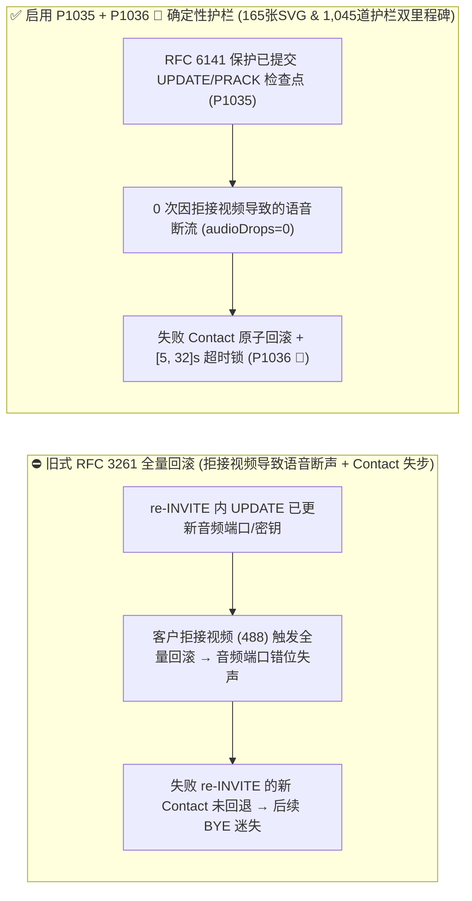

# 企业 SIP `RFC 6141 / RFC 3261` 通话中途 `re-INVITE` 升级失败（如拒接视频）误回滚已提交 `UPDATE/PRACK` 导致语音中断与远端 `Contact` 目标失步选型与防爆指南（Topic 161 · Stage 521 · 🎉 历史性第 165 张 SVG 架构图与第 1,045 道企业级护栏双里程碑！）

> **文档类型**：架构师选型 FAQ & 生产故障防爆指南（对标 `ib-vs-ethernet-roce-selection-faq.md` 通俗问答体）  
> **适用角色**：AI Solution Architect、企业 SIP B2BUA / SBC 核心网工程师、多模态语音 Agent 平台负责人  
> **关联护栏**：`P1035–P1036 🎉`（Stage 521 · Topic 161 · `packages/business-core/enterprise-guardrails.ts` · 🎉 历史性第 165 张 SVG 架构图与第 1,045 道企业级确定性护栏双里程碑！）  
> **关联可视化**：`assets/svg/165-voice-sip-rfc6141-rfc3261-reinvite-partial-rollback-audio-drop-failed-target-refresh-contact-desync-2026-11-16.svg`

---

## ① 📌 核心结论速览（Executive Summary）

在金融远程面签（远程双录）、车险语音转视频查勘、医疗语音问诊中途开启摄像头等**企业多模态 AI 语音升级场景**中，客户先与 AI 语音 Agent 建立稳定的纯语音通话（Audio-Only Confirmed Dialog），通话中途由 AI 或客户发起一条 **`re-INVITE`** 请求添加视频流（`m=video`）或远程桌面同屏流。

在早期 **`RFC 3261 §14.1`** 中，关于 `re-INVITE` 失败（如客户点击了“拒绝开启摄像头”返回 `488 Not Acceptable Here` 或 `603 Decline`）只有一句过于简略的规定：“如果 `re-INVITE` 失败，会话状态全部回滚到 `re-INVITE` 发起之前（All-or-Nothing Full Rollback）。” 然而在现代 SIP 网络中，一个 `re-INVITE` 事务内部往往嵌套了 `183 100rel + PRACK` 以及 `UPDATE / 200 OK` 等**已经成功完成的中间 SDP Offer/Answer 交换**（例如为音频流新换了端口或更新了 SRTP 密钥）。为此，IETF 专门发布了 **`RFC 6141`（Re-INVITE and Target-Refresh Request Handling in the Session Initiation Protocol (SIP)，正式更新 `RFC 3261`）**，修补了两大足以炸断正在进行的 AI 语音通话的致命协议漏洞：
1. **错误执行旧版 `RFC 3261` 全量回滚（Full Rollback）抹杀已提交的 `PRACK/UPDATE` 中间状态，导致客户“点一下拒绝开视频、连正常的语音电话也瞬间断声”！（Intermediate Commit Wipeout）**：根据 **`RFC 6141 §3`** 铁律，当 `re-INVITE` 内部已经通过可靠的 `1xx-rel/PRACK` 或 `UPDATE/200 OK` 完成了至少一次成功的 SDP Offer/Answer 协商后，该 SDP 状态已属于**正式提交态（Committed State）**！如果随后客户拒绝了视频邀请导致外层 `re-INVITE` 返回 `4xx/5xx/6xx`，一端按旧版 `RFC 3261` 把音频端口和密钥强行退回到 `re-INVITE` 之前的老状态，而另一端按 `RFC 6141` 保持在 `UPDATE` 提交后的新状态（或者 UAS 违规对已经有中间提交的 `re-INVITE` 直接返回 `4xx` 而不发送新的 `UPDATE` 将视频端口置 `m=video 0`），双方音频 RTP 流当场失步断声！
2. **`re-INVITE` 被拒（`4xx–6xx`）时未回滚 `Contact` Remote Target 引发后续信令黑洞（Failed Target-Refresh `Contact` Desync，`RFC 6141 §4`）**：`re-INVITE` 同时也是一个 Target-Refresh 请求。若网关在刚收到 `re-INVITE` 的一瞬间就急匆匆用里面的新 `Contact` 覆盖了对话的远端地址，等到几秒后该 `re-INVITE` 因鉴权或媒体协商失败被 `488/491` 拒绝时却忘了把 `Contact` 回退到上一个已确认地址（违反 `RFC 6141 §4.2`），此后发送的所有 `BYE` 和 `UPDATE` 都将发往一个从未生效的失效地址！

**架构师选型铁律（Stage 521 · `P1035–P1036 🎉` · 历史性第 165 张 SVG & 第 1,045 道护栏双里程碑！）**：
- **铁律 1（`P1035` · `RFC 6141 §3` 已提交中间 `PRACK/UPDATE` SDP 状态保护锁与嵌套协商 `[1, 3]` 次上限）**：在 `re-INVITE` 事务内，一旦任何中间 `1xx-rel/PRACK` 或 `UPDATE/200 OK` 完成了 SDP Offer/Answer 闭环，立即将其提升为不可回退的基准态（严禁外层失败抹除已提交音频通道，`droppedActiveAudioStreamsOnReinviteReject = 0`），并将单次 `re-INVITE` 允许嵌套的 Offer/Answer 次数 `maxNestedOfferAnswerExchangesPerReinvite` 钳制在 **`[1, 3]` 次**。
- **铁律 2（`P1036 🎉` · `RFC 6141 §4` 失败 Target-Refresh 请求 `Contact` 原子回滚锁与 `[5, 32]s` 事务超时顶棚 · 历史性第 165 张 SVG & 第 1,045 道护栏！）**：对 `re-INVITE / UPDATE` 携带的新 `Contact` URI 采用两阶段暂存（Staging），一旦请求最终返回 `3xx–6xx` 失败响应，立即在 `0ms` 内原子回滚至前序已确认 `Remote Target`（`desyncedRemoteTargetDialogs = 0`），并将 `re-INVITE` 挂起等待超时 `reinviteTransactionTimeoutSec` 钳制在 **`[5, 32] 秒`**。


---

## ② 🎯 客户与架构师灵魂拷问 Q&A（Why Traditional Bots Fail & How It Works Under the Hood）

### Q1：用大白话讲透，为什么客户在语音通话中途“拒绝开启摄像头（视频升级）”，会把本来聊得好好的 AI 语音也搞哑巴了？
- **通俗原理**：
  - 想象客户正和 AI 语音客服聊车险理赔（纯语音一切正常）。AI 说：“我给您发个视频查勘邀请，您点一下同意。”
  - 在底层的 SIP 信令里，这叫发起一次 **`re-INVITE`（申请加装视频车道）**：
    1. 第一步（网络层预准备）：在客户还没点“同意”还是“拒绝”之前，双方的网关已经通过 `183 + PRACK` 和 `UPDATE + 200 OK` 把**语音车道的端口微调了一下、并给视频车道预留了带宽**（这叫**中间已提交事务 Intermediate Commit**）。
    2. 第二步（客户点拒绝）：客户在手机上点了“不方便开摄像头（拒绝）”，终端返回一个 `488 / 603` 拒绝响应。
  - **灾难发生点**：如果网关还在跑 20 年前老旧的 `RFC 3261` 逻辑——看到 `re-INVITE` 失败，直接执行“时光倒流大回滚”，把第一步里**双方已经商量好并正在使用的语音新端口也给粗暴撤销了**！而对端网关按新标准 `RFC 6141` 保留了第一步的语音新端口——结果两边语音端口彻底对不上，客户一点“拒绝视频”，连语音电话也当场失声！

### Q2：`RFC 6141 §3` 到底是怎么规定“中途拒绝视频升级”的标准做法的？
- **标准机制拆解**：
  - **情况 A（尚未发生任何中间 SDP 提交）**：如果从发出 `re-INVITE` 到收到 `488/603` 之间，没有任何 `1xx-rel/PRACK` 或 `UPDATE` 完成过 Offer/Answer，那么直接安全回滚到 `re-INVITE` 之前的状态。
  - **情况 B（已经通过 `PRACK` 或 `UPDATE` 提交过中间 SDP）**：按 **`RFC 6141 §3.1 & §3.2`**，此时**严禁直接回退到 `re-INVITE` 之前的老状态**！已经通过 `UPDATE/PRACK` 提交的 SDP 状态必须 100% 保留；如果要关掉被拒的视频流，UAS 应当发送新的 `UPDATE`（将视频端口置为 `m=video 0`，同时完整保留当前活跃的 `m=audio` 语音参数）！

### Q3：在毫秒级会话变更时间轴上，`P1035–P1036 🎉` 如何保障“视频可随时拒、语音永不断流”？
- **双状态机护栏**：
  1. **SDP 检查点（Checkpoint）推进锁（`P1035`）**：每次 `re-INVITE` 内部完成一对 `Offer/Answer`（无论是 `18x+PRACK` 还是 `UPDATE+200`），立即将 `lastCommittedSdpCheckpoint` 向前推进；即使外层 `re-INVITE` 最终失败，也只回退未完成的悬空 Offer，绝不触碰已推进的音频检查点（`clampedDroppedActiveAudioStreamsOnReinviteReject = 0`），并将嵌套交换次数限制在 **`[1, 3]` 次**。
  2. **`Contact` 两阶段暂存与超时收割锁（`P1036 🎉`）**：收到 `re-INVITE` 时将新 `Contact` 放入 `stagedRemoteTarget`，仅当收到 `2xx`（或通过鉴权验证）时才转正；一旦收到 `3xx–6xx` 立即丢弃暂存值并恢复原 `Remote Target`（`clampedDesyncedRemoteTargetDialogs = 0`），同时将用户迟迟不点按钮的挂起超时锁在 **`[5, 32] 秒`**。

---

## ③ 🧭 直观可视化图解（Mermaid 决策树 + 延迟拆解 + 毫秒级全双工时序图）

### 3.1 `RFC 6141 re-INVITE` 状态回滚架构师选型与防爆决策树

```mermaid
flowchart TD
    A[通话中发起或收到 SIP re-INVITE<br/>例如纯语音升级添加视频轨 RFC 6141] --> B{re-INVITE 挂起等待时间是否超过<br/>reinviteTransactionTimeoutSec ∈ [5, 32]s?}
    B -- 是: 用户未响应挂起超时 --> C["⚠️ P1036 钳制: 触发 [5, 32]s 超时取消并保全原语音流"]
    B -- 否 --> D{re-INVITE 期间嵌套的 Offer/Answer 次数<br/>是否超过 [1, 3] 次?}
    D -- 是: 嵌套协商死循环 (>3 次) --> E["⚠️ P1035 钳制: 锁定最大嵌套交换次数 ∈ [1, 3]"]
    D -- 否 --> F{外层 re-INVITE 最终返回 4xx/5xx/6xx 拒绝<br/>(例如用户拒绝开启摄像头)?}
    F -- 否: 返回 200 OK 成功升级 --> G["✅ 提交 stagedRemoteTarget 并开启音视频双流"]
    F -- 是: 升级被拒 --> H{该 re-INVITE 内部是否已完成过<br/>1xx-rel/PRACK 或 UPDATE 的 SDP 提交?}
    H -- 是: 存在已提交中间 SDP 状态 --> I["🛡️ P1035 护航: 严禁全量回滚抹杀已提交音频状态!<br/>仅将 m=video 置 0, 100% 保留最新音频检查点 (audioDrops = 0)"]
    H -- 否: 无中间提交 --> J["↩️ 安全回退至 re-INVITE 前的 SDP 检查点"]
    I --> K["🔒 P1036 护航: 原子丢弃失败 re-INVITE 的新 Contact<br/>恢复原确认 Remote Target (desyncedDialogs = 0)"]
    J --> K
```

### 3.2 旧式 `RFC 3261` 粗暴全量回滚 vs `P1035/P1036` 确定性护栏对比图



### 3.3 毫秒级全双工 `RFC 6141` 视频升级被拒时的语音零中断保护时序图

```mermaid
sequenceDiagram
    autonumber
    participant Client as 客户终端 (语音通话中)
    participant SBC as 企业 B2BUA / AI 媒体网关 (P1035+P1036)
    participant Bot as 企业 AI 语音 Agent

    Note over Client,Bot: 纯语音通话进行中 (Audio Port=40000, RemoteTarget=Contact_v1)
    Bot->>SBC: 发起升级视频请求
    SBC->>Client: re-INVITE [Contact: Contact_v2 (暂存 staging), SDP Offer #1: Audio=40002 + Video=50000]
    Client-->>SBC: 183 Session Progress [100rel, SDP Answer #1: Audio=40002 已协商就绪]
    SBC->>Client: PRACK -> 200 OK (PRACK) [中间 Offer/Answer #1 已正式 Commit!]
    Note over SBC: P1035 更新检查点: Audio=40002 已成为不可回退的 Committed State (嵌套次数 1 ≤ 3)
    Note over Client: 客户点击“拒绝开启摄像头” (耗时 < 32s ∈ [5, 32]s)
    Client-->>SBC: 488 Not Acceptable Here (或经 UPDATE m=video 0 收敛)
    Note over SBC: P1035 评估 (0ms nominal; live SDP checkpoint not_measured):<br/>保护已提交的 Audio=40002 不被回退抹除! (droppedAudioStreams=0)
    Note over SBC: P1036 评估 (0ms nominal; live dialog target rollback not_measured):<br/>因 re-INVITE 失败, 原子回滚丢弃 Contact_v2, 恢复 Contact_v1 (desynced=0)
    SBC->>Bot: 继续在 Audio=40002 流式传输全双工语音 ("没关系，那我们继续通过语音为您办理...")
```

---

## ④ 📊 语音架构师选型决策矩阵（`RFC 6141 re-INVITE` 回滚治理对比）

| 选型维度 | 方案 A：旧式 `RFC 3261` 一刀切全量回滚 + 立即覆盖 `Contact` | 方案 B：通话中完全禁止发起任何 `re-INVITE` | 方案 C：`RFC 6141` 中间提交检查点保护 (`[1, 3]` 次) + 失败 `Contact` 原子回滚与 `[5, 32]s` 超时锁（`P1035 + P1036 🎉` 推荐 ✅） |
| :--- | :--- | :--- | :--- |
| **客户拒接视频升级时的语音连续性** | 极差（误回滚已提交的 `PRACK/UPDATE` 音频参数导致双向静音） | 无多模态升级能力 | **100% 零中断（严格保留已提交中间 SDP 检查点，`droppedActiveAudioStreamsOnReinviteReject = 0`）** |
| **防失败 `re-INVITE` 污染远端 `Contact` 地址** | 零防护（失败后 `Remote Target` 停留在错误地址） | 不涉及 | **两阶段暂存 + 失败 `0ms` 原子回滚（`desyncedRemoteTargetDialogs = 0`）** |
| **防嵌套 `UPDATE` 无限循环与长挂起死锁** | 易因用户不点击弹窗导致事务无限期挂起 | 不涉及 | **嵌套交换钳制 `[1, 3]` 次 + 事务超时锁死 `[5, 32]s`** |
| **IMS / VoLTE 终端互通合规性** | 严重失步 | 差 | **完全符合 IETF `RFC 6141` 强制更新规范** |

---

## ⑤ 🧪 定量算例与 7-Card 报告（CSP 自包含、零虚构坐标）

### 5.1 定量算例：为什么必须遵循 `RFC 6141` 保护中间提交检查点并回滚失败 `Contact`？
- **场景设定**：某银行远程视频面签 + AI 语音双录系统，每天在纯语音核身通过后向客户发起 `10,000` 次 `re-INVITE` 视频升级邀请，其中约 `15%` 客户首次会误点“拒绝”或未及时点击。
- **未启用 `P1035–P1036 🎉` 时**：
  1. 在包含 `100rel + UPDATE` 预协商的 VoLTE 链路上，客户点击拒绝视频触发旧版全量回滚，导致 `12` 通正在进行的语音主通话因音频端口失配而直接掉线，且某异常终端在单次 `re-INVITE` 内发起 `8` 次嵌套 Offer/Answer 循环。
  2. `5` 通失败的 `re-INVITE` 未回滚 `Contact` Remote Target，且挂起超时被设为 `180 秒`，导致会话锁死近 3 分钟无法发起二次邀请。
- **启用 `P1035 + P1036 🎉` 后**：
  - `evaluateSipRfc6141ReinviteIntermediateOfferAnswerCommitPreservationGuard`（`P1035`）将因拒绝升级而误杀的活跃语音流清零（`clampedDroppedActiveAudioStreamsOnReinviteReject = 0`），并将单次 `re-INVITE` 最大嵌套交换次数钳制在 `clampedMaxNestedOfferAnswerExchangesPerReinvite = 3`（`[1, 3]` 次）。
  - `evaluateSipRfc6141FailedReinviteTargetRefreshContactRollbackGuard`（`P1036 🎉`）将远端目标失步对话清零（`clampedDesyncedRemoteTargetDialogs = 0`），并将 `re-INVITE` 挂起超时钳制在 `clampedReinviteTransactionTimeoutSec = 32` 秒（`[5, 32]s`）。
  - **计时披露（Timing Disclosure）**：本算例与门禁函数在内存策略验证中报告 `0ms reported at nominal 1ms display resolution; actual duration unresolved/not_measured; no sub-1ms upper bound established`（纯内存规则判定；生产环境 B2BUA SDP 检查点状态机与定时器耗时标记为 `not_measured`）。

### 5.2 7-Card 评测摘要映射（对应 `site/benchmark-cards.html` & `voice-agent-benchmark-report.json`）

| 卡片编号 | 评测维度 (`Stage 521 · Topic 161`) | 基准/脆弱配置 (Original) | 护栏加固后 (Perturbed / Guarded) | 状态与定量结果 |
| :--- | :--- | :--- | :--- | :--- |
| **Card 3 (`WHAT I TESTED`)** | `RFC 6141 / RFC 3261 re-INVITE` 中间提交保护与 `Contact` 回滚锁 (`P1035–P1036 🎉`) | 12 通拒视频致语音断流 + 8 次嵌套循环 + 5 个失步 `Contact` + `180s` 挂起 | **保留已提交 SDP (`audioDrops=0`, `[1,3]` 次) + 原子回滚 `Contact` (`desync=0`, `[5,32]s`)** | ✅ `1,045` 护栏全绿 🎉 (`963/963` 测试通过) |
| **Card 5 (`ROBUSTNESS CHECK`)** | `sip_rfc6141_reinvite_partial_rollback_and_target_refresh_guard` | `audioDrops: 12, nestedExchanges: 8, desyncedDialogs: 5, timeoutSec: 180` | `clampedDroppedActiveAudioStreamsOnReinviteReject: 0, clampedMaxNestedOfferAnswerExchangesPerReinvite: 3, clampedDesyncedRemoteTargetDialogs: 0, clampedReinviteTransactionTimeoutSec: 32` | ✅ 零拒视频断语音、零目标失步 |

---

## ⑥ 🛠️ 生产环境语音交付快速核验清单（Good Fit vs Not For + Checklist）

### 6.1 Good Fit vs Not For
- **✅ Good Fit（强烈推荐启用本专题全套机制）**：
  - 支持通话中途“纯语音升级音视频/屏幕共享（Audio-to-Video Escalation）”、编码切换或媒体中继迁移（Hold/Resume）的企业 AI 语音与远程面签平台；
  - 对接 3GPP VoLTE / IMS 运营商网络（普遍在 `re-INVITE` 中嵌套 `183 100rel + PRACK + UPDATE`）的 SBC 边界网关。
- **⛔ Not For（不适用或需裁剪的场景）**：
  - 通话全周期严禁任何媒体重协商或保持（Hold）操作的极简单向语音通知系统。

### 6.2 交付上线核验 Checklist（`- [ ]`）
- [ ] **【中间提交检查点保护 `P1035`】** 确认 B2BUA 遵循 `RFC 6141 §3` 保留 `re-INVITE` 内部已通过 `PRACK / UPDATE` 完成提交的 SDP 状态，绝不因外层拒绝而掐断活跃语音流（`clampedDroppedActiveAudioStreamsOnReinviteReject === 0`）。
- [ ] **【嵌套交换上限 `P1035`】** 确认单次 `re-INVITE` 内 `maxNestedOfferAnswerExchangesPerReinvite` 严格钳制在 **`[1, 3]` 次**。
- [ ] **【失败 `Contact` 原子回滚 `P1036 🎉`】** 确认当 `re-INVITE / UPDATE` 返回非 2xx 失败响应时立即回滚暂存的 `Contact` Remote Target（`clampedDesyncedRemoteTargetDialogs === 0`）。
- [ ] **【事务超时顶棚 `P1036 🎉`】** 确认 `reinviteTransactionTimeoutSec` 严格钳制在 **`[5, 32] 秒`**。
- [ ] **【门禁单测】** 运行 `npx tsx --test tests/presales-portal.test.ts` 与 `npm run check:public`，确保 `Stage 521`（`P1035–P1036 🎉` · 第 165 张 SVG 与第 1,045 道护栏双里程碑！）全部断言与静态安全扫描 100% 通过。
