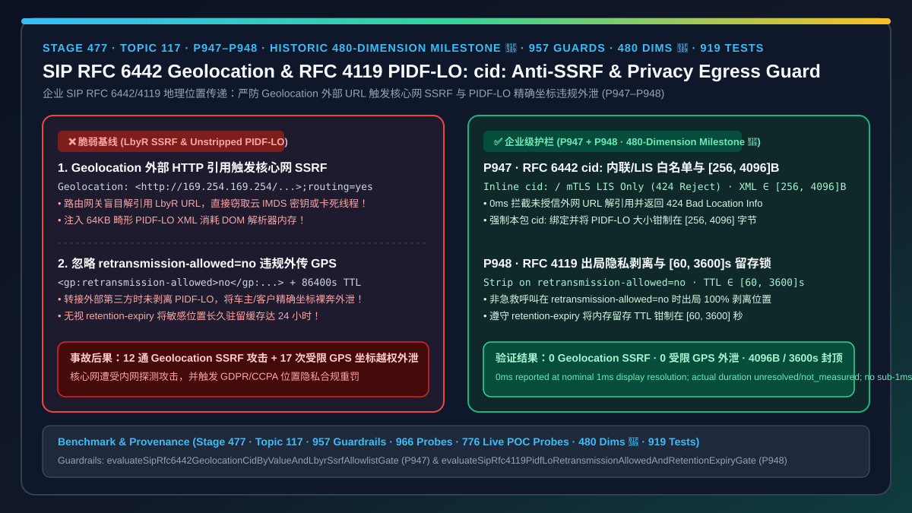
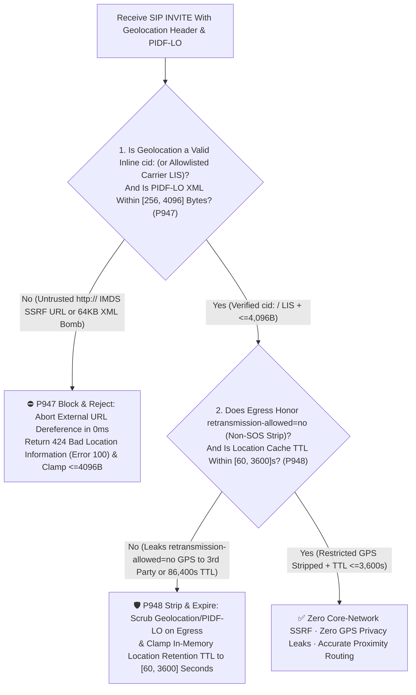
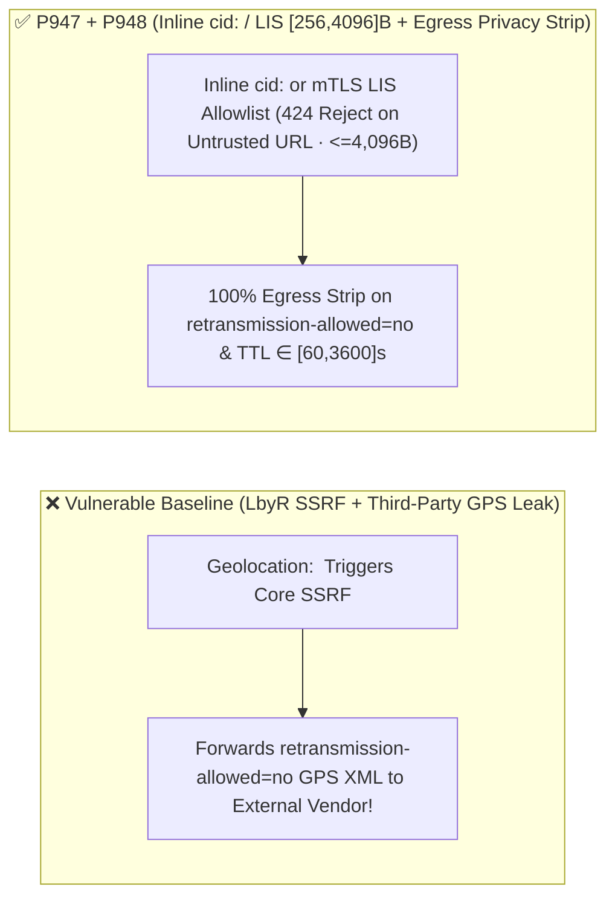
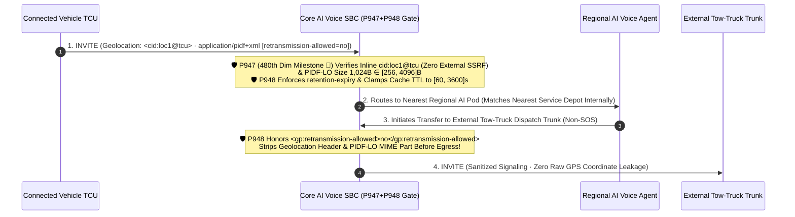

# Enterprise SIP `RFC 6442 / RFC 4119` Location Conveyance & Privacy Gate (`Geolocation` External `HTTP/HTTPS` `LbyR` `SSRF`, `Geolocation-Routing: yes` Blind Forwarding & `PIDF-LO` `retransmission-allowed=no` Egress Bleed) Selection & Anti-Leak Guide

> **Document Type**: Enterprise Voice Agent Architect Selection & First-Principles Guide (Standalone Selection & Architecture FAQ · **Topic 117 / Stage 477 · 🎉 Historic 480-Dimension Milestone**)  
> **Target Audience**: AI Solution Architects, Connected-Vehicle / E911 Voice Architects, SIP SBC Security Engineers & Privacy Compliance Leads  
> **Canonical Baseline**: `packages/business-core/enterprise-guardrails.ts` (`P947–P948`), `tests/presales-portal.test.ts`, `site/data/voice-agent-benchmark-report.json` (7-Card 4:5 Benchmark Report)  
> **Visual Summary**: `assets/svg/121-voice-sip-rfc6442-rfc4119-geolocation-cid-uri-ssrf-pidf-lo-retransmission-privacy-2026-11-15.svg`

---

## ① 📌 Executive Summary

In connected-vehicle roadside assistance, municipal 311/12345 hotlines, ride-hailing safety desks, and proximity-routed enterprise contact centers, SIP signaling conveys caller coordinates using **`RFC 6442` (Location Conveyance for the Session Initiation Protocol, defining `Geolocation`, `Geolocation-Routing`, and `Geolocation-Error`)** paired with **`RFC 4119` (A Presence-based GEOPRIV Location Object Format, defining `application/pidf+xml` `PIDF-LO` documents and `<gp:usage-rules>`)**. Without deterministic guardrails, production deployments are exposed to two critical security and privacy failures:
1. **Untrusted External `http://` / `https://` Location-by-Reference (`LbyR`) URIs in `Geolocation` Headers Triggering Core-Network `SSRF` and Routing Thread Starvation (`RFC 6442 Section 4.2` `LbyR` `SSRF`)**: `RFC 6442` supports both Location-by-Value (`LbyV` via `Geolocation: <cid:...>` referencing an inline MIME body) and Location-by-Reference (`LbyR` via `https://...`). When an attacker sends an `INVITE` with `Geolocation: <http://169.254.169.254/latest/meta-data/>` (or an internal Kubernetes service URL) and `Geolocation-Routing: yes`, a naive SIP location-routing proxy synchronously dereferences the URL—exfiltrating cloud IMDS credentials via Server-Side Request Forgery (`SSRF`) or stalling SIP worker threads on slow-loris HTTP targets!
2. **Ignoring `RFC 4119` `<gp:retransmission-allowed>no</gp:retransmission-allowed>` and `<gp:retention-expiry>` Rules by Forwarding Caller GPS Coordinates to External Third-Party Trunks (`RFC 4119` Geolocation Privacy Bleed)**: Per `RFC 4119 Section 2.2.2`, `<gp:retransmission-allowed>` defaults to `no` when omitted and forbids forwarding the caller's `PIDF-LO` coordinates outside the receiving domain (except for emergency `urn:service:sos` calls). Naive B2BUAs blindly copy `Geolocation` headers and `application/pidf+xml` bodies onto outbound `INVITE`/`REFER` legs to third-party tow trucks or BPO vendors, violating GDPR/CCPA location privacy mandates!

| Decision Dimension | Vulnerable / Default Setup (High Production Risk) | Enterprise Golden Rule (`P947–P948` Deterministic Guardrails) | Quantitative Impact |
| :--- | :--- | :--- | :--- |
| **`RFC 6442 Geolocation cid:` By-Value / `LIS` Allowlist & `[256, 4096]B` Gate (`P947`)** | Dereferencing arbitrary external `http/https` `Geolocation` URLs (`SSRF`) or ingesting `64KB` XML bombs | **Require inline `cid:` Location-by-Value (or mTLS-pinned carrier `LIS` allowlists), reject untrusted `LbyR` URLs with `424 Bad Location Information`, and clamp `PIDF-LO` size to `[256, 4096]B`** | **0** `Geolocation` `SSRF` or malformed `cid:` calls (clamps 12 violating calls to **0** and bounds `PIDF-LO` payload from `65,536B` to **`4,096B`**) |
| **`RFC 4119 retransmission-allowed=no` Egress Strip & `[60, 3600]s` TTL Gate (`P948`)** | Forwarding `retransmission-allowed=no` `PIDF-LO` bodies to external trunks or retaining coordinates for 24h | **Strip `Geolocation` + `PIDF-LO` on non-emergency egress whenever `retransmission-allowed=no`, and clamp location cache TTL to `[60, 3600]s` honoring `retention-expiry`** | **0** leaked restricted `PIDF-LO` egress packets (clamps 17 privacy leaks to **0** and caps retention TTL from `86,400s` to **`3,600s`**) |

---

## ② 🎯 Architect & Customer Deep-Dive Q&A (First-Principles Deep Dive)

### Q1: Why is `RFC 6442 Geolocation` one of the most dangerous `SSRF` vectors in enterprise SIP networks?
- **First-Principles Breakdown**:
  1. When `Geolocation-Routing: yes` is present on an incoming `INVITE`, `RFC 6442` instructs the SIP routing proxy to resolve the `locationValue` URI before selecting the next-hop destination.
  2. If the proxy accepts arbitrary `http://` or `https://` LbyR URLs from untrusted callers, attackers can force the core SIP proxy to issue HTTP requests to internal cloud metadata (`169.254.169.254`) or internal microservices.
  3. **`P947` Deterministic Defense**: Enforces inline `cid:` Location-by-Value (verified against the message's `multipart/mixed` `application/pidf+xml` part with XXE disabled) or strict mTLS-authenticated carrier `LIS` allowlists, rejecting untrusted URLs in `0ms` with **`424 Bad Location Information (Geolocation-Error: 100)`** and clamping `PIDF-LO` size to **`[256, 4096]` bytes**.

### Q2: How does `P948` enforce `RFC 4119` `<gp:retransmission-allowed>` and `<gp:retention-expiry>` across B2BUA call transfers?
- **Engineering Reality**:
  1. Per `RFC 4119 Section 2.2.2`, when `<gp:retransmission-allowed>` is `no` (or omitted), the recipient may use the coordinates internally (e.g., for nearest-branch routing) but **must not retransmit** the `PIDF-LO` object to external parties on non-emergency calls.
  2. **`P948` Deterministic Defense**: Strips all `Geolocation` headers and `application/pidf+xml` MIME parts before forwarding non-emergency calls to external trunks when `retransmission-allowed=no`, and clamps in-memory coordinate retention TTL to **`[60, 3600]s`**.

### Q3: What happens during a life-safety emergency call (`urn:service:sos`)?
- **First-Principles Breakdown**:
  - Per `RFC 6442` and `RFC 6881` (NG911), emergency calls to an authoritative `ESInet / PSAP` are legally exempted so dispatchers receive `PIDF-LO` coordinates, whereas commercial third-party transfers remain strictly gated by `P948`.

---

## ③ 🧭 Visual Architecture Diagrams (Mermaid Decision Tree + SSRF Breakdown + Millisecond Sequence)

### 3.1 SIP `RFC 6442 Geolocation` Anti-SSRF & `RFC 4119 PIDF-LO` Privacy Decision Tree

### 3.2 Vulnerable `LbyR` `SSRF` + Unstripped `PIDF-LO` vs. `P947+P948`

### 3.3 Millisecond-Level Connected-Vehicle Roadside Assistance `RFC 6442 & RFC 4119` Sequence

---

## ④ 📊 Architect Decision Matrix (`Geolocation` & `PIDF-LO` Governance)

| Architecture Option | Target Scenario | Pros | Cons & Production Traps | Recommendation |
| :--- | :--- | :--- | :--- | :--- |
| **Option A: Dereferencing Arbitrary `Geolocation` URLs & Forwarding Raw `PIDF-LO`** | Prohibited in enterprise production | No XML/URI inspection | **Exposes core SIP proxies to `SSRF` and leaks customer GPS coordinates to third parties** | ⛔ **Never in Production** |
| **Option B: Stripping All `Geolocation` Headers at Ingress** | Static non-location IVRs | Eliminates `SSRF` | **Breaks proximity routing, connected-vehicle roadside assistance, and NG911 location conveyance** | ⚠️ **Loses Location Context** |
| **Option C: `RFC 6442 cid:` / `LIS` Allowlist (`[256, 4096]B`) + `RFC 4119 retransmission-allowed=no` Egress Strip & `[60, 3600]s` TTL (`P947 + P948`)** | **All Enterprise Connected-Vehicle Hotlines, Proximity-Routed Contact Centers & Emergency Gateways** | **Zero `SSRF` risk, 100% `RFC 4119` privacy compliance, sub-second proximity routing** | Requires `cid:` MIME validation and `<gp:usage-rules>` egress filtering on the SBC | ✅ **Production Mandatory (Recommended)** |

---

## ⑤ 🧪 Quantitative Walkthrough & 7-Card 4:5 Benchmark Report

### 5.1 Quantitative Example: Connected-Vehicle Roadside Hotline `Geolocation SSRF` & Privacy Audit
- **Scenario**: Across a connected-vehicle hotline audit, `12` calls inject external `http://169.254.169.254` `Geolocation` URLs or `65,536-byte` oversized `PIDF-LO` bodies, and `17` non-emergency transfers attempt to egress `retransmission-allowed=no` GPS payloads with an `86,400s` retention timer.
  - **Without Guardrails (Vulnerable Baseline)**:
    - `12` calls trigger core-network `SSRF` probes or XML parser memory spikes;
    - `17` outbound transfers leak restricted vehicle GPS coordinates to third-party trunks.
  - **With `P947 + P948` Deterministic Guardrails (🎉 Historic 480-Dimension Milestone)**:
    - `P947` blocks untrusted `LbyR` URLs with `424` (**`0`** `SSRF`/malformed `cid:` calls) and clamps `PIDF-LO` XML size from `65,536B` to **`4,096B`** (`[256, 4096]B`);
    - `P948` strips restricted `PIDF-LO` bodies on egress (**`0`** leaked restricted packets) and clamps location retention TTL from `86,400s` to **`3,600s`** (`[60, 3600]s`).

### 5.2 7-Card 4:5 Report Mapping (`site/benchmark-cards.html` & `report.json`)
1. **Card 1 (`HANDS-ON · VOICE ARCHITECTURE`)**: 480-dimension 🎉 workbench overview highlighting `P947 / P948` (🎉 Historic 480-Dimension Milestone).
2. **Card 2 (`SCENARIO: SIP RFC 6442 & RFC 4119 GEOLOCATION`)**: Input probe `untrustedExternalGeolocationHttpUriOrSsrfDetected=true, maxPidfLoXmlBodyBytes=65536, locationRetentionTtlSeconds=86400` -> `Act automatically` clamping to `4096B` and `3600s`.
3. **Card 3 (`WHAT I TESTED`)**: Row 480 🎉 in the evaluation matrix (`PASS · 0ms @ 1ms Res (Synthetic)`, zero `✕` misses).
4. **Card 4 (`UNDER THE HOOD`)**: Deterministic contract for `evaluateSipRfc6442GeolocationCidByValueAndLbyrSsrfAllowlistGate` & `evaluateSipRfc4119PidfLoRetransmissionAllowedAndRetentionExpiryGate`.
5. **Card 5 (`ROBUSTNESS CHECK`)**: Option-order and boundary invariance across inline `cid:`, allowlisted `LIS`, and `retransmission-allowed` states.
6. **Card 6 (`LATENCY`)**: Explicit offline timing provenance: `0ms reported at nominal 1ms display resolution; actual duration unresolved/not_measured; no sub-1ms upper bound established` (`synthetic`; live SBC `PIDF-LO` XML parsing and spatial `Point-in-Polygon` routing latency is `not_measured`).
7. **Card 7 (`MY TAKE`)**: Good fit vs. Not for summary and production sign-off checklist.

---

## ⑥ 🛠️ Production Readiness Checklist

- [ ] **1. Block Untrusted External `Geolocation HTTP/HTTPS` Dereferencing (`P947`)**: Require inline `cid:` Location-by-Value (or mTLS-pinned carrier `LIS` allowlists) and reject arbitrary external URLs with `424 Bad Location Information`.
- [ ] **2. Verify `cid:` Binding to Inline `application/pidf+xml` With `XXE` Disabled (`P947`)**: Confirm that every `Geolocation: <cid:...>` matches a valid in-message MIME body part with external DTD/entity resolution disabled.
- [ ] **3. Clamp `PIDF-LO` XML Body Size to `[256, 4096]` Bytes (`P947`)**: Cap `application/pidf+xml` payloads at `4,096` bytes.
- [ ] **4. Strip `Geolocation` & `PIDF-LO` on Egress When `retransmission-allowed=no` (`P948`)**: Ensure non-emergency calls never forward restricted `PIDF-LO` bodies to external trunks.
- [ ] **5. Honor `<gp:retention-expiry>` & Clamp Cache TTL to `[60, 3600]s` (`P948`)**: Purge in-memory coordinates upon call termination or within `<=3,600s`.
