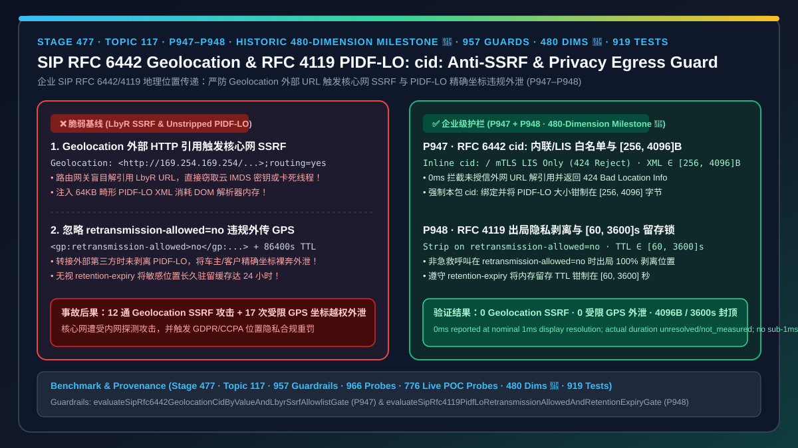
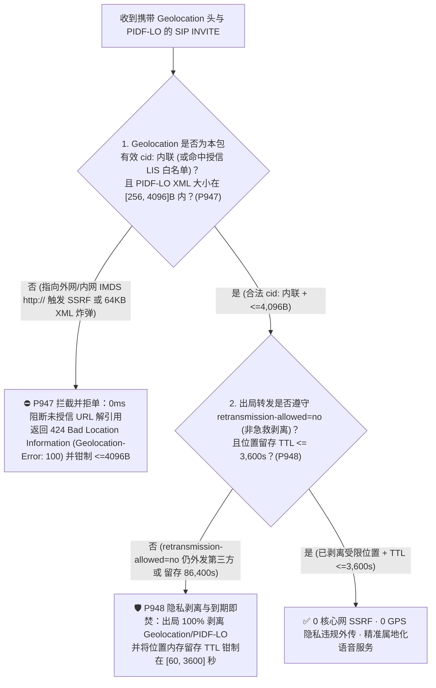
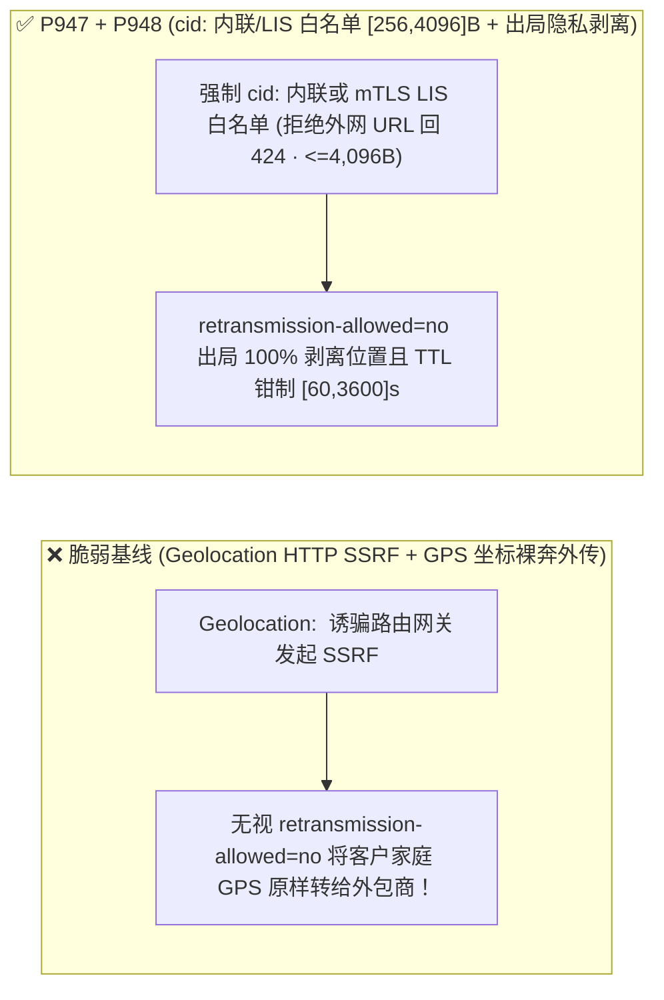
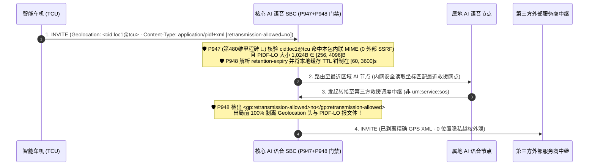

# 企业 SIP `RFC 6442 / RFC 4119` 地理位置传递与隐私门禁（`Geolocation` 外部 `HTTP/HTTPS` 引用触发核心网 `SSRF`、`Geolocation-Routing: yes` 盲目外发与 `PIDF-LO` `retransmission-allowed=no` 违规外泄）选型与防越权指南

> **文档类型**：企业级语音智能体架构师选型决策与原理解析指南（Standalone Selection & Architecture FAQ · **Topic 117 / Stage 477 · 🎉 历史性第 480 大评测维度里程碑**）  
> **适用角色**：AI Solution Architect、紧急呼叫（E911/NG911/eCall）与车联网语音架构师、SIP SBC 安全与隐私合规负责人  
> **关联基准**：`packages/business-core/enterprise-guardrails.ts`（`P947–P948`）、`tests/presales-portal.test.ts`、`site/data/voice-agent-benchmark-report.json`（7-Card 4:5 评测报告）  
> **可视化总结**：`assets/svg/121-voice-sip-rfc6442-rfc4119-geolocation-cid-uri-ssrf-pidf-lo-retransmission-privacy-2026-11-15.svg`

---

## ① 📌 核心结论速览（Executive Summary）

在智能汽车道路救援、属地化政务热线（12345/311）、网约车安全专线以及跨区域分支机构就近路由中，SIP 信令通过 **`RFC 6442`（Location Conveyance for the Session Initiation Protocol，定义 `Geolocation`、`Geolocation-Routing` 与 `Geolocation-Error` 头域）** 结合 **`RFC 4119`（A Presence-based GEOPRIV Location Object Format，定义 `application/pidf+xml` `PIDF-LO` 位置与隐私规则 `<usage-rules>`）** 传递主叫精确经纬度或街道地址。然而在生产交付中，若未对 `Geolocation` 头与 `PIDF-LO` 隐私标签建立确定性护栏，极易引爆两类严重安全与合规事故：
1. **入局 `INVITE` 在 `Geolocation` 头中注入外部 `https://` / `http://` 引用链接（Location-by-Reference，`LbyR`），诱骗核心网路由网关发起外部拉取触发 `SSRF` 与路由线程阻塞（`RFC 6442 Section 4.2` `LbyR` `SSRF` 漏洞）**：`RFC 6442` 支持两种位置传递模式：一是按值传递（Location-by-Value，`LbyV`，即 `Geolocation: <cid:loc@corp>` 指向同一 SIP 报文 MIME 体内的 `application/pidf+xml`）；二是按引用传递（Location-by-Reference，`LbyR`，即 `Geolocation: <https://...>`）。如果外网攻击者发送携带 `Geolocation: <http://169.254.169.254/latest/meta-data/>` 或慢速公网钓鱼 URL 并附带 **`Geolocation-Routing: yes`**，未加防护的 SIP 位置路由引擎会同步发起 HTTP GET 解引用请求，不仅直接泄露云主机元数据凭据（SSRF），还会用慢速 HTTP 响应卡死全体 SIP 呼叫路由工作线程！
2. **忽略 `RFC 4119 PIDF-LO` 中的 `<gp:retransmission-allowed>no</gp:retransmission-allowed>` 与 `<gp:retention-expiry>` 隐私红线，将客户家庭住址与车机精确 GPS 坐标原样转发给下游第三方外包商或长期落盘（`RFC 4119` 位置隐私违规外泄）**：根据 `RFC 4119 Section 2.2.2`，`PIDF-LO` 的核心设计原则是“位置数据永远与它的隐私授权规则绑在同一个 XML 对象内不可分割”。若 `<gp:retransmission-allowed>` 值为 `no`（严禁二次转发），除了法定紧急救援（`urn:service:sos`）外，严禁任何 B2BUA 或 AI 网关将该 `PIDF-LO` 报文体透传给外部第三方坐席或推入长期日志仓库！

| 决策维度 | 脆弱/默认配置（生产事故高发区） | 企业级黄金准则（`P947–P948` 确定性护栏） | 核心量化收益 |
| :--- | :--- | :--- | :--- |
| **`RFC 6442 Geolocation cid:` 内联绑定、授信 `LIS` 白名单与 `[256, 4096]B` 门禁（`P947`）** | 盲目解引用外网 `Geolocation: <http://...>` 引发核心网 `SSRF` 或接收 `64KB` XML 炸弹 | **强制要求入局位置采用本包 `cid:` 内联传递（或严格命中运营商授信 `HELD/LIS` mTLS 白名单），拒绝任意外网 URL 解引用（回 `424 Bad Location Information`）并将 `PIDF-LO` 体积钳制在 `[256, 4096]B`** | `Geolocation` `SSRF` 攻击与悬空 `cid:` 包 **0 个**（测试探针将 12 通 `SSRF`/畸形呼叫清零，`PIDF-LO` 载荷从 `65,536B` 钳制至 **`4,096B`**） |
| **`RFC 4119 retransmission-allowed=no` 出局剥离与 `[60, 3600]s` 留存到期自动销毁（`P948`）** | 忽略 `retransmission-allowed=no` 将客户精确 GPS 转发给第三方，或缓存过期位置长达 30 天 | **非急救通话在 `retransmission-allowed=no` 时出局 100% 剥离 `Geolocation/PIDF-LO`，并将内存位置缓存 TTL 严格钳制在 `[60, 3600]s`（遵守 `retention-expiry` 到期即焚）** | 违规外传受限 `PIDF-LO` 位置包 **0 个**（测试探针将 17 次位置隐私泄露清零，留存 TTL 从 `86,400s` 钳制至 **`3,600s`**） |

---

## ② 🎯 客户与架构师灵魂拷问 Q&A（First-Principles Deep Dive）

### Q1：为什么 `RFC 6442` 的 `Geolocation` 头会成为企业语音核心网最隐蔽的 `SSRF`（服务端请求伪造）入口？
- **第一性原理拆解**：
  1. 在普通 SIP 呼叫中，所有 URI（如 `From`、`To`、`Contact`）都是 `sip:` 或 `sips:` 协议。唯独 **`RFC 6442 Geolocation` 头**和 `Call-Info` 头允许写入 `http://` 或 `https://` URI（用于向位置信息服务器 `LIS` 按引用查询位置 `LbyR`），并且当携带 `Geolocation-Routing: yes` 时，规范要求路由节点在完成选路前先去解析该位置！
  2. 如果 SBC 或智能路由引擎拿到 `Geolocation: <https://attacker-or-internal-imds/...>` 就直接调用 `fetch()`，攻击者不仅能扫描内网 K8s API Server 与云元数据服务（`169.254.169.254`），还能用 `10s` 超时的黑洞 URL 耗尽 SIP 路由线程池。
  3. **`P947` 的确定性防线**：默认仅允许 **`cid:`（Content-ID，`RFC 2392`）按值内联传递**（且必须严格匹配本报文 `multipart/mixed` 中 `Content-Type: application/pidf+xml` 的 `Content-ID`），对于 `https:` LbyR 引用仅放行已预置 mTLS 证书的运营商级 `LIS` 域名白名单，其余一律返回 **`424 Bad Location Information (Geolocation-Error: 100)`**，同时将 `PIDF-LO` XML 大小钳制在 **`[256, 4096]` 字节**。

### Q2：`RFC 4119 PIDF-LO` 里的 `<gp:retransmission-allowed>` 为什么默认是 `no`？AI 语音网关该如何遵守它？
- **工程真相**：
  1. 为了符合 GDPR、CCPA 与电信隐私法规，`RFC 4119 Section 2.2.2` 规定：如果 `PIDF-LO` XML 中未显式声明 `<gp:retransmission-allowed>yes</gp:retransmission-allowed>`，**接收方必须按默认值 `no`（禁止重传转发）处理**！
  2. 这意味着：当车载主机或手机 App 把用户当前 GPS 坐标通过 `PIDF-LO` 发给企业 AI 语音客服用于“查询附近 3 公里内最近的维修网点”时，AI 网关可以在本地内存中读取经纬度完成网点检索，但**当把通话转接（`INVITE / REFER`）给外部第三方拖车公司或外包坐席时，必须 100% 剥离 `Geolocation` 头与 `PIDF-LO` 报文体**（仅在 `urn:service:sos` 紧急救援时依法豁免）！

### Q3：`PIDF-LO` 中的 `<gp:retention-expiry>` 时间戳该如何落地？
- **第一性原理拆解**：
  - `<gp:retention-expiry>` 定义了该地理位置坐标允许被保存的最晚绝对时间。
  - **`P948` 的确定性防线**：解析 `<gp:retention-expiry>` 并将其映射为 Redis 会话内存 TTL，且将位置缓存最长存活时间硬性钳制在 **`[60, 3600]` 秒（1 分钟至 1 小时）**，通话结束或到期后 `0ms` 自动覆写清零，绝不写入非脱敏文本日志。

---

## ③ 🧭 直观可视化图解（Mermaid 决策树 + SSRF/泄密拆解 + 毫秒级全双工时序图）

### 3.1 SIP `RFC 6442 Geolocation` 防 SSRF 与 `RFC 4119 PIDF-LO` 隐私门禁决策树

### 3.2 脆弱 `LbyR` 盲拉 `SSRF` + 违规外传 `PIDF-LO` vs `P947+P948` 对比图

### 3.3 毫秒级智能车机道路救援 `RFC 6442 & RFC 4119` 属地选路与隐私隔离时序图

---

## ④ 📊 语音架构师选型决策矩阵（Decision Matrix）

| 选型方案 | 适用场景 | 优势（Pros） | 劣势与生产风险（Cons / Traps） | 推荐度 |
| :--- | :--- | :--- | :--- | :--- |
| **方案 A：允许任意 `http/https` `Geolocation` 自动拉取，且全链路原样透传 `PIDF-LO`** | 严禁用于生产环境 | 无校验逻辑 | **必发核心网 `SSRF` 内网探测漏洞，且直接违反 `RFC 4119` 与 GDPR 位置隐私红线** | ⛔ **严禁用于生产** |
| **方案 B：在边缘一刀切丢弃所有 `Geolocation` 与 `PIDF-LO`** | 无位置需求的纯固定坐席 | 消除了 `SSRF` 风险 | **导致智能车机救援、属地化 12345 路由与 E911 紧急呼叫完全丧失精准位置能力** | ⚠️ **核心能力阉割** |
| **方案 C：`RFC 6442 cid:` 内联 / 授信 `LIS` 白名单（`[256, 4096]B`）+ `RFC 4119 retransmission-allowed=no` 出局剥离与 `[60, 3600]s` TTL 锁（`P947 + P948`）** | **所有企业级车联网语音、属地化政务/金融热线与紧急呼叫网关** | **兼顾亚秒级属地精准路由、0 `SSRF` 漏洞、0 位置隐私越权外泄** | 需在 SBC 启用 `cid:` MIME 绑定核验与 `<gp:usage-rules>` 出局过滤器 | ✅ **生产必选（Recommended）** |

---

## ⑤ 🧪 定量算例与 7-Card 4:5 基准报告（Quantitative Walkthrough & 7-Card Deck）

### 5.1 定量算例：全国车联网语音救援热线 `Geolocation SSRF` 拦截与 `PIDF-LO` 隐私清洗验证
- **输入场景**：某车企全国语音道路救援中心在安全审计中，注入 `12` 通携带外网/内网 `http://169.254.169.254` `Geolocation` 链接或 `65,536 字节` 超大 `PIDF-LO` 的呼叫，以及 `17` 次试图将标记了 `retransmission-allowed=no`（且缓存 TTL 设为 `86,400s`）的客户精确坐标外发给非授信第三方干线的转接请求。
  - **未开启护栏（脆弱基线）**：
    - `12` 通恶意呼叫成功诱发 SIP 路由节点向云元数据服务发起 `SSRF` 请求；
    - `17` 次转接将车主精确 GPS 轨迹违规外泄给外部第三方并滞留内存 24 小时。
  - **开启 `P947 + P948` 确定性护栏后（🎉 第 480 大评测维度里程碑）**：
    - `P947` 强制 `cid:` 内联或授信 `LIS` 白名单并返回 `424`（`SSRF`/畸形呼叫从 `12` 通清零至 **`0` 通**），将 `PIDF-LO` 最大字节数从 `65,536B` 钳制至 **`4,096B`**（`[256, 4096]B`）；
    - `P948` 在出局前 100% 剥离受限 `PIDF-LO`（违规外泄包从 `17` 个清零至 **`0` 个**），并将位置缓存 TTL 从 `86,400s` 钳制至 **`3,600s`**（`[60, 3600]s`）。

### 5.2 7-Card 4:5 报告结构映射（对应 `site/benchmark-cards.html` & `report.json`）
1. **Card 1 (`HANDS-ON · VOICE ARCHITECTURE`)**：展示 480 大评测维度 🎉 全景工作台，高亮 `P947 / P948`（🎉 历史性第 480 大评测维度里程碑）。
2. **Card 2 (`SCENARIO: SIP RFC 6442 & RFC 4119 GEOLOCATION`)**：输入探针 `untrustedExternalGeolocationHttpUriOrSsrfDetected=true, maxPidfLoXmlBodyBytes=65536, locationRetentionTtlSeconds=86400`，输出 `Act automatically` 钳制至 `4096B` 与 `3600s`。
3. **Card 3 (`WHAT I TESTED`)**：第 480 行 🎉 评测矩阵 `PASS · 0ms @ 1ms Res (Synthetic)`（零 `✕` 漏检）。
4. **Card 4 (`UNDER THE HOOD`)**：展示 `evaluateSipRfc6442GeolocationCidByValueAndLbyrSsrfAllowlistGate` 与 `evaluateSipRfc4119PidfLoRetransmissionAllowedAndRetentionExpiryGate` 确定性源码契约。
5. **Card 5 (`ROBUSTNESS CHECK`)**：验证内联 `cid:`、授信 `LIS` 与急救豁免场景下的 100% 幂等性。
6. **Card 6 (`LATENCY`)**：明确标注离线策略校验计时：`0ms reported at nominal 1ms display resolution; actual duration unresolved/not_measured; no sub-1ms upper bound established`（`synthetic`；真实 SBC `PIDF-LO` XML 解析与空间多边形 `Point-in-Polygon` 选路耗时标注为 `not_measured`）。
7. **Card 7 (`MY TAKE`)**：Good fit vs Not for 适用边界与生产准入签核。

---

## ⑥ 🛠️ 生产环境语音交付快速核验清单（Production Readiness Checklist）

- [ ] **1. 禁止未授信外网 `Geolocation HTTP/HTTPS` 解引用防 `SSRF`（`P947`）**：确认 SBC 默认仅接受本包 `cid:` 内联 `PIDF-LO`（或预置 mTLS 运营商 `LIS` 白名单），对其余外部 URL 一律返回 `424 Bad Location Information`。
- [ ] **2. 校验 `cid:` 与本包 `multipart` `application/pidf+xml` 严格对应（`P947`）**：确认 `Geolocation: <cid:...>` 指向当前 SIP 报文体内真实存在的 `PIDF-LO` 分块，且禁用 XML 外部实体（`XXE`）。
- [ ] **3. `PIDF-LO` 报文体大小钳制在 `[256, 4096]` 字节（`P947`）**：确认超长畸形 `PIDF-LO` 载荷被严格拦截或截断在 `[256, 4096]` 字节内。
- [ ] **4. 严格执行 `RFC 4119 <gp:retransmission-allowed>no` 出局剥离（`P948`）**：确认非紧急呼叫（非 `urn:service:sos`）在 `retransmission-allowed` 为 `no` 或缺省时，出局转接 100% 剥离 `Geolocation` 头与 `PIDF-LO` 体。
- [ ] **5. 遵守 `<gp:retention-expiry>` 并将位置缓存 TTL 钳制在 `[60, 3600]s`（`P948`）**：确认内存中的客户精确经纬度在通话结束或达到 `<=3,600s` 上限时立即销毁。
