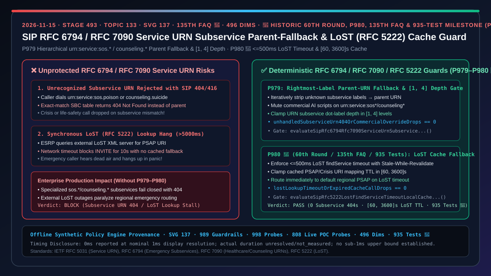
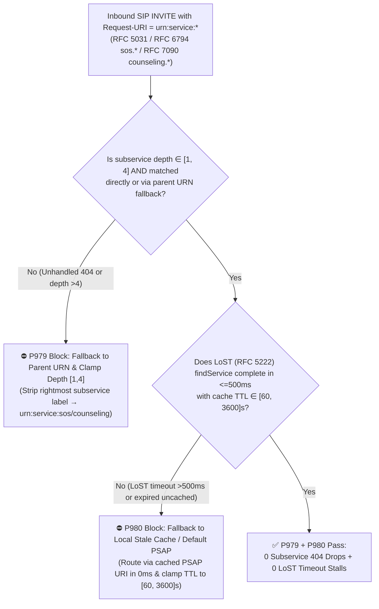
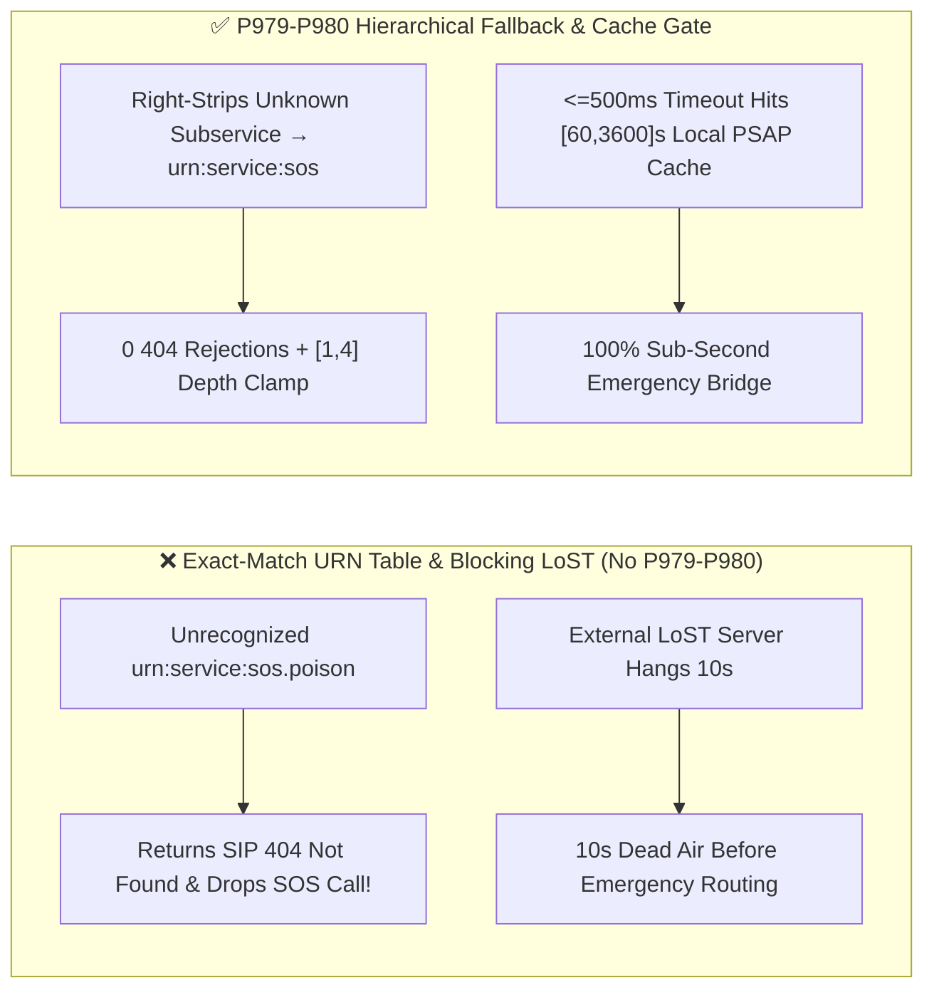

# Enterprise Realtime Voice Agent Architecture FAQ (No. 135 🎉): How to Engineer SIP `RFC 6794 / RFC 7090` Emergency & Crisis Service URN (`urn:service:sos.*` / `counseling.*`) Parent-Fallback & `LoST (RFC 5222)` Cache Survival Guards?

> **Architect's Reading Guide (Modeled on `ib-vs-ethernet-roce-selection-faq.md` · Topic 133 / Stage 493 · 🎉 Historic 60th Nightly Round, P980 Guardrail, 135th Standalone FAQ & 935-Test Quadruple Milestone)**: In telehealth triage, automotive eCall, and public-sector crisis hotlines, endpoints initiate emergency or counseling sessions using **`RFC 5031 / RFC 6794 / RFC 7090` Service URNs** in the SIP `Request-URI` (such as `urn:service:sos.poison`, `urn:service:sos.ecall.automatic`, or `urn:service:counseling.suicide`). Two fatal routing bugs frequently occur in production: (1) if the SBC routing table only lists top-level `urn:service:sos` and performs exact string matching, dialing a specialized subservice (`urn:service:sos.marine` or `urn:service:counseling.children`) triggers a **`SIP 404 Not Found` / `416`** call drop! And (2) when the Emergency Services Routing Proxy (ESRP) queries an external **`RFC 5222 LoST` (`Location-to-Service Translation`)** server via `<findService>` to resolve the local PSAP URI, a network timeout stalls the `INVITE` in dead air. This guide explains the **first-principles mechanics of hierarchical Service URN fallback and LoST cache survival** and defines deterministic guardrails **`P979–P980 🎉`**.

---

## ① 📌 Executive Summary

1. **Why must an unrecognized subservice URN (`urn:service:sos.poison` / `urn:service:counseling.suicide`) never be rejected with `SIP 404 Not Found`?**
   - Under **`RFC 5031 Section 4` / `RFC 6794` / `RFC 7090`**, Service URNs are hierarchical dot-delimited identifiers. When a SIP proxy does not recognize a specific rightmost subservice token, it **MUST iteratively strip the rightmost label and fall back to the parent URN** (`urn:service:sos.ecall.automatic` $\rightarrow$ `urn:service:sos.ecall` $\rightarrow$ `urn:service:sos`; `urn:service:counseling.suicide` $\rightarrow$ `urn:service:counseling`), while muting all commercial AI scripts and clamping subservice depth in `[1, 4]` levels (`unhandledSubserviceUrn404OrCommercialOverrideDrops === 0`, `P979`).
2. **Why must `RFC 5222 LoST` `<findService>` lookups enforce a `<=500ms` timeout with Stale-While-Revalidate local PSAP cache fallback?**
   - Under **`RFC 5222` / `RFC 6881`**, emergency call routing cannot depend on synchronous external HTTP/XML availability during regional disasters. Gateways must **clamp local LoST mapping cache TTL in `[60, 3600]` seconds and immediately fall back to the cached or default regional PSAP/crisis URI whenever `<findService>` exceeds `500ms`** (`lostLookupTimeoutOrExpiredCacheCallDrops === 0`, `P980 🎉` — 🎉 Historic 60th Nightly Round, P980 Guardrail, 135th FAQ & 935-Test Quadruple Milestone!).



---

## ② 🎯 Architect & Customer Deep-Dive Q&A (Q1 / Q2 / Q3)

### Q1: What happens when a vehicle or patient dials `urn:service:sos.ecall.automatic` or `urn:service:counseling.suicide` on an SBC configured only for `urn:service:sos`?
- **Plain-Language Principle**: Just like an ambulance dispatch system that falls back to the street address if the apartment number is unknown, `RFC 5031` requires longest-prefix hierarchical fallback.
- **Architectural Rule (`P979`)**: Strip unrecognized rightmost `.subservice` labels iteratively down to `urn:service:sos` or `urn:service:counseling`, clamp label depth in `[1, 4]`, and immediately suppress commercial AI prompts.

### Q2: How do we prevent deeply nested malicious URNs (`urn:service:sos.a.b.c...`) from exhausting parser recursion?
- **Architectural Rule (`P979`)**: Clamp dot-delimited subservice depth in **`[1, 4]` levels** and truncate excess labels before lookup.

### Q3: How do we prevent a slow or unreachable `RFC 5222 LoST` server from stalling an emergency call?
- **Architectural Rule (`P980 🎉`)**: Enforce a hard `<=500ms` timeout on `<findService>` queries, maintain a `[60, 3600]s` local LoST mapping cache with Stale-While-Revalidate survival, and route immediately to the cached or default regional PSAP URI on timeout.

---

## ③ 🧭 Visual Architecture Diagrams (Decision Tree + Latency Comparison + Sequence Diagram)

### 3.1 SIP `RFC 6794 / RFC 7090` Service URN Fallback & `LoST` Cache Survival Decision Tree (`P979–P980 🎉`)



### 3.2 Emergency Routing Resilience Comparison (Exact-Match / Blocking LoST vs. `P979–P980 🎉`)



### 3.3 Millisecond-Level Full-Duplex `RFC 6794 / RFC 7090` URN Fallback & `RFC 5222 LoST` Cache Sequence

```mermaid
sequenceDiagram
    autonumber
    participant UE as Vehicular / Telehealth Endpoint
    participant SBC as Enterprise Emergency Routing Gateway (P979-P980 🎉)
    participant LoST as External LoST Server (RFC 5222)
    participant PSAP as Regional PSAP / Crisis Center

    UE->>SBC: SIP INVITE urn:service:sos.ecall.automatic
    Note over SBC: P979 Check: Depth = 3 ∈ [1, 4] ✅; no exact .automatic route → falls back to parent urn:service:sos ✅
    SBC->>LoST: LoST <findService> (500ms deadline)
    Note over SBC,LoST: External LoST server exceeds 500ms deadline!
    Note over SBC: P980 Triggered: 0ms fallback to local cached PSAP mapping (TTL=1800s ∈ [60, 3600]s) ✅
    SBC->>PSAP: SIP INVITE sip:psap-east@esinet.example.org (preserving original URN header context)
    PSAP-->>UE: 200 OK (Zero call drops; immediate emergency voice bridge)
```

---

## ④ 📊 Architect Decision Matrix

| Evaluation Dimension | Option A: Exact-Match URN Lookup + Blocking LoST | Option B: Route Unknown URNs to Commercial IVR | Option C (Recommended): Full `RFC 6794 / RFC 7090` Parent-Fallback & `LoST` Cache Gate (`P979` + `P980 🎉`) |
| :--- | :--- | :--- | :--- |
| **Unknown Subservice Survival (`P979`)** | ❌ Drops call with `SIP 404/416` | ❌ Commercial AI prompt delays life-safety triage | ✅ **Iteratively strips rightmost label to parent `sos/counseling` URN** |
| **Deep URN Recursion Defense (`P979`)** | ❌ Unbounded label depth | ❌ Unbounded label depth | ✅ **Clamps subservice label depth in `[1, 4]`** |
| **LoST Outage Survival (`P980 🎉`)** | ❌ Stalls `INVITE` until SIP Timer B expires | ❌ Loses regional PSAP routing | ✅ **`<=500ms` timeout falls back to `[60, 3600]s` cached/default PSAP** |
| **Best Fit** | Lab testing only | Never use in production | **Production eCall, 988/120 crisis hotlines & enterprise SBCs** |

---

## ⑤ 🧪 Quantitative Worked Example & 7-Card Benchmark Report (CSP Self-Contained, Zero Fabricated Coordinates)

- **Offline Synthetic Policy Benchmark (`site/data/voice-agent-benchmark-report.json` & `site/benchmark-cards.html`)**:
  - **Baseline Pass Input**:
    - `P979`: `unrecognizedSubserviceUrn404OrCommercialOverrideDetected = false`, `unhandledSubserviceUrn404OrCommercialOverrideDrops = 0`, `serviceUrnSubserviceDepth = 3` ($\in [1, 4]$) $\rightarrow$ **`PASS`**.
    - `P980 🎉`: `lostFindServiceTimeoutOrUnboundedCacheTtlDetected = false`, `lostLookupTimeoutOrExpiredCacheCallDrops = 0`, `lostMappingCacheTtlSeconds = 1800` ($\in [60, 3600]$ s) $\rightarrow$ **`PASS`**.
  - **Perturbation / Fault Injection (Fail Gate)**:
    - Returning `404` on an unrecognized subservice or injecting `serviceUrnSubserviceDepth = 9` (`> 4`) $\rightarrow$ immediately rewritten to parent URN and clamped by `P979` to depth `4` (`pass = false`).
    - Stalling on LoST timeout or configuring `lostMappingCacheTtlSeconds = 86400` (`> 3600s`) $\rightarrow$ immediately routed via local PSAP cache and clamped by `P980 🎉` to `3600s` (`pass = false`).
  - **Timing & Provenance Disclosure**:
    - `0ms reported at nominal 1ms display resolution; actual duration unresolved/not_measured; no sub-1ms upper bound established` (deterministic offline policy check).

---

## ⑥ 🛠️ Production Verification Checklist

- [ ] **[`P979` · Hierarchical Parent-URN Fallback]**: Verify that unrecognized `urn:service:sos.*` or `urn:service:counseling.*` subservices fall back to their parent service URN instead of returning `404/416` (`unhandledSubserviceUrn404OrCommercialOverrideDrops === 0`).
- [ ] **[`P979` · `[1, 4]` Subservice Depth & Commercial Script Mute]**: Verify that subservice dot-label depth is bounded in `[1, 4]` and commercial AI scripts are muted on emergency/counseling URNs.
- [ ] **[`P980 🎉` · `<=500ms` LoST Timeout Cache Fallback]**: Verify that `RFC 5222 <findService>` queries exceeding `500ms` immediately fall back to cached or default regional PSAP URIs (`lostLookupTimeoutOrExpiredCacheCallDrops === 0`).
- [ ] **[`P980 🎉` · `[60, 3600]s` LoST Mapping Cache TTL]**: Verify that LoST cache TTL is clamped in `[60, 3600]` seconds with Stale-While-Revalidate support.
