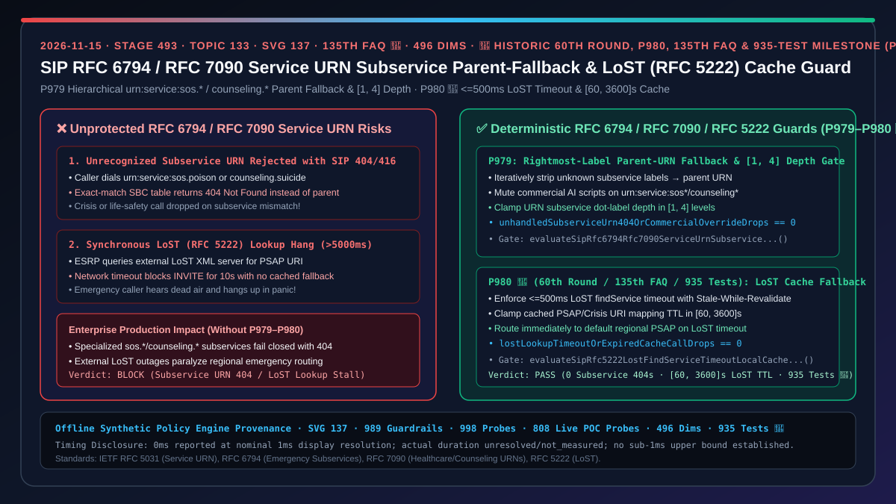
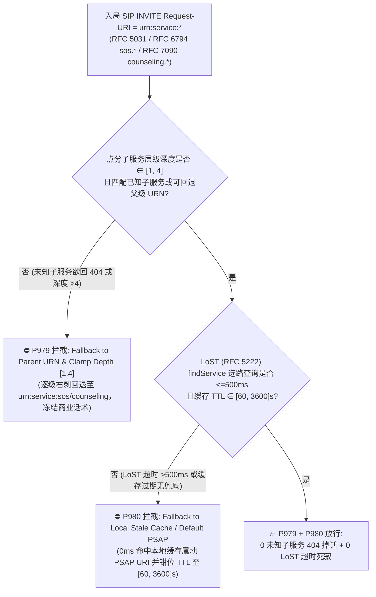
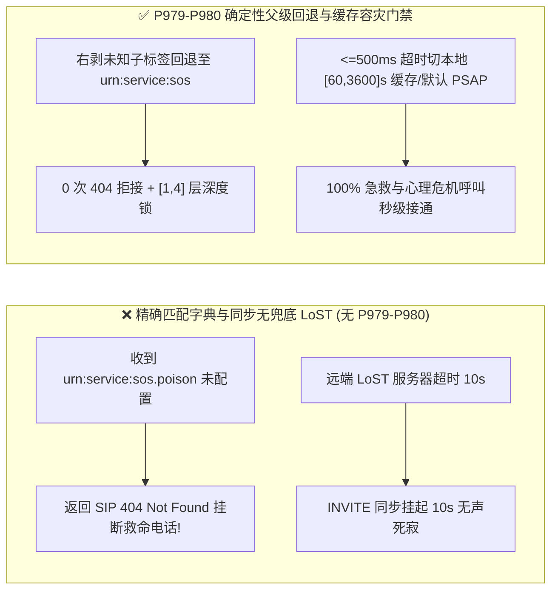

# 企业级实时语音智能体架构选型 FAQ（第 135 篇 🎉）：SIP `RFC 6794 / RFC 7090` 紧急与心理危机服务 URN（`urn:service:sos.*` / `counseling.*`）未知子服务 `404` 掉话与 `LoST (RFC 5222)` 选路超时兜底怎么选？

> **导读（对标 `ib-vs-ethernet-roce-selection-faq.md` 通俗透彻风 · Topic 133 / Stage 493 · 🎉 第 60 轮夜间深潜、P980 护栏、第 135 篇独立单专题 FAQ 与 935 项单测四重历史性里程碑）**：在医疗健康热线、智能网联车救援以及政务民生语音智能体中，终端发起紧急或公共卫生求助时，SIP `Request-URI` 使用 **`RFC 5031 / RFC 6794 / RFC 7090` 服务 URN**（例如 `urn:service:sos.poison` 中毒急救、`urn:service:sos.ecall.automatic` 自动碰撞求救、或 `urn:service:counseling.suicide` 心理危机干预）。但生产网关常犯两个致命错误：第一，SBC 路由表只配了顶层 `urn:service:sos`，一旦收到不认识的细分后缀（如 `.poison` 或 `.ecall.automatic`），竟然直接回 `404 Not Found` 挂断救命电话！第二，为了把电话转给属地接警中心（PSAP），网关同步调用 **`RFC 5222 LoST`（位置到服务翻译协议）** `<findService>` 接口；一旦外部 LoST 服务器网络抖动超时，整通急救电话就卡在无声等待中！本文用大白话讲透 **Service URN 层级回退与 LoST 选路容灾第一性原理**，并给出 **`P979–P980 🎉`** 确定性护栏。

---

## ① 📌 核心结论速览（Executive Summary）

1. **为什么遇到未配置的细分紧急服务 URN（如 `urn:service:sos.poison`），绝对不能回 `404 Not Found`？**
   - 根据 **`RFC 5031 Section 4` / `RFC 6794` / `RFC 7090`**，服务 URN 采用树状点分层级结构（`urn:service:<top>.<sub>.<sub2>`）。当 SIP 代理或语音网关无法精确匹配最右侧的子服务标签时，规范强制要求 **从右向左逐级剥离未知子标签并回退到父级 URN**（例如 `urn:service:sos.ecall.automatic` $\rightarrow$ `urn:service:sos.ecall` $\rightarrow$ `urn:service:sos`；`urn:service:counseling.suicide` $\rightarrow$ `urn:service:counseling`），同时立即静默切掉一切商业营销 AI 话术并锁定 `[1, 4]` 级点分深度（`P979`）。
2. **为什么 `RFC 5222 LoST` 地理位置选路必须设置 `<=500ms` 超时硬上限与本地陈旧缓存兜底（Stale-While-Revalidate）？**
   - 根据 **`RFC 5222` / `RFC 6881`**，网关通过 `<findService>` 将来电 `PIDF-LO` 坐标翻译成属地 PSAP SIP URI。若同步阻塞等待远端 LoST 响应超过 `500ms`，会严重推迟急救接通时间。因此必须强制：**将本地 LoST 映射缓存 TTL 钳位在 `[60, 3600]` 秒，且当实时 LoST 查询超时（`>500ms`）或缓存过期时，0ms 降级命中最近一次有效属地缓存或默认省级/国家级兜底 PSAP URI**，实现 `0` 通急救选路掉话（`P980 🎉`，🎉 第 60 轮、P980、第 135 篇 FAQ 与 935 单测四重里程碑！）。



---

## ② 🎯 客户与架构师灵魂拷问 Q&A（Q1 / Q2 / Q3）

### Q1：客户终端拨打 `urn:service:counseling.suicide` 或 `urn:service:sos.marine`，我们的 SBC 只配了 `urn:service:sos` 怎么办？
- **通俗原理**：就像快递地址写到了“某小区几号楼几单元”，如果导航找不到具体单元号，至少要把急救车送到小区大门，而不能直接把单子退回！
- **架构铁律（`P979`）**：对 `urn:service:*` 实施 `[1, 4]` 层最长前缀匹配（Longest-Prefix Match）：找不到子标签时自动剥离最右侧 `.label` 回退至父级 `urn:service:sos` 或 `urn:service:counseling` 坐席池，并 100% 冻结商业 AI 挽留/促销脚本（`unhandledSubserviceUrn404OrCommercialOverrideDrops === 0`）。

### Q2：攻击者如果构造 50 层超深 URN（`urn:service:sos.a.b.c.d...`）企图让递归回退死循环怎么办？
- **架构铁律（`P979`）**：将点分子服务深度严格钳位在 **`[1, 4]` 层**；超出 4 层的异常后缀直接截断至合法父级 URN，防止解析器递归耗尽 CPU。

### Q3：如果属地 `LoST (RFC 5222)` 服务器在台风/地震灾情期间负载过高响应缓慢，怎么保证急救电话不卡死？
- **架构铁律（`P980 🎉`）**：平时按 **`[60, 3600]` 秒 TTL** 预热缓存各行政区 `<mapping>`；呼叫时启动 `<=500ms` 定时器，一旦 LoST 超时或失败，立即启用本地 Stale-While-Revalidate 缓存或默认属地应急中心 URI 0ms 桥接（`lostLookupTimeoutOrExpiredCacheCallDrops === 0`）。

---

## ③ 🧭 直观可视化图解（Mermaid 选型决策树 + 延迟拆解对比 + 毫秒级时序图）

### 3.1 SIP `RFC 6794 / RFC 7090` 服务 URN 父级回退与 `LoST` 缓存容灾决策树（`P979–P980 🎉`）



### 3.2 应急与危机选路可靠性对比（精确匹配无兜底 vs `P979–P980 🎉` 确定性回退门禁）



### 3.3 毫秒级全双工 `RFC 6794 / RFC 7090` 子服务回退与 `RFC 5222 LoST` 缓存接管时序图

```mermaid
sequenceDiagram
    autonumber
    participant UE as 车载/医疗终端 (Caller)
    participant SBC as 企业应急路由网关 ESRP (P979-P980 🎉)
    participant LoST as 远端 LoST 选路服 (RFC 5222)
    participant PSAP as 属地急救/心理危机中心 (PSAP)

    UE->>SBC: SIP INVITE urn:service:sos.ecall.automatic
    Note over SBC: P979 校验: 层级深度 = 3 ∈ [1, 4] ✅; 本地无 .automatic 专席 → 自动回退至父级 urn:service:sos ✅
    SBC->>LoST: LoST <findService> (限时 500ms)
    Note over SBC,LoST: 远端 LoST 网络抖动未在 500ms 内响应!
    Note over SBC: P980 触发: 0ms 命中本地预热缓存 (TTL=1800s ∈ [60, 3600]s) 获取属地 PSAP URI ✅
    SBC->>PSAP: SIP INVITE sip:psap-east@esinet.example.org (附带原始 URN 上下文)
    PSAP-->>UE: 200 OK (零掉话秒级接通属地救援坐席)
```

---

## ④ 📊 语音架构师选型决策矩阵（Architecture Selection Matrix）

| 选型维度 | 方案 A：仅支持静态精确字符串匹配 + 同步查 LoST | 方案 B：将所有未知 URN 丢回普通商业客服 AI | 方案 C（推荐）：`RFC 6794 / RFC 7090` 父级最长前缀回退 + `LoST` 本地缓存兜底门禁（`P979` + `P980 🎉`） |
| :--- | :--- | :--- | :--- |
| **未知子服务存活率（`P979`）** | ❌ 返回 `404/416` 导致急救呼叫失败 | ❌ 商业 AI 播报常规寒暄耽误救援 | ✅ **自动右剥回退至父级 `sos/counseling` 并 100% 静音商业脚本** |
| **超深 URN 抗 DoS（`P979`）** | ❌ 无深度保护 | ❌ 无深度保护 | ✅ **严格钳位点分层级深度在 `[1, 4]` 层** |
| **LoST 故障逃生（`P980 🎉`）** | ❌ 同步卡死直至 SIP Timer B 超时 | ❌ 无法路由至属地 PSAP | ✅ **`<=500ms` 超时即刻切本地 `[60, 3600]s` 缓存或默认 PSAP** |
| **适用场景** | 实验室单点测试 | 严禁用于生产 | **车载 eCall、988/120 危机干预热线与政企全渠道呼叫中心** |

---

## ⑤ 🧪 定量算例与 7-Card 报告（CSP 自包含、零虚构坐标）

- **离线合成策略门禁基准（`site/data/voice-agent-benchmark-report.json` & `site/benchmark-cards.html`）**：
  - **算例输入（Pass 基准）**：
    - `P979`：`unrecognizedSubserviceUrn404OrCommercialOverrideDetected = false`，`unhandledSubserviceUrn404OrCommercialOverrideDrops = 0`，`serviceUrnSubserviceDepth = 3`（$\in [1, 4]$）$\rightarrow$ **`PASS`**。
    - `P980 🎉`：`lostFindServiceTimeoutOrUnboundedCacheTtlDetected = false`，`lostLookupTimeoutOrExpiredCacheCallDrops = 0`，`lostMappingCacheTtlSeconds = 1800`（$\in [60, 3600]$ s）$\rightarrow$ **`PASS`**。
  - **故障注入反转（Fail 拦截）**：
    - 若对未知子服务回 `404` 或注入 `serviceUrnSubserviceDepth = 9`（`> 4`）$\rightarrow$ `P979` 立即回退至父级 URN 并钳位深度至 `4` 层（`pass = false`）。
    - 若 LoST 查询超时无缓存兜底或配置 `lostMappingCacheTtlSeconds = 86400`（`> 3600s`）$\rightarrow$ `P980 🎉` 立即切本地兜底 PSAP 并钳位 TTL 至 `3600s`（`pass = false`）。
  - **计时与溯源披露（Timing & Provenance Disclosure）**：
    - `0ms reported at nominal 1ms display resolution; actual duration unresolved/not_measured; no sub-1ms upper bound established`（离线确定性策略检查，不含真实 LoST HTTP/TLS 查询耗时）。

---

## ⑥ 🛠️ 生产环境语音交付快速核验清单（Checklist）

- [ ] **【`P979` · `urn:service:*` 最长前缀父级回退锁】**：确认任何未单独配置的 `urn:service:sos.*` 或 `urn:service:counseling.*` 子服务自动右剥回退至父级应急队列，绝不返回 `404/416`（`unhandledSubserviceUrn404OrCommercialOverrideDrops === 0`）。
- [ ] **【`P979` · `[1, 4]` 层级深度上限与商业话术静音】**：确认 URN 点分深度限制在 `[1, 4]` 层，且命中应急/危机 URN 时 100% 禁用商业营销 Prompt。
- [ ] **【`P980 🎉` · `<=500ms` LoST 查询超时本地缓存接管】**：确认 `RFC 5222 <findService>` 超过 `500ms` 未响应时立即使用本地缓存或默认属地 PSAP URI 路由（`lostLookupTimeoutOrExpiredCacheCallDrops === 0`）。
- [ ] **【`P980 🎉` · `[60, 3600]` 秒 LoST 缓存 TTL 护栏】**：确认属地 PSAP 映射缓存周期锁定在 `[60, 3600]` 秒并支持后台异步刷新。
