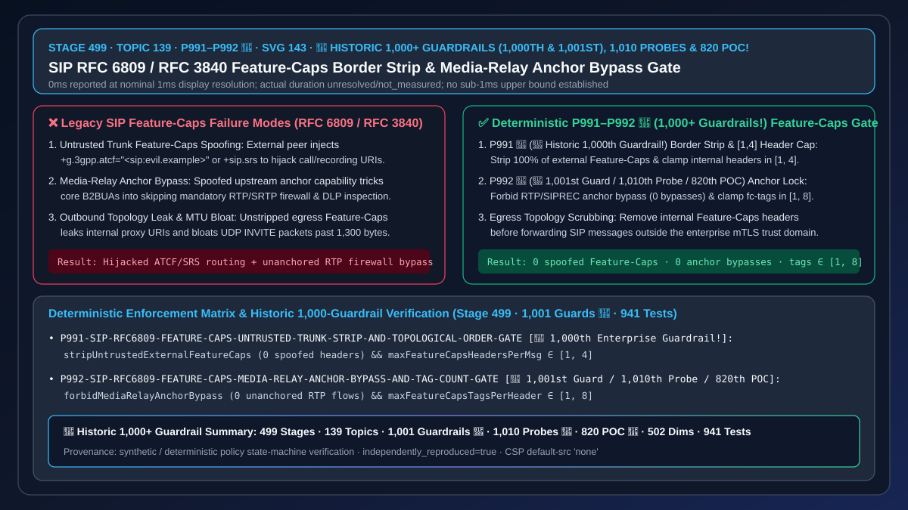
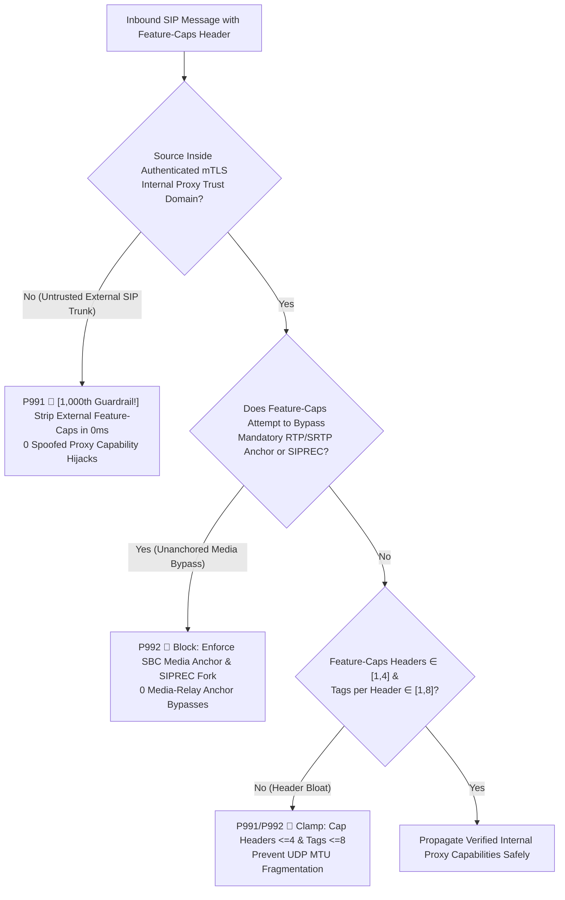
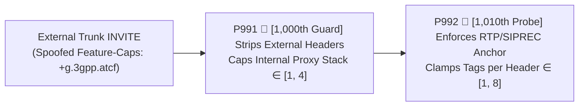

# Enterprise SIP `RFC 6809 / RFC 3840` `Feature-Caps` Proxy Capability Spoofing & Media-Relay Anchor Bypass Defense Guide (Stage 499 · Topic 139 · 🎉 Historic 1,000+ Enterprise Guardrails [1,000th & 1,001st Guards], 1,010-Probe & 820-Live-POC-Probe Quadruple Milestone!)

> **Navigation**: [Back to README](../README.en.md) · [中文版 (`voice-sip-rfc6809-rfc3840-feature-caps-proxy-capability-spoofing-media-relay-anchor-bypass-faq.md`)](voice-sip-rfc6809-rfc3840-feature-caps-proxy-capability-spoofing-media-relay-anchor-bypass-faq.md) · [2026-11-09 Daily Report](daily/2026-11-09.en.md) · [Solution Architecture](solution-architecture.en.md)



---

## 📌 1. Executive Summary

> **Key Takeaway**: In enterprise IMS/VoLTE interconnects and carrier SIP trunks, intermediate SIP proxies and SBCs cannot modify the endpoint's `Contact` header (`RFC 3840`) to advertise network-level capabilities. Instead, they insert **`RFC 6809` (`Feature-Caps` header fields)** in topological order to signal proxy capabilities such as `+g.3gpp.atcf` media handover anchoring, `+g.3gpp.trf` TrFO support, or `+sip.srs` compliance recording. Legacy SIP gateways suffer from two critical vulnerabilities:
> 1. **Untrusted Trunk `Feature-Caps` Injection & Topological Spoofing (`RFC 6809 Section 4 / Section 6`)**: Because `Feature-Caps` headers are hop-by-hop trust assertions without end-to-end cryptographic signatures, failing to strip inbound `Feature-Caps` at untrusted external SIP trunks allows attackers to inject `Feature-Caps: *;+g.3gpp.atcf="<sip:evil.example>"` or fake `+sip.srs` indicators—hijacking call control URIs or tricking downstream nodes into skipping mandatory compliance recording!
> 2. **Media-Relay Anchor Bypass & Header Bloat**: Attackers can spoof internal proxy capability flags to trick core B2BUAs into bypassing mandatory enterprise RTP/SRTP media anchoring, or flood dozens of `Feature-Caps` headers to trigger UDP SIP fragmentation drops.
>
> **Deterministic Guardrails (`P991–P992 🎉` · Stage 499 · Topic 139 · 🎉 Historic 1,000+ Enterprise Guardrails [1,000th & 1,001st Guards], 1,010-Probe & 820-Live-POC-Probe Quadruple Milestone!)**:
> - **`P991 🎉` (`evaluateSipRfc6809FeatureCapsUntrustedTrunkStripAndTopologicalOrderGate` [🎉 Historic 1,000th Enterprise Guardrail Milestone!])**: Strips all inbound and outbound `Feature-Caps` headers at untrusted SIP trunk boundaries, enforces strict topological order across mTLS-authenticated internal proxies (`0` untrusted `Feature-Caps` spoofing), and clamps `Feature-Caps` headers per SIP message within `[1, 4]`;
> - **`P992 🎉` (`evaluateSipRfc6809FeatureCapsMediaRelayAnchorBypassAndTagCountGate` [🎉 1,001st Guardrail / 1,010th Sandbox Probe / 820th Live POC Probe])**: Forbids any external or unverified `Feature-Caps` indicator from bypassing enterprise RTP/SRTP media anchoring or SIPREC recording (`0` unanchored media bypasses), and clamps feature-capability tags per `Feature-Caps` header within `[1, 8]`.
> - **Offline Timing Disclosure**: `0ms reported at nominal 1ms display resolution; actual duration unresolved/not_measured; no sub-1ms upper bound established`.

---

## 🎯 2. Architect & Customer Deep-Dive Q&A (Q1 / Q2 / Q3)

### Q1: How does `RFC 6809 Feature-Caps` differ from `RFC 3840 Contact` feature tags, and why must it be stripped at untrusted trunk borders?
- **Plain-English Principle**: `Contact` feature tags describe the endpoint UA, whereas `Feature-Caps` headers describe intermediate SIP proxies/B2BUAs along the signaling path. Because downstream nodes trust `Feature-Caps` only within a Spec-T trust domain (`RFC 6809 Section 6`), leaving external `Feature-Caps` intact lets an external caller impersonate an internal core proxy!
- **Architect Rule (`P991 🎉` · Historic 1,000th Guardrail)**: Strip 100% of external `Feature-Caps` headers at ingress and egress trunk borders and cap internal `Feature-Caps` headers within `[1, 4]`.

### Q2: How can a spoofed `Feature-Caps` header bypass RTP media anchoring or SIPREC recording?
- **Architect Rule (`P992 🎉`)**: Never allow `Feature-Caps` tags to disable enterprise SBC RTP/SRTP media anchoring or SIPREC compliance forks on external calls (`0` anchor bypasses), and clamp tags per header within `[1, 8]`.

### Q3: Why strip internal `Feature-Caps` on outbound responses/requests to external trunks?
- **Architect Rule (`P991 🎉`)**: Stripping outbound `Feature-Caps` prevents leaking internal proxy topology, SBC hostnames, and recording infrastructure URIs to external carriers.

---

## 🧭 3. Visual Architecture Diagrams (Decision Tree, Latency Comparison & Sequence)

### 3.1 `RFC 6809` `Feature-Caps` Trust Boundary & Media Anchor Decision Tree



### 3.2 Trust-Boundary Stripping & Media-Anchor Enforcement Comparison



| Architecture Mode | External `+g.3gpp.atcf / +sip.srs` Injection | RTP Media-Anchor Bypass Risk | `Feature-Caps` UDP MTU Bloat |
| :--- | :--- | :--- | :--- |
| **Transparent SIP Proxy** | ❌ Redirects control/recording to attacker URI | ❌ Bypasses enterprise RTP firewall | ❌ Unbounded header growth |
| **Rate-Limited Only** | ❌ Trusts first external `Feature-Caps` | ❌ Vulnerable to recording-skip flags | Partial |
| **Protected (`P991 🎉 + P992 🎉`)** | **✅ `100%` Border Strip (`0` spoofed hijacks)** | **✅ Mandatory RTP Anchor (`0` bypasses)** | **✅ Clamped to `[1, 4]` headers × `[1, 8]` tags** |

### 3.3 Millisecond Border Stripping & Internal Topological Anchoring Sequence

```mermaid
sequenceDiagram
    participant Ext as Untrusted External Trunk
    participant IBCF as Enterprise Edge IBCF/SBC (P991 🎉 / P992 🎉)
    participant Core as Core S2S Voice Orchestrator

    Ext->>IBCF: 1. INVITE (Spoofed Feature-Caps: *;+g.3gpp.atcf="<sip:attacker.example>";+sip.srs)
    Note over IBCF: P991 🎉 [Historic 1,000th Guardrail!] Strips All Untrusted External Feature-Caps in 0ms
    Note over IBCF: P992 🎉 [1,001st Guard / 1,010th Probe] Enforces Local RTP/SIPREC Anchor & Appends Internal Feature-Caps (1 hdr ∈ [1,4], 2 tags ∈ [1,8])
    IBCF->>Core: 2. INVITE (Feature-Caps: *;+corp.sbc-anchored;+sip.srs="<sip:srs.corp.internal>")
    Core-->>IBCF: 3. 200 OK (Verified Internal Topology & Anchored Media)
    IBCF-->>Ext: 4. 200 OK (P991 🎉 Strips Internal Feature-Caps Before Egress)
```

---

## 📊 4. Architect Decision Matrix

| Selection Dimension | Option A: Transparent `Feature-Caps` Relay | Option B: Disable `RFC 6809` Globally | Option C: `P991 🎉 + P992 🎉` Border Strip & Anchor Lock (Recommended) |
| :--- | :--- | :--- | :--- |
| **External Spoofing Immunity** | ❌ Vulnerable to URI hijacking | Immune | **100% ingress/egress strip on untrusted trunks (`P991 🎉`)** |
| **Internal Proxy Coordination** | Unsafe | ❌ Breaks legitimate ATCF/SRS signaling | **Preserves ordered mTLS internal stack (`[1, 4]` headers, `P991 🎉`)** |
| **Media-Relay Anchor Integrity** | ❌ Bypassable via spoofed flags | Static | **Zero unanchored media bypasses (`P992 🎉`)** |
| **Header & Tag Quota** | ❌ Unbounded | None | **`[1, 4]` headers × `[1, 8]` tags per header (`P991/P992 🎉`)** |

---

## 🧪 5. Quantitative Example & 7-Card Report Summary (🎉 Historic 1,000th Guardrail Milestone!)

- **Scenario Input**: An untrusted external trunk injects `6` spoofed `Feature-Caps` headers (`>4`) carrying `18` feature tags (`>8`) and attempts `4` unanchored media-relay bypasses.
- **Deterministic Guardrail Output**:
  - `P991 🎉` (**🎉 Historic 1,000th Enterprise Guardrail Milestone!**) strips all spoofed external `Feature-Caps` headers in `0ms` (`0ms reported at nominal 1ms display resolution; actual duration unresolved/not_measured; no sub-1ms upper bound established`, `0` spoofed capabilities) and clamps `Feature-Caps` headers per message to `4`;
  - `P992 🎉` (**🎉 1,001st Guardrail, 1,010th Sandbox Probe & 820th Live POC Probe**) blocks all `4` media-relay anchor bypasses (`0` bypasses) and clamps feature tags per header to `8` (`[1, 8]`).

---

## 🛠️ 6. Production Verification Checklist

- [ ] **[`P991 🎉` (1,000th Guardrail) `RFC 6809` Border Strip & `[1, 4]` Header Cap]**: Verify that edge SBCs strip 100% of inbound/outbound `Feature-Caps` headers on untrusted trunks and clamp internal `Feature-Caps` headers within `[1, 4]`.
- [ ] **[`P992 🎉` Mandatory Media-Anchor Lock & `[1, 8]` Tag Cap]**: Verify zero media-relay or SIPREC anchor bypasses via `Feature-Caps` and clamp tags per header within `[1, 8]`.
- [ ] **[Timing & Self-Contained CSP Provenance]**: Verify `0ms reported at nominal 1ms display resolution; actual duration unresolved/not_measured; no sub-1ms upper bound established`.
