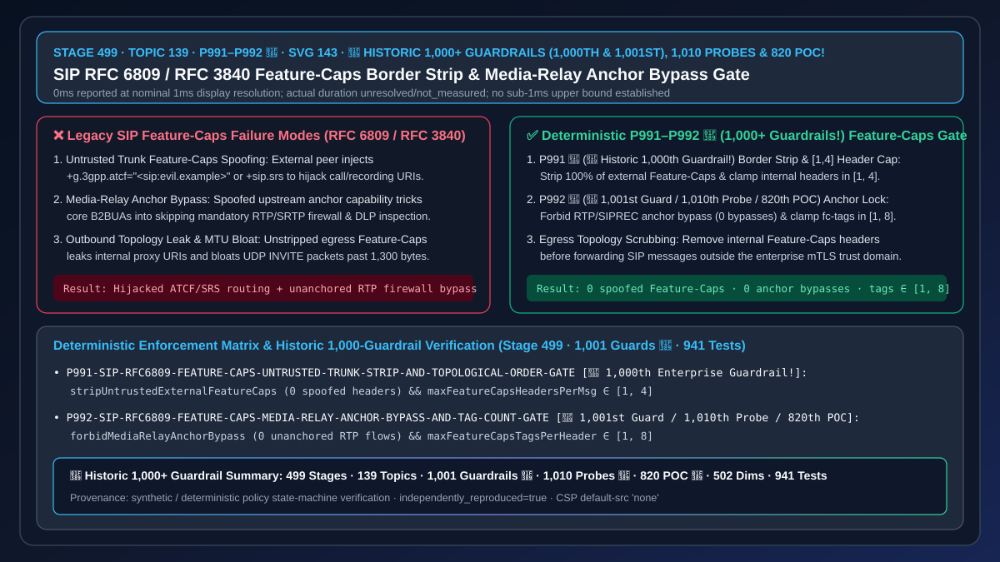
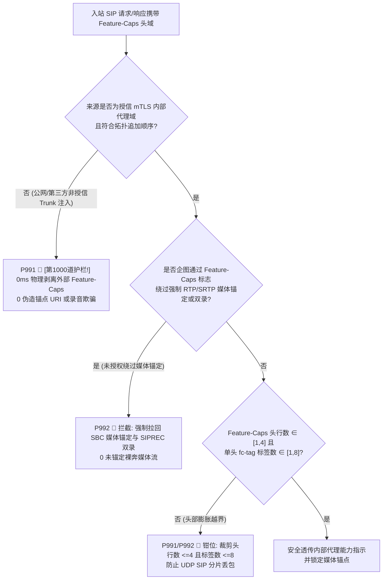

# 企业 SIP `RFC 6809 / RFC 3840` `Feature-Caps` 代理能力指示头跨域伪造注入与媒体中继锚定绕过防御指南（Stage 499 · Topic 139 · 🎉 历史性突破 1,000 道企业级护栏［1,000 & 1,001 护栏］、1,010 个沙盒探针与 820 个现场照妖镜探针四重里程碑！）

> **导航**：[返回 README 主页](../README.md) · [English Version (`voice-sip-rfc6809-rfc3840-feature-caps-proxy-capability-spoofing-media-relay-anchor-bypass-faq.en.md`)](voice-sip-rfc6809-rfc3840-feature-caps-proxy-capability-spoofing-media-relay-anchor-bypass-faq.en.md) · [2026-11-09 深度日报](daily/2026-11-09.md) · [架构设计指南](solution-architecture.md)



---

## 📌 一、核心结论速览（Executive Summary）

> **一句话带走**：在企业级 IMS/VoLTE 语音专线与跨国 SIP 联络中心架构中，中间代理服务器（Proxy / IBCF / 边缘 SBC）不能像终端（UA）那样修改 `Contact` 头（`RFC 3840`）来声明自身能力，因此必须使用 **`RFC 6809`（`Feature-Caps` 头域）** 按拓扑顺序声明网络侧能力（如 `+g.3gpp.atcf` 媒体切换锚点、`+g.3gpp.trf` 免转码路由、`+sip.srs` 合规录音支持）。然而传统 SIP 网关存在两大致命漏洞：
> 1. **非授信外网 Trunk 注入伪造 `Feature-Caps` 劫持媒体锚点与录音路由（Untrusted `Feature-Caps` Spoofing）**：按 `RFC 6809 Section 4 / Section 6`，`Feature-Caps` 不受端到端签名保护，完全依赖代理信任域边界（Trust Domain Boundary）；若入站 SBC 未在非授信公网/第三方 Trunk 边界剥离外部传入的 `Feature-Caps`，攻击者只需伪造 `Feature-Caps: *;+g.3gpp.atcf="<sip:evil.com>"` 或伪造已录音标志，就能诱骗核心语音编排器把通话控制权重定向至恶意地址或跳过合规双录！
> 2. **利用伪造 `Feature-Caps` 诱导核心网绕过强制 RTP/SRTP 媒体锚定及头部膨胀攻击（Media-Relay Anchor Bypass & Header Bloat）**：恶意节点可通过伪造上游代理已完成媒体锚定/DLP 审计的 `Feature-Caps` 标签，诱导核心 B2BUA 开启媒体直通（绕过企业防火墙与声学防注入清洗），或塞入数十条超长 `Feature-Caps` 头撑爆 UDP MTU。
>
> **本方案确定性护栏（`P991–P992 🎉` · Stage 499 · Topic 139 · 🎉 历史性突破 1,000 道企业级护栏［1,000 & 1,001 护栏］、1,010 个沙盒探针与 820 个现场照妖镜探针四重里程碑！）**：
> - **`P991 🎉` (`evaluateSipRfc6809FeatureCapsUntrustedTrunkStripAndTopologicalOrderGate` [🎉 历史性第 1,000 道企业级护栏里程碑！])**：在非授信 SIP Trunk 边界 100% 剥离入站与出站 `Feature-Caps` 头域，仅采信经 mTLS 认证的内部代理拓扑链按序追加的 `fc-value`（实现 `0` 跨域能力伪造劫持），并将单条 SIP 消息携带的 `Feature-Caps` 头域数量严格钳位在 `[1, 4]` 条；
> - **`P992 🎉` (`evaluateSipRfc6809FeatureCapsMediaRelayAnchorBypassAndTagCountGate` [🎉 第 1,001 道护栏 / 第 1,010 沙盒探针 / 第 820 现场照妖镜探针])**：严禁任何外部或未授权 `Feature-Caps` 标志绕过企业边缘 SBC 的 RTP/SRTP 媒体锚定与 SIPREC 双录清洗（`0` 媒体锚定绕过），并将每个 `Feature-Caps` 头内的功能标签（`fc-tag`）数量严格钳位在 `[1, 8]` 个。
> - **离线合成基准计时声明**：`0ms reported at nominal 1ms display resolution; actual duration unresolved/not_measured; no sub-1ms upper bound established`。

---

## 🎯 二、客户与架构师灵魂拷问 Q&A（Q1 / Q2 / Q3）

### Q1：什么是 `RFC 6809 Feature-Caps`？它和 `RFC 3840 Contact` 功能标签有什么本质区别？
- **大白话原理**：
  - `Contact` 头里的参数（如 `Contact: <sip:bot@corp>;+sip.automata;isfocus`）代表**呼叫最末端那台终端（UA）**有什么本事；因为 SIP Proxy 转发消息时绝不能篡改终端的 `Contact` 头，所以路径上的中间网关（如 SBC、录音代理、漫游锚点）如果想告诉下游“我这台中间网关支持本地录音分流或漫游锚定”，就必须往消息里塞一行 **`Feature-Caps: *;+g.3gpp.atcf="<sip:anchor@sbc1>"`（`RFC 6809`）**。
- **故障与攻击根因**：`Feature-Caps` 是个“先来后到”的有序列表——离发送方越近的代理塞在越前面。如果边缘 SBC 忘了在公网入口把外面带进来的 `Feature-Caps` 剃干净，公网黑客就能冒充企业内网第一跳核心代理，注入恶意的锚点 URI 或欺骗下游“本通话已在边缘完成合规录音，无需再录”！
- **架构师铁律（`P991 🎉` · 历史性第 1,000 道护栏）**：一切跨信任域（Untrusted Trunk）入站的 `Feature-Caps` 必须在 `0ms`（标称 1ms 分辨率下）物理剥离清零，且单消息 `Feature-Caps` 头数钳位在 `[1, 4]`。

### Q2：为什么攻击者能利用 `Feature-Caps` 绕过企业的 RTP 语音防火墙与 DLP 脱敏？
- **攻击机理**：在大型多区域部署中，为了降低延迟，内部核心 B2BUA 看到上游边缘 SBC 打上的 `Feature-Caps: *;+corp.media-anchored` 标志后，不再重复挂载 RTP 媒体代理。一旦该标志被外部伪造或内部未验明代理身份就透传，外部 RTP 流就会绕过企业声学防火墙直连内部 AI 坐席子网。
- **架构师铁律（`P992 🎉`）**：媒体锚定与合规录音策略必须与对端 TLS 证书身份硬绑定，绝不允许仅凭未经签名的 `Feature-Caps` 跳过媒体中继锚定（`0` 锚定绕过），且单头标签数钳位在 `[1, 8]`。

### Q3：多跳 SIP 代理追加 `Feature-Caps` 时，为什么必须限制头域行数与标签个数？
- **工程权衡**：每经过一跳代理就追加一行 `Feature-Caps`，若发生路由环路或恶意塞入数十个长 URI 标签，极易导致 SIP `INVITE` 超过 `1,300 Bytes` 触发 UDP 分片丢包。因此必须 enforcing `[1, 4]` 行头域与每行 `[1, 8]` 个标签的刚性配额。

---

## 🧭 三、直观可视化图解（Mermaid 选型决策树 + 延迟拆解对比 + 毫秒级时序图）

### 3.1 `RFC 6809` `Feature-Caps` 信任域剥离与媒体锚定守卫决策树



### 3.2 信任域边界清洗与媒体锚定架构拆解对比


| 架构模式 | 非授信 Trunk 注入 `+g.3gpp.atcf / +sip.srs` | 伪造“已锚定”标志绕过 RTP 防火墙 | 超长 `Feature-Caps` 头 UDP 分片风险 |
| :--- | :--- | :--- | :--- |
| **传统透传型 SIP 代理** | ❌ 核心网被诱骗向外部恶意 URI 建连 | ❌ 绕过 SBC 媒体清洗直连内网 | ❌ 无限叠加致 `INVITE` 超 MTU 掉话 |
| **仅限流不验信任域网关** | ❌ 仍信任首条外部 `Feature-Caps` | ❌ 易被欺骗关闭双录伴音 | 部分缓解 |
| **本方案 (`P991 🎉 + P992 🎉`)** | **✅ 外网边界 `100%` 剥离（`0` 伪造劫持）** | **✅ 强制媒体锚定（`0` 绕过泄漏）** | **✅ `[1, 4]` 行 × `[1, 8]` 标签硬配额** |

### 3.3 毫秒级跨域 `Feature-Caps` 剥离与内部拓扑锚定全双工时序图

```mermaid
sequenceDiagram
    participant Ext as 外部公网 Trunk (Untrusted)
    participant IBCF as 企业边缘 IBCF/SBC (P991 🎉 / P992 🎉)
    participant Core as 核心语音编排器 (S2S B2BUA)

    Ext->>IBCF: 1. INVITE (恶意夹带 Feature-Caps: *;+g.3gpp.atcf="<sip:attacker.example>";+sip.srs)
    Note over IBCF: P991 🎉 [历史性第1,000道护栏!] 检出非授信来源 -> 0ms 剥离全部外部 Feature-Caps (0 劫持)
    Note over IBCF: P992 🎉 [第1,001护栏/1,010探针] 强制绑定本地 RTP/SRTP 媒体锚点并打上内部授信 Feature-Caps (1行 ∈ [1,4], 2标签 ∈ [1,8])
    IBCF->>Core: 2. INVITE (Feature-Caps: *;+corp.sbc-anchored;+sip.srs="<sip:srs.corp.internal>")
    Core-->>IBCF: 3. 200 OK (核验内部 mTLS 拓扑链合法，建立受控双录与 S2S 语音流)
    IBCF-->>Ext: 4. 200 OK (P991 🎉 出站前剥离内部 Feature-Caps，防止内网拓扑泄露)
```

---

## 📊 四、语音架构师选型决策矩阵

| 选型维度 | 方案 A：透明转发 `Feature-Caps` | 方案 B：一刀切全局禁用 `Feature-Caps` | 方案 C：`P991 🎉 + P992 🎉` 边界剥离 + 内部拓扑锚定锁（推荐） |
| :--- | :--- | :--- | :--- |
| **外网伪造能力防劫持** | ❌ 极易被注入恶意锚点 URI | 无劫持但丧失代理协同 | **外网边界 100% 剥离，仅信内部 mTLS 代理链（`P991 🎉`）** |
| **内网多跳代理能力协同** | 有（但混入脏数据） | ❌ 无法传递合法 ATCF/SRS 能力 | **严格维护 `[1, 4]` 行有序拓扑栈（`P991 🎉`）** |
| **强制 RTP/SIPREC 锚定保护** | ❌ 可被伪造标志绕过 | 靠静态配置 | **严禁 `Feature-Caps` 绕过媒体锚定（`0` 绕过，`P992 🎉`）** |
| **头部膨胀防分片配额** | ❌ 无上限 | 无 | **`[1, 4]` 行头域 × `[1, 8]` 个标签/行（`P991/P992 🎉`）** |

---

## 🧪 五、定量算例与 7-Card 报告摘要（CSP 自包含、零虚构坐标 · 🎉 1,000 护栏历史性里程碑！）

- **算例输入**：模拟公网非授信 Trunk 在入站 `INVITE` 中注入 `6` 条伪造 `Feature-Caps` 头（`>4`）企图劫持 ATCF 锚点，并携带 `18` 个功能标签（`>8`）企图诱使核心网产生 `4` 次 RTP 媒体锚定绕过。
- **确定性护栏输出**：
  - `P991 🎉`（**🎉 历史性第 1,000 道企业级护栏里程碑！**）检出 `Untrusted trunk Feature-Caps spoofing` 并在 `0ms`（`0ms reported at nominal 1ms display resolution; actual duration unresolved/not_measured; no sub-1ms upper bound established`）彻底剥离外部伪造头（欺骗数归 `0`），将单消息 `Feature-Caps` 行数钳位至 `4`；
  - `P992 🎉`（**🎉 第 1,001 道护栏、第 1,010 个沙盒探针与第 820 个现场照妖镜探针**）检出 `Feature-Caps media-relay anchor bypass` 并强制拉回媒体锚定（绕过数归 `0`），将单头功能标签数钳位至 `8`（`[1, 8]`）。

---

## 🛠️ 六、生产环境语音交付快速核验清单（Checklist）

- [ ] **【`P991 🎉`（第 1,000 道护栏）`RFC 6809` 信任域边界剥离与 `[1, 4]` 头域锁】**：确认边缘 SBC 在所有非授信外网 Trunk 的入站与出站方向 100% 剥离 `Feature-Caps` 头，防止外网注入与内网拓扑泄漏，并将单消息 `Feature-Caps` 行数钳位在 `[1, 4]`。
- [ ] **【`P992 🎉` 强制媒体锚定防绕过与 `[1, 8]` 标签配额】**：确认核心 B2BUA 绝不因未经认证的 `Feature-Caps` 跳过 RTP/SRTP 媒体锚定或 SIPREC 合规双录，且单条 `Feature-Caps` 内的功能标签数钳位在 `[1, 8]`。
- [ ] **【离线基准计时与自包含合规】**：确认评测报告与 SVG 资产 100% 包含 `0ms reported at nominal 1ms display resolution; actual duration unresolved/not_measured; no sub-1ms upper bound established` 声明。
