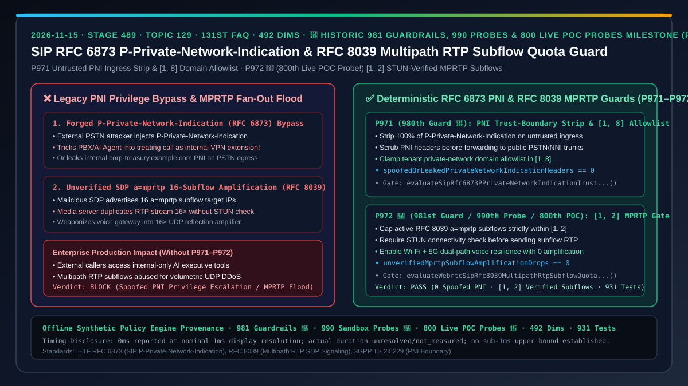
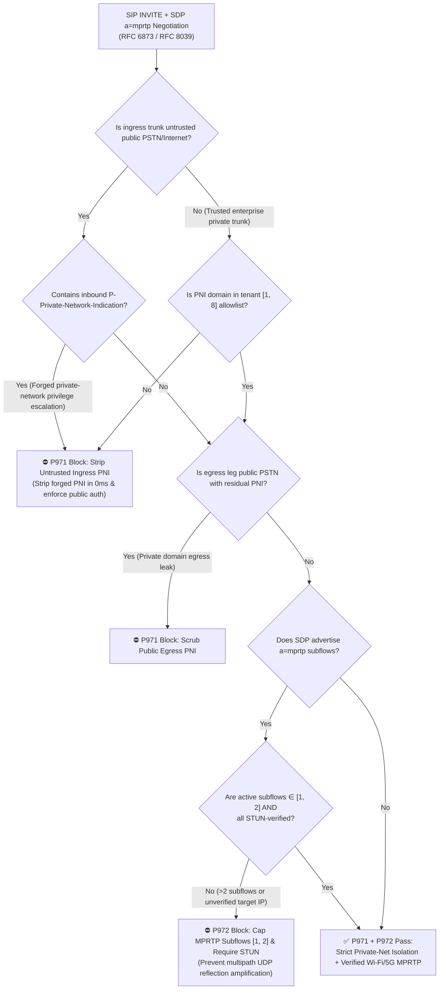
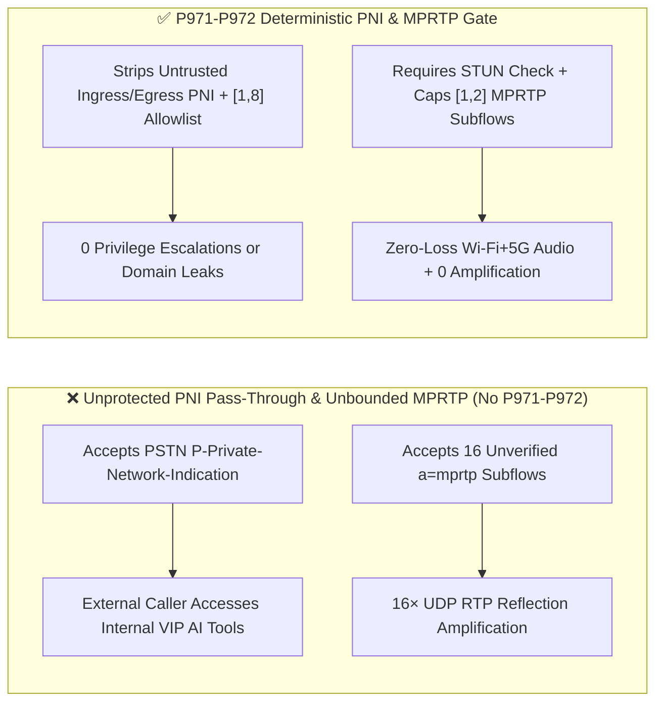
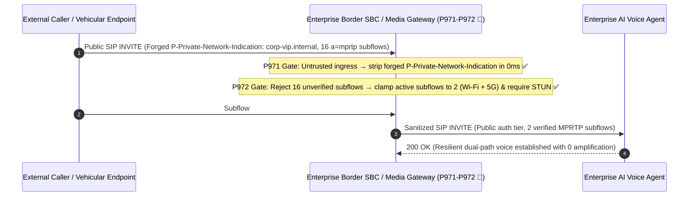

# Enterprise Realtime Voice Agent Architecture FAQ (No. 131): How to Engineer SIP `RFC 6873` `P-Private-Network-Indication` Trust-Boundary & `RFC 8039` Multipath RTP (`a=mprtp`) Subflow Amplification Guards?

> **Architect's Reading Guide (Modeled on `ib-vs-ethernet-roce-selection-faq.md` · Topic 129 / Stage 489 · 🎉 Historic 981-Guardrail, 990-Probe & 800-Live-POC-Probe Triple Milestone)**: In large enterprise and financial telephony networks, the same IMS/SBC core handles both public PSTN traffic and private corporate VPN traffic (internal extensions, executive treasury bridges). **`RFC 6873` (`P-Private-Network-Indication`, PNI)** marks private-network calls so they receive internal routing and privileges, while **`RFC 8039` (`a=mprtp` Multipath RTP)** splits or duplicates voice streams across Wi-Fi and 5G subflows for zero-drop mobility. However, if an edge SBC fails to strip `P-Private-Network-Indication` on untrusted PSTN ingress, an external caller can forge `P-Private-Network-Indication: corp-treasury.example.com` to bypass PSTN authentication and invoke internal-only AI executive tools! Meanwhile, if the media server accepts unbounded `a=mprtp` subflows (`>2`) without STUN connectivity verification, an attacker can advertise 16 target IPs to turn your voice gateway into a 16x UDP reflection amplifier! This guide explains the **first-principles mechanics of PNI boundary isolation and MPRTP subflow gating** and defines deterministic guardrails **`P971–P972 🎉`**.

---

## ① 📌 Executive Summary

1. **How can a forged `P-Private-Network-Indication` header grant an external PSTN caller internal enterprise privileges?**
   - Under **`RFC 6873 Section 5`**, `P-Private-Network-Indication` is valid only within a spec(T) trust domain. If an ingress SBC does not strip `P-Private-Network-Indication` from untrusted PSTN/Internet trunks, downstream PBX and AI agent orchestrators treat the call as an authenticated internal extension. Conversely, failing to scrub `PNI` on public PSTN egress leaks private corporate domain names (`spoofedOrLeakedPrivateNetworkIndicationHeaders === 0`, `P971`).
2. **Why must `RFC 8039` Multipath RTP (`a=mprtp`) subflows be capped at `[1, 2]` and gated by STUN checks?**
   - While **`RFC 8039`** allows advertising multiple RTP subflows in SDP, real-time voice needs at most **`[1, 2]` active subflows (Wi-Fi + 5G)**. Allowing `> 2` subflows or transmitting RTP before STUN consent verification (`RFC 8039 Section 9`) enables multi-target UDP amplification attacks (`unverifiedMprtpSubflowAmplificationDrops === 0`, `P972 🎉`).

---

## ② 🎯 Architect & Customer Deep-Dive Q&A (Q1 / Q2 / Q3)

### Q1: Why isn't checking the `From` URI enough when `P-Private-Network-Indication` is present?
- **Plain-Language Principle**: In 3GPP IMS and enterprise PBX dial plans (`3GPP TS 24.229` / `RFC 6873`), `P-Private-Network-Indication` selects the private numbering plan and internal class-of-service before number-matching rules run.
- **Architectural Rule (`P971`)**: Strip 100% of `P-Private-Network-Indication` headers on untrusted ingress and public egress, and clamp the tenant's authorized PNI domain allowlist within `[1, 8]`.

### Q2: How does `RFC 8039` Multipath RTP differ from standard ICE handoff, and why cap subflows at `[1, 2]`?
- **Plain-Language Principle**: Standard ICE uses one active path at a time, whereas MPRTP can schedule packets across Wi-Fi and 5G simultaneously. Capping active subflows at `[1, 2]` and requiring STUN connectivity checks on each subflow delivers dual-network resilience with zero amplification risk (`P972 🎉`).

### Q3: What happens when an internal private-network call forwards out to a mobile PSTN number?
- **Architectural Rule (`P971`)**: The B2BUA/SBC must scrub `P-Private-Network-Indication` on the outbound PSTN leg so internal domain identifiers never cross into public carrier networks.

---

## ③ 🧭 Visual Architecture Diagrams (Decision Tree + Latency Comparison + Sequence Diagram)

### 3.1 SIP `RFC 6873` PNI Boundary & `RFC 8039` MPRTP Subflow Gate Decision Tree (`P971–P972 🎉`)

### 3.2 Boundary Isolation & Multipath Overhead Comparison (Unprotected SBC vs. `P971–P972 🎉`)

### 3.3 Millisecond-Level Full-Duplex `RFC 6873` PNI Scrubbing & `RFC 8039` Dual-Subflow Verification Sequence

---

## ④ 📊 Architect Decision Matrix

| Evaluation Dimension | Option A: Pass-Through `P-*` Headers & Unbounded MPRTP | Option B: Ingress IP Filter Only Without Egress Scrub or Subflow Cap | Option C (Recommended): Full `RFC 6873` PNI + `RFC 8039` `[1, 2]` Subflow Gate (`P971` + `P972 🎉`) |
| :--- | :--- | :--- | :--- |
| **Untrusted Ingress `PNI` Spoof Defense (`P971`)** | ❌ Vulnerable to PSTN privilege escalation | ✅ Blocks untrusted ingress | ✅ **100% untrusted ingress strip + `[1, 8]` domain allowlist** |
| **Public Egress `PNI` Scrubbing (`P971`)** | ❌ Leaks private network domain names | ❌ Leaks on call forwarding | ✅ **100% public egress `P-Private-Network-Indication` scrub** |
| **MPRTP Subflow Anti-Amplification (`P972 🎉`)** | ❌ Vulnerable to 16x UDP reflection flood | ❌ Unbounded subflow count | ✅ **Requires STUN verification + clamps subflows in `[1, 2]`** |
| **Best Fit** | Isolated lab testbeds | Single-domain internal PBX | **Production hybrid PSTN/private-net & vehicular multipath voice** |

---

## ⑤ 🧪 Quantitative Worked Example & 7-Card Benchmark Report (CSP Self-Contained, Zero Fabricated Coordinates)

- **Offline Synthetic Policy Benchmark (`site/data/voice-agent-benchmark-report.json` & `site/benchmark-cards.html`)**:
  - **Baseline Pass Input**:
    - `P971`: `untrustedIngressPniSpoofOrPublicEgressLeakDetected = false`, `spoofedOrLeakedPrivateNetworkIndicationHeaders = 0`, `allowedPrivateNetworkDomainsCount = 3` ($\in [1, 8]$) $\rightarrow$ **`PASS`**.
    - `P972 🎉`: `unverifiedMprtpSubflowOrAmplificationFloodDetected = false`, `unverifiedMprtpSubflowAmplificationDrops = 0`, `activeMprtpSubflowsCount = 2` ($\in [1, 2]$) $\rightarrow$ **`PASS`**.
  - **Perturbation / Fault Injection (Fail Gate)**:
    - Injecting forged `PNI` (`spoofedOrLeakedPrivateNetworkIndicationHeaders = 5`) or setting `allowedPrivateNetworkDomainsCount = 20` (`> 8`) $\rightarrow$ immediately blocked by `P971` and clamped to `8` (`pass = false`).
    - Advertising `activeMprtpSubflowsCount = 16` (`> 2`) or unverified subflows $\rightarrow$ immediately blocked by `P972 🎉` and clamped to `2` subflows (`pass = false`).
  - **Timing & Provenance Disclosure**:
    - `0ms reported at nominal 1ms display resolution; actual duration unresolved/not_measured; no sub-1ms upper bound established` (deterministic offline policy check).

---

## ⑥ 🛠️ Production Verification Checklist

- [ ] **[`P971` · Untrusted Ingress `P-Private-Network-Indication` Strip]**: Verify that all untrusted PSTN/Internet trunks strip inbound `P-Private-Network-Indication` headers (`spoofedOrLeakedPrivateNetworkIndicationHeaders === 0`).
- [ ] **[`P971` · Public Egress Scrub & `[1, 8]` Domain Allowlist]**: Verify that outbound public SIP trunks scrub `PNI` headers and clamp tenant private domains to `[1, 8]`.
- [ ] **[`P972 🎉` · `[1, 2]` Active MPRTP Subflow Quota]**: Verify that `RFC 8039 a=mprtp` sessions cap active voice subflows at `2` (Wi-Fi + 5G).
- [ ] **[`P972 🎉` · Mandatory STUN Verification Before Subflow Media]**: Verify that no RTP packets are transmitted on an MPRTP subflow prior to STUN connectivity verification (`unverifiedMprtpSubflowAmplificationDrops === 0`).
