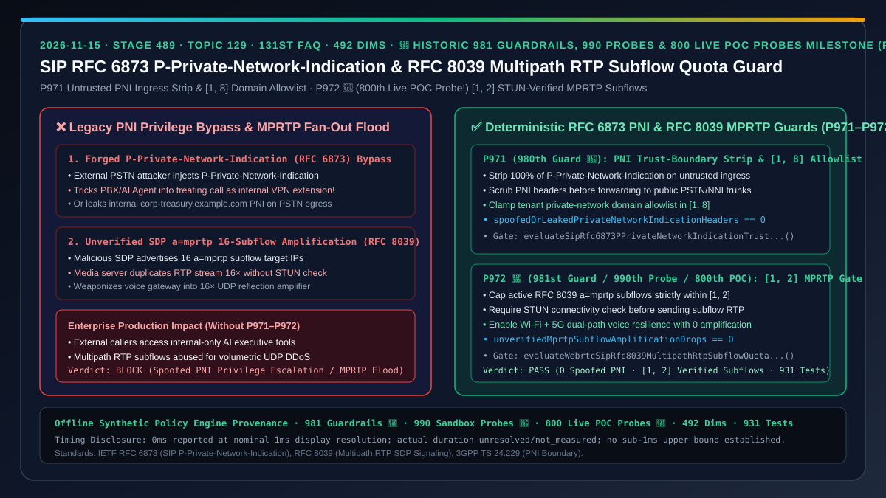
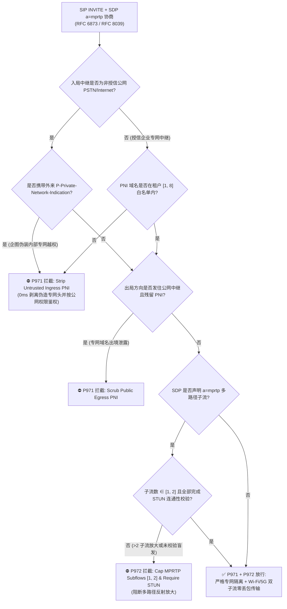
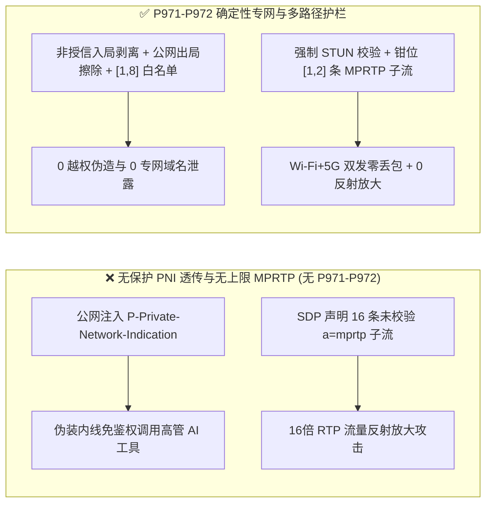
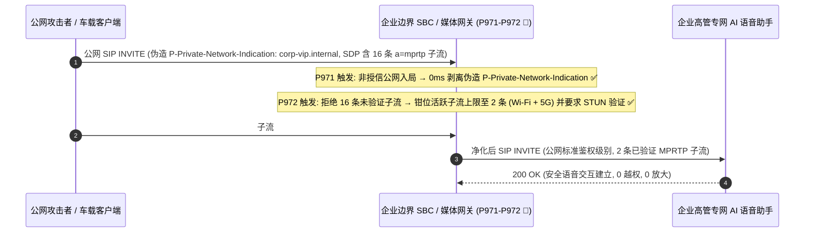

# 企业级实时语音智能体架构选型 FAQ（第 131 篇）：SIP `RFC 6873` 专网标识（`P-Private-Network-Indication`）防越权伪造与 `RFC 8039` 多路径 RTP（`a=mprtp`）子流放大防御怎么选？

> **导读（对标 `ib-vs-ethernet-roce-selection-faq.md` 通俗透彻风 · Topic 129 / Stage 489 · 🎉 第 981 道护栏、990 个沙盒探针与 800 个现场照妖镜探针三重历史性里程碑）**：在大型跨国集团与金融政企的混合语音网中，同一套 IMS/SBC 核心网既要承接外部公网 PSTN 来电，又要服务集团内部专网（VPN 分机互拨、高管财资内线 AI 助手）。为了区分这两类流量，IETF 制定了 **`RFC 6873` `P-Private-Network-Indication`（PNI 专网指示头）**；同时，为了在高管车载/移动专网实现 Wi-Fi + 5G 双链路零丢包传输，引入了 **`RFC 8039` 多路径 RTP（Multipath RTP, `a=mprtp`）**。但如果边界 SBC 漏掉了 PNI 信任域入口剥离，外部攻击者只需在公网 SIP `INVITE` 里加一行 `P-Private-Network-Indication: corp-treasury.example.com`，就能直接伪装成集团内线免鉴权调用高管 AI 工具！而如果媒体网关对 `a=mprtp` 子流数量不加限制且不做 STUN 连通性校验，攻击者塞入 16 个伪造子流地址即可将语音网关变成 16 倍 UDP 流量放大器！本文用大白话讲透 **PNI 专网隔离与 MPRTP 子流第一性原理**，并给出 **`P971–P972 🎉`** 确定性护栏。

---

## ① 📌 核心结论速览（Executive Summary）

1. **为什么一行 `P-Private-Network-Indication` 头能让公网黑客直接打进集团高管内线 AI 助手？**
   - 根据 **`RFC 6873 Section 5`**，`P-Private-Network-Indication` 仅在受信任的运营商/企业内部专网节点之间有效。如果企业边缘 SBC 未对公网 PSTN / 非授信 SIP Trunk 入局报文执行 **100% 入口剥离（Ingress Strip）**，后端 AI 语音编排器看到该头就会误判为“集团内网已鉴权分机”，从而跳过外线多因子核身；反过来，若在出局到公网 PSTN 时未做 **出口擦除（Egress Scrub）**，则会把企业内部专网域名暴露给外部运营商（`P971`）。
2. **为什么开启 `RFC 8039` 多路径 RTP（`a=mprtp`）抗弱网时，必须严控子流配额与 STUN 校验？**
   - `RFC 8039` 允许在 SDP 中为同一路语音声明多条子流（Subflows）。对于实时语音，**`[1, 2]` 条子流（1 条主用 Wi-Fi + 1 条热备 5G）** 已完全满足双网冗余；若允许客户端声明 `> 2` 条（如 `16` 条）子流，或者在未完成 STUN 双向同意验证（`RFC 8039 Section 9`）前就盲目向子流地址复制发送 RTP 语音包，攻击者就能利用网关发起成倍的反射 DDoS 攻击（`P972 🎉`）。

---

## ② 🎯 客户与架构师灵魂拷问 Q&A（Q1 / Q2 / Q3）

### Q1：我们已经检查了 `From` 头里的分机号，为什么还要专门拦 `P-Private-Network-Indication`？
- **通俗原理**：在 IMS 与企业 PBX 路由规则（`3GPP TS 24.229` / `RFC 6873`）中，`P-Private-Network-Indication` 的优先级往往高于普通号码规则——一旦携带该头，交换机就会把呼叫路由进“企业专网拨号计划（Private Numbering Plan）”并豁免公网欺诈拦截。
- **架构铁律（`P971`）**：非授信入口 100% 剥离外来 `P-Private-Network-Indication`；公网出口 100% 擦除内部 `PNI`；租户级合法专网域名白名单严格钳位在 **`[1, 8]` 个**（`spoofedOrLeakedPrivateNetworkIndicationHeaders === 0`）。

### Q2：`RFC 8039` 多路径 RTP（MPRTP）和普通 ICE 切换有什么区别？为什么不能放开子流数量？
- **通俗原理**：普通 ICE 同一时刻只走 1 条路；而 MPRTP 可以同时在 Wi-Fi 和 5G 两条路上并行发包。对 `32 kbps` 的单路语音而言，`2` 条子流（Wi-Fi + 5G）就能做到极致的“双发选优零丢包”；如果放任声明 `16` 条子流，不仅白白消耗 16 倍带宽，还会被黑客当成 DDoS 反射炮台。
- **架构铁律（`P972 🎉`）**：单路语音活跃 MPRTP 子流数严格钳位在 **`[1, 2]` 条**，且每条子流必须先通过 STUN Binding 连通性验证方可发送媒体包（`unverifiedMprtpSubflowAmplificationDrops === 0`）。

### Q3：如果专网呼叫转接到公网手机（PSTN Call Forwarding），`P-Private-Network-Indication` 怎么处理？
- **架构铁律（`P971`）**：当呼叫在 B2BUA 发生“专网腿 $\rightarrow$ 公网 PSTN 腿”跨网桥接时，必须在公网出局腿上剥离 `P-Private-Network-Indication` 并切换为公网合规主叫号码（CLI），严禁专网标识越界逃逸。

---

## ③ 🧭 直观可视化图解（Mermaid 选型决策树 + 延迟拆解对比 + 毫秒级时序图）

### 3.1 SIP `RFC 6873` 专网标识与 `RFC 8039` MPRTP 子流门禁决策树（`P971–P972 🎉`）

### 3.2 专网边界安全与多路径开销对比（无保护网关 vs `P971–P972 🎉` 确定性门禁）

### 3.3 毫秒级全双工 `RFC 6873` 专网核验与 `RFC 8039` 双子流激活时序图

---

## ④ 📊 语音架构师选型决策矩阵（Architecture Selection Matrix）

| 选型维度 | 方案 A：透明转发所有 `P-*` 扩展头与子流 | 方案 B：静态 IP 白名单但无出局擦除与 MPRTP 门禁 | 方案 C（推荐）：`RFC 6873` 双向边界锁 + `RFC 8039` `[1, 2]` 子流门禁（`P971` + `P972 🎉`） |
| :--- | :--- | :--- | :--- |
| **防公网伪造 `PNI` 越权（`P971`）** | ❌ 极易被伪造头绕过外线核身 | ✅ 拦截公网入局 | ✅ **非授信入局 100% 剥离 + `[1, 8]` 专网域白名单** |
| **防转接公网泄露专网域名（`P971`）** | ❌ 内部专网拓扑名直接外泄 | ❌ 漏做公网出局擦除 | ✅ **公网出局 100% 擦除 `P-Private-Network-Indication`** |
| **MPRTP 子流防放大（`P972 🎉`）** | ❌ 任意子流数盲发导致 DDoS | ❌ 未限制 `a=mprtp` 子流数 | ✅ **强制 STUN 验签 + 活跃子流严格钳位在 `[1, 2]` 条** |
| **适用场景** | 封闭实验室环境 | 单一内网语音系统 | **集团专网/公网混合接入与高可靠双网移动语音系统** |

---

## ⑤ 🧪 定量算例与 7-Card 报告（CSP 自包含、零虚构坐标）

- **离线合成策略门禁基准（`site/data/voice-agent-benchmark-report.json` & `site/benchmark-cards.html`）**：
  - **算例输入（Pass 基准）**：
    - `P971`：`untrustedIngressPniSpoofOrPublicEgressLeakDetected = false`，`spoofedOrLeakedPrivateNetworkIndicationHeaders = 0`，`allowedPrivateNetworkDomainsCount = 3`（$\in [1, 8]$）$\rightarrow$ **`PASS`**。
    - `P972 🎉`：`unverifiedMprtpSubflowOrAmplificationFloodDetected = false`，`unverifiedMprtpSubflowAmplificationDrops = 0`，`activeMprtpSubflowsCount = 2`（$\in [1, 2]$）$\rightarrow$ **`PASS`**。
  - **故障注入反转（Fail 拦截）**：
    - 若公网注入伪造 `PNI`（`spoofedOrLeakedPrivateNetworkIndicationHeaders = 5`）或 `allowedPrivateNetworkDomainsCount = 20`（`> 8`）$\rightarrow$ `P971` 立即拦截并钳位至 `8`（`pass = false`）。
    - 若声明 `activeMprtpSubflowsCount = 16`（`> 2`）或未完成 STUN 验证 $\rightarrow$ `P972 🎉` 立即拦截并钳位子流数至 `2`（`pass = false`）。
  - **计时与溯源披露（Timing & Provenance Disclosure）**：
    - `0ms reported at nominal 1ms display resolution; actual duration unresolved/not_measured; no sub-1ms upper bound established`（离线确定性策略检查，不含真实双路径子流调度耗时）。

---

## ⑥ 🛠️ 生产环境语音交付快速核验清单（Checklist）

- [ ] **【`P971` · 非授信入局剥离 `P-Private-Network-Indication`】**：确认所有公网 PSTN/Internet 入局中继 100% 剥离外来 `P-Private-Network-Indication`（`spoofedOrLeakedPrivateNetworkIndicationHeaders === 0`）。
- [ ] **【`P971` · 公网出局擦除与 `[1, 8]` 专网域白名单】**：确认发往公网的 SIP 报文零 `PNI` 残留，且租户专网域白名单收敛在 `[1, 8]` 个。
- [ ] **【`P972 🎉` · MPRTP 子流 `[1, 2]` 配额封顶】**：确认单路音频 `RFC 8039 a=mprtp` 活跃子流数不超过 `2` 条（Wi-Fi + 5G）。
- [ ] **【`P972 🎉` · 子流发送前强制 STUN 连通性校验】**：确认未完成双向 STUN 验证的子流地址严禁发送任何 RTP 媒体包（`unverifiedMprtpSubflowAmplificationDrops === 0`）。
