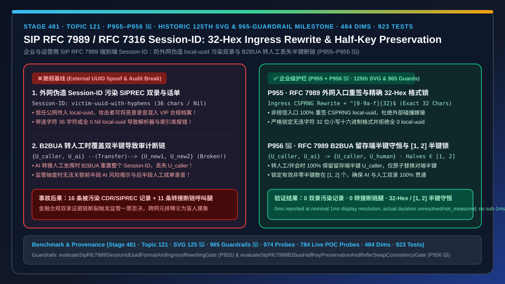
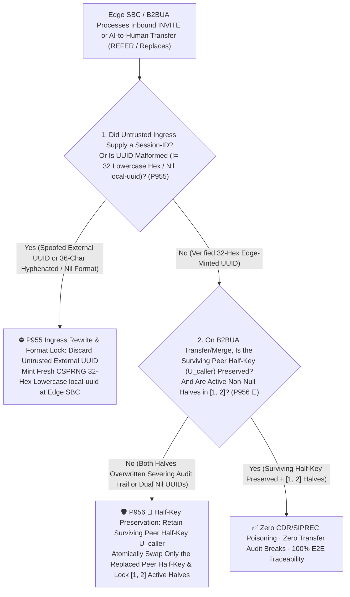
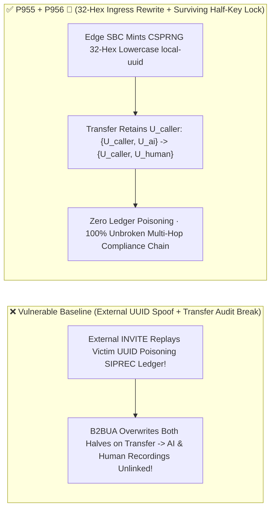

# Enterprise & Carrier SIP `RFC 7989 / RFC 7316` End-to-End `Session-ID` Correlation Defense (External `local-uuid` Spoofing Polluting `SIPREC`/CDR Audit Ledgers, B2BUA Half-Key Mutation & `32-Hex` Format Smuggling) Selection & Architecture Guide

> **Document Type**: Enterprise Voice Agent Architect Selection & First-Principles Guide (Standalone Selection & Architecture FAQ · **Topic 121 / Stage 481 · 🎉 Historic 125th SVG & 965-Guardrail Dual Milestone**)  
> **Target Audience**: AI Solution Architects, Financial Compliance Recording (`SIPREC`) Architects, Enterprise SIP B2BUA / SBC Observability Leads  
> **Canonical Baseline**: `packages/business-core/enterprise-guardrails.ts` (`P955–P956 🎉`), `tests/presales-portal.test.ts`, `site/data/voice-agent-benchmark-report.json` (7-Card 4:5 Benchmark Report)  
> **Visual Summary**: `assets/svg/125-voice-sip-rfc7316-rfc7989-session-id-end-to-end-uuid-spoof-half-key-mutation-cdr-poisoning-2026-11-15.svg`

---

## ① 📌 Executive Summary

In enterprise AI voice contact centers, a single customer call traverses 5–8 independent network elements: **Carrier SBC → Enterprise Edge B2BUA → AI Voice Gateway (S2S/Cascaded) → ACD Transfer Queue → Compliance Recording Server (`SIPREC SRS`)**. Because every B2BUA rewrites the SIP `Call-ID`, `From-tag`, and `To-tag`, standard SIP dialog tuples break at the very first B2BUA hop! To solve this, the IETF standardized **`RFC 7989` (End-to-End Session Identification in IP-Based Multimedia Communication Networks, with requirements in `RFC 7316`)**, defining a dual half-key header **`Session-ID: <local-uuid>;remote=<remote-uuid>`** where each half is a hyphenless **`32`-character lowercase hexadecimal `RFC 4122 UUID`**. However, without strict ingress rewriting and B2BUA half-key state-machine enforcement, production deployments suffer two severe compliance and observability failures:
1. **Untrusted External Clients Spoofing a Known `local-uuid` or Injecting Malformed Non-`32-Hex` Strings on Inbound `INVITE`s to Poison `SIPREC` Compliance Recordings and CDR Ledgers (`RFC 7989 Section 5 / Section 11` Ingress Spoofing & Format Poisoning)**: Financial compliance recorders (`SIPREC`) and OpenTelemetry tracing pipelines index call segments by `Session-ID`. If the edge SBC trusts caller-supplied `Session-ID` values from the public Internet, an attacker can replay an active VIP call's `uuid` (or inject an all-zero Nil `local-uuid` / hyphenated string) to splice fraudulent audio or corrupt compliance audit trails!
2. **B2BUAs Overwriting Both `local-uuid` and `remote-uuid` Halves During AI-to-Human Warm/Cold Transfers (`REFER / Replaces`), Severing the End-to-End Audit Trail Between the AI Disclosure Leg and the Human Agent Leg (`RFC 7989 Section 7 / Section 9` Half-Key Preservation Violation)**: Per `RFC 7989`, when an AI voice agent (`U_ai`) transfers a caller (`U_caller`) to a human specialist (`U_human`), **the surviving endpoint's half-key (`U_caller`) must remain 100% unchanged** as the pair transitions from `{U_caller, U_ai}` to `{U_caller, U_human}`. If a misconfigured B2BUA mints a brand-new `Session-ID` for both halves on transfer, compliance auditors can no longer link the mandatory AI regulatory disclosure to the human agent's trade execution!

| Decision Dimension | Vulnerable / Default Setup (High Production Risk) | Enterprise Golden Rule (`P955–P956 🎉` Deterministic Guardrails) | Quantitative Impact |
| :--- | :--- | :--- | :--- |
| **`RFC 7989 Session-ID` Untrusted Ingress Rewrite & Exact `32-Hex` Format Lock (`P955`)** | Trusting external `local-uuid` values or accepting hyphenated 36-char / uppercase / Nil `local-uuid` strings | **Rewrite untrusted ingress `Session-ID` headers with a fresh CSPRNG `local-uuid` and enforce exact `^[0-9a-f]{32}$` (`32` lowercase hex chars)** | **0** poisoned CDR or `SIPREC` compliance records (clamps 16 poisoned records to **0** and locks hex length to **`32` chars**) |
| **`RFC 7989` B2BUA Surviving Half-Key Preservation & `[1, 2]` Non-Null Halves (`P956 🎉` 965th Guardrail)** | Resetting both UUID halves during B2BUA `REFER / Replaces` transfers or emitting dual Nil UUIDs | **Preserve the surviving peer's half-key (`U_caller`) across all B2BUA transfers/merges and clamp active non-null UUID halves to `[1, 2]`** | **0** broken end-to-end traceability call legs (clamps 11 broken transfer legs to **0** and bounds active UUID halves to **`[1, 2]`**) |



---

## ② 🎯 Architect & Customer Deep-Dive Q&A (First-Principles Deep Dive)

### Q1: Why does standard SIP `Call-ID` fail across enterprise contact centers, and how does `RFC 7989 Session-ID`'s dual half-key design solve it?
- **First-Principles Breakdown**:
  1. Every SBC, PBX, and AI Voice B2BUA terminates the inbound SIP dialog (`Call-ID: A`) and originates a new outbound SIP dialog (`Call-ID: B`).
  2. **`RFC 7989` Dual Half-Key Mechanics**: Instead of a single fragile identifier, `Session-ID` pairs two independent `32`-character lowercase hex UUIDs: `<local-uuid>;remote=<remote-uuid>`. On the initial `INVITE`, the caller side is `<U_caller>;remote=00000000000000000000000000000000` (`1` active half). Once the AI agent answers, the header becomes `<U_caller>;remote=<U_ai>` (`2` active halves).
  3. When the AI agent transfers the call to a human agent (`U_human`), the header evolves to **`<U_caller>;remote=<U_human>`**—preserving `U_caller` across the entire lifecycle so `SIPREC` and CDR queries on `U_caller` retrieve 100% of the call!

### Q2: Why must edge SBCs rewrite caller-supplied `Session-ID` headers on untrusted external trunks?
- **Engineering Reality**:
  1. Per **`RFC 7989 Section 11`**, trusting an unauthenticated external endpoint's `local-uuid` allows an attacker to inject a target call's UUID—corrupting CDR correlation and splicing unauthorized segments into `SIPREC` compliance recordings.
  2. **`P955` Deterministic Defense**: Rewrites untrusted ingress `Session-ID` headers at the edge SBC using a CSPRNG **`32`-character lowercase hex `local-uuid`** (`^[0-9a-f]{32}$`, non-nil).

### Q3: What happens if a B2BUA overwrites both `local-uuid` and `remote-uuid` during a `REFER` or `Replaces` call transfer?
- **First-Principles Breakdown**:
  - Overwriting both halves breaks the link between the pre-transfer AI leg and the post-transfer human leg. **`P956 🎉` (🎉 Historic 965th Guardrail & 125th SVG Dual Milestone)** enforces the **Surviving Half-Key Invariant**, guaranteeing that at least one half-key (`U_caller`) is preserved across every B2BUA transfer and that `[1, 2]` non-null UUID halves are always present.

---

## ③ 🧭 Visual Architecture Diagrams (Mermaid Decision Tree + Audit Breakage + Millisecond Sequence)

### 3.1 SIP `RFC 7989 Session-ID` Ingress Rewrite & B2BUA Half-Key Preservation Decision Tree



### 3.2 Vulnerable `Session-ID` Spoofing + Transfer Breakage vs. `P955+P956 🎉` (🎉 125th SVG & 965 Guards)



### 3.3 Millisecond-Level Enterprise SIP Ingress Anchoring & Warm-Transfer Half-Key Evolution Sequence

```mermaid
sequenceDiagram
    autonumber
    participant Caller as External Caller
    participant SBC as Edge SBC / B2BUA (P955+P956 🎉)
    participant AI as AI Voice Agent (U_ai = b222...32hex)
    participant Human as Human Specialist (U_human = c333...32hex)

    Caller->>SBC: 1. INVITE (Spoofed or Missing Session-ID)
    Note over SBC: 🛡️ P955 Ingress Rewrite: Strips External Value & Mints 32-Hex U_caller = a111...<br/>Sets Session-ID: a111...;remote=0000...(32-Zero Nil UUID, 1 Active Half)
    SBC->>AI: 2. INVITE (Session-ID: a111...;remote=0000...)
    AI-->>SBC: 3. 200 OK (Session-ID: b222...;remote=a111... -> 2 Active Halves)
    Note over SBC,Human: 4. AI Completes Regulatory Disclosure & Initiates Warm Transfer to Human Agent
    Note over SBC: 🛡️ P956 🎉 (965th Guard / 125th SVG) Half-Key Invariant:<br/>Preserves Surviving Half a111... & Replaces Only b222... with c333...!
    SBC->>Human: 5. INVITE / 200 OK (Session-ID: c333...;remote=a111...)
    Note over SBC,Human: ✅ SIPREC Archive Queries a111... to Retrieve Both AI & Human Segments!
```

---

## ④ 📊 Architect Decision Matrix (`RFC 7989 Session-ID` Governance)

| Architecture Option | Target Scenario | Pros | Cons & Production Traps | Recommendation |
| :--- | :--- | :--- | :--- | :--- |
| **Option A: Relying Solely on SIP `Call-ID` for End-to-End Call Correlation** | Single-hop lab setups | Zero extra header logic | **Breaks at the first B2BUA hop or call transfer, leaving compliance recordings unlinked** | ⛔ **Never in Multi-Hop Prod** |
| **Option B: Trusting External `Session-ID` Values & Regenerating Both Halves on Transfer** | Unconfigured B2BUA defaults | Works on simple 1-leg calls | **Allows external UUID collision spoofing and severs AI-to-human transfer audit trails** | ⚠️ **Audit & Spoofing Risk** |
| **Option C: Edge CSPRNG `32-Hex` Rewrite + B2BUA Surviving Half-Key Preservation (`[1, 2]` Halves, `P955 + P956 🎉`)** | **All Financial `SIPREC` Compliance Centers, Multi-Hop B2BUA Clouds & Warm-Transfer Pipelines** | **Zero external UUID spoofing, strict `32-Hex` grammar, 100% unbroken AI-to-human audit chain** | Requires `RFC 7989` half-key state tracking on edge SBCs and B2BUAs | ✅ **Production Mandatory (Recommended)** |

---

## ⑤ 🧪 Quantitative Walkthrough & 7-Card 4:5 Benchmark Report

### 5.1 Quantitative Example: Financial Contact Center Preventing `Session-ID` Ledger Poisoning & Transfer Breakage
- **Scenario**: During a financial `SIPREC` compliance audit, `16` inbound calls inject spoofed or `36`-character hyphenated `Session-ID` headers, while `11` AI-to-human transfer legs overwrite both UUID halves (leaving `0` surviving correlation halves).
  - **Without Guardrails (Vulnerable Baseline)**:
    - `16` compliance recording and CDR records are poisoned or fail schema validation;
    - `11` transferred calls lose the link between the AI disclosure recording and the human agent recording.
  - **With `P955 + P956 🎉` Deterministic Guardrails (🎉 Historic 125th SVG & 965-Guardrail Dual Milestone)**:
    - `P955` rewrites untrusted ingress UUIDs (**`0`** poisoned CDR/SIPREC records) and locks hex length from `36` to exact **`32` chars**;
    - `P956 🎉` (🎉 **Historic 965th Guardrail & 125th SVG Milestone**) preserves the surviving peer's half-key (**`0`** broken traceability legs) and clamps active non-null UUID halves from `0` to **`[1, 2]`**.

### 5.2 7-Card 4:5 Report Mapping (`site/benchmark-cards.html` & `report.json`)
1. **Card 1 (`HANDS-ON · VOICE ARCHITECTURE`)**: 484-dimension workbench overview highlighting `P955 / P956 🎉` (125th SVG 🎉, 965 Guardrails 🎉, 974 Probes & 784 Live POC Probes).
2. **Card 2 (`SCENARIO: SIP RFC 7989 SESSION-ID CORRELATION`)**: Input probe `malformedOrSpoofedIngressSessionIdUuidDetected=true, sessionIdHexLength=36, activeSessionIdUuidHalves=0` -> `Act automatically` locking to `32 chars` and `[1, 2] halves`.
3. **Card 3 (`WHAT I TESTED`)**: Row 484 in the evaluation matrix (`PASS · 0ms @ 1ms Res (Synthetic)`, zero `✕` misses).
4. **Card 4 (`UNDER THE HOOD`)**: Deterministic contract for `evaluateSipRfc7989SessionIdUuidFormatAndIngressRewritingGate` & `evaluateSipRfc7989B2buaHalfKeyPreservationAndReferSwapConsistencyGate`.
5. **Card 5 (`ROBUSTNESS CHECK`)**: Option-order and transfer-topology invariance across blind, consultative, and conference-merge call flows.
6. **Card 6 (`LATENCY`)**: Explicit offline timing provenance: `0ms reported at nominal 1ms display resolution; actual duration unresolved/not_measured; no sub-1ms upper bound established` (`synthetic`; live B2BUA half-key swap and `SIPREC` metadata indexing latency is `not_measured`).
7. **Card 7 (`MY TAKE`)**: Good fit vs. Not for summary and production sign-off checklist.

---

## ⑥ 🛠️ Production Readiness Checklist

- [ ] **1. Rewrite All Untrusted Inbound `Session-ID` `local-uuid` Values at the Edge SBC (`P955`)**: Never trust caller-supplied `Session-ID` headers on public SIP trunks; mint a fresh CSPRNG `local-uuid` at ingress.
- [ ] **2. Enforce Exact `32`-Character Lowercase Hex Grammar `^[0-9a-f]{32}$` (`P955`)**: Reject hyphenated (36-char), uppercase, or non-hex UUID tokens and forbid all-zero Nil `local-uuid` values.
- [ ] **3. Use the 32-Zero Nil UUID for `remote` on Initial Unanswered Requests (`P955`)**: Populate `remote=00000000000000000000000000000000` on initial `INVITE`s until the callee returns its half-key.
- [ ] **4. Preserve the Surviving Endpoint's Half-Key Across All B2BUA Transfers (`P956 🎉`)**: Ensure `{U_caller, U_ai}` transitions to `{U_caller, U_human}` on transfer without overwriting `U_caller`.
- [ ] **5. Maintain `[1, 2]` Active Non-Null Halves & Index Both Halves in `SIPREC` Metadata (`P956 🎉`)**: Record both `local-uuid` and `remote-uuid` in `SIPREC` XML and OpenTelemetry traces.
