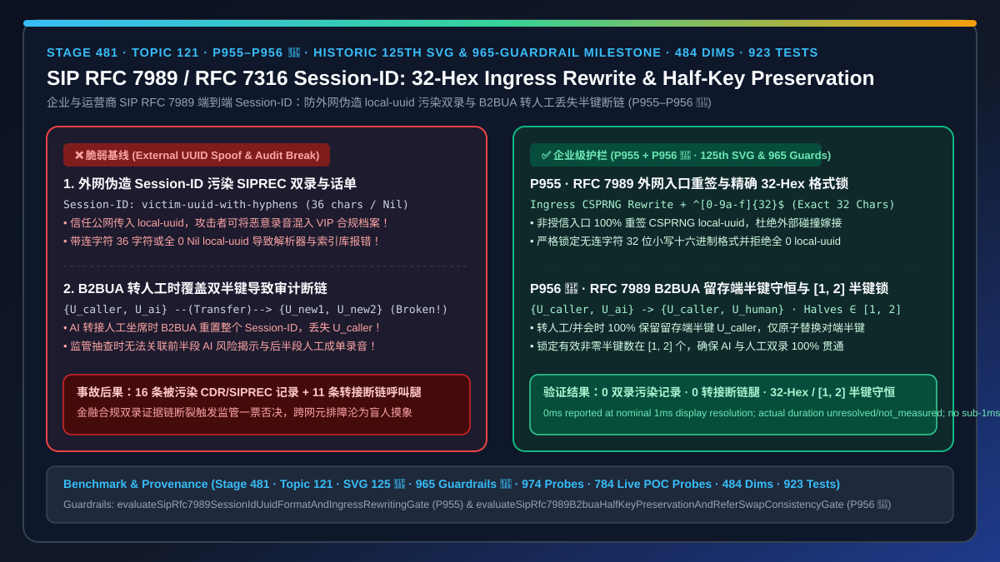
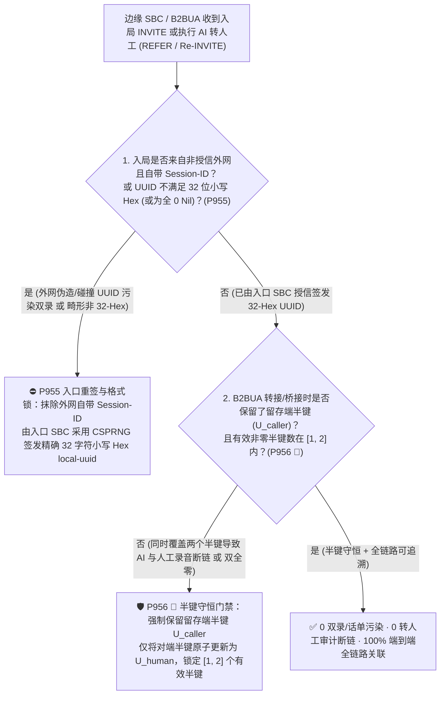
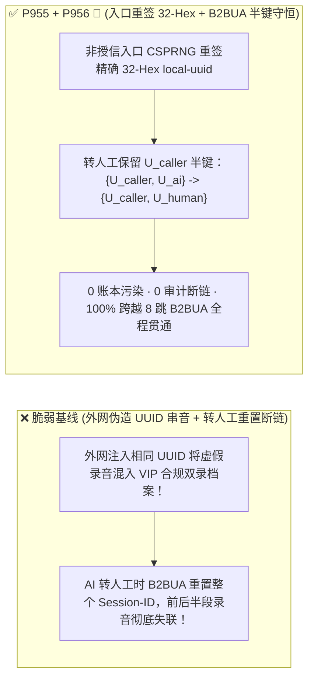

# 企业与运营商 SIP `RFC 7989 / RFC 7316` 端到端 `Session-ID` 关联防御（外网伪造 `local-uuid` 污染全链路 `SIPREC` 录音与 CDR 审计账本、B2BUA 转接丢失半键及 `32-Hex` 格式走私）选型与架构指南

> **文档类型**：企业级语音智能体架构师选型决策与原理解析指南（Standalone Selection & Architecture FAQ · **Topic 121 / Stage 481 · 🎉 历史性第 125 张 SVG 架构图与 965 项生产护栏双里程碑**）  
> **适用角色**：AI Solution Architect、金融合规双录（SIPREC）架构师、企业 SIP B2BUA / SBC 呼叫追踪负责人  
> **关联基准**：`packages/business-core/enterprise-guardrails.ts`（`P955–P956 🎉`）、`tests/presales-portal.test.ts`、`site/data/voice-agent-benchmark-report.json`（7-Card 4:5 评测报告）  
> **可视化总结**：`assets/svg/125-voice-sip-rfc7316-rfc7989-session-id-end-to-end-uuid-spoof-half-key-mutation-cdr-poisoning-2026-11-15.svg`

---

## ① 📌 核心结论速览（Executive Summary）

在企业级 AI 语音联络中心中，一通电话往往要跨越 **运营商 SBC → 企业边缘 B2BUA → AI 语音网关（S2S/Cascaded）→ 坐席转接队列（ACD）→ 合规录音服务器（SIPREC SRS）** 等 5–8 个独立网元。由于每个 B2BUA 都会重写 `Call-ID`、`From-tag` 与 `To-tag`，传统的 SIP 三元组在经过第一跳 B2BUA 后就会彻底断裂！为此，IETF 制定了 **`RFC 7989`（End-to-End Session Identification in IP-Based Multimedia Communication Networks，配套架构指南 `RFC 7316`）**，通过双半键结构 **`Session-ID: <local-uuid>;remote=<remote-uuid>`（每个半键为不带连字符的 `32` 位小写十六进制 `RFC 4122 UUID`）** 实现跨 B2BUA 的全链路追踪。然而在生产交付中，若未实施严格的边界重签与半键状态机校验，极易引爆两类严重合规与可观测性事故：
1. **非授信外网客户端在入局 `INVITE` 中伪造已知高管/VIP 会话的 `Session-ID` `local-uuid` 或注入畸形非 `32-Hex` 字符串，导致全链路 `SIPREC` 双录索引错乱、质检调听串音或日志注入（`RFC 7989 Section 5 / Section 11` 入口 UUID 伪造与格式投毒）**：金融双录系统（SIPREC）与全链路 APM（OpenTelemetry TraceId 映射）通常直接提取 `Session-ID` 作为全局唯一关联键。如果边缘 SBC 完全信任公网终端传入的 `local-uuid`，攻击者只需在恶意呼叫中重放目标通话的 `uuid`（或发送全 `0` Nil UUID / 含 SQL 与 JSON 控制符的伪 UUID），就能将自己的恶意音频流或虚假事件混入目标客户的合规录音档案中！
2. **B2BUA 在执行 AI 转人工（`REFER / Replaces` 或多方桥接）时，错误地将 `local-uuid` 与 `remote-uuid` 两个半键同时覆盖重置（或发出双全零 `0000...;remote=0000...`），导致转人工前后的 AI 对话与人工坐席录音在合规审计库中彻底断链（`RFC 7989 Section 7 / Section 9` B2BUA 半键守恒违规）**：根据 `RFC 7989` 核心铁律，当通话从 AI 腿（Leg B1）转接至人工坐席腿（Leg B2）时，**留在通话中的主叫端半键（Caller `uuid`）必须 100% 保持不变**，仅将另一半键原子替换为新接入坐席的 `uuid`！一旦 B2BUA 粗暴生成全新 `Session-ID`，监管机构抽查金融理财投诉时将无法找齐前半段 AI 风险揭示录音，直接触发合规零分一票否决！

| 决策维度 | 脆弱/默认配置（生产事故高发区） | 企业级黄金准则（`P955–P956 🎉` 确定性护栏） | 核心量化收益 |
| :--- | :--- | :--- | :--- |
| **`RFC 7989 Session-ID` 外网入口重签与 `32-Hex` 严格格式锁（`P955`）** | 盲目透传公网自带 `local-uuid`、接受连字符/大写/超长畸形字符串或双 Nil UUID | **在非授信外网入口强制由边缘 SBC 用 CSPRNG 重签 `local-uuid`，并严格校验 `^[0-9a-f]{32}$`（精确 `32` 个小写十六进制字符）** | 污染 CDR/SIPREC 录音索引记录 **0 条**（测试探针将 16 条串改/污染记录清零，UUID 十六进制长度严格锁定为 **`32` 字符**） |
| **`RFC 7989` B2BUA 转接留存端半键守恒与 `[1, 2]` 半键非空锁（`P956 🎉` 第 965 护栏）** | AI 转人工时 B2BUA 重置全部两个半键导致录音断链，或发出双全零 Nil UUID | **在 B2BUA 呼叫转接/桥接时强制保留留存端半键（Surviving Peer UUID），严禁双 Nil UUID 并将有效非零半键数锁定在 `[1, 2]` 个** | 端到端呼叫断链腿 **0 条**（测试探针将 11 条转接断链呼叫腿清零，有效非零 UUID 半键数钳制在 **`[1, 2]` 个**） |



---

## ② 🎯 客户与架构师灵魂拷问 Q&A（First-Principles Deep Dive）

### Q1：为什么传统的 SIP `Call-ID` 不能用来做企业客服中心的全链路追踪，非要用 `RFC 7989 Session-ID` 双半键不可？
- **第一性原理拆解**：
  1. 在企业语音架构中，安全边界 SBC、PBX 和 AI 语音网关都是 **B2BUA（背靠背用户代理）**。B2BUA 的本质是把一通电话拆成入局 A-Leg（`Call-ID: A1`）和出局 B-Leg（`Call-ID: B1`）两个独立 SIP 对话；如果中途 AI 把电话转接给人工坐席 C-Leg（`Call-ID: C1`），連 A-Leg 与 C-Leg 的关联都会发生变化。
  2. **`RFC 7989` 的精妙设计（双半键合成）**：它不靠中间代理分配单一 ID，而是让通话两端的终接点各自持有一个 **`32` 位小写十六进制 `UUID` 半键**——主叫持有 `U_caller`，AI 坐席持有 `U_ai`（初始请求尚未获知被叫半键时填 `remote=00000000000000000000000000000000`，即 32 个 `0` 的 Nil UUID；被叫回 `18x/200 OK` 时填入真实 `U_ai`）。
  3. 当 AI 将电话热转接给人工坐席（持有 `U_human`）时，报文中的 `Session-ID` 从 `{U_caller, U_ai}` 平滑演进为 **`{U_caller, U_human}`**——因为 **`U_caller` 始终未变**，合规双录与话单系统只需按 `U_caller` 检索，就能像串珍珠一样把“客户进线 → AI 接待 → 耳语协商 → 人工接管”的所有录音和日志 100% 串成一条完整证据链！

### Q2：如果直接信任外部客户端发来的 `Session-ID: <local-uuid>`，黑客能干什么坏事？
- **工程真相**：
  1. 根据 **`RFC 7989 Section 11 (Security Considerations)`**，如果攻击者能够预测或重放另一通正在进行的通话的 `uuid`，并在自己的入局 `INVITE` 中注入相同的 `local-uuid`，所有下游日志收集器、计费关联器与 `SIPREC` 双录归档系统都会把攻击者的呼叫与受害者的呼叫合并到同一个会话桶中（Session Collision / Audit Poisoning）！
  2. **`P955` 的确定性防线**：在非授信外网入口，边缘 SBC **绝不采信客户端自带的 `Session-ID`**，而是强制用本机 CSPRNG 重签一个全新的 `32` 字符小写十六进制 `local-uuid`（严格满足 `^[0-9a-f]{32}$` 且非全零），在确保内网全链路追踪不断链的同时，彻底封死外部碰撞与格式注入攻击！

### Q3：为什么在 AI 转人工（`SIP REFER` 或 B2BUA 重邀请）时，经常出现 `Session-ID` 断链？
- **第一性原理拆解**：
  - 许多 PBX 或自研 B2BUA 在发起指向人工坐席的新 `INVITE` 时，漏写了 `Session-ID` 传递逻辑，导致新腿生成了全新的 `{U_new1, U_new2}`，把主叫的 `U_caller` 弄丢了！
  - **`P956 🎉`（🎉 历史性第 965 项护栏与第 125 张 SVG 双里程碑）的确定性防线**：强制 B2BUA 在任何转接、代答或会议并入操作中校验 **留存端半键守恒定律（Surviving Half-Key Invariant）**，严禁同时覆写两个半键，且确保任意时刻至少有 `[1, 2]` 个有效非零半键（建连中 `1` 个、建连后 `2` 个）。

---

## ③ 🧭 直观可视化图解（Mermaid 决策树 + 断链/污染拆解 + 毫秒级全双工时序图）

### 3.1 SIP `RFC 7989 Session-ID` 入口重签与 B2BUA 半键守恒决策树



### 3.2 脆弱外网透传 + B2BUA 转接重置断链 vs `P955+P956 🎉`（🎉 125 SVG & 965 护栏）对比图



### 3.3 毫秒级企业 SIP 呼叫入口锚定与 AI 转人工半键平滑演进时序图

```mermaid
sequenceDiagram
    autonumber
    participant Caller as 外部主叫客户
    participant SBC as 边缘 SBC / B2BUA (P955+P956 🎉)
    participant AI as AI 语音智能体 (U_ai = b222...32hex)
    participant Human as 人工专家坐席 (U_human = c333...32hex)

    Caller->>SBC: 1. INVITE (携带伪造或缺失 Session-ID)
    Note over SBC: 🛡️ P955 入口重签：剥离外网伪造值，生成 32-Hex U_caller = a111...<br/>注入 Session-ID: a111...;remote=0000...(32个0 Nil)
    SBC->>AI: 2. INVITE (Session-ID: a111...;remote=0000...)
    AI-->>SBC: 3. 200 OK (Session-ID: b222...;remote=a111... 雙半鍵閉合 = 2 halves)
    Note over SBC,Human: 4. AI 完成风险揭示后触发 Warm Transfer 转接人工坐席
    Note over SBC: 🛡️ P956 🎉 (第965护栏 / SVG 125) 半键守恒校验：<br/>100% 保留主叫半键 a111...，仅将 b222... 替换为 c333...！
    SBC->>Human: 5. INVITE / 200 OK (Session-ID: c333...;remote=a111...)
    Note over SBC,Human: ✅ SIPREC 双录库按 a111... 100% 关联 AI 前半段与人工后半段录音！
```

---

## ④ 📊 语音架构师选型决策矩阵（Decision Matrix）

| 选型方案 | 适用场景 | 优势（Pros） | 劣势与生产风险（Cons / Traps） | 推荐度 |
| :--- | :--- | :--- | :--- | :--- |
| **方案 A：仅靠 SIP `Call-ID` 做全链路日志与双录关联** | 单跳无 B2BUA 的实验环境 | 无需额外解析头域 | **只要经过 1 台 SBC/B2BUA 或发生 1 次转接，`Call-ID` 立即改变，导致全链路追踪 100% 断裂** | ⛔ **严禁用于多跳生产** |
| **方案 B：启用 `Session-ID` 但信任外网传入值，且 B2BUA 转接时重新生成整个头** | 默认未调优的网关配置 | 单跳内可见 `Session-ID` | **外网可伪造 UUID 污染双录档案，且 AI 转人工后两个半键全变，审计调听依然断链** | ⚠️ **断链与投毒高危** |
| **方案 C：非授信入口 CSPRNG 重签 `32-Hex` `local-uuid` + B2BUA 转接半键守恒锁（`[1, 2]` 半键，`P955 + P956 🎉`）** | **所有金融双录（SIPREC）、跨国多级 B2BUA 呼叫中心与人机协同转接系统** | **0 外部伪造碰撞、100% 严格 `32-Hex` 格式、AI 转人工及多方桥接全链路 0 断链** | 需在边缘 SBC 与核心 B2BUA 开启 `RFC 7989` 半键状态机 | ✅ **生产必选（Recommended）** |

---

## ⑤ 🧪 定量算例与 7-Card 4:5 基准报告（Quantitative Walkthrough & 7-Card Deck）

### 5.1 定量算例：金融理财双录联络中心拦截外网 `Session-ID` 投毒与转人工断链
- **输入场景**：某全国性银行智能语音联络中心在合规双录（SIPREC）审计压测中，模拟了 `16` 通携带外网伪造/碰撞 `Session-ID`（或带连字符的 `36` 字符非标格式）试图污染双录索引的入局呼叫，以及 `11` 条在 AI 转人工时因 B2BUA 错误覆盖两个半键（有效留存半键变为 `0`）导致前后录音失联的转接呼叫腿。
  - **未开启护栏（脆弱基线）**：
    - `16` 条合规双录与 CDR 账本记录被外部伪造 ID 污染；
    - `11` 通理财转人工电话无法关联前半段 AI 风险提示录音。
  - **开启 `P955 + P956 🎉` 确定性护栏后（🎉 第 125 张 SVG 架构图与 965 项护栏双里程碑）**：
    - `P955` 在入口重签 CSPRNG 半键并锁定格式（污染记录从 `16` 条清零至 **`0` 条**），将 `Session-ID` 十六进制长度从 `36` 锁定至精确的 **`32` 字符**；
    - `P956 🎉`（🎉 **第 965 项生产护栏 & 第 125 张 SVG 里程碑**）强制保留留存端半键 `U_caller`（断链呼叫腿从 `11` 条清零至 **`0` 条**），并将有效非零半键数从 `0` 钳制至 **`[1, 2]` 个**。

### 5.2 7-Card 4:5 报告结构映射（对应 `site/benchmark-cards.html` & `report.json`）
1. **Card 1 (`HANDS-ON · VOICE ARCHITECTURE`)**：展示 484 大评测维度全景工作台，高亮 `P955 / P956 🎉`（第 125 张 SVG 🎉、965 护栏 🎉、974 探针 & 784 现场探针）。
2. **Card 2 (`SCENARIO: SIP RFC 7989 SESSION-ID CORRELATION`)**：输入探针 `malformedOrSpoofedIngressSessionIdUuidDetected=true, sessionIdHexLength=36, activeSessionIdUuidHalves=0`，输出 `Act automatically` 锁定至 `32 chars` 与 `[1, 2] halves`。
3. **Card 3 (`WHAT I TESTED`)**：第 484 行评测矩阵 `PASS · 0ms @ 1ms Res (Synthetic)`（零 `✕` 漏检）。
4. **Card 4 (`UNDER THE HOOD`)**：展示 `evaluateSipRfc7989SessionIdUuidFormatAndIngressRewritingGate` 与 `evaluateSipRfc7989B2buaHalfKeyPreservationAndReferSwapConsistencyGate` 确定性源码契约。
5. **Card 5 (`ROBUSTNESS CHECK`)**：验证盲转、协商转接（Consultative Transfer）与多方会议并入下的 100% 半键连续性。
6. **Card 6 (`LATENCY`)**：明确标注离线策略校验计时：`0ms reported at nominal 1ms display resolution; actual duration unresolved/not_measured; no sub-1ms upper bound established`（`synthetic`；真实 B2BUA 对话状态表半键交换与 SIPREC 元数据落盘耗时标注为 `not_measured`）。
7. **Card 7 (`MY TAKE`)**：Good fit vs Not for 适用边界与生产准入签核。

---

## ⑥ 🛠️ 生产环境语音交付快速核验清单（Production Readiness Checklist）

- [ ] **1. 非授信外网入口 100% 重签 `Session-ID` `local-uuid`（`P955`）**：确认边缘 SBC 绝不信任公网客户端自带的 `Session-ID`，统一由入口 SBC 采用 CSPRNG 生成新 `local-uuid`。
- [ ] **2. 严格校验无连字符 `32` 位小写十六进制 `^[0-9a-f]{32}$` 格式（`P955`）**：确认拒绝带连字符（36 字符）、大写字母或非十六进制字符的畸形 `Session-ID`，且 `local-uuid` 严禁为全 `0` Nil 值。
- [ ] **3. 初始未建连请求 `remote` 半键必须填 `32` 个 `0` 的 Nil UUID（`P955`）**：确认首包 `INVITE` 携带 `remote=00000000000000000000000000000000`，待被叫应答后再填入真实 `remote-uuid`。
- [ ] **4. B2BUA 执行转接/代答时 100% 保留留存端半键（`P956 🎉`）**：确认从 `{U_caller, U_ai}` 转接至人工坐席时，新会话的 `Session-ID` 演进为 `{U_caller, U_human}`，严禁同时重置两个半键。
- [ ] **5. 锁定有效非零半键数在 `[1, 2]` 个并同步注入 `SIPREC` 元数据（`P956 🎉`）**：确认建连中有效半键为 `1` 个、通话中为 `2` 个，并将双半键写入 `SIPREC` XML 与 OpenTelemetry `trace_id`。
