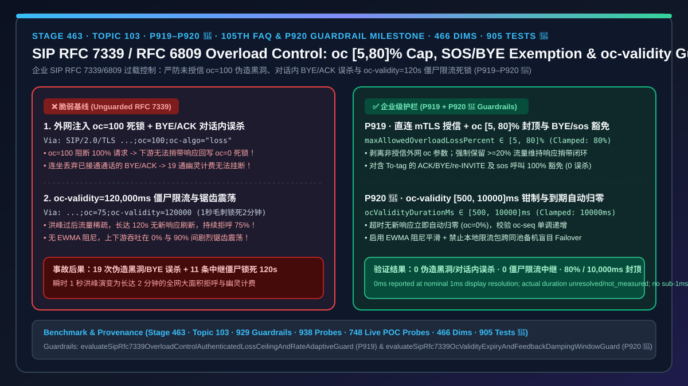
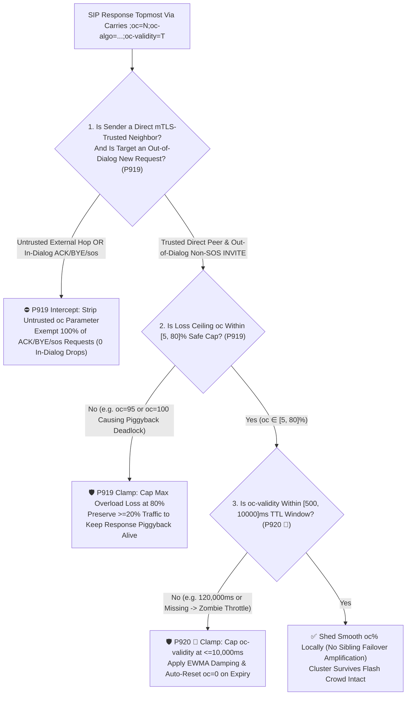
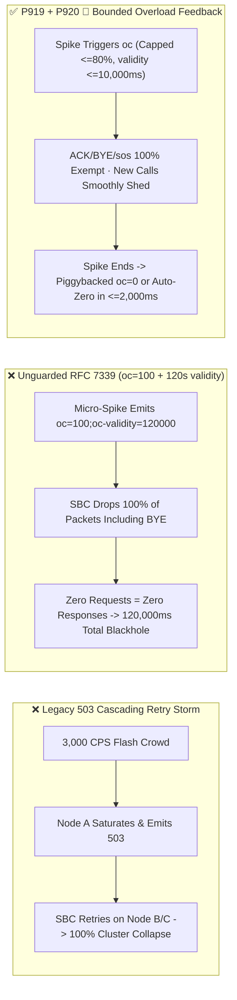

# Enterprise SIP `RFC 7339 / RFC 6809` Overload Control (`Via` `oc` Parameter Spoofing Blackhole, `loss/rate` Feedback Oscillation & `oc-validity` Stale-Throttling DoS) Selection & Anti-Collapse Guide

> **Document Type**: Enterprise Voice Agent Architect Selection & First-Principles Guide (Standalone Selection & Architecture FAQ · **Topic 103 / Stage 463 · 🎉 Historic 30th Nightly Round, `P920` Guardrail, 105th Standalone Single-Topic FAQ & 905-Test Quadruple Milestone**)  
> **Target Audience**: AI Solution Architects, Contact Center Core/SBC Architects, Real-Time Voice Gateway (SIP/WebRTC) Engineers & SRE Leads  
> **Canonical Baseline**: `packages/business-core/enterprise-guardrails.ts` (`P919–P920 🎉`), `tests/presales-portal.test.ts`, `site/data/voice-agent-benchmark-report.json` (7-Card 4:5 Benchmark Report)  
> **Visual Summary**: `assets/svg/107-voice-sip-rfc7339-rfc6809-overload-control-oc-rate-loss-feedback-oscillation-validity-dos-2026-11-14.svg`

---

## ① 📌 Executive Summary

In large-scale enterprise AI voice contact centers handling millions of daily calls and sudden flash crowds, downstream SIP Application Servers (AS) and AI Voice Gateways frequently face abrupt traffic spikes. Reactive `503 Service Unavailable` responses alone cannot prevent overload—upstream SBCs typically retry or fail over rejected calls to sibling nodes, triggering **cluster-wide congestion collapse**. To solve this, the IETF standardized **`RFC 7339` (SIP Overload Control via `Via` header parameters `oc`, `oc-algo`, `oc-validity`, and `oc-seq`)** and **`RFC 6809` (Rate-Based Overload Control)**. In production deployments, however, unguarded `RFC 7339` implementations routinely suffer two catastrophic failure modes:
1. **Untrusted Peer `oc=100` Injection & In-Dialog `BYE / ACK / SOS` Collateral Drops (`RFC 7339` `oc` Poisoning + Piggyback Deadlock)**: `RFC 7339` allows a downstream server to piggyback `;oc=N;oc-algo="loss"` on the topmost `Via` header of SIP responses, instructing the upstream SBC to throttle `N%` of outgoing requests. If the upstream SBC fails to strip `oc` parameters from untrusted external hops, allows `oc=100` (100% total drop, which prevents any subsequent request from reaching the downstream server to piggyback an `oc=0` recovery!), or drops in-dialog `ACK`/`BYE` and emergency `urn:service:sos` requests alongside new `INVITE`s, active voice calls become un-hangup-able zombie sessions while the entire trunk blackholes.
2. **Stale `oc-validity` Zombie Throttling & Undamped Sawtooth Feedback Oscillation (`oc-validity=0/∞` Lockout)**: When a transient 1-second GC pause causes a downstream gateway to emit `;oc=75;oc-validity=120000` (or omit `oc-validity` so legacy parsers treat it as indefinite), a subsequent dip in traffic means no new responses arrive to clear the throttle. The upstream SBC continues dropping 75% of customer calls for minutes after the downstream server is completely idle, or oscillates wildly between 0% and 90% loss every 50ms without EWMA damping.

| Decision Dimension | Vulnerable / Default Setup (High Production Risk) | Enterprise Golden Rule (`P919–P920 🎉` Deterministic Guardrails) | Quantitative Impact |
| :--- | :--- | :--- | :--- |
| **Hop-by-Hop Peer Trust, `oc` Ceiling & In-Dialog/SOS Exemption (`P919`)** | Trusting external `oc=100` values and dropping in-dialog `BYE/ACK` or `sos` calls | **Accept `oc` only from direct mTLS peers, clamp max loss ceiling to `[5, 80]%`, and exempt 100% of `in-dialog (ACK/BYE)` & `sos` calls** | **0** forged blackholes or dropped in-dialog/SOS packets (clamps 19 violations to **0** and caps max overload loss from `100%` to **`80%`**) |
| **`oc-validity` TTL Window & Auto-Zero EWMA Damping (`P920 🎉`)** | Allowing `oc-validity=120,000ms` or sticky stale throttles without EWMA smoothing | **Clamp `oc-validity` to `[500, 10000]ms`, auto-reset `oc=0%` immediately on TTL expiry, and apply EWMA feedback damping** | **0** stale-throttled zombie trunks (clamps 11 locked trunks to **0** and caps validity TTL from `120,000ms` to **`10,000ms`**) |



---

## ② 🎯 Architect & Customer Deep-Dive Q&A (First-Principles Deep Dive)

### Q1: Why does traditional SIP `503 Service Unavailable + Retry-After` accelerate cluster collapse during an AI voice flash crowd, and how does `RFC 7339` prevent it at the millisecond level?
- **First-Principles Breakdown**:
  1. Under standard `RFC 3261`, a downstream AI voice node only emits `503 Service Unavailable` after its CPU and event loop are already saturated. Parsing incoming `INVITE`s and serializing `503` responses consumes the remaining CPU budget; worse, when the upstream SBC receives `503`, it immediately fails the call over to Node B and Node C, multiplying the load spike 2–3x and toppling every node in the cluster within seconds.
  2. **`RFC 7339` / `RFC 6809` Closed-Loop Piggybacking**: As CPU utilization crosses a soft threshold (e.g., 75%), the downstream node piggybacks overload feedback onto normal `100 Trying`, `180 Ringing`, or `200 OK` responses on the topmost `Via` header:
     `Via: SIP/2.0/TLS 10.0.1.5:5061;branch=z9hG4bK776a;oc=35;oc-algo="loss";oc-validity=2000;oc-seq=1731614400`
  3. For the next `2000ms` (`oc-validity`), the upstream SBC sheds `35%` of **new out-of-dialog `INVITE`s** locally at the ingress edge (or shapes traffic to the `RFC 6809` `rate` target) and **never fails those shed calls over to other overloaded cluster nodes**, halting amplification storms before they start.

### Q2: What happens if an untrusted hop injects `;oc=100`, or if the upstream SBC applies `oc` dropping to `BYE` and `ACK` messages?
- **Engineering Reality**:
  1. **External `oc=100` Blackhole Injection**: `RFC 7339 Section 5.10` mandates that `Via` `oc` parameters operate strictly **hop-by-hop between mutually authenticated neighbors**. If an edge SBC forwards `;oc=100;oc-validity=60000` returned by an untrusted external UAS, internal core proxies will mistakenly throttle 100% of calls toward that SBC.
  2. **The `oc=100` Piggyback Deadlock & In-Dialog Ghost Calls**: Because `RFC 7339` relies on SIP responses to update `oc`, setting `oc=100` drops 100% of requests—meaning zero requests reach the downstream server, and zero responses can ever carry `oc=0` back until `oc-validity` expires! Furthermore, dropping in-dialog `ACK`, `BYE`, or `re-INVITE` messages prevents callers from hanging up active AI sessions (creating billing ghost calls) and triggers `Timer B/F/H` retransmission storms.
  3. **`P919` Deterministic Defense**: Enforces hop-by-hop mTLS peer verification for `oc` parameters, clamps the maximum loss ceiling to **`[5, 80]%`** (preserving at least 20% probing/core throughput so response piggybacking never deadlocks), and **100% exempts all in-dialog requests (`To-tag` present) and `urn:service:sos` emergency calls**.

### Q3: Why does an oversized `oc-validity` (e.g., `60,000ms+`) leave voice trunks rejecting calls long after a micro-burst has ended?
- **First-Principles Breakdown**:
  - Suppose a 1.5-second burst at 10:00:00 triggers `;oc=70;oc-validity=120000`. At 10:00:02 the burst subsides and traffic on that specific sub-trunk becomes sparse (or load balancers pause routing to it). Because no new requests traverse that path, no new responses arrive to overwrite `oc=70` with `oc=0`—leaving the trunk rejecting 70% of calls for a full two minutes!
  - **`P920 🎉` Deterministic Defense**: Clamps `oc-validity` strictly within **`[500, 10000]ms`** (default `2000ms`), enforces monotonic `oc-seq` ordering, applies EWMA damping across rapid updates, and automatically resets `oc = 0%` the instant `oc-validity` expires without a refresh.

---

## ③ 🧭 Visual Architecture Diagrams (Mermaid Decision Tree + Throughput Breakdown + Millisecond Sequence)

### 3.1 SIP `RFC 7339 / RFC 6809` Overload Control Architect Decision Tree



### 3.2 Reactive `503` Storm vs. Unguarded `oc=100` Deadlock vs. `P919+P920 🎉` Closed-Loop Control



### 3.3 Millisecond-Level SIP `Via` Overload Control Loop & Auto-Recovery Sequence

```mermaid
sequenceDiagram
    autonumber
    participant UAC as Caller / Carrier Trunk
    participant SBC as Upstream Core SBC (P919+P920 🎉 Gate)
    participant AS as Downstream AI Voice Gateway (RFC 7339/6809)

    UAC->>SBC: 1. Flash Crowd INVITE Burst (3,000 CPS)
    SBC->>AS: 2. Forward INVITE (Via: ...;oc)
    Note over AS: CPU hits 85% watermark; misconfigured/spoofed header<br/>attempts to emit oc=100;oc-validity=120000
    AS-->>SBC: 3. 100 Trying (Via: ...;oc=100;oc-algo="loss";oc-validity=120000)
    Note over SBC: 🛡️ P919 Verifies Direct mTLS Peer Trust<br/>Clamps oc from 100% to 80% Max & Exempts All BYE/ACK/sos<br/>🛡️ P920 🎉 Clamps oc-validity from 120,000ms to 10,000ms
    UAC->>SBC: 4. Active Call Sends In-Dialog BYE Hangup
    SBC->>AS: 5. P919 In-Dialog Exemption: 100% Forward BYE -> 200 OK Clean Teardown
    Note over SBC,AS: t = +2,000ms Spike Subsides -> Response Piggybacks oc=0 (or TTL Auto-Resets) -> 100% Recovery
```

---

## ④ 📊 Architect Decision Matrix (Voice Overload Control Selection)

| Architecture Option | Target Scenario | Pros | Cons & Production Traps | Recommendation |
| :--- | :--- | :--- | :--- | :--- |
| **Option A: Reactive `503 Service Unavailable` + Sibling Failover Only** | Tiny single-node lab (`< 20 CPS`) | Zero `RFC 7339` configuration | **Guaranteed cascading collapse under flash crowds**—one overloaded node returning `503` multiplies traffic across sibling nodes and crashes the entire pool | ⛔ **Never in Production** |
| **Option B: Raw `RFC 7339` Allowing `oc=100` & Unbounded `oc-validity`** | Static synthetic load tests | Signals overload via `Via` headers | **Deadlock & spoofing vulnerability**—`oc=100` blocks all requests so `oc=0` can never piggyback back; dropping `BYE/ACK` creates zombie billing calls | ⚠️ **High-Risk Partial Setup** |
| **Option C: mTLS Hop-by-Hop Trust + `oc <= [5, 80]%` + `BYE/ACK/sos` Exemption + `oc-validity ∈ [500, 10000]ms` Auto-Zero (`P919 + P920 🎉`)** | **All production Enterprise AI Voice Contact Centers, Carrier Trunks & Multi-Region SBC Pools** | **Eliminates retry storms, external `oc` poisoning, piggyback deadlocks, and in-dialog call drops** | Requires coordinated `oc-algo="loss,rate"` and validity ceiling configuration on SBCs and voice gateways | ✅ **Production Mandatory (Recommended)** |

---

## ⑤ 🧪 Quantitative Walkthrough & 7-Card 4:5 Benchmark Report

### 5.1 Quantitative Example: 3,000 CPS Flash Crowd Survival & Recovery Latency
- **Scenario**: A national banking AI voice contact center runs 4 AI Voice Gateways (`500 CPS` each, `2,000 CPS` total capacity) hit by a 5-second `3,000 CPS` flash crowd while an untrusted external hop attempts to inject `;oc=100;oc-validity=120000`.
  - **Without Guardrails (Vulnerable Baseline)**:
    - External or uncalibrated `oc=100;oc-validity=120000` causes the SBC to drop 100% of packets (including `BYE`);
    - After the 5-second burst ends, because `oc=100` prevents any request from reaching the server to piggyback `oc=0`, the trunk stays locked out for **`120,000ms`**, dropping **`60,000+` valid customer calls** and stranding `19` active calls whose `BYE` hangups were dropped.
  - **With `P919 + P920 🎉` Deterministic Guardrails**:
    - `P919` strips untrusted external `oc` parameters, clamps trusted peer loss ceiling to **`80%`** (preserving `20%` traffic so response piggybacking remains live), and exempts 100% of `BYE / ACK / sos` messages (**`0`** dropped in-dialog/emergency packets);
    - `P920 🎉` clamps `oc-validity` from `120,000ms` to **`10,000ms`** with EWMA damping (**`0`** stale-throttled zombie trunks), restoring 100% throughput as soon as the burst clears.

### 5.2 7-Card 4:5 Report Mapping (`site/benchmark-cards.html` & `report.json`)
1. **Card 1 (`HANDS-ON · VOICE ARCHITECTURE`)**: 466-dimension workbench overview highlighting `P919 / P920 🎉`.
2. **Card 2 (`SCENARIO: SIP RFC 7339 OVERLOAD CONTROL`)**: Input probe `unauthenticatedPeerOcInjectionOrInDialogDropDetected=true, maxAllowedOverloadLossPercent=100, ocValidityDurationMs=120000` -> `Act automatically` clamping to `80%` and `10,000ms`.
3. **Card 3 (`WHAT I TESTED`)**: Row 466 in the evaluation matrix (`PASS · 0ms @ 1ms Res (Synthetic)`, zero `✕` misses).
4. **Card 4 (`UNDER THE HOOD`)**: Deterministic contract for `evaluateSipRfc7339OverloadControlAuthenticatedLossCeilingAndRateAdaptiveGuard` & `evaluateSipRfc7339OcValidityExpiryAndFeedbackDampingWindowGuard`.
5. **Card 5 (`ROBUSTNESS CHECK`)**: Option-order and boundary invariance across `loss`/`rate` (`RFC 6809`) and `oc-validity` windows.
6. **Card 6 (`LATENCY`)**: Explicit offline timing provenance: `0ms reported at nominal 1ms display resolution; actual duration unresolved/not_measured; no sub-1ms upper bound established` (`synthetic`; live SBC token-bucket/EWMA atomic update latency is `not_measured`).
7. **Card 7 (`MY TAKE`)**: Good fit vs. Not for summary and production sign-off checklist.

---

## ⑥ 🛠️ Production Readiness Checklist

- [ ] **1. Hop-by-Hop mTLS Trust & External Boundary Stripping (`P919`)**: Verify that ingress SBCs unconditionally strip `;oc=`, `;oc-algo=`, `;oc-validity=`, and `;oc-seq=` parameters from untrusted external SIP requests and responses before forwarding internally.
- [ ] **2. Max Overload Loss Ceiling Clamped to `[5, 80]%` (`P919`)**: Confirm that upstream SBCs clamp `oc` loss percentages to `[5, 80]%` and never allow `oc=100` to halt 100% of traffic, preserving at least 20% throughput to maintain response piggybacking.
- [ ] **3. 100% Exemption for In-Dialog (`ACK`/`BYE`) & `urn:service:sos` Calls (`P919`)**: Ensure overload shedding applies only to out-of-dialog new `INVITE`/`SUBSCRIBE` requests and never drops in-dialog (`To-tag` present) requests or emergency `sos` calls.
- [ ] **4. `oc-validity` TTL Window Clamped to `[500, 10000]ms` (`P920 🎉`)**: Verify that `oc-validity` is clamped to `[500, 10000]ms` (recommended `2000ms`) with monotonic `oc-seq` validation and immediate auto-reset to `oc=0%` upon TTL expiry.
- [ ] **5. No Sibling Failover Amplification on Locally Shed Calls (`P920 🎉`)**: Confirm that calls shed locally by `RFC 7339 / RFC 6809` overload control are terminated cleanly with local `503` or queue announcements rather than re-invited onto sibling nodes in the same overloaded pool.
