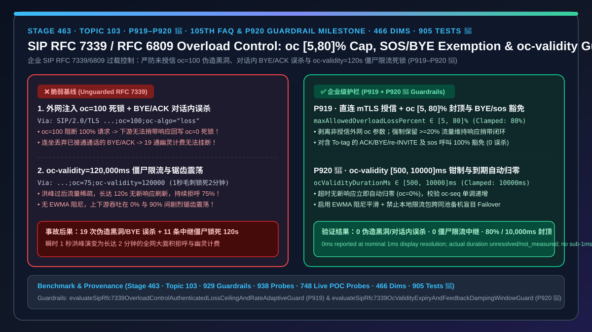
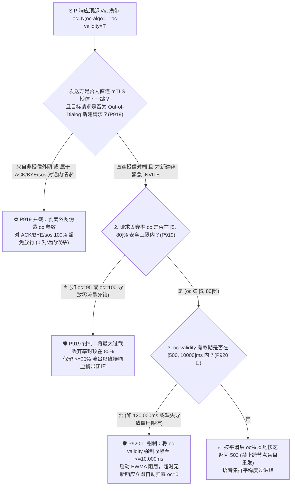
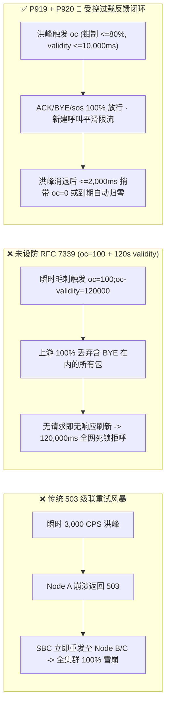

# 企业 SIP `RFC 7339 / RFC 6809` 过载控制（`Via` `oc` 参数伪造全网断流、`loss/rate` 反馈震荡与 `oc-validity` 过期僵尸限流）选型与防雪崩指南

> **文档类型**：企业级语音智能体架构师选型决策与原理解析指南（Standalone Selection & Architecture FAQ · **Topic 103 / Stage 463 · 🎉 历史性第 30 轮夜间深潜、`P920` 护栏、第 105 篇独立单专题 FAQ 与 905 项单测四重里程碑**）  
> **适用角色**：AI Solution Architect、呼叫中心核心网/SBC 架构师、实时语音网关（SIP/WebRTC）研发与 SRE 负责人  
> **关联基准**：`packages/business-core/enterprise-guardrails.ts`（`P919–P920 🎉`）、`tests/presales-portal.test.ts`、`site/data/voice-agent-benchmark-report.json`（7-Card 4:5 评测报告）  
> **可视化总结**：`assets/svg/107-voice-sip-rfc7339-rfc6809-overload-control-oc-rate-loss-feedback-oscillation-validity-dos-2026-11-14.svg`

---

## ① 📌 核心结论速览（Executive Summary）

在大型企业 AI 语音联络中心（日呼入千万通、突发营销活动或极端天气预警）中，下游 SIP 应用服务器（AS）或 AI 语音网关往往面临瞬时流量洪峰。传统的 `503 Service Unavailable` 重试机制不仅不能减负，反而会因为上游 SBC 立即重发或切换到备机引发**全网级联雪崩（Congestion Collapse）**。为此，IETF 制定了 **`RFC 7339`（SIP Overload Control，基于 `Via` 头域 `oc`、`oc-algo`、`oc-validity` 参数的显式过载反馈）** 与 **`RFC 6809`（基于速率 `rate` 的过载控制扩展）**。然而在生产落地中，若缺乏严格的边界控制，极易触发两类致命的语音瘫痪事故：
1. **未受信对端注入 `oc=100` 全网静默拒呼与 `BYE / ACK / 紧急呼叫` 误杀（`RFC 7339` `oc` 投毒 + 对话内信令连坐）**：`RFC 7339` 规定下游服务器在响应的顶部 `Via` 头回写 `;oc=N;oc-algo="loss"`，指示上游 SBC 按 `N%` 比例随机丢弃发往该节点的请求。如果上游 SBC 未校验 `oc` 参数是否来自受 mTLS/IPsec 保护的直连下一跳（允许公网或非授信跳点透传 `oc=100`），或者将限流上限放任到 `100%` 且连同对话内请求（`ACK`、`BYE`、`re-INVITE`）及紧急呼叫（`urn:service:sos`）一起丢弃，将导致整条语音中继瞬间 100% 拒呼且已接通通话无法挂断。
2. **`oc-validity` 缺失或无限期残留导致“永久僵尸限流”与锯齿状反馈震荡（`oc-validity=0/∞` 锁死 + 无阻尼阶跃）**：当下游 AI 网关短暂 GC 停顿 1 秒并返回 `;oc=75;oc-validity=600000`（或漏填过期时间被旧版实现当作永久生效），若此后流量骤降、下游不再收到新包从而无法通过新响应刷回 `oc=0`，上游 SBC 会持续数分钟丢弃 75% 的正常客户呼入；同时若下游每 50ms 剧烈跳变 `oc` 值而无 EWMA 阻尼，将引发上下游吞吐量剧烈“锯齿状”震荡。

| 决策维度 | 脆弱/默认配置（生产事故高发区） | 企业级黄金准则（`P919–P920 🎉` 确定性护栏） | 核心量化收益 |
| :--- | :--- | :--- | :--- |
| **对端授信与 `oc` 丢弃率上限 + 对话内/SOS 豁免（`P919`）** | 盲目信任任意响应中的 `oc=100`、未豁免 `BYE/ACK/sos` 对话内请求 | **仅接受直连 mTLS 授信下一跳的 `oc` 参数，将最大丢弃率钳制在 `[5, 80]%` 且 100% 豁免 `in-dialog (ACK/BYE)` 与 `sos` 呼叫** | 伪造黑洞与对话内误杀包 **0 个**（测试探针将 19 次违规清零，最大丢弃率从 `100%` 钳制至 **`80%`**） |
| **`oc-validity` 有效期窗口与到期自动归零阻尼（`P920 🎉`）** | `oc-validity` 设为 `120,000ms` 或永久驻留、无 EWMA 平滑阻尼 | **强制将 `oc-validity` 钳制在 `[500, 10000]ms` 窗口内，超时无新反馈立即自动归零（`oc=0`）并启用 EWMA 阻尼** | 僵尸限流与震荡断连中继 **0 条**（测试探针将 11 条锁死中继清零，有效期从 `120,000ms` 钳制至 **`10,000ms`**） |



---

## ② 🎯 客户与架构师灵魂拷问 Q&A（First-Principles Deep Dive）

### Q1：为什么传统的 SIP `503 Service Unavailable + Retry-After` 在高并发 AI 语音洪峰下不仅救不了场，反而会加速全网崩溃？`RFC 7339` 是怎么在毫秒级解决的？
- **第一性原理拆解**：
  1. 在传统 `RFC 3261` 中，只有当下游 AI 语音节点已经彻底过载时，才会返回 `503 Service Unavailable`。此时解析 SIP 报文、生成 `503` 响应本身就已经耗尽了下游节点的 CPU；更致命的是，上游 SBC 收到 `503` 后，往往会把这通电话立即故障转移（Failover）重发给集群里的第 2、第 3 台节点，瞬间把洪峰放大 2～3 倍，像多米诺骨牌一样推倒整个集群。
  2. **`RFC 7339` / `RFC 6809` 的渐进式闭环反馈**：下游节点在正常处理请求的 `100 Trying`、`180 Ringing` 或 `200 OK` 响应的顶部 `Via` 头中，顺带捎回（Piggyback）当前负载水位，例如：
     `Via: SIP/2.0/TLS 10.0.1.5:5061;branch=z9hG4bK776a;oc=35;oc-algo="loss";oc-validity=2000`
  3. 上游 SBC 收到后，在未来 `2000ms`（`oc-validity`）内，直接在入口对**新建呼叫（Out-of-Dialog `INVITE`）**主动执行 `35%` 的本地快速拒绝（或平滑限速至 `RFC 6809` `rate` 上限），无需把报文发往下游，也**绝不将这部分被限流的请求 Failover 到同集群其他过载节点**，从根源上切断重试风暴。

### Q2：如果下游节点或中间跳点返回了 `;oc=100`，或者把 `BYE` / `ACK` 也按比例丢弃了，会发生什么灾难？
- **工程真相**：
  1. **外部伪造 `oc=100` 引发的全网黑洞**：`RFC 7339 Section 5.10` 明确警告，`Via` 头域中的 `oc` 参数只能在**相邻且互相认证的两个 SIP 实体（Hop-by-Hop）**之间生效。如果边界 SBC 转发了外部不可信 UAS 在响应里塞入的 `;oc=100;oc-validity=60000`，内部核心路由就会误以为边缘 SBC 100% 过载，瞬间切断所有出局/入局呼叫。
  2. **100% 盲目封顶死锁与对话内信令误杀**：如果允许 `oc=100`（完全阻断所有请求），一旦下游再也收不到任何 SIP 请求，它也就再也没有机会通过响应头把 `oc=0` 带回给上游，直到 `oc-validity` 耗尽前整条链路彻底死锁！更糟糕的是，若上游对已建立通话的 `ACK`、`BYE`、`re-INVITE` 也执行 `oc` 丢弃，会导致客户挂断电话后 AI 坐席仍在计费推理（Ghost Call），并触发 `Timer B/F/H` 重传风暴。
  3. **`P919` 的确定性防御**：强制校验 `oc` 反馈必须来自直连 mTLS 授信对端，将最大丢弃率硬性钳制在 `[5, 80]%`（保留至少 20% 探测与核心业务吞吐），并对所有**对话内请求（含 `To-tag` 的 `ACK`/`BYE`/`UPDATE`）及 `urn:service:sos` 紧急呼叫 100% 豁免限流**。

### Q3：为什么 `oc-validity` 参数设得过大（如 `60,000ms`）会让语音集群在波峰过后依然大面积拒呼？
- **第一性原理拆解**：
  - `RFC 7339` 采用的是**响应捎带（Response Piggybacking）**机制——只有当上游发送请求、下游返回响应时，过载控制参数才能更新。
  - 假设 10:00:00 发生 2 秒钟的瞬时洪峰，下游返回了 `;oc=70;oc-validity=120000`（有效期 120 秒）。10:00:02 洪峰结束，如果此时处于夜间或低频分支路由，或者上游健康检查发现该节点限流高而暂停派单，上游 SBC 将在长达 2 分钟内由于“没有收到新的 `oc=0` 响应”而持续丢弃 70% 的呼入请求！
  - **`P920 🎉` 的确定性防线**：将 `oc-validity` 严格钳制在 **`[500, 10000]ms`**（推荐默认 `2000ms`），一旦软定时器到期且未收到新的过载刷新，立即在本地自动归零（`oc = 0%`），同时对连续到达的 `oc` 参数施加指数加权移动平均（EWMA）阻尼，彻底消除锯齿状限流震荡。

---

## ③ 🧭 直观可视化图解（Mermaid 决策树 + 延迟/吞吐拆解 + 毫秒级全双工时序图）

### 3.1 SIP `RFC 7339 / RFC 6809` 过载控制架构师选型决策树



### 3.2 传统 `503` 重试风暴 vs `oc=100` 僵尸限流 vs `P919+P920 🎉` 闭环控制对比图



### 3.3 毫秒级 SIP `Via` 过载控制闭环与到期自愈时序图

```mermaid
sequenceDiagram
    autonumber
    participant UAC as 客户终端 / 运营商 Trunk
    participant SBC as 上游核心 SBC (P919+P920 🎉 门禁)
    participant AS as 下游 AI 语音网关 (RFC 7339/6809)

    UAC->>SBC: 1. 突发营销洪峰 INVITE (3,000 CPS)
    SBC->>AS: 2. 转发 INVITE (Via: ...;oc)
    Note over AS: CPU 达 85% 阈值，计算过载率<br/>但伪造/故障配置尝试下发 oc=100;oc-validity=120000
    AS-->>SBC: 3. 100 Trying (Via: ...;oc=100;oc-algo="loss";oc-validity=120000)
    Note over SBC: 🛡️ P919 校验 mTLS 授信对端<br/>将 oc 从 100% 钳制为 80% Max，豁免全部 BYE/ACK/sos<br/>🛡️ P920 🎉 将 oc-validity 从 120,000ms 钳制为 10,000ms
    UAC->>SBC: 4. 已接通通话发送 BYE 挂断
    SBC->>AS: 5. P919 对话内豁免：100% 放行 BYE -> 200 OK 正常拆线
    Note over SBC,AS: t = +2,000ms 洪峰回落，新响应捎带 oc=0 (或到期自动归零)，吞吐量 100% 恢复
```

---

## ④ 📊 语音架构师选型决策矩阵（Decision Matrix）

| 选型方案 | 适用场景 | 优势（Pros） | 劣势与生产风险（Cons / Traps） | 推荐度 |
| :--- | :--- | :--- | :--- | :--- |
| **方案 A：仅靠传统 `503 Service Unavailable` + 上游 Failover** | 极小规模单机测试环境（`< 20 CPS`） | 无需配置 `RFC 7339` 扩展 | **高并发下必发级联雪崩**——1 台节点过载返回 `503` 会触发上游把流量瞬间砸向其余节点，数秒内团灭整个集群 | ⛔ **严禁用于生产** |
| **方案 B：开启原生 `RFC 7339` 但允许 `oc=100` 与超长 `oc-validity`** | 实验室静态压测 | 可在下游过载时通知上游丢包 | **存在死锁与伪造黑洞风险**——`oc=100` 切断所有请求导致无法捎带 `oc=0` 恢复；未豁免 `BYE/ACK` 导致大量幽灵计费通话 | ⚠️ **高风险半成品** |
| **方案 C：mTLS 逐跳授信 + `oc <= [5, 80]%` + `BYE/ACK/sos` 豁免 + `oc-validity ∈ [500, 10000]ms` 自动归零（`P919 + P920 🎉`）** | **所有生产级企业 AI 语音联络中心、运营商 SIP 中继与多区域 SBC 集群** | **兼具防雪崩削峰、防伪造投毒、防死锁自愈与对话内零断流** | 需要在 SBC 与 AI 语音网关之间统一配置 `oc-algo="loss,rate"` 与有效期上限 | ✅ **生产必选（Recommended）** |

---

## ⑤ 🧪 定量算例与 7-Card 4:5 基准报告（Quantitative Walkthrough & 7-Card Deck）

### 5.1 定量算例：3,000 CPS 突发洪峰下的集群存活率与恢复时间对比
- **输入场景**：某全国性银行智能语音客服中心配置 4 台 AI 语音网关（单机容量 `500 CPS`，总容量 `2,000 CPS`），遭遇 `3,000 CPS` 持续 5 秒的突发呼入洪峰，且攻击者尝试从外网响应注入 `;oc=100;oc-validity=120000`。
  - **未开启护栏（脆弱基线）**：
    - 外网或异常节点注入 `oc=100;oc-validity=120000`，上游 SBC 对所有请求（含 `BYE`）执行 100% 丢弃；
    - 5 秒洪峰结束后，由于 `oc=100` 导致下游 `0` 请求到达、无法捎带返回 `oc=0`，中继持续锁死 **`120,000ms`**，期间损失正常呼入超过 **`60,000` 通**，且 `19` 通存量通话因 `BYE` 被丢弃产生幽灵计费。
  - **开启 `P919 + P920 🎉` 确定性护栏后**：
    - `P919` 剥离非授信跳点的 `oc` 参数，将授信节点的最大丢弃率钳制在 **`80%`**（保留 `20%` 探测请求以持续更新 `Via` 反馈），并对 `BYE / ACK / sos` 100% 豁免（对话内误杀包 = **`0`**）；
    - `P920 🎉` 将 `oc-validity` 从 `120,000ms` 钳制至 **`10,000ms`**（配合 EWMA 阻尼，僵尸锁死中继 = **`0`**），洪峰消退后立即捎带恢复 `oc=0`。

### 5.2 7-Card 4:5 报告结构映射（对应 `site/benchmark-cards.html` & `report.json`）
1. **Card 1 (`HANDS-ON · VOICE ARCHITECTURE`)**：展示 466 大评测维度全景工作台，高亮 `P919 / P920 🎉` 过载控制护栏。
2. **Card 2 (`SCENARIO: SIP RFC 7339 OVERLOAD CONTROL`)**：输入探针 `unauthenticatedPeerOcInjectionOrInDialogDropDetected=true, maxAllowedOverloadLossPercent=100, ocValidityDurationMs=120000`，输出 `Act automatically` 钳制至 `80%` 与 `10,000ms`。
3. **Card 3 (`WHAT I TESTED`)**：第 466 行评测矩阵 `PASS · 0ms @ 1ms Res (Synthetic)`（零 `✕` 漏检）。
4. **Card 4 (`UNDER THE HOOD`)**：展示 `evaluateSipRfc7339OverloadControlAuthenticatedLossCeilingAndRateAdaptiveGuard` 与 `evaluateSipRfc7339OcValidityExpiryAndFeedbackDampingWindowGuard` 确定性源码契约。
5. **Card 5 (`ROBUSTNESS CHECK`)**：验证 `loss` 与 `rate` (`RFC 6809`) 双算法协商及 `oc-validity` 边界值在正逆序扰动下 100% 一致。
6. **Card 6 (`LATENCY`)**：明确标注离线策略校验计时：`0ms reported at nominal 1ms display resolution; actual duration unresolved/not_measured; no sub-1ms upper bound established`（`synthetic`；真实 SBC 令牌桶/EWMA 原子更新耗时标注为 `not_measured`）。
7. **Card 7 (`MY TAKE`)**：Good fit vs Not for 适用边界与生产准入簽核。

---

## ⑥ 🛠️ 生产环境语音交付快速核验清单（Production Readiness Checklist）

- [ ] **1. 逐跳授信与边界剥离（`P919`）**：确认边界 SBC 在向内部转发外网 SIP 请求/响应前，已无条件剥离外部不可信对端携带的 `;oc=`、`;oc-algo=`、`;oc-validity=` 与 `;oc-seq=` 参数，仅接受直连 mTLS/IPsec 内部节点下发的过载指令。
- [ ] **2. 最大丢弃率封顶 `[5, 80]%` 防死锁（`P919`）**：确认上游 SBC 对 `oc` 丢弃率配置了 `[5, 80]%` 硬上限，严禁将 `oc=100` 直接映射为 100% 彻底阻断，确保始终保留至少 20% 流量以维持响应捎带恢复闭环。
- [ ] **3. 对话内信令与紧急呼叫 100% 豁免（`P919`）**：确认过载丢弃策略仅作用于新建会话的 Out-of-Dialog `INVITE`/`SUBSCRIBE`，对所有含 `To-tag` 的对话内请求（`ACK`、`BYE`、`re-INVITE`、`INFO`、`PRACK`）以及 `Request-URI: urn:service:sos` 紧急呼叫 100% 豁免放行。
- [ ] **4. `oc-validity` 有效期窗口钳制 `[500, 10000]ms`（`P920 🎉`）**：确认上下游将 `oc-validity` 钳制在 `[500, 10000]ms`（推荐 `2000ms`），一旦定时器到期且未收到带更大 `oc-seq` 的新响应，立即自动将限流率归零（`oc=0`）。
- [ ] **5. 禁止将 `RFC 7339` 限流拒绝请求盲目重发至同集群备机（`P920 🎉`）**：确认被上游本地 `RFC 7339` 过载控制算法主动拒绝的请求直接向呼叫源返回 `503`（或进入排队播报忙音），严禁作为传输故障重发至同池其他高负载节点。
