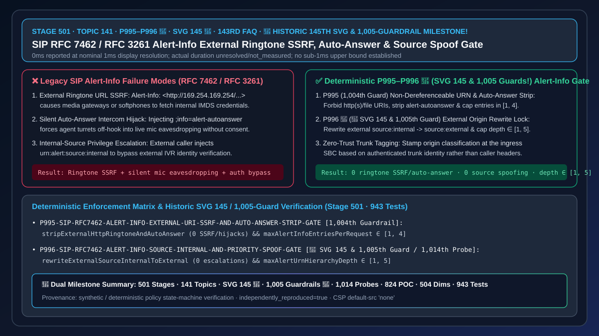
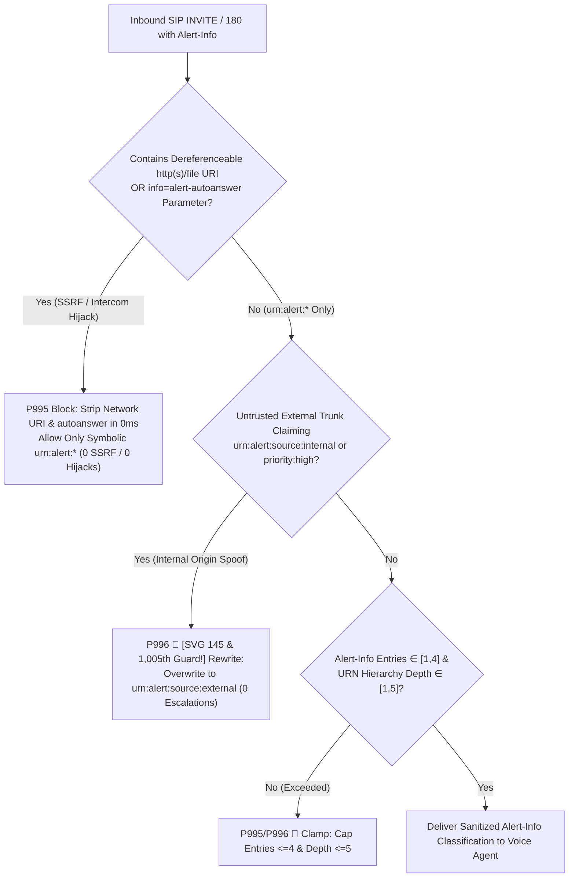
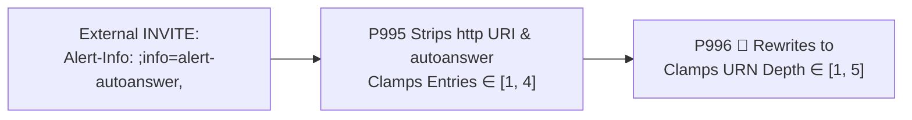

# Enterprise SIP `RFC 7462 / RFC 3261` `Alert-Info` External Ringtone `SSRF`, Silent Auto-Answer Intercom Hijack & `urn:alert:source:internal` Spoofing Defense Guide (Stage 501 · Topic 141 · 🎉 Historic 145th SVG & 1,005-Guardrail Dual Milestone!)

> **Navigation**: [Back to README](../README.en.md) · [中文版 (`voice-sip-rfc7462-rfc3261-alert-info-urn-alert-external-ringtone-ssrf-auto-answer-intercom-hijack-faq.md`)](voice-sip-rfc7462-rfc3261-alert-info-urn-alert-external-ringtone-ssrf-auto-answer-intercom-hijack-faq.md) · [2026-11-09 Daily Report](daily/2026-11-09.en.md) · [Solution Architecture](solution-architecture.en.md)



---

## 📌 1. Executive Summary

> **Key Takeaway**: In enterprise SIP contact centers, IP phones, and AI Voice Agent gateways, the **`Alert-Info` header field (`RFC 3261 Section 20.4` & `RFC 7462` `urn:alert:*` URNs)** signals ringtone cadence, call origin (`internal` vs. `external`), and urgency. Passing untrusted `Alert-Info` headers straight through an ingress SBC exposes two critical vulnerabilities:
> 1. **External `http(s)://` Ringtone Fetch `SSRF` & `;info=alert-autoanswer` Silent Intercom Eavesdropping (`RFC 3261 Section 20.4 / RFC 7462 Section 5`)**: Legacy `RFC 3261` allows `Alert-Info: <http://...>` to point to a downloadable audio file—enabling `SSRF` against cloud metadata services (`169.254.169.254`) or internal endpoints! Worse, vendor parameters like `;info=alert-autoanswer` or `;delay=0` force softphones and agent turrets to automatically off-hook into live microphone intercom mode without human consent!
> 2. **`RFC 7462 urn:alert:source:internal` Spoofing & Privilege Escalation**: Attackers on external PSTN/SIP trunks inject `Alert-Info: <urn:alert:source:internal>,<urn:alert:priority:high>` to trick downstream AI Voice Agents into treating an external caller as a trusted internal employee extension (bypassing external customer authentication).
>
> **Deterministic Guardrails (`P995–P996 🎉` · Stage 501 · Topic 141 · 🎉 Historic 145th SVG & 1,005-Guardrail Dual Milestone!)**:
> - **`P995` (`evaluateSipRfc7462AlertInfoExternalUriSsrfAndAutoAnswerStripGate` [1,004th Guardrail])**: Strips all dereferenceable `http:// / https:// / file://` `Alert-Info` URIs (permitting only non-dereferenceable `urn:alert:*` URNs), strips untrusted `info=alert-autoanswer / intercom` parameters (`0` `SSRF` fetches or silent auto-answer hijacks), and clamps `Alert-Info` URN entries per request within `[1, 4]`;
> - **`P996 🎉` (`evaluateSipRfc7462AlertInfoSourceInternalAndPrioritySpoofGate` [🎉 Historic 145th SVG & 1,005th Enterprise Guardrail Milestone / 1,014th Sandbox Probe / 824th Live POC Probe])**: Strips spoofed `urn:alert:source:internal` and `urn:alert:priority:high/emergency` URNs arriving on external trunks—overwriting origin classification to `<urn:alert:source:external>` (`0` internal-source privilege escalations)—and clamps `urn:alert` hierarchy depth within `[1, 5]`.
> - **Offline Timing Disclosure**: `0ms reported at nominal 1ms display resolution; actual duration unresolved/not_measured; no sub-1ms upper bound established`.

---

## 🎯 2. Architect & Customer Deep-Dive Q&A (Q1 / Q2 / Q3)

### Q1: How can an `Alert-Info` header trigger both server-side `SSRF` and silent room eavesdropping?
- **Plain-English Principle**: `RFC 3261` allowed `Alert-Info` to contain an HTTP URL for custom ringback/ringtone WAV files, and PBX vendors added `;info=alert-autoanswer` for hands-free intercom paging.
- **Architect Rule (`P995`)**: Reject all dereferenceable network URLs in `Alert-Info` (allow only symbolic `urn:alert:*` names), strip `autoanswer / intercom` parameters on external trunks, and cap `Alert-Info` entries within `[1, 4]`.

### Q2: Why must `urn:alert:source:internal` be overwritten at the ingress SBC boundary?
- **Plain-English Principle**: Downstream AI Voice Agents inspect `urn:alert:source:internal` vs. `urn:alert:source:external` (`RFC 7462`) to select internal helpdesk vs. external customer verification flows.
- **Architect Rule (`P996 🎉` · Historic 145th SVG & 1,005th Guardrail)**: Never trust caller-supplied `urn:alert:source:internal` on external trunks; overwrite it deterministically to `urn:alert:source:external` and cap URN label depth in `[1, 5]`.

### Q3: Why cap `urn:alert` hierarchy depth?
- **Architect Rule (`P996 🎉`)**: Clamping colon-delimited `urn:alert` depth within `[1, 5]` prevents parser recursion abuse while supporting standard `RFC 7462` trees.

---

## 🧭 3. Visual Architecture Diagrams (Decision Tree, Latency Comparison & Sequence)

### 3.1 `RFC 7462 / RFC 3261` `Alert-Info` Anti-SSRF & Origin-Rewrite Decision Tree



### 3.2 Security & Classification Integrity Comparison



| Architecture Mode | `Alert-Info: <http://169.254.169.254>` | External `;info=alert-autoanswer` | External `<urn:alert:source:internal>` |
| :--- | :--- | :--- | :--- |
| **Legacy Pass-Through Proxy** | ❌ Triggers IMDS `SSRF` fetch | ❌ Forces silent mic auto-answer | ❌ Bypasses external caller verification |
| **URL-Filter Only** | ✅ Blocks `SSRF` | ❌ Still auto-answers intercom | ❌ Trusts spoofed `source:internal` |
| **Protected (`P995 + P996 🎉`)** | **✅ `urn:alert:*` Only (`0` SSRF)** | **✅ `100%` Auto-Answer Strip (`0` hijacks)** | **✅ Forced `source:external` (`0` escalations)** |

### 3.3 Millisecond `Alert-Info` Sanitization & Origin Rewrite Sequence

```mermaid
sequenceDiagram
    participant Attacker as External Caller (Untrusted Trunk)
    participant SBC as Enterprise Edge SBC (P995 / P996 🎉)
    participant Agent as AI Voice Agent / Turret

    Attacker->>SBC: 1. INVITE (Alert-Info: <http://169.254.169.254/ring.wav>;info=alert-autoanswer, <urn:alert:source:internal>)
    Note over SBC: P995 Strips External http URI & alert-autoanswer in 0ms (0 SSRF, 0 Auto-Answer)
    Note over SBC: P996 🎉 [145th SVG & 1,005th Guard!] Rewrites Spoofed source:internal -> <urn:alert:source:external> (Depth=3 ∈ [1,5])
    SBC->>Agent: 2. Sanitized INVITE (Alert-Info: <urn:alert:source:external>)
    Agent-->>SBC: 3. 180 Ringing (Enforces Full External Caller Authentication)
```

---

## 📊 4. Architect Decision Matrix

| Selection Dimension | Option A: Raw `Alert-Info` Pass-Through | Option B: Strip All `Alert-Info` | Option C: `P995 + P996 🎉` `urn:alert` Allowlist & Origin Rewrite (Recommended) |
| :--- | :--- | :--- | :--- |
| **External Ringtone `SSRF` Defense** | ❌ Vulnerable | Safe | **Blocks all network URIs; `urn:alert:*` only (`P995`)** |
| **Silent Auto-Answer Immunity** | ❌ Vulnerable to intercom hijack | Safe | **Strips `autoanswer / intercom` on external trunks (`P995`)** |
| **Internal vs. External Origin Trust** | ❌ Spoofable | ❌ Loses origin classification | **SBC-enforced `urn:alert:source:external` rewrite (`P996 🎉`)** |
| **Entry & Depth Bounds** | ❌ Unbounded | None | **`[1, 4]` entries × `[1, 5]` URN depth (`P995/P996 🎉`)** |

---

## 🧪 5. Quantitative Example & 7-Card Report Summary (🎉 145th SVG & 1,005-Guardrail Milestone!)

- **Scenario Input**: An external `INVITE` injects `3` `http://` ringtone `SSRF` / `alert-autoanswer` payloads across `10` `Alert-Info` entries (`>4`), while spoofing `4` `urn:alert:source:internal` claims with a `12`-level URN hierarchy (`>5`).
- **Deterministic Guardrail Output**:
  - `P995` strips all `3` external URI / auto-answer injections (`0` SSRF or intercom hijacks) and clamps `Alert-Info` entries per request to `4`;
  - `P996 🎉` (**🎉 Historic 145th SVG & 1,005-Guardrail Dual Milestone**) rewrites all `4` spoofed `source:internal` claims in `0ms` (`0ms reported at nominal 1ms display resolution; actual duration unresolved/not_measured; no sub-1ms upper bound established`, `0` escalations) and clamps URN hierarchy depth to `5` (`[1, 5]`).

---

## 🛠️ 6. Production Verification Checklist

- [ ] **[`P995` `Alert-Info` Non-Dereferenceable URN & Auto-Answer Strip]**: Verify that all `http(s)://` / `file://` `Alert-Info` URIs and `info=alert-autoanswer` parameters are stripped on untrusted trunks and entries are clamped in `[1, 4]`.
- [ ] **[`P996 🎉` (145th SVG & 1,005th Guard) External Origin Rewrite & `[1, 5]` Depth Cap]**: Verify that external trunks cannot assert `urn:alert:source:internal` and URN depth is clamped within `[1, 5]`.
- [ ] **[Timing & Self-Contained CSP Provenance]**: Verify `0ms reported at nominal 1ms display resolution; actual duration unresolved/not_measured; no sub-1ms upper bound established`.
