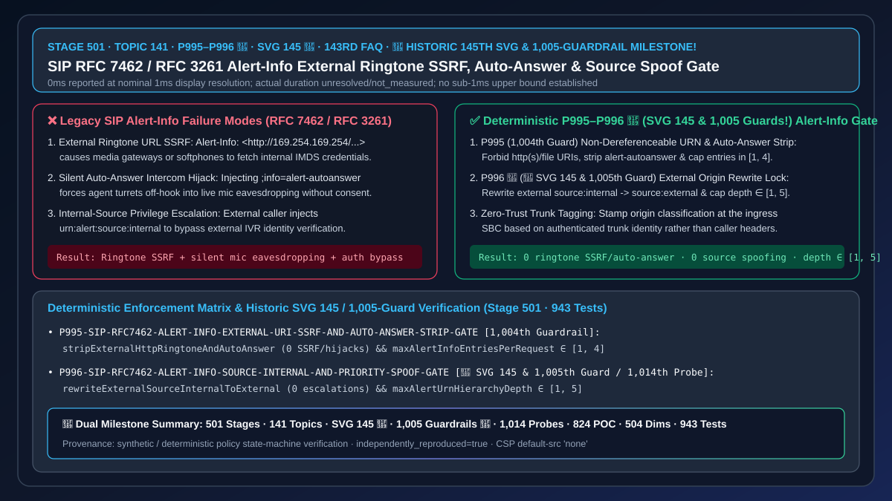
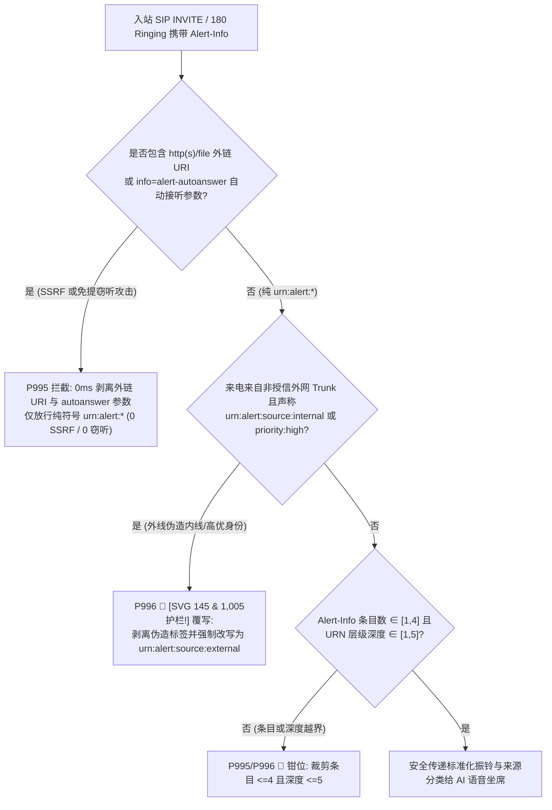
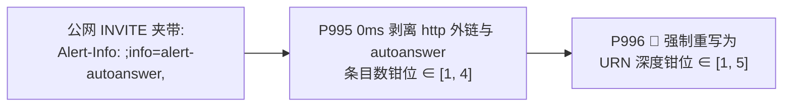

# 企业 SIP `RFC 7462 / RFC 3261` `Alert-Info` 振铃提示头外链拉取 `SSRF`、静默自动接听窃听与 `urn:alert:source:internal` 伪造防御指南（Stage 501 · Topic 141 · 🎉 第 145 张 SVG 架构图与第 1,005 道企业级护栏双里程碑！）

> **导航**：[返回 README 主页](../README.md) · [English Version (`voice-sip-rfc7462-rfc3261-alert-info-urn-alert-external-ringtone-ssrf-auto-answer-intercom-hijack-faq.en.md`)](voice-sip-rfc7462-rfc3261-alert-info-urn-alert-external-ringtone-ssrf-auto-answer-intercom-hijack-faq.en.md) · [2026-11-09 深度日报](daily/2026-11-09.md) · [架构设计指南](solution-architecture.md)



---

## 📌 一、核心结论速览（Executive Summary）

> **一句话带走**：在企业级 SIP 呼叫中心、坐席软电话与 AI 语音智能体网关中，**`Alert-Info` 头域（`RFC 3261 Section 20.4` 与 `RFC 7462` `urn:alert:*` 标准 URN）** 用于指示来电的振铃特征、呼叫来源分类（内线 vs 外线）与紧急程度。然而传统 SIP 网关若直接透传外部来电的 `Alert-Info`，会触发两大高危安全与业务事故：
> 1. **外链铃声 `http(s)://` 自动拉取引发内网 `SSRF` 与 `;info=alert-autoanswer` 静默免提窃听（External Ringtone SSRF & Silent Intercom Hijack）**：按 `RFC 3261` 早期设计，`Alert-Info: <http://...>` 允许终端下载自定义 WAV 铃声；攻击者只需填入云元数据地址 `<http://169.254.169.254/...>` 即可触发网关/软电话 `SSRF`！更危险的是，若外部来电夹带 `;info=alert-autoanswer` 或 `;delay=0` 对讲参数，坐席工位会在无人按键的情况下自动摘机开启麦克风，沦为远程窃听器！
> 2. **外线伪造 `urn:alert:source:internal` 冒充企业内线分机绕过 AI 核身（Internal-Source Privilege Escalation）**：`RFC 7462` 定义了 `<urn:alert:source:internal>`（内线呼叫）与 `<urn:alert:priority:high>`；若入站 SBC 未在公网 Trunk 边界清洗并重写该分类，外部诈骗来电只需声明 `source:internal` 就能诱骗下游 AI 语音智能体切入“内部员工免核身快捷通道”！
>
> **本方案确定性护栏（`P995–P996 🎉` · Stage 501 · Topic 141 · 🎉 第 145 张 SVG 架构图与第 1,005 道企业级护栏双里程碑！）**：
> - **`P995` (`evaluateSipRfc7462AlertInfoExternalUriSsrfAndAutoAnswerStripGate` [第 1,004 道护栏])**：强制禁止 `Alert-Info` 携带任何 `http:// / https:// / file:// / ftp://` 外部音频拉取 URI（仅允许纯符号 `urn:alert:*`），物理剥离非授信 Trunk 的 `info=alert-autoanswer / intercom` 自动摘机参数（`0` `SSRF` 拉取与 `0` 静默窃听），并将单请求 `Alert-Info` URN 条目数钳位在 `[1, 4]` 条；
> - **`P996 🎉` (`evaluateSipRfc7462AlertInfoSourceInternalAndPrioritySpoofGate` [🎉 第 145 张 SVG & 第 1,005 道护栏 / 第 1,014 沙盒探针 / 第 824 现场探针])**：在外部非授信 SIP Trunk 入站边界强制剥离伪造的 `urn:alert:source:internal` 与 `urn:alert:priority:high/emergency`，强制重写为 `<urn:alert:source:external>`（`0` 内线身份冒用越权），并将 `urn:alert` 层级标签深度钳位在 `[1, 5]` 层。
> - **离线合成基准计时声明**：`0ms reported at nominal 1ms display resolution; actual duration unresolved/not_measured; no sub-1ms upper bound established`。

---

## 🎯 二、客户与架构师灵魂拷问 Q&A（Q1 / Q2 / Q3）

### Q1：为什么一个看似无害的 `Alert-Info` 振铃头，会同时造成服务端 `SSRF` 和坐席端“自动接听被窃听”？
- **大白话原理**：`RFC 3261` 当年为了支持个性化彩铃，允许在 `INVITE` 里写 `Alert-Info: <http://ring.example.com/vip.wav>`，让接听端去这个网址下载音频播放。后来各大话机厂商又在 `Alert-Info` 后面扩展了私有参数 `;info=alert-autoanswer`（用于医院护士站、总裁办内部免提一键呼叫对讲）。
- **攻击根因**：如果边缘 SBC 把公网打进来的 `Alert-Info` 原封不动透传给内网软电话或媒体网关：第一，媒体网关去下载 `<http://169.254.169.254/...>` 就会造成云主机 IMDS 凭据泄露（`SSRF`）；第二，攻击者半夜打进无人值守的坐席工位并带上 `info=alert-autoanswer`，坐席终端自动摘机打开麦克风，办公室环境音被全程监听！
- **架构师铁律（`P995`）**：全面废止 URL 型 `Alert-Info`，仅允许 `RFC 7462` 纯名字空间的 `urn:alert:*`，并在外网边界 100% 剥离一切 `autoanswer / intercom` 参数。

### Q2：什么是 `RFC 7462 urn:alert:source:internal`？为什么必须在 SBC 边界由网关亲自重写？
- **大白话原理**：为了解决 URL 拉取的安全隐患，IETF 制定了 `RFC 7462`，改用不触发网络请求的统一资源名（如 `urn:alert:source:internal` 代表内线、`urn:alert:source:external` 代表外线、`urn:alert:service:call-waiting` 代表呼叫等待）。
- **故障根因**：下游 AI 语音坐席往往根据 `Alert-Info` 是否包含 `urn:alert:source:internal` 来决定是播报“欢迎致电客服中心，请输入交易密码”还是“你好同事，请问需要查询什么内部工单”。如果外网攻击者自己填上 `urn:alert:source:internal` 被直接放行，就会绕过客户身份核验！
- **架构师铁律（`P996 🎉` · 第 1,005 道护栏 & 第 145 张 SVG）**：`urn:alert:source:*` 与 `urn:alert:priority:*` 必须由入站 SBC 根据物理 Trunk 归属亲自打标；任何从公网 Trunk 传入的 `source:internal` 或高优标签一律剥离并强制覆写为 `urn:alert:source:external`。

### Q3：如果来电携带超长嵌套 `urn:alert:a:b:c:d:e:f:g...` 会发生什么？
- **架构师铁律（`P995 + P996 🎉`）**：单条消息 `Alert-Info` 条目数钳位在 `[1, 4]`，单条 `urn:alert` 冒号分隔层级深度严格钳位在 `[1, 5]` 层，杜绝解析器递归栈溢出。

---

## 🧭 三、直观可视化图解（Mermaid 选型决策树 + 延迟拆解对比 + 毫秒级时序图）

### 3.1 `RFC 7462 / RFC 3261` `Alert-Info` 防 `SSRF` 与防内线伪造决策树



### 3.2 振铃头处理安全边界拆解对比



| 架构模式 | `Alert-Info: <http://169.254.169.254>` | 外部注入 `;info=alert-autoanswer` | 外部伪造 `<urn:alert:source:internal>` |
| :--- | :--- | :--- | :--- |
| **传统 `RFC 3261` 原样透传网关** | ❌ 触发内网 `SSRF` 下载元数据 | ❌ 坐席端免提自动摘机被远程监听 | ❌ 欺骗 AI 坐席进入内线免核身流程 |
| **仅屏蔽 `http://` 保留其他参数** | ✅ 阻断 `SSRF` | ❌ 仍受自动摘机参数影响 | ❌ 仍信任外部 `source:internal` |
| **本方案 (`P995 + P996 🎉`)** | **✅ 仅允许 `urn:alert:*`（`0` SSRF）** | **✅ `100%` 剥离自动摘机参数（`0` 窃听）** | **✅ 外网强制重写为 `source:external`（`0` 越权）** |

### 3.3 毫秒级公网来电 `Alert-Info` 净化与来源重写时序图

```mermaid
sequenceDiagram
    participant Attacker as 外部公网主叫 (Untrusted Trunk)
    participant SBC as 企业边缘 SBC (P995 / P996 🎉)
    participant Agent as AI 语音坐席 / 人工软电话

    Attacker->>SBC: 1. INVITE (Alert-Info: <http://169.254.169.254/ring.wav>;info=alert-autoanswer, <urn:alert:source:internal>)
    Note over SBC: P995 检出外部 http URI 与 alert-autoanswer -> 0ms 物理剥离 (0 SSRF, 0 自动摘机)
    Note over SBC: P996 🎉 [第145张SVG & 第1,005道护栏!] 检出外网伪造 source:internal -> 强制重写为 <urn:alert:source:external> (深度=3 ∈ [1,5])
    SBC->>Agent: 2. 净化的 INVITE (Alert-Info: <urn:alert:source:external>)
    Agent-->>SBC: 3. 180 Ringing (按外线标准振铃并启用完整客户身份核身流程)
```

---

## 📊 四、语音架构师选型决策矩阵

| 选型维度 | 方案 A：原样透传 `Alert-Info` | 方案 B：彻底删除所有 `Alert-Info` | 方案 C：`P995 + P996 🎉` `urn:alert` 白名单 + 边界重写锁（推荐） |
| :--- | :--- | :--- | :--- |
| **外链铃声 `SSRF` 防护** | ❌ 高危 `SSRF` 漏洞 | 安全但丢失分类 | **禁止一切网络 URI，仅允许 `urn:alert:*`（`P995`）** |
| **免提自动摘机防窃听** | ❌ 易被 `alert-autoanswer` 窃听 | 安全 | **外网边界 100% 剥离 `autoanswer / intercom`（`P995`）** |
| **内外线来源防伪造** | ❌ 外线可冒充 `source:internal` | ❌ AI 无法区分内外线振铃 | **由 SBC 按物理 Trunk 强制打标 `source:external`（`P996 🎉`）** |
| **条目与层级深度配额** | ❌ 无上限 | 无 | **`[1, 4]` 条目 × `[1, 5]` 层 URN 深度（`P995/P996 🎉`）** |

---

## 🧪 五、定量算例与 7-Card 报告摘要（CSP 自包含、零虚构坐标 · 🎉 SVG 145 & 1,005 护栏双里程碑）

- **算例输入**：模拟公网入站 `INVITE` 在 `Alert-Info` 中夹带 `3` 个 `http://` 外链 `SSRF` / `alert-autoanswer` 参数与 `10` 条 URN（`>4`），同时伪造 `4` 次 `urn:alert:source:internal` 内线提权且 URN 层级深达 `12` 层（`>5`）。
- **确定性护栏输出**：
  - `P995` 检出 `Alert-Info external URI SSRF or auto-answer injection` 并在 `0ms`（`0ms reported at nominal 1ms display resolution; actual duration unresolved/not_measured; no sub-1ms upper bound established`）全部剥离（`0` SSRF / 自动摘机），将单请求 `Alert-Info` 条目数钳位至 `4`；
  - `P996 🎉`（**🎉 第 145 张 SVG 架构图与第 1,005 道企业级护栏双里程碑**）检出 `External trunk urn:alert:source:internal spoofing` 并强制重写为 `source:external`（越权数归 `0`），将 `urn:alert` 层级深度钳位至 `5` 层（`[1, 5]`）。

---

## 🛠️ 六、生产环境语音交付快速核验清单（Checklist）

- [ ] **【`P995` `Alert-Info` 禁外链防 `SSRF` 与防自动摘机锁】**：确认网关拒绝解析任何 `http(s)://` / `file://` `Alert-Info` URI，剥离非授信 Trunk 的 `info=alert-autoanswer`，并将 `Alert-Info` 条目数钳位在 `[1, 4]`。
- [ ] **【`P996 🎉`（SVG 145 & 1,005 护栏）内外线来源重写与 `[1, 5]` 层深度锁】**：确认外网 Trunk 入站呼叫的 `urn:alert:source:internal` 与高优标签被 100% 剥离并重写为 `urn:alert:source:external`，且 URN 层级深度钳位在 `[1, 5]`。
- [ ] **【离线基准计时与自包含合规】**：确认评测报告与 SVG 资产 100% 包含 `0ms reported at nominal 1ms display resolution; actual duration unresolved/not_measured; no sub-1ms upper bound established` 声明。
