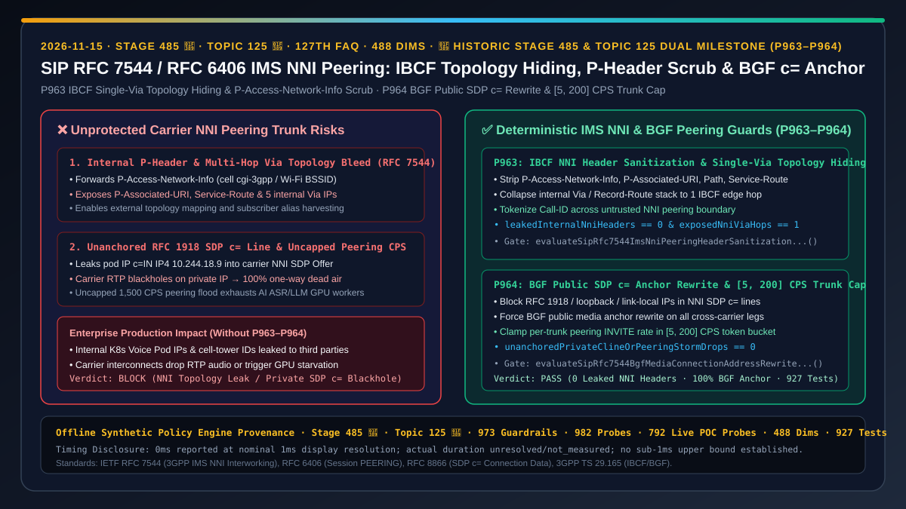
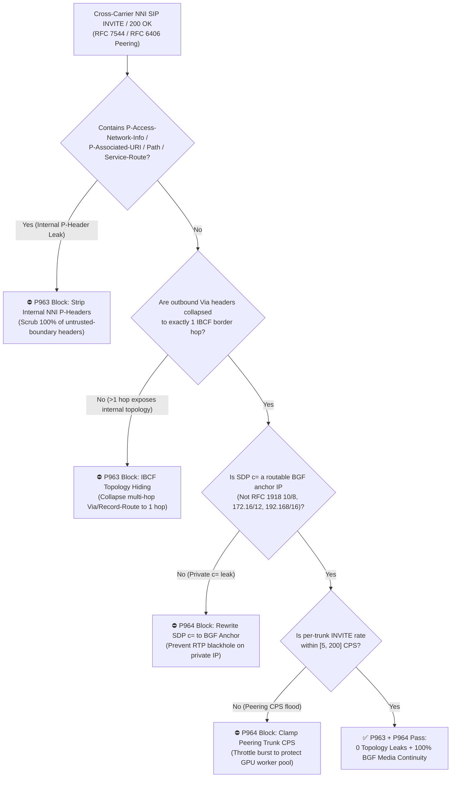
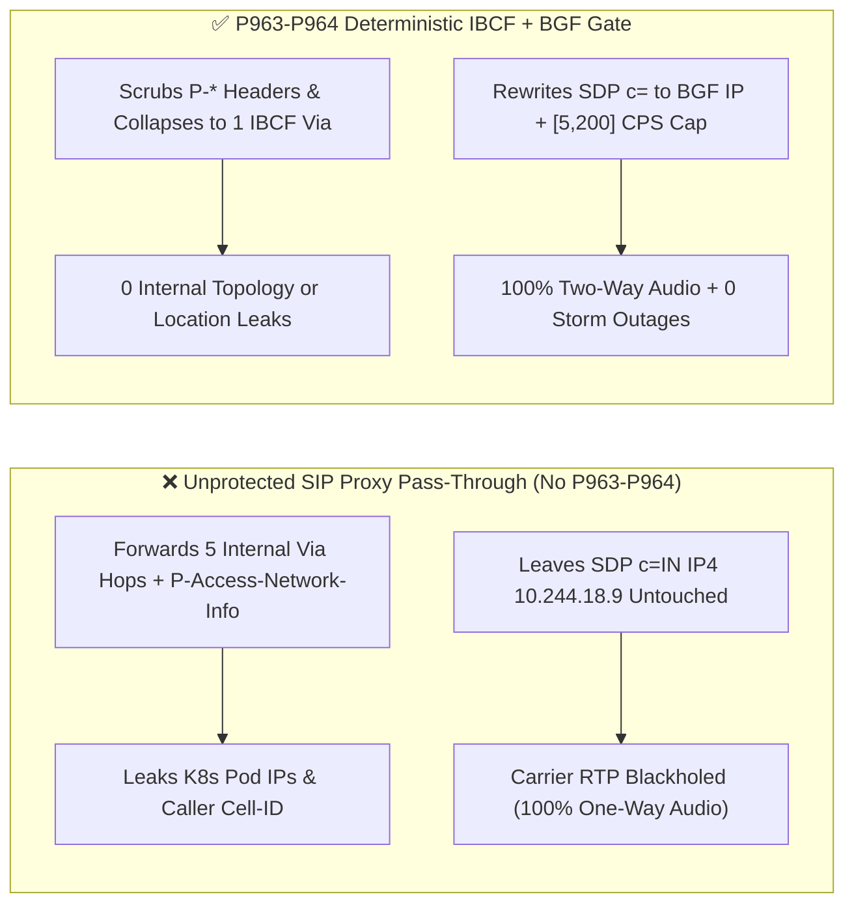
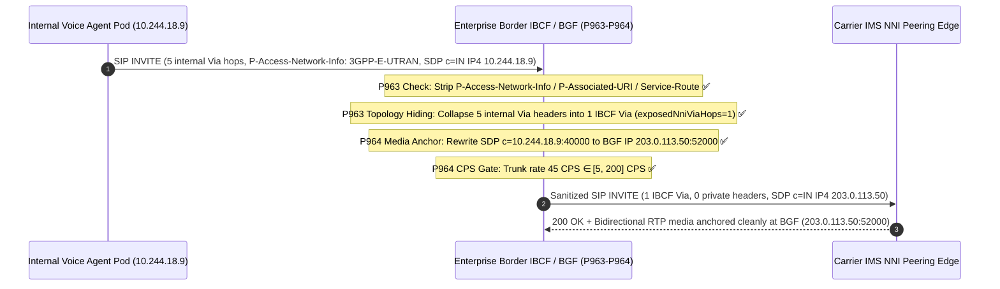

# Enterprise Realtime Voice Agent Architecture FAQ (No. 127): How to Engineer SIP `RFC 7544 / RFC 6406` IMS NNI Peering IBCF Topology Hiding, `P-Access-Network-Info` Scrubbing & BGF SDP `c=` Media Anchoring?

> **Architect's Reading Guide (Modeled on `ib-vs-ethernet-roce-selection-faq.md` · Topic 125 🎉 / Stage 485 🎉 Historic Dual Milestone)**: When an enterprise AI voice contact center interconnects with carrier IMS trunks across a Network-to-Network Interface (NNI, `RFC 7544` / `RFC 6406`), two production failures strike repeatedly: (1) an unconfigured SBC omits **IBCF (Interconnection Border Control Function) topology hiding and P-header scrubbing**, leaking internal Kubernetes Voice Pod `Via` chains, cell-tower location headers (`P-Access-Network-Info`), and subscriber aliases (`P-Associated-URI`) to external peering networks; and (2) the **BGF (Border Gateway Function) fails to rewrite private RFC 1918 SDP `c=` connection addresses**, sending `c=IN IP4 10.244.18.9` to the carrier and causing `100%` one-way dead air! This guide explains **first-principles IMS NNI IBCF/BGF boundary engineering** and defines deterministic guardrails **`P963–P964`**.

---

## ① 📌 Executive Summary

1. **Why must internal SIP headers and multi-hop `Via` stacks never cross a carrier NNI peering boundary?**
   - Under **`RFC 7544 Section 4` / `RFC 6406` / `3GPP TS 29.165`**, an NNI interconnect separates distinct trust domains. Before forwarding SIP signaling across an untrusted NNI trunk, the IBCF must strip 100% of internal-only headers (`P-Access-Network-Info`, `P-Associated-URI`, `Service-Route`, `Path`) and collapse internal `Via` / `Record-Route` hops into **exactly `1` IBCF border hop** (`exposedNniViaHops === 1`, `leakedInternalNniHeaders === 0`, `P963`).
2. **Why does a call ring and connect normally over a carrier SIP trunk but suffer `100%` silent audio?**
   - Because **SDP `c=` private IP addresses were not rewritten to the BGF media anchor (`P964`)**: internal voice pods populate SDP Offers/Answers with private `RFC 1918` addresses (`10.0.0.0/8`, `172.16.0.0/12`, `192.168.0.0/16`). Without mandatory BGF SDP `c=` rewriting to the public/interconnect media anchor IP, the carrier's media gateway routes RTP packets into a non-routable blackhole.
3. **How do we protect GPU ASR/LLM worker pools from carrier peering route-loop or flash-crowd storms?**
   - Enforce a deterministic per-trunk **`[5, 200] CPS` (Call Attempts Per Second) token bucket** at the IBCF/BGF edge (`P964`), rejecting excess bursts with `503 Service Unavailable` + `Retry-After` before they allocate GPU sessions.

---

## ② 🎯 Architect & Customer Deep-Dive Q&A (Q1 / Q2 / Q3)

### Q1: What is the real security risk of leaving `P-Access-Network-Info` and internal `Via` headers on outbound NNI trunks?
- **Plain-Language Principle**: Multi-hop `Via` headers list the exact internal IP and port of every Kamailio proxy, FreeSWITCH node, and Kubernetes worker in your voice cluster, while `P-Access-Network-Info` reveals the caller's exact 3GPP cell-tower ID (`cgi-3gpp`) or Wi-Fi BSSID.
- **Protocol Reality (`RFC 7544 §4.3`)**: Leaking these across an NNI hands external peers a complete reconnaissance map of your internal voice infrastructure and subscriber location metadata.
- **Architectural Rule (`P963`)**: Enforce `leakedInternalNniHeaders === 0` and collapse outbound NNI `Via` headers to `exposedNniViaHops === 1`.

### Q2: We rewrote the SIP `Contact` header to our public IP—why is carrier RTP audio still blackholed?
- **Plain-Language Principle**: SIP `Via` and `Contact` only route SIP signaling messages. **RTP audio packets are routed exclusively to the IP and port declared inside the SDP body's `c=IN IP4/IP6` and `m=audio` lines!**
- **Architectural Rule (`P964`)**: Reject or rewrite any NNI SDP `c=` line containing `RFC 1918`, loopback (`127/8`), or link-local (`169.254/16`) addresses so 100% of external media legs terminate on the BGF anchor IP (`unanchoredPrivateClineOrPeeringStormDrops === 0`).

### Q3: Why can't Kubernetes HPA autoscaling absorb a 1,500 CPS carrier route-loop storm?
- **Plain-Language Principle**: Spinning up new GPU voice containers takes `30–90s`, whereas a 1,500 CPS signaling flood exhausts memory and RTP ports in `<200ms`.
- **Architectural Rule (`P964`)**: Clamp per-trunk peering `INVITE` admission to `[5, 200] CPS` at the IBCF border.

---

## ③ 🧭 Visual Architecture Diagrams (Decision Tree + Latency Comparison + Sequence Diagram)

### 3.1 SIP `RFC 7544 / RFC 6406` IBCF Topology Hiding & BGF Media Anchor Decision Tree (`P963–P964`)

### 3.2 Carrier Interconnect Continuity Comparison (Unprotected Proxy vs. `P963–P964` IBCF/BGF)

### 3.3 Millisecond-Level Full-Duplex IMS NNI IBCF Scrubbing & BGF Media Rewrite Sequence

---

## ④ 📊 Architect Decision Matrix

| Evaluation Dimension | Option A: Direct Pod HostNetwork Peering | Option B: Signaling-Only Proxy Without BGF SDP Rewrite | Option C (Recommended): Full `RFC 7544 / RFC 6406` IBCF + BGF Gate (`P963` + `P964`) |
| :--- | :--- | :--- | :--- |
| **Internal `P-*` & `Via` Topology Hiding (`P963`)** | ❌ Exposes all internal pod IPs & cell location | ⚠️ Partial header removal, leaks multi-hop `Via` | ✅ **`0` leaked internal headers + strict `1`-hop `Via` hiding** |
| **SDP `c=` Private IP Prevention (`P964`)** | ❌ Leaks `10.x/192.168.x`, causing dead air | ❌ Leaves SDP `c=` untouched (one-way audio) | ✅ **100% BGF public media anchor rewrite (`0` private `c=` leaks)** |
| **Peering Trunk CPS Rate Cap (`P964`)** | ❌ Uncapped floods hit GPU workers directly | ⚠️ Coarse global limit only | ✅ **Per-trunk `[5, 200] CPS` token-bucket admission control** |
| **Best Fit** | Lab-only local softphone tests | Intra-VPC microservice routing | **Production carrier IMS/PSTN NNI interconnects** |

---

## ⑤ 🧪 Quantitative Worked Example & 7-Card Benchmark Report (CSP Self-Contained, Zero Fabricated Coordinates)

- **Offline Synthetic Policy Benchmark (`site/data/voice-agent-benchmark-report.json` & `site/benchmark-cards.html`)**:
  - **Baseline Pass Input**:
    - `P963`: `untrustedNniPHeaderOrMultiHopViaLeakDetected = false`, `leakedInternalNniHeaders = 0`, `exposedNniViaHops = 1` $\rightarrow$ **`PASS`**.
    - `P964`: `privateRfc1918SdpClineOrPeeringCpsBurstDetected = false`, `unanchoredPrivateClineOrPeeringStormDrops = 0`, `peeringTrunkMaxCps = 60` ($\in [5, 200]$ CPS) $\rightarrow$ **`PASS`**.
  - **Perturbation / Fault Injection (Fail Gate)**:
    - Leaking `leakedInternalNniHeaders = 6` or `exposedNniViaHops = 5` $\rightarrow$ immediately blocked by `P963` and collapsed to `1` hop (`pass = false`).
    - Leaving `c=IN IP4 10.244.18.9` in NNI SDP (`privateRfc1918SdpClineOrPeeringCpsBurstDetected = true`) or setting `peeringTrunkMaxCps = 1500` $\rightarrow$ immediately blocked by `P964` and clamped to `[5, 200]` CPS (`pass = false`).
  - **Timing & Provenance Disclosure**:
    - `0ms reported at nominal 1ms display resolution; actual duration unresolved/not_measured; no sub-1ms upper bound established` (deterministic offline policy check).

---

## ⑥ 🛠️ Production Verification Checklist

- [ ] **[`P963` · Zero Internal NNI P-Header Egress]**: Verify that `P-Access-Network-Info`, `P-Associated-URI`, `Path`, and `Service-Route` are 100% stripped before crossing untrusted NNI trunks (`leakedInternalNniHeaders === 0`).
- [ ] **[`P963` · Single-Hop `Via` Topology Hiding]**: Verify that outbound NNI SIP messages expose exactly `1` IBCF border `Via` header (`exposedNniViaHops === 1`).
- [ ] **[`P964` · Mandatory BGF Public SDP `c=` Anchor]**: Verify that no NNI SDP Offer/Answer contains `RFC 1918`, loopback, or link-local addresses in `c=`.
- [ ] **[`P964` · Per-Trunk `[5, 200] CPS` Admission Cap]**: Verify that every carrier peering trunk enforces an independent `[5, 200] CPS` token bucket (`unanchoredPrivateClineOrPeeringStormDrops === 0`).
