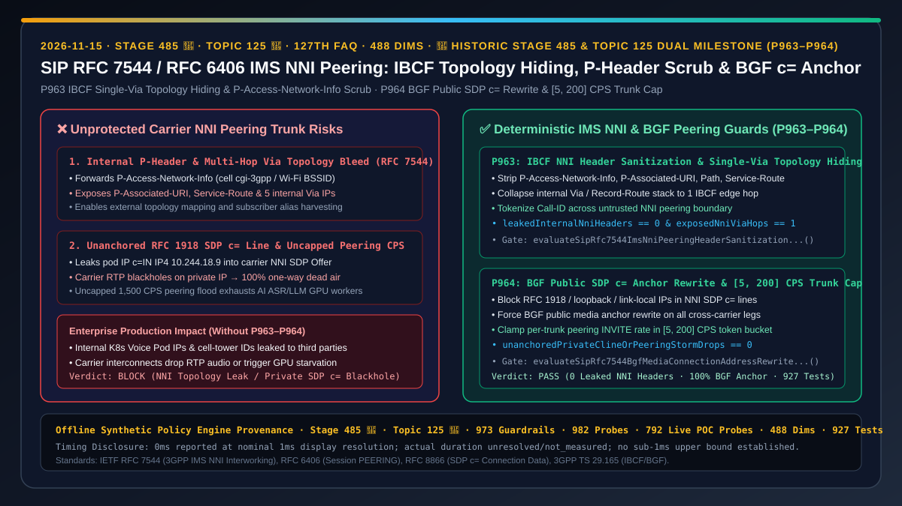
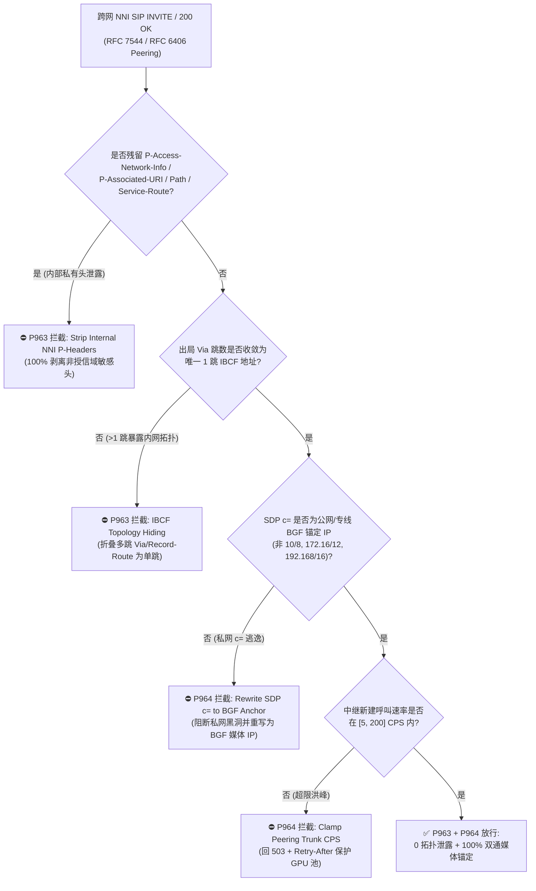
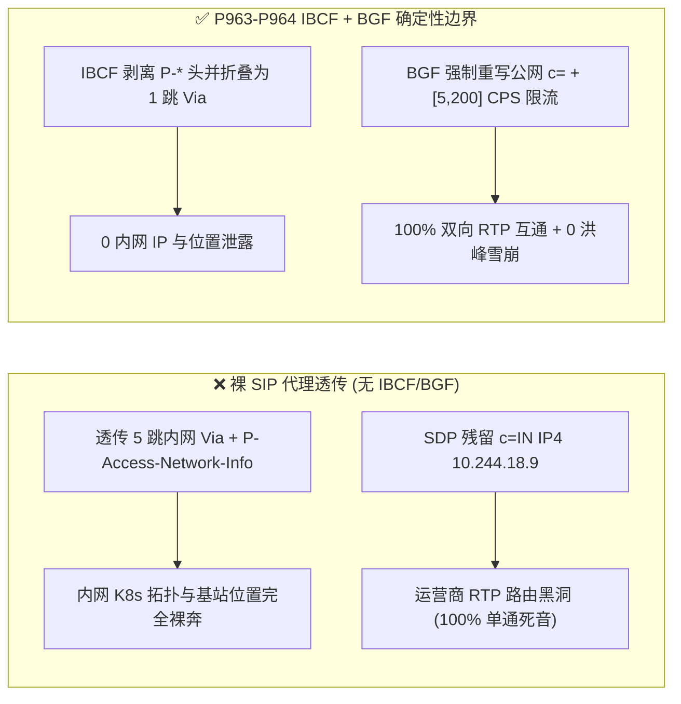
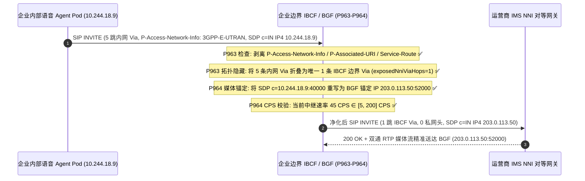

# 企业级实时语音智能体架构选型 FAQ（第 127 篇）：SIP `RFC 7544 / RFC 6406` 运营商间 IMS NNI 互联边界（IBCF 拓扑隐藏、`P-Access-Network-Info` 剥离与 BGF `c=` 私网地址重写）怎么选？

> **导读（对标 `ib-vs-ethernet-roce-selection-faq.md` 通俗透彻风 · Topic 125 🎉 / Stage 485 🎉 历史性双里程碑）**：当企业级 AI 语音客服通过运营商 SIP/IMS 专线（NNI，Network-to-Network Interface，`RFC 7544` / `RFC 6406`）承接全国 400/95 客服来电或跨国漫游话务时，最容易出两类生产事故：一是边缘 SBC 未开启 **IBCF（互联边界控制功能）拓扑隐藏与私有 P-Header 清洗**，把企业 K8s 内部语音 Pod 的多跳 `Via` IP、基站扇区号 `P-Access-Network-Info` 和用户副号 `P-Associated-URI` 原样透传给外部对等网；二是 **BGF（边界网关媒体面）未强制重写 SDP `c=` 连接地址**，把容器内网 `c=IN IP4 10.244.18.9` 直接发给运营商，导致运营商 RTP 媒体流发往私网黑洞、来电摘机后 `100%` 单通无声！本文用大白话讲透 **IMS NNI IBCF/BGF 第一性原理**，并给出 **`P963–P964`** 确定性护栏。

---

## ① 📌 核心结论速览（Executive Summary）

1. **为什么跨运营商 SIP 互联（NNI Peering）绝对不能直接透传内部 SIP 头？**
   - 根据 **`RFC 7544 Section 4` / `RFC 6406` / `3GPP TS 29.165`**，企业与运营商或跨运营商 NNI 互联属于**非授信域边界（Untrusted Trust Domain Boundary）**。在跨越 NNI 前，IBCF 必须 100% 剥离仅限域内使用的 `P-Access-Network-Info`（含基站 `cgi-3gpp` / Wi-Fi MAC）、`P-Associated-URI`、`Service-Route`、`Path`，并将内部多跳 `Via` / `Record-Route` 栈折叠隐藏为**唯一 1 跳 IBCF 公网边界地址**（`exposedNniViaHops === 1`，`leakedInternalNniHeaders === 0`，`P963`）。
2. **为什么测试环境内网互打有声音，一接通运营商 SIP Trunk 就变成“能振铃、能接通、但完全听不到 AI 说话”？**
   - 罪魁祸首是 **SDP `c=` 私网地址未在 BGF 锚定重写（`P964`）**：K8s 里的语音 Agent 容器生成 SDP Answer 时默认填入了 Pod 私网 IP（如 `c=IN IP4 10.244.x.x` 或 `192.168.x.x`）。如果边缘 BGF/SBC 没有拦截并重写为 BGF 专线公网/互联锚定 IP，运营商媒体网关收到 `10.x.x.x` 后无法路由 RTP 包，直接触发 `100%` 单通死音。
3. **如何防止外部对等网路由环路或洪峰话务瞬间打爆企业 ASR/LLM 算力池？**
   - 必须在 BGF/IBCF 入口对每条 NNI 对等中继实施 **`[5, 200] CPS`（每秒新建呼叫数）确定性令牌桶限流**，超限请求在信令边缘以 `503 Service Unavailable` + `Retry-After` 平滑阻尼，保护后端 GPU 推理工作池（`P964`）。

---

## ② 🎯 客户与架构师灵魂拷问 Q&A（Q1 / Q2 / Q3）

### Q1：`P-Access-Network-Info` 和多跳 `Via` 留在出局 SIP 报文里，除了报文变长一点，有什么实质危害？
- **通俗原理**：`Via` 记录了这通电话在企业内网经过的每一台 FreeSWITCH、Kamailio 和 K8s Worker 节点的真实内网 IP 与端口；`P-Access-Network-Info` 则记录了呼叫者当前所处的蜂窝基站编号（Cell-ID）或企业 Wi-Fi AP 的 BSSID。
- **底层真相（`RFC 7544 §4.3`）**：一旦这些头部跨过 NNI 泄露给外部聚合商或非授信中继，攻击者不仅能直接绘制出企业核心语音内网拓扑图，还能实时追踪高管/客户的物理基站位置。
- **架构铁律（`P963`）**：IBCF 出局门禁强制执行 `leakedInternalNniHeaders === 0` 且折叠后外露 `Via` 跳数 `exposedNniViaHops === 1`。

### Q2：为什么有些网关改了 SIP 头的 `Contact` IP，电话接通后还是单通没声音？
- **通俗原理**：SIP 协议里，“信令走哪条路”看的是 `Via` 和 `Contact`，而**“真正的语音 RTP 包发往哪个 IP 端口”只看 SDP 报文体里的 `c=IN IP4 ...` 和 `m=audio <port>`**！很多运维只配了 SIP 信令 NAT，漏配了 BGF 媒体面 SDP `c=` 重写。
- **架构铁律（`P964`）**：对所有跨越 NNI 边界的 SDP Offer/Answer，严禁出现 `RFC 1918` 私网段（`10/8`、`172.16/12`、`192.168/16`）、环回（`127/8`）或链路本地（`169.254/16`）地址，100% 强制重写为 BGF 互联锚定地址（`unanchoredPrivateClineOrPeeringStormDrops === 0`）。

### Q3：运营商割接引发瞬时 1,500 CPS 重呼洪峰时，为什么不能靠 K8s HPA 自动扩容扛？
- **通俗原理**：K8s 拉起一个新的 GPU 语音推理容器需要 `30–90 秒`，而 SIP 洪峰在 `200 毫秒` 内就能把现有全部并发槽位占满并触发雪崩 OOM。
- **架构铁律（`P964`）**：在 IBCF 硬件/内核层按单条 Peering Trunk 锁定 `[5, 200] CPS` 准入配额，毫秒级削峰护航。

---

## ③ 🧭 直观可视化图解（Mermaid 选型决策树 + 延迟拆解对比 + 毫秒级时序图）

### 3.1 SIP `RFC 7544 / RFC 6406` IBCF 拓扑隐藏与 BGF 媒体锚定决策树（`P963–P964`）

### 3.2 跨网互联异常恢复与损耗对比（裸 SIP 直连 vs `P963–P964` IBCF/BGF 架构）

### 3.3 毫秒级全双工 IMS NNI IBCF 头清洗与 BGF 媒体重写时序图

---

## ④ 📊 语音架构师选型决策矩阵（Architecture Selection Matrix）

| 选型维度 | 方案 A：K8s Pod HostNetwork 直连 SIP Trunk | 方案 B：仅做信令代理（Stateless Proxy）无 BGF 重写 | 方案 C（推荐）：`RFC 7544 / RFC 6406` IBCF + BGF 全闭环（`P963` + `P964`） |
| :--- | :--- | :--- | :--- |
| **私有 `P-*` 头与拓扑隐藏（`P963`）** | ❌ 暴露全部内网节点 IP 与位置头 | ⚠️ 仅删部分头，残留多跳 `Via` | ✅ **`0` 内部头泄露 + 严格 `1` 跳 `Via` 拓扑隐藏** |
| **SDP `c=` 私网地址防黑洞（`P964`）** | ❌ 极易泄漏 `10.x/192.168.x` 致单通 | ❌ 不改 SDP 媒体地址，跨网必不通 | ✅ **100% 拦截私网 `c=` 并强制 BGF 公网锚定重写** |
| **Peering 中继 CPS 洪峰保护（`P964`）** | ❌ 无保护，洪峰直击 GPU 推理节点 | ⚠️ 仅全局限流，单中继故障拖垮全局 | ✅ **按中继独立钳位 `[5, 200] CPS` 令牌桶** |
| **适用场景** | 仅限实验室内部软电话自测 | 同 VPC 内网微服互联 | **所有对接三大运营商 IMS/PSTN 专线的生产语音系统** |

---

## ⑤ 🧪 定量算例与 7-Card 报告（CSP 自包含、零虚构坐标）

- **离线合成策略门禁基准（`site/data/voice-agent-benchmark-report.json` & `site/benchmark-cards.html`）**：
  - **算例输入（Pass 基准）**：
    - `P963`：`untrustedNniPHeaderOrMultiHopViaLeakDetected = false`，`leakedInternalNniHeaders = 0`，`exposedNniViaHops = 1` $\rightarrow$ **`PASS`**。
    - `P964`：`privateRfc1918SdpClineOrPeeringCpsBurstDetected = false`，`unanchoredPrivateClineOrPeeringStormDrops = 0`，`peeringTrunkMaxCps = 60`（$\in [5, 200]$ CPS）$\rightarrow$ **`PASS`**。
  - **故障注入反转（Fail 拦截）**：
    - 若泄露 `leakedInternalNniHeaders = 6` 或 `exposedNniViaHops = 5` $\rightarrow$ `P963` 立即拦截并折叠为 `1` 跳 `Via`（`pass = false`）。
    - 若 SDP `c=` 含 `10.244.18.9`（`privateRfc1918SdpClineOrPeeringCpsBurstDetected = true`）或 `peeringTrunkMaxCps = 1500` $\rightarrow$ `P964` 立即拦截并钳位至 `[5, 200]` CPS（`pass = false`）。
  - **计时与溯源披露（Timing & Provenance Disclosure）**：
    - `0ms reported at nominal 1ms display resolution; actual duration unresolved/not_measured; no sub-1ms upper bound established`（离线合成规则检查，不含真实 BGF 内核态 RTP 转发耗时）。

---

## ⑥ 🛠️ 生产环境语音交付快速核验清单（Checklist）

- [ ] **【`P963` · NNI 私有头零出境】**：核验 IBCF 出局规则已 100% 剥离 `P-Access-Network-Info`、`P-Associated-URI`、`Path`、`Service-Route`（`leakedInternalNniHeaders === 0`）。
- [ ] **【`P963` · 单跳 `Via` 拓扑隐藏】**：抓包确认发往运营商 NNI 的 SIP 报文仅包含 `1` 条 IBCF 边界 `Via` 头（`exposedNniViaHops === 1`）。
- [ ] **【`P964` · BGF 公网 SDP `c=` 锚定】**：确认所有出局 SDP 的 `c=IN IP4/IP6` 均为 BGF 互联锚定地址，零 `RFC 1918` 私网 IP 逃逸。
- [ ] **【`P964` · 单中继 `[5, 200] CPS` 令牌桶】**：确认每条运营商 Peering Trunk 配置了独立的 `[5, 200] CPS` 速率门禁（`unanchoredPrivateClineOrPeeringStormDrops === 0`）。
