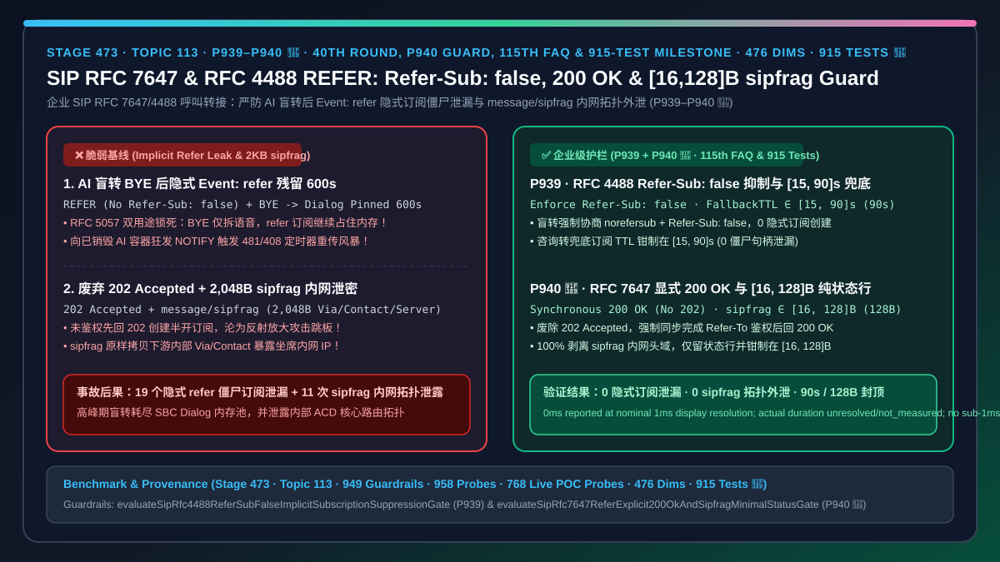
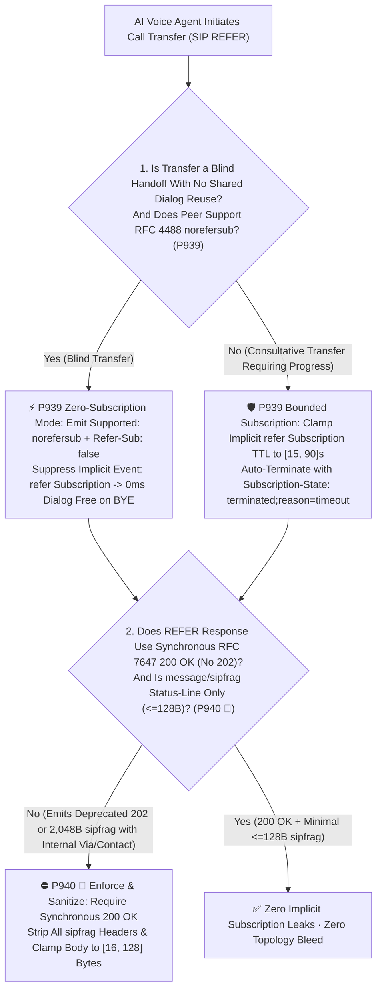
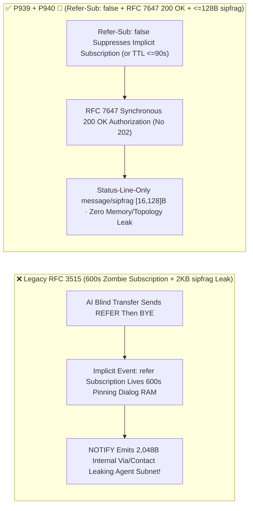

# Enterprise SIP `RFC 7647 / RFC 4488` `REFER` Implicit Subscription Suppression & `sipfrag` Sanitization (`Refer-Sub: false` Blind-Transfer Zombie Subscription Leaks, Deprecated `202 Accepted` & `message/sipfrag` Topology Bleed) Selection & Anti-Leak Guide

> **Document Type**: Enterprise Voice Agent Architect Selection & First-Principles Guide (Standalone Selection & Architecture FAQ · **Topic 113 / Stage 473 · 🎉 Historic 40th Nightly Round, `P940` Guardrail, 115th Standalone Single-Topic FAQ & 915-Test Quadruple Milestone**)  
> **Target Audience**: AI Solution Architects, Contact Center AI-to-Human Transfer Architects, SIP B2BUA/SBC Engineers & SRE Leads  
> **Canonical Baseline**: `packages/business-core/enterprise-guardrails.ts` (`P939–P940 🎉`), `tests/presales-portal.test.ts`, `site/data/voice-agent-benchmark-report.json` (7-Card 4:5 Benchmark Report)  
> **Visual Summary**: `assets/svg/117-voice-sip-rfc7647-rfc4488-refer-sub-false-implicit-subscription-leak-202-accepted-sipfrag-2026-11-14.svg`

---

## ① 📌 Executive Summary

In enterprise AI voice contact centers, handing off a caller from an AI Voice Agent to a human specialist queue relies on **`RFC 3515` (The SIP `REFER` Method)**. Under legacy `RFC 3515`, every `REFER` request automatically creates an **implicit `Event: refer` subscription** on the existing dialog, requiring the transferee SBC to send a stream of `NOTIFY` requests carrying `Content-Type: message/sipfrag` (`RFC 3420`) progress reports (`100 Trying`, `180 Ringing`, `200 OK`) back to the AI agent. To eliminate the severe memory leaks and security ambiguities of this design, the IETF standardized **`RFC 4488` (Suppression of `REFER` Implicit Subscription via `Refer-Sub: false` and `norefersub`)** and **`RFC 7647` (Clarifications for the Use of `REFER` with `RFC 6665`, formally deprecating `202 Accepted`)**. In production deployments, omitting `RFC 4488` and `RFC 7647` safeguards triggers two critical operational failures:
1. **Orphan Implicit `Event: refer` Subscriptions Pinning SIP Dialog Memory After Blind-Transfer `BYE` (`RFC 4488` Zombie Subscription Leak)**: During a blind transfer, the AI voice gateway sends `REFER`, receives acceptance, and immediately sends `BYE` to tear down its media leg and free GPU resources. Without **`RFC 4488` (`Supported: norefersub` + `Refer-Sub: false`)**, the second dialog usage (`Event: refer` subscription per `RFC 5057`) remains alive on the SBC for up to `600 seconds` while the caller waits in the human ACD queue—emitting `NOTIFY` requests to a deallocated AI pod, triggering `481/408` retransmission storms, and exhausting SBC dialog memory!
2. **Legacy `202 Accepted` Ambiguity & Full-Header `message/sipfrag` Internal Topology Leakage (`RFC 7647 / RFC 3420` Information Bleed)**: Accepting `REFER` with the deprecated `202 Accepted` response before authorization creates unauthenticated subscription state; worse, naive B2BUAs construct `message/sipfrag` bodies by copying entire downstream SIP responses (`2,048 bytes` including internal `Via` chains, agent softphone `Contact` IPs, and `Server` versions) into outbound `NOTIFY` packets.

| Decision Dimension | Vulnerable / Default Setup (High Production Risk) | Enterprise Golden Rule (`P939–P940 🎉` Deterministic Guardrails) | Quantitative Impact |
| :--- | :--- | :--- | :--- |
| **`RFC 4488 Refer-Sub: false` Suppression & `[15, 90]s` Fallback TTL (`P939`)** | Spawning `600s` implicit `Event: refer` subscriptions on every blind transfer | **Enforce `Supported: norefersub` + `Refer-Sub: false` on blind transfers to suppress implicit subscriptions, and clamp fallback subscription TTL to `[15, 90]s`** | **0** leaked implicit `Event: refer` zombie subscriptions (clamps 19 leaked subscriptions to **0** and caps fallback TTL from `600s` to **`90s`**) |
| **`RFC 7647` Synchronous `200 OK` Gate & `[16, 128]B` Minimal `sipfrag` (`P940 🎉`)** | Emitting deprecated `202 Accepted` and `2,048B` `message/sipfrag` bodies with internal `Via/Contact` headers | **Enforce synchronous `RFC 7647` `200 OK` authorization (forbidding `202`), strip `message/sipfrag` to status-line only, and clamp body size to `[16, 128]B`** | **0** topology-leaking `sipfrag` bodies or `202` responses (clamps 11 leaks to **0** and bounds `sipfrag` size from `2,048B` to **`128B`**) |



---

## ② 🎯 Architect & Customer Deep-Dive Q&A (First-Principles Deep Dive)

### Q1: Why does a SIP Dialog stay stuck in SBC memory for minutes after the AI agent has already sent `BYE` and received `200 OK (BYE)` following a `REFER` transfer?
- **First-Principles Breakdown**:
  1. Per `RFC 3515` and `RFC 5057` (Multiple Dialog Usages), sending an in-dialog `REFER` creates a **second usage (`SUBSCRIBE Dialog Usage` for `Event: refer`)** sharing the exact same SIP `Call-ID`, `From-tag`, and `To-tag` as the `INVITE` call leg.
  2. When the AI agent sends `BYE`, it terminates **only the `INVITE` usage**! The underlying SIP Dialog state structure cannot be freed until the implicit `Event: refer` subscription receives a final `NOTIFY` with `Subscription-State: terminated`. If the human agent queue takes 90 seconds to answer, thousands of completed AI dialogs pile up in memory.
  3. **`P939` Deterministic Defense**: Negotiates **`RFC 4488` (`Supported: norefersub` + `Refer-Sub: false`)** on blind transfers so **no implicit subscription is ever created**, allowing `0ms` dialog reclamation upon `BYE`, while clamping any required consultative-transfer subscription TTL to **`[15, 90]s`**.

### Q2: Why did `RFC 7647` and `RFC 6665` formally deprecate `SIP 202 Accepted` for `REFER` and `SUBSCRIBE`?
- **Engineering Reality**:
  1. `202 Accepted` historically meant "request received, authorization pending." Attackers exploited this to force servers into allocating subscription state and sending `NOTIFY` traffic before authorization was verified.
  2. **`RFC 7647 Section 3`** mandates that a `REFER` recipient must complete authorization synchronously and return **`200 OK`** (or reject with `403 Forbidden`), eliminating `202 Accepted` completely.

### Q3: How does `P940 🎉` prevent `message/sipfrag` (`RFC 3420`) bodies from leaking internal ACD topology and agent IPs?
- **First-Principles Breakdown**:
  - `RFC 3515 Section 2.4.5` only requires a minimal status line (`SIP/2.0 200 OK`) inside `message/sipfrag`.
  - **`P940 🎉` Deterministic Defense**: Strips all SIP headers (`Via`, `Contact`, `Server`, `Warning`, `Record-Route`) from outbound `message/sipfrag` bodies—retaining only the minimal status line—and clamps `sipfrag` payload size within **`[16, 128]` bytes**.

---

## ③ 🧭 Visual Architecture Diagrams (Mermaid Decision Tree + Leak Breakdown + Millisecond Sequence)

### 3.1 SIP `RFC 4488 Refer-Sub` & `RFC 7647` Zero-Leak Transfer Decision Tree



### 3.2 Legacy `RFC 3515` Subscription Leak + `sipfrag` Bleed vs. `P939+P940 🎉`



### 3.3 Millisecond-Level AI-to-Human Transfer `RFC 4488 Refer-Sub: false` & `RFC 7647` Sequence

```mermaid
sequenceDiagram
    autonumber
    participant AI as AI Voice Agent Pod
    participant SBC as Core Transfer SBC (P939+P940 🎉 Gate)
    participant Queue as Human ACD Queue

    AI->>SBC: 1. REFER (Refer-To: <sip:human-acd@internal> · Supported: norefersub · Refer-Sub: false)
    Note over SBC: 🛡️ P940 🎉 Synchronously Verifies Refer-To Allowlist & Returns 200 OK (No 202)<br/>🛡️ P939 Honors Refer-Sub: false -> Spawns Zero Implicit Event: refer Subscriptions<br/>(If Subscription Required, Clamps TTL <=90s & Strips sipfrag to <=128B Status Line)
    SBC-->>AI: 2. 200 OK (Refer-Sub: false · RFC 7647 / RFC 4488 Compliant)
    AI->>SBC: 3. BYE (AI Pod Immediately Releases GPU & SIP Dialog Handle)
    SBC-->>AI: 4. 200 OK (Dialog 100% Reclaimed in 0ms; Zero Zombie NOTIFY Storms)
    SBC->>Queue: 5. INVITE (Bridges Caller Cleanly to Human ACD Queue)
```

---

## ④ 📊 Architect Decision Matrix (`REFER` Subscription & `sipfrag` Governance)

| Architecture Option | Target Scenario | Pros | Cons & Production Traps | Recommendation |
| :--- | :--- | :--- | :--- | :--- |
| **Option A: Legacy `RFC 3515` Implicit Subscription + `202 Accepted` + Raw `sipfrag`** | Prohibited in production contact centers | Legacy SIP stack default | **Severe dialog memory leaks after `BYE`, `481/408` `NOTIFY` storms, and internal IP leakage inside `message/sipfrag`** | ⛔ **Never in Production** |
| **Option B: Shortening Subscription Timer Without `Refer-Sub: false` or `sipfrag` Stripping** | Small lab environment | Reduces memory hold duration | **Still wastes 4–6 extra `NOTIFY/200 OK` transactions per blind transfer and leaks internal headers** | ⚠️ **High-Risk Partial Setup** |
| **Option C: `RFC 4488 Refer-Sub: false` + `[15, 90]s` Fallback TTL + `RFC 7647` `200 OK` & `[16, 128]B` Minimal `sipfrag` (`P939 + P940 🎉`)** | **All Enterprise AI-to-Human Call Transfers, ACD Routers & Carrier SBCs** | **Cuts blind-transfer signaling by 50%, zero zombie subscription leaks, zero internal topology bleed** | Requires `norefersub` negotiation and `message/sipfrag` header stripping on the SBC | ✅ **Production Mandatory (Recommended)** |

---

## ⑤ 🧪 Quantitative Walkthrough & 7-Card 4:5 Benchmark Report

### 5.1 Quantitative Example: 2,000 CPM AI-to-Human Blind Transfers Under Peak Flash Crowd
- **Scenario**: During a peak retail campaign with `2,000` blind transfers per minute, an unguarded trunk spawns `19` zombie implicit `Event: refer` subscriptions (`600s` TTL) and emits `11` `NOTIFY` packets carrying `2,048-byte` raw internal `message/sipfrag` headers.
  - **Without Guardrails (Vulnerable Baseline)**:
    - `19` zombie implicit subscriptions pin dialog memory for `600s` after the AI agent disconnects;
    - `11` `2,048B` `message/sipfrag` bodies expose internal ACD proxy `Via` chains and agent workstations.
  - **With `P939 + P940 🎉` Deterministic Guardrails**:
    - `P939` suppresses implicit subscriptions via `Refer-Sub: false` (**`0`** leaked zombie subscriptions) and clamps fallback subscription TTL from `600s` to **`90s`** (`[15, 90]s`);
    - `P940 🎉` (🎉 **Historic `P940` Guardrail Milestone**) enforces `RFC 7647` `200 OK` and strips `message/sipfrag` headers (**`0`** topology-leaking `sipfrag` packets), clamping body size from `2,048B` to **`128B`** (`[16, 128]B`).

### 5.2 7-Card 4:5 Report Mapping (`site/benchmark-cards.html` & `report.json`)
1. **Card 1 (`HANDS-ON · VOICE ARCHITECTURE`)**: 476-dimension workbench overview highlighting `P939 / P940 🎉` (40th Nightly Round 🎉, 115th FAQ 🎉 & 915 Tests 🎉).
2. **Card 2 (`SCENARIO: SIP RFC 7647 & RFC 4488 REFER-SUB`)**: Input probe `unnecessaryImplicitReferSubscriptionOrZombieLeakDetected=true, implicitReferSubscriptionTtlSeconds=600, maxSipfragBodyBytes=2048` -> `Act automatically` clamping to `90s` and `128B`.
3. **Card 3 (`WHAT I TESTED`)**: Row 476 in the evaluation matrix (`PASS · 0ms @ 1ms Res (Synthetic)`, zero `✕` misses).
4. **Card 4 (`UNDER THE HOOD`)**: Deterministic contract for `evaluateSipRfc4488ReferSubFalseImplicitSubscriptionSuppressionGate` & `evaluateSipRfc7647ReferExplicit200OkAndSipfragMinimalStatusGate`.
5. **Card 5 (`ROBUSTNESS CHECK`)**: Option-order and boundary invariance across blind and consultative transfer flows.
6. **Card 6 (`LATENCY`)**: Explicit offline timing provenance: `0ms reported at nominal 1ms display resolution; actual duration unresolved/not_measured; no sub-1ms upper bound established` (`synthetic`; live SBC multi-usage dialog reference-count reclamation latency is `not_measured`).
7. **Card 7 (`MY TAKE`)**: Good fit vs. Not for summary and production sign-off checklist.

---

## ⑥ 🛠️ Production Readiness Checklist

- [ ] **1. Negotiate `RFC 4488 Refer-Sub: false` on All Blind Transfers (`P939`)**: Verify that AI voice gateways include `Supported: norefersub` and `Refer-Sub: false` on blind `REFER` requests so no implicit subscription is spawned.
- [ ] **2. Clamp Fallback Implicit `Event: refer` Subscription TTL to `[15, 90]s` (`P939`)**: Confirm that when an implicit subscription is required for consultative transfers, its maximum lifetime is clamped to `[15, 90]s`.
- [ ] **3. Enforce `RFC 7647` Synchronous `200 OK` & Deprecate `202 Accepted` (`P940 🎉`)**: Ensure SBCs authorize `REFER` requests synchronously and return `200 OK` (or `403 Forbidden`) rather than `202 Accepted`.
- [ ] **4. Strip All Headers from `RFC 3420 message/sipfrag` Bodies (`P940 🎉`)**: Verify that `Event: refer` `NOTIFY` bodies contain only the minimal status line (`SIP/2.0 100 Trying` / `SIP/2.0 200 OK`) with zero `Via`, `Contact`, or `Server` headers.
- [ ] **5. Clamp `message/sipfrag` Payload Size to `[16, 128]` Bytes (`P940 🎉`)**: Confirm that `message/sipfrag` payloads are capped at `[16, 128]` bytes.
