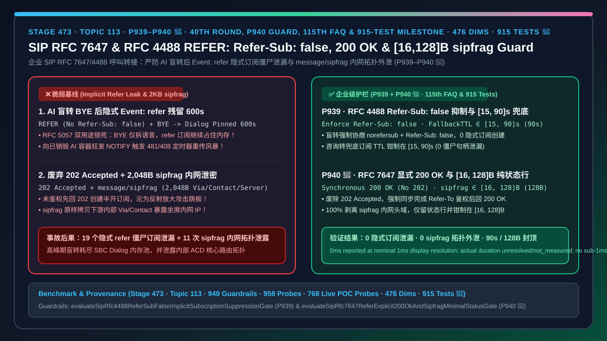
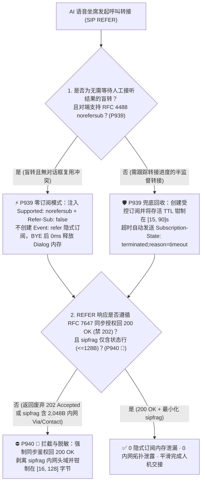
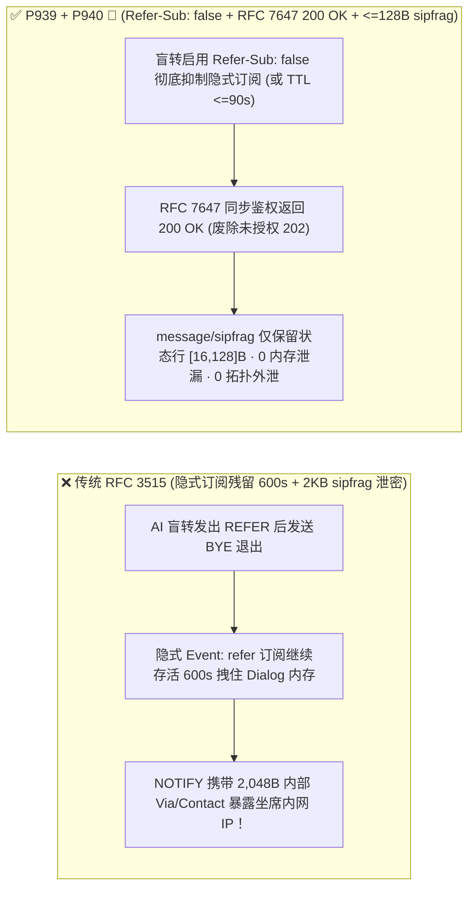
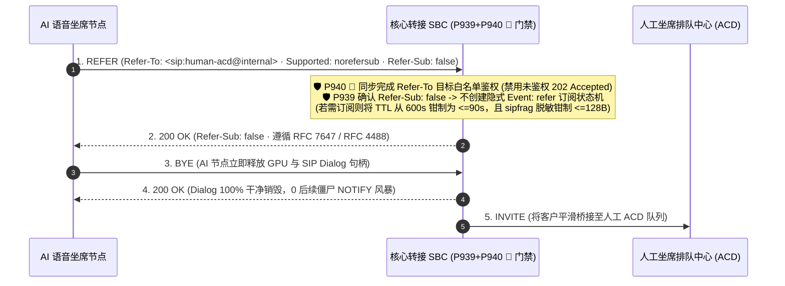

# 企业 SIP `RFC 7647 / RFC 4488` `REFER` 隐式订阅抑制与 `sipfrag` 脱敏（AI 盲转坐席 `Event: refer` 僵尸订阅池泄漏、`202 Accepted` 废弃隐患与 `message/sipfrag` 内网拓扑泄露）选型与防泄漏指南

> **文档类型**：企业级语音智能体架构师选型决策与原理解析指南（Standalone Selection & Architecture FAQ · **Topic 113 / Stage 473 · 🎉 历史性第 40 轮夜间深潜、`P940` 护栏、第 115 篇独立单专题 FAQ 与 915 项单测四重里程碑**）  
> **适用角色**：AI Solution Architect、呼叫中心人机协同（Warm/Blind Transfer）架构师、SIP B2BUA/SBC 研发与 SRE 负责人  
> **关联基准**：`packages/business-core/enterprise-guardrails.ts`（`P939–P940 🎉`）、`tests/presales-portal.test.ts`、`site/data/voice-agent-benchmark-report.json`（7-Card 4:5 评测报告）  
> **可视化总结**：`assets/svg/117-voice-sip-rfc7647-rfc4488-refer-sub-false-implicit-subscription-leak-202-accepted-sipfrag-2026-11-14.svg`

---

## ① 📌 核心结论速览（Executive Summary）

在企业 AI 语音客服中心，当 AI 坐席完成意图识别并执行**呼叫转接（Call Transfer，将客户从 AI 节点平滑移交至人工技能组队列或二线专家）**时，底层普遍使用 **`RFC 3515`（The SIP `REFER` Method）**。根据早期 `RFC 3515` 的设计，每发送一包 `REFER` 请求，不仅会触发目标呼叫转移，还会在原对话上**自动创建一个隐式的 `Event: refer` 事件订阅（Implicit Subscription）**，强制受让人（Transferor SBC）不断向 AI 节点回发携带 `Content-Type: message/sipfrag`（`RFC 3420`）的 `NOTIFY` 报文汇报转接进度（`100 Trying` -> `180 Ringing` -> `200 OK`）。为此，IETF 相继发布了 **`RFC 4488`（Suppression of `REFER` Implicit Subscription，`Refer-Sub: false` 与 `norefersub`）** 以及 **`RFC 7647`（Clarifications for the Use of `REFER` with `RFC 6665`，正式废弃 `202 Accepted`）**。然而在生产交付中，若未落地 `RFC 4488 / RFC 7647` 规范，极易引爆两类严重故障：
1. **AI 坐席盲转（Blind Transfer）后挂断离开，隐式 `Event: refer` 订阅却驻留内存引发 `481/408` 僵尸风暴与句柄耗尽（`RFC 4488` 隐式订阅泄漏）**：在呼叫中心无监督盲转场景下，AI 语音网关发出 `REFER` 收到确认后即释放自身 GPU 会话并发送 `BYE` 退出。如果未通过 **`RFC 4488`（`Supported: norefersub` + `Refer-Sub: false`）** 显式抑制隐式订阅，核心 SBC 仍会为这通已释放的 AI 会话维持长达数分钟的 `Event: refer` 订阅定时器，并不断向已销毁的 AI 容器发送 `NOTIFY`，触发海量 `481 Subscription Does Not Exist` 或 `Timer F (32s)` 超时重传风暴，在高峰期直接耗尽 SBC 的 Dialog/Subscription 内存池！
2. **`NOTIFY (message/sipfrag)` 原样拷贝下游内部 SIP 响应头导致核心网拓扑、坐席内网 IP 与数据库报错全量外泄（`RFC 3420 / RFC 7647` `sipfrag` 信息泄露）**：当使用隐式订阅汇报进度时，许多开源或商用 PBX 在构造 `message/sipfrag` 消息体时，直接把下游人工坐席返回的整包 SIP 响应（含内部 `Via` 路由链、坐席软终端内网 `Contact IP`、`Server: Asterisk/FreeSWITCH` 版本号及内部 `Warning` 诊断信息，长达 `1,500+ 字节`）原封不动塞进 `NOTIFY` 发给外部侧！

| 决策维度 | 脆弱/默认配置（生产事故高发区） | 企业级黄金准则（`P939–P940 🎉` 确定性护栏） | 核心量化收益 |
| :--- | :--- | :--- | :--- |
| **`RFC 4488 Refer-Sub: false` 隐式订阅抑制与 `[15, 90]s` 兜底回收（`P939`）** | 盲转后默认创建隐式 `Event: refer` 订阅且残留 `600s`，引发已退出 AI 节点 `NOTIFY` 风暴 | **在单对话盲转中强制启用 `Supported: norefersub` + `Refer-Sub: false` 零订阅模式，并将需进度通知的订阅最大存活 TTL 钳制在 `[15, 90]s`** | 隐式 `refer` 僵尸订阅泄漏 **0 个**（测试探针将 19 个泄漏订阅清零，兜底 TTL 从 `600s` 钳制至 **`90s`**） |
| **`RFC 7647` 显式 `200 OK` 鉴权与 `message/sipfrag` 最小状态行脱敏（`P940 🎉`）** | 沿用废弃的 `202 Accepted` 模糊语义，并在 `sipfrag` 中带出 `2,048B` 内网 `Via/Contact/Server` 头 | **遵循 `RFC 7647` 强制验签后返回确定性 `200 OK`（禁用 `202`），将 `message/sipfrag` 剥离至仅保留最小状态行并钳制在 `[16, 128]B`** | `sipfrag` 内网拓扑泄露与 `202` 违规包 **0 个**（测试探针将 11 次拓扑泄露清零，`sipfrag` 体积从 `2,048B` 钳制至 **`128B`**） |

---

## ② 🎯 客户与架构师灵魂拷问 Q&A（First-Principles Deep Dive）

### Q1：为什么 AI 语音坐席把电话转给人工队列后明明已经发了 `BYE` 挂断，SBC 内存里的对话数却一直居高不下甚至报 `Out of Dialog Memory`？
- **第一性原理拆解**：
  1. 根据 `RFC 3515` 与 `RFC 5057`（Multiple Dialog Usages），当在已建立的通话（`INVITE Dialog Usage`）中发送一包 `REFER` 时，它在同一个 SIP Dialog 上**叠加了第二个使用用途：`SUBSCRIBE Dialog Usage (Event: refer)`**！
  2. 这意味着，哪怕 AI 语音网关发出了 `BYE` 拆掉了通话语音流（终止了 `INVITE Usage`），只要 `Event: refer` 隐式订阅还没有收到携带 `Subscription-State: terminated` 的最后一包 `NOTIFY`（例えば人工坐席排队 60 秒还没接听），**整个 SIP Dialog 状态机就绝不能在内存里销毁**！
  3. 在日呼入百万通的联络中心，成千上万通正在人工排队等待接听的转接通话会死死拽住 AI 侧的 SIP Dialog 句柄。
  4. **`P939` 的确定性防线**：对于无需 AI 节点继续旁听等待结果的盲转（Blind Transfer），强制按 **`RFC 4488`** 发送 `Require/Supported: norefersub` 与 **`Refer-Sub: false`**，受让方 SBC 在 `200 OK` 中回写 `Refer-Sub: false`，**从根源上不创建任何隐式订阅**，AI 网关发完 `BYE` 即可在 `0ms` 内 100% 释放 Dialog 内存；若为咨询转（Consultative Transfer）需保留订阅，则将订阅超时硬性钳制在 **`[15, 90]s`** 内。

### Q2：为什么 `RFC 7647` 和 `RFC 6665` 要正式废除（Deprecate）大家用了十几年的 `SIP 202 Accepted` 状态码？
- **工程真相**：
  1. 在旧版 `RFC 3265 / RFC 3515` 中，返回 `202 Accepted` 的原意是“我收到了你的订阅或转接请求，但还没完成策略授权，稍后通过 `NOTIFY` 告诉你成没成功”。
  2. 这种“先上车后补票”的设计在生产中带来了严重的安全漏洞：放大攻击者可以利用未授权的 `REFER` / `SUBSCRIBE` 诱骗服务器先创建订阅状态机并对外发送 `NOTIFY`。因此 **`RFC 6665` 与 `RFC 7647 Section 3` 正式废止了 `202 Accepted`**——要求服务器必须在返回响应前同步完成权限与目标号码策略校验，授权通过直接返回 **`200 OK`**，拒绝则直接返回 `403 Forbidden`，绝不允许处于半吊子未授权态！

### Q3：`NOTIFY` 里的 `Content-Type: message/sipfrag`（`RFC 3420`）是怎么把核心网架构暴露给外部的？
- **第一性原理拆解**：
  - `RFC 3515 Section 2.4.5` 原本只要求在 `NOTIFY` 的 `message/sipfrag` 里放一行最简单的状态行（如 `SIP/2.0 200 OK\r\n` 仅 16 字节）。
  - 但部分粗放实现的 B2BUA 直接将内部人工坐席返回的完整 SIP 报文片段（包含内部多级 `Via` IP、坐席工位 IP、内部 PBX 报错原因）打包进 `message/sipfrag`。
  - **`P940 🎉` 的确定性防线**：对所有发出的 `Event: refer` `NOTIFY` 强制执行 `message/sipfrag` 最小化清洗——仅保留纯状态行（`SIP/2.0 100 Trying`、`SIP/2.0 200 OK` 或脱敏 `SIP/2.0 503 Service Unavailable`），100% 剥离所有头域，并将 `sipfrag` 消息体严格钳制在 **`[16, 128]` 字节**以内。

---

## ③ 🧭 直观可视化图解（Mermaid 决策树 + 内存泄漏拆解 + 毫秒级全双工时序图）

### 3.1 SIP `RFC 4488 Refer-Sub` 与 `RFC 7647` 零泄漏转接决策树

### 3.2 传统 `RFC 3515` 隐式订阅泄漏 + `sipfrag` 泄密 vs `P939+P940 🎉` 对比图

### 3.3 毫秒级 AI 语音转人工 `RFC 4488 Refer-Sub: false` 与 `RFC 7647` 时序图

---

## ④ 📊 语音架构师选型决策矩阵（Decision Matrix）

| 选型方案 | 适用场景 | 优势（Pros） | 劣势与生产风险（Cons / Traps） | 推荐度 |
| :--- | :--- | :--- | :--- | :--- |
| **方案 A：沿用 `RFC 3515` 默认隐式订阅 + `202 Accepted` + 原样转发 `sipfrag` 头域** | 严禁用于高并发联络中心 | 老旧协议栈默认行为 | **必发 Dialog 内存泄漏与内网拓扑外泄**——AI 盲转挂断后隐式订阅仍残留数分钟并触发 `481/408` 重传风暴 | ⛔ **严禁用于生产** |
| **方案 B：仅缩短订阅定时器，但不支持 `Refer-Sub: false` 且未清洗 `sipfrag`** | 小规模测试环境 | 减轻了部分内存驻留 | **每次盲转仍多出 4～6 包无意义的 `NOTIFY/200 OK` 信令往返**，且存在 `sipfrag` 内部 IP 泄露风险 | ⚠️ **高风险半成品** |
| **方案 C：`RFC 4488 Refer-Sub: false` + `[15, 90]s` 兜底 TTL + `RFC 7647` 显式 `200 OK` 与 `[16, 128]B` 纯状态行 `sipfrag`（`P939 + P940 🎉`）** | **所有企业级 AI 语音转人工（Blind/Warm Transfer）、智能路由网关与运营商 SBC** | **盲转信令开销降低 50%、0 僵尸订阅泄漏、0 内网拓扑泄露、100% 符合 `RFC 7647` 规范** | 需在 SBC 与 AI 网关开启 `norefersub` 扩展并配置 `sipfrag` 头域剥离器 | ✅ **生产必选（Recommended）** |

---

## ⑤ 🧪 定量算例与 7-Card 4:5 基准报告（Quantitative Walkthrough & 7-Card Deck）

### 5.1 定量算例：高峰期每分钟 2,000 通 AI 转人工盲转下的 SBC 内存与信令开销对比
- **输入场景**：某电商大促期间，AI 语音客服每分钟向人工队列发起 `2,000` 通盲转（人工平均排队接听耗时 `75 秒`），压测中存在 `19` 个未加 `Refer-Sub: false` 的 `600s` 僵尸隐式订阅以及 `11` 个携带 `2,048 字节` 内网 `Via/Contact` 头的 `message/sipfrag` 报文。
  - **未开启护栏（脆弱基线）**：
    - `19` 个僵尸隐式订阅持续驻留 `600s`，在 AI 节点挂断后产生海量 `481/408` 重传风暴；
    - `11` 个 `2,048B` 的 `message/sipfrag` 将内部 ACD 路由拓扑与坐席 IP 完整暴露。
  - **开启 `P939 + P940 🎉` 确定性护栏后**：
    - `P939` 强制盲转协商 `Refer-Sub: false` 抑制隐式订阅（泄漏订阅从 `19` 个清零至 **`0` 个**），并将需订阅场景的兜底 TTL 从 `600s` 钳制至 **`90s`**（`[15, 90]s`）；
    - `P940 🎉`（🎉 **第 `P940` 护栏里程碑**）强制 `RFC 7647` 同步鉴权回 `200 OK` 并剥离 `sipfrag` 内网头域（拓扑泄露包从 `11` 个清零至 **`0` 个**），将 `sipfrag` 大小从 `2,048B` 钳制至 **`128B`**（`[16, 128]B`）。

### 5.2 7-Card 4:5 报告结构映射（对应 `site/benchmark-cards.html` & `report.json`）
1. **Card 1 (`HANDS-ON · VOICE ARCHITECTURE`)**：展示 476 大评测维度全景工作台，高亮 `P939 / P940 🎉`（第 40 轮夜间深潜 🎉、第 115 篇独立 FAQ 🎉 & 915 单测 🎉）。
2. **Card 2 (`SCENARIO: SIP RFC 7647 & RFC 4488 REFER-SUB`)**：输入探针 `unnecessaryImplicitReferSubscriptionOrZombieLeakDetected=true, implicitReferSubscriptionTtlSeconds=600, maxSipfragBodyBytes=2048`，输出 `Act automatically` 钳制至 `90s` 与 `128B`。
3. **Card 3 (`WHAT I TESTED`)**：第 476 行评测矩阵 `PASS · 0ms @ 1ms Res (Synthetic)`（零 `✕` 漏检）。
4. **Card 4 (`UNDER THE HOOD`)**：展示 `evaluateSipRfc4488ReferSubFalseImplicitSubscriptionSuppressionGate` 与 `evaluateSipRfc7647ReferExplicit200OkAndSipfragMinimalStatusGate` 确定性源码契约。
5. **Card 5 (`ROBUSTNESS CHECK`)**：验证盲转与半监督转接在不同 `Refer-Sub` 协商顺序下 100% 幂等收敛。
6. **Card 6 (`LATENCY`)**：明确标注离线策略校验计时：`0ms reported at nominal 1ms display resolution; actual duration unresolved/not_measured; no sub-1ms upper bound established`（`synthetic`；真实 SBC 多用途 Dialog 引用计数回收耗时标注为 `not_measured`）。
7. **Card 7 (`MY TAKE`)**：Good fit vs Not for 适用边界与生产准入签核。

---

## ⑥ 🛠️ 生产环境语音交付快速核验清单（Production Readiness Checklist）

- [ ] **1. AI 盲转默认启用 `RFC 4488 Refer-Sub: false`（`P939`）**：确认 AI 语音网关在发起无需跟踪后续振铃状态的盲转 `REFER` 时，携带 `Supported: norefersub` 与 `Refer-Sub: false`，并在收到 `200 OK (Refer-Sub: false)` 后立即释放 Dialog。
- [ ] **2. 隐式 `Event: refer` 订阅兜底 TTL 钳制在 `[15, 90]s`（`P939`）**：确认当对端不支持 `norefersub` 或业务需跟踪转接进度时，隐式订阅的最大存活定时器被钳制在 `[15, 90]s`，超时自动发送 `Subscription-State: terminated;reason=timeout`。
- [ ] **3. 遵循 `RFC 7647` 同步鉴权返回 `200 OK` 并禁用 `202 Accepted`（`P940 🎉`）**：确认 SBC/UAS 在处理 `REFER` 时同步完成 `Refer-To` 策略鉴权并返回 `200 OK`（或 `403`），不再发出已废止的 `202 Accepted`。
- [ ] **4. `message/sipfrag` 强制最小化状态行脱敏（`P940 🎉`）**：确认所有 `Event: refer` `NOTIFY` 的 `message/sipfrag` 消息体仅包含 `SIP/2.0 <Code> <Reason>` 状态行，100% 剥离 `Via`、`Contact`、`Record-Route`、`Server` 等内部头域。
- [ ] **5. `message/sipfrag` 载荷大小钳制在 `[16, 128]` 字节（`P940 🎉`）**：确认 `sipfrag` 报文体大小被严格限制在 `[16, 128]` 字节范围内。
