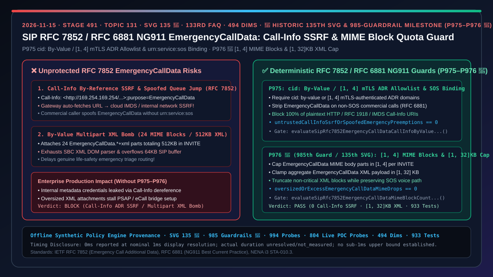
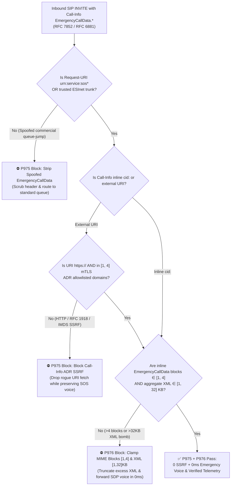
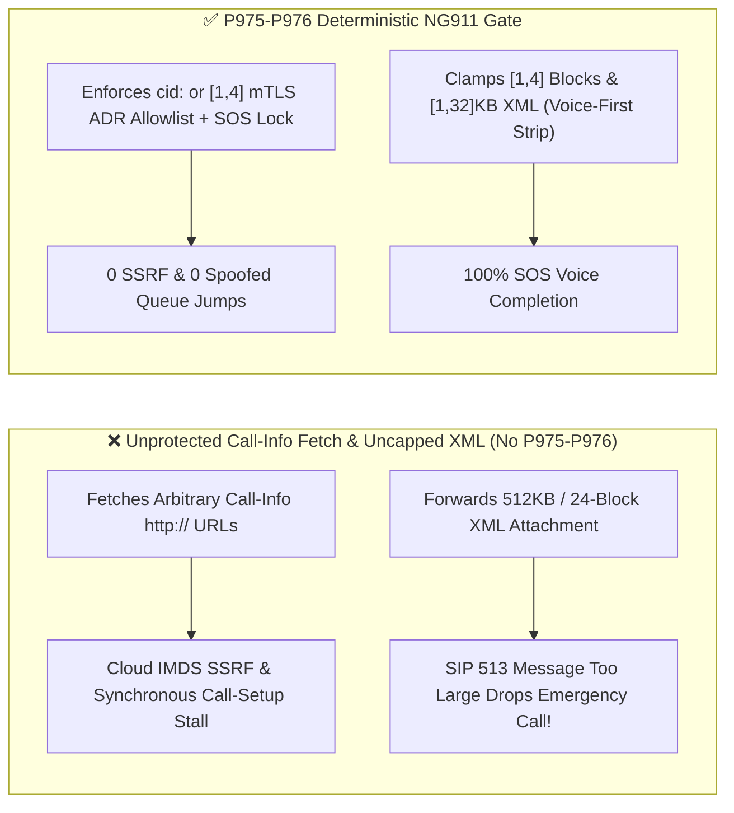

# Enterprise Realtime Voice Agent Architecture FAQ (No. 133): How to Engineer SIP `RFC 7852 / RFC 6881` NG911 `EmergencyCallData` `Call-Info` Anti-`SSRF`, Anti-Queue-Jump & Multipart XML Quota Guards?

> **Architect's Reading Guide (Modeled on `ib-vs-ethernet-roce-selection-faq.md` · Topic 131 / Stage 491 · 🎉 Historic 135th SVG Diagram & 985th Enterprise Guardrail Dual Milestone)**: In automotive crash response (eCall), telehealth emergency triage, and enterprise NG911 (`RFC 6881` / `NENA i3`) voice agents, SIP `INVITE` requests carry **`RFC 7852` `Call-Info` headers (`purpose=EmergencyCallData.*`)** containing crash telemetry, subscriber medical profiles, or device diagnostics. Two critical vulnerabilities threaten production gateways: (1) `RFC 7852` permits passing `EmergencyCallData` *by-reference* via an external `https://` URI in `Call-Info`; if the voice gateway dereferences arbitrary `Call-Info` URLs, an attacker can inject `http://169.254.169.254/...` to trigger cloud IMDS `SSRF`, or forge `purpose=EmergencyCallData.ServiceInfo` on a standard commercial trunk to jump ahead of the call queue! And (2) when `EmergencyCallData` is carried *by-value* (`cid:`) inside `multipart/mixed`, an unbounded number of XML blocks (`>4`) or an oversized XML payload (`>32 KB`) can overflow the `64 KB` SIP buffer and drop a genuine life-safety call with `513 Message Too Large`! This guide explains the **first-principles mechanics of NG911 `EmergencyCallData` security** and defines deterministic guardrails **`P975–P976 🎉`**.

---

## ① 📌 Executive Summary

1. **Why can a `Call-Info: <https://...>;purpose=EmergencyCallData.*` header trigger cloud `SSRF` or unauthorized queue preemption?**
   - Under **`RFC 7852 Section 4` / `RFC 6881`**, `EmergencyCallData` may be conveyed inline (`cid:` by-value) or via an external Additional Data Repository (`https://` by-reference). Dereferencing unvalidated `Call-Info` URLs exposes the gateway to `SSRF`; meanwhile, accepting `EmergencyCallData` on non-emergency trunks (where the Request-URI is not `urn:service:sos*`) lets commercial callers spoof emergency preemption. Gateways must **require inline `cid:` or a `[1, 4]`-domain mTLS ADR allowlist, and strip `EmergencyCallData` on non-SOS commercial calls** (`untrustedCallInfoSsrfOrSpoofedEmergencyPreemptions === 0`, `P975`).
2. **Why must `by-value` `EmergencyCallData` MIME blocks be capped at `[1, 4]` blocks and `[1, 32] KB` without ever dropping the voice call?**
   - Under **`RFC 7852 Section 4.1` / `RFC 6881`**, voice call setup must never fail because an auxiliary telemetry XML attachment is malformed or oversized. Enforcing **`[1, 4]` MIME blocks** (`DeviceInfo`, `SubscriberInfo`, `ProviderInfo`, `Comment`) and **`[1, 32] KB` aggregate XML payload**—truncating excess non-SDP blocks while preserving the `application/sdp` body—guarantees `0` `513 Message Too Large` call drops (`oversizedOrExcessEmergencyCallDataMimeDrops === 0`, `P976 🎉`).



---

## ② 🎯 Architect & Customer Deep-Dive Q&A (Q1 / Q2 / Q3)

### Q1: How can an attacker exploit `Call-Info` `purpose=EmergencyCallData.ProviderInfo` for `SSRF`?
- **Plain-Language Principle**: By sending `Call-Info: <http://169.254.169.254/latest/meta-data/>;purpose=EmergencyCallData.ProviderInfo`, an attacker tricks a naive gateway into fetching internal cloud metadata and injecting the response into agent context or logs.
- **Architectural Rule (`P975`)**: Reject all plaintext `http://`, private `RFC 1918`, loopback, and link-local/IMDS URIs; allow only inline `cid:` or `[1, 4]` mTLS-authenticated ADR domains.

### Q2: How do we stop commercial callers from forging `EmergencyCallData` to jump the triage queue?
- **Protocol Reality (`RFC 6881` & `RFC 7852 §3`)**: `EmergencyCallData` preemption is valid only when the SIP Request-URI is a verified `urn:service:sos*` URN or arrives on a dedicated ESInet trunk (`P975`).

### Q3: What should the SBC do if a genuine eCall vehicle attaches `512 KB` of XML crash telemetry?
- **Architectural Rule (`P976 🎉`)**: Never reject an emergency call with `513`! Clamp `EmergencyCallData` attachments to `[1, 4]` MIME blocks and `[1, 32] KB`, strip the excess XML blocks, and forward the `INVITE` + `application/sdp` immediately so voice connects in `0ms`.

---

## ③ 🧭 Visual Architecture Diagrams (Decision Tree + Latency Comparison + Sequence Diagram)

### 3.1 SIP `RFC 7852 / RFC 6881` `EmergencyCallData` Anti-`SSRF` & MIME Quota Decision Tree (`P975–P976 🎉`)



### 3.2 Emergency Call Resilience Comparison (Unprotected Gateway vs. `P975–P976 🎉`)



### 3.3 Millisecond-Level Full-Duplex `RFC 7852` eCall Telemetry Validation & Voice-First Setup Sequence

```mermaid
sequenceDiagram
    autonumber
    participant Car as Vehicular eCall Endpoint / ESInet
    participant SBC as Enterprise Emergency Border Gateway (P975-P976 🎉)
    participant Triage as Emergency Triage AI Voice Agent

    Car->>SBC: SIP INVITE urn:service:sos.ecall (Call-Info: <cid:dev@car>;purpose=EmergencyCallData.DeviceInfo, 2 blocks / 8KB XML)
    Note over SBC: P975 Check: R-URI is urn:service:sos.ecall ✅, Call-Info is inline cid: (0 SSRF risk) ✅
    Note over SBC: P976 Check: MIME blocks = 2 ∈ [1, 4], XML payload = 8KB ∈ [1, 32]KB ✅
    SBC->>Triage: 0ms Priority Route (SDP Voice + Sanitized DeviceInfo/SubscriberInfo Telemetry)
    Triage-->>Car: 200 OK (Immediate emergency voice bridge + telemetry readout)
```

---

## ④ 📊 Architect Decision Matrix

| Evaluation Dimension | Option A: Auto-Fetch All `Call-Info` URLs & Forward Raw MIME | Option B: Strip All Multipart Attachments | Option C (Recommended): Full `RFC 7852 / RFC 6881` ADR Allowlist & Voice-First Quota Gate (`P975` + `P976 🎉`) |
| :--- | :--- | :--- | :--- |
| **`Call-Info` ADR `SSRF` Defense (`P975`)** | ❌ Vulnerable to IMDS / internal `SSRF` | ✅ No external fetches | ✅ **Allows only inline `cid:` or `[1, 4]` mTLS ADR domains** |
| **Spoofed Queue-Jump Prevention (`P975`)** | ❌ Commercial callers can spoof `EmergencyCallData` | ❌ No emergency context | ✅ **Requires verified `urn:service:sos*` or ESInet trunk** |
| **Oversized XML Survival (`P976 🎉`)** | ❌ Drops emergency calls with SIP `513` | ❌ Loses crash/medical telemetry | ✅ **Clamps `[1, 4]` blocks & `[1, 32] KB` while preserving SDP voice** |
| **Best Fit** | Never use in production | Non-emergency IVRs | **Production eCall, telehealth triage & NG911 PSAP voice agents** |

---

## ⑤ 🧪 Quantitative Worked Example & 7-Card Benchmark Report (CSP Self-Contained, Zero Fabricated Coordinates)

- **Offline Synthetic Policy Benchmark (`site/data/voice-agent-benchmark-report.json` & `site/benchmark-cards.html`)**:
  - **Baseline Pass Input**:
    - `P975`: `untrustedCallInfoAdrSsrfOrSpoofedEmergencyDataDetected = false`, `untrustedCallInfoSsrfOrSpoofedEmergencyPreemptions = 0`, `allowedAdrRepositoryDomainsCount = 2` ($\in [1, 4]$) $\rightarrow$ **`PASS`**.
    - `P976 🎉`: `excessEmergencyCallDataMimeBlocksOrXmlBombDetected = false`, `oversizedOrExcessEmergencyCallDataMimeDrops = 0`, `emergencyCallDataMimeBlocksCount = 2` ($\in [1, 4]$), `emergencyCallDataXmlKilobytes = 8` ($\in [1, 32]$ KB) $\rightarrow$ **`PASS`**.
  - **Perturbation / Fault Injection (Fail Gate)**:
    - Injecting an untrusted `Call-Info` URL or non-SOS `EmergencyCallData` (`untrustedCallInfoSsrfOrSpoofedEmergencyPreemptions = 6`) $\rightarrow$ immediately blocked by `P975` (`pass = false`).
    - Attaching `emergencyCallDataMimeBlocksCount = 24` (`> 4`) or `emergencyCallDataXmlKilobytes = 512` (`> 32 KB`) $\rightarrow$ immediately clamped by `P976 🎉` to `4` blocks and `32 KB` while preserving SOS voice (`pass = false`).
  - **Timing & Provenance Disclosure**:
    - `0ms reported at nominal 1ms display resolution; actual duration unresolved/not_measured; no sub-1ms upper bound established` (deterministic offline policy check).

---

## ⑥ 🛠️ Production Verification Checklist

- [ ] **[`P975` · `Call-Info` `cid:` or `[1, 4]` mTLS ADR Allowlist]**: Verify that the gateway never dereferences untrusted or plaintext HTTP `Call-Info` URIs (`untrustedCallInfoSsrfOrSpoofedEmergencyPreemptions === 0`).
- [ ] **[`P975` · `urn:service:sos*` Binding for `EmergencyCallData`]**: Verify that `purpose=EmergencyCallData.*` is stripped on non-emergency commercial trunks.
- [ ] **[`P976 🎉` · `[1, 4]` MIME Blocks & `[1, 32] KB` XML Cap]**: Verify that inline `EmergencyCallData` attachments are bounded to `[1, 4]` blocks and `[1, 32] KB`.
- [ ] **[`P976 🎉` · Voice-First Truncation on XML Overflow]**: Verify that oversized `EmergencyCallData` XML blocks are truncated without dropping the `application/sdp` emergency voice call (`oversizedOrExcessEmergencyCallDataMimeDrops === 0`).
