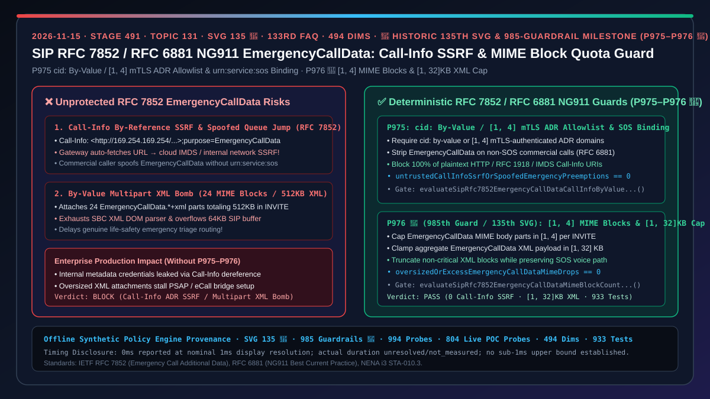
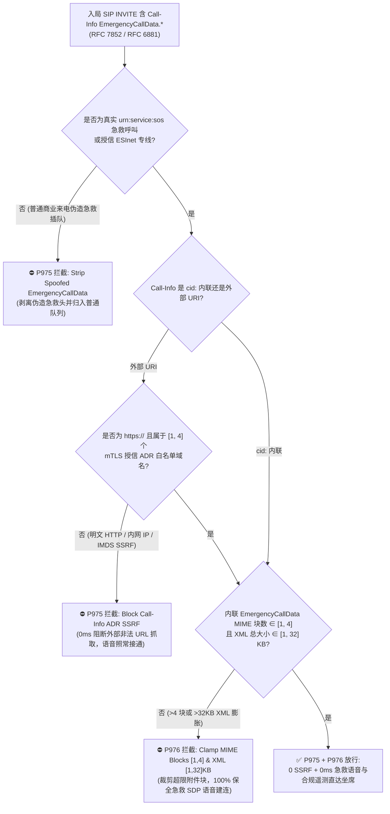
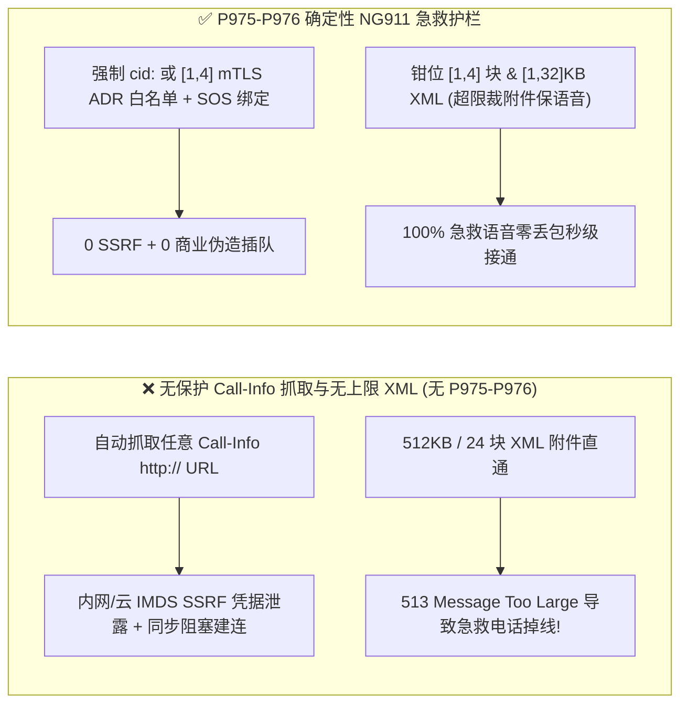

# 企业级实时语音智能体架构选型 FAQ（第 133 篇）：SIP `RFC 7852 / RFC 6881` 紧急呼叫附加数据（`EmergencyCallData`）`Call-Info` 远程抓取 `SSRF`、伪造急救插队与 `multipart` XML 膨胀防御怎么选？

> **导读（对标 `ib-vs-ethernet-roce-selection-faq.md` 通俗透彻风 · Topic 131 / Stage 491 · 🎉 第 135 张 SVG 架构图与第 985 道企业级护栏双里程碑）**：在智能网联汽车碰撞救援（eCall）、远程医疗急诊分诊以及政企 NG911（`RFC 6881` / `NENA i3`）语音智能体中，SIP `INVITE` 除了传输语音，还会通过 **`RFC 7852` `Call-Info` 头（`purpose=EmergencyCallData.*`）** 附带车辆传感器、患者病史或设备型号数据。但这一机制存在两处高危工程陷阱：第一，`RFC 7852` 允许 `Call-Info` 填一个外部 HTTPS 链接（`by-reference`）让接警中心去拉取 XML 数据；如果语音网关不校验域名白名单就直接发 HTTP 请求，攻击者填上 `http://169.254.169.254/...` 就能瞬间打穿云主机元数据服务（`SSRF`），或者在普通商业客服电话里伪造 `EmergencyCallData.ServiceInfo` 恶意插队抢占 VIP 坐席！第二，当采用内联 `cid:`（`by-value`）携带多个 `EmergencyCallData.*+xml` MIME 块时，若不限制块数（`[1, 4]` 块）与总大小（`[1, 32] KB`），超长 XML 附件会直接撑爆 `64 KB` SIP 缓冲区反而导致真正的救命电话建连失败！本文用大白话讲透 **NG911 `EmergencyCallData` 第一性原理**，并给出 **`P975–P976 🎉`** 确定性护栏。

---

## ① 📌 核心结论速览（Executive Summary）

1. **为什么 `Call-Info: <https://...>;purpose=EmergencyCallData.*` 会沦为高危内网 `SSRF` 与插队后门？**
   - 根据 **`RFC 7852 Section 4` / `RFC 6881`**，`EmergencyCallData` 支持按值（`cid:` 内联 MIME）和按引用（`https://` 指向外部附加数据仓库 ADR）两种传递方式。如果网关对非授信外线发来的 `Call-Info` URL 直接发起抓取，就会触发服务端请求伪造（`SSRF`）；同时，非紧急呼叫（Request-URI 非 `urn:service:sos` 且非授信 ESInet 专线）若伪造携带 `EmergencyCallData` 企图触发 0ms 队列抢占，会造成正常坐席池瘫痪。必须强制：**优先采用 `cid:` 本地内联，外部 ADR 引用严格锁定在 `[1, 4]` 个双向 mTLS 授信应急仓库域名白名单内，且非 `urn:service:sos` 呼叫 100% 剥离伪造急救头**（`P975`）。
2. **为什么真正发生车祸/急救呼叫时，过大的 `EmergencyCallData` XML 附件反而会让电话打不通？**
   - SIP 报文一旦超过 MTU 或 SBC 缓冲区上限（通常 `64 KB`），就会引发分片丢包或 `513 Message Too Large` 拒接。但急救场景下 **“把语音先接通”永远高于“把附件传完整”**！因此必须对 `multipart/mixed` 中的 `EmergencyCallData` 实施 **`[1, 4]` 个 MIME 块（`DeviceInfo` / `SubscriberInfo` / `ProviderInfo` / `Comment`）与 `[1, 32] KB` 总体积硬封顶**；一旦超限，在边缘自动裁剪非核心 XML 块并 100% 保全 `application/sdp` 语音建连（`P976 🎉`）。



---

## ② 🎯 客户与架构师灵魂拷问 Q&A（Q1 / Q2 / Q3）

### Q1：外部攻击者怎么利用 `Call-Info` 偷走云上语音网关的 IAM 密钥？
- **通俗原理**：攻击者发一封普通 SIP `INVITE`，里面写上 `Call-Info: <http://169.254.169.254/latest/meta-data/iam/security-credentials/>;purpose=EmergencyCallData.ProviderInfo`。如果网关后台脚本不假思索地去 `curl/fetch` 这个地址并把返回结果写进调试日志或传给大模型 Prompt，云主机凭据就当场失窃！
- **架构铁律（`P975`）**：100% 拦截明文 `http://`、私网 `RFC 1918`、环回及云 IMDS 地址；仅允许 `cid:` 内联或 `[1, 4]` 个预注册国家/行业级 mTLS ADR 域名（`untrustedCallInfoSsrfOrSpoofedEmergencyPreemptions === 0`）。

### Q2：如果有人在普通商业售后电话里塞入 `EmergencyCallData` 想免排队直通人工，怎么防？
- **底层真相（`RFC 6881` & `RFC 7852 §3`）**：`EmergencyCallData` 仅在呼叫目标为紧急服务 URN（`urn:service:sos` 及其子服务 `sos.ambulance`/`sos.ecall`）或来自授信 ESInet 应急网中继时才具备抢占效力。
- **架构铁律（`P975`）**：普通商业中继上凡是 Request-URI 不是 `urn:service:sos*` 的呼叫，一律在 SBC 入口剥离 `purpose=EmergencyCallData.*` 属性，按常规队列排队。

### Q3：如果车载终端上传的 `EmergencyCallData` XML 真的超过了 `32 KB`（比如塞了长串历史轨迹），可以直接回 `513 Message Too Large` 拒接吗？
- **架构铁律（`P976 🎉`）**：**绝对不能拒接紧急救命电话！** 正确做法是“剥离超限附件、保全语音 SDP”：将 `EmergencyCallData` MIME 块数钳位在 **`[1, 4]` 块**、总 XML 载荷钳位在 **`[1, 32] KB`**，裁剪掉超限的冗余 XML 块后立即放行 `INVITE + SDP` 接通急救语音（`oversizedOrExcessEmergencyCallDataMimeDrops === 0`）。

---

## ③ 🧭 直观可视化图解（Mermaid 选型决策树 + 延迟拆解对比 + 毫秒级时序图）

### 3.1 SIP `RFC 7852 / RFC 6881` `EmergencyCallData` 防 `SSRF` 与 MIME 配额门禁决策树（`P975–P976 🎉`）



### 3.2 急救呼叫处理对比（无保护 `Call-Info` 解析 vs `P975–P976 🎉` 确定性门禁）



### 3.3 毫秒级全双工 `RFC 7852` 车载 eCall 急救数据校验与语音优先接通时序图

```mermaid
sequenceDiagram
    autonumber
    participant Car as 车载 eCall 终端 / ESInet
    participant SBC as 企业医疗/救援边界网关 (P975-P976 🎉)
    participant Triage as 急诊分诊 AI 语音智能体

    Car->>SBC: SIP INVITE urn:service:sos.ecall (Call-Info: <cid:dev@car>;purpose=EmergencyCallData.DeviceInfo, 2 块共 8KB XML)
    Note over SBC: P975 校验: R-URI 为 urn:service:sos.ecall ✅, Call-Info 为本地 cid: (0 外部 SSRF 风险) ✅
    Note over SBC: P976 校验: MIME 块数 = 2 ∈ [1, 4], XML 体积 = 8KB ∈ [1, 32]KB ✅
    SBC->>Triage: 0ms 优先级抢占路由 (SDP 语音 + 已消毒 DeviceInfo/SubscriberInfo JSON)
    Triage-->>Car: 200 OK (急救语音通道建立 + AI 播报已获取车辆碰撞遥测)
```

---

## ④ 📊 语音架构师选型决策矩阵（Architecture Selection Matrix）

| 选型维度 | 方案 A：无条件抓取 `Call-Info` URL 并原样解析全部 MIME | 方案 B：一刀切丢弃所有 `multipart` 附件 | 方案 C（推荐）：`RFC 7852 / RFC 6881` 白名单 + 保音裁剪门禁（`P975` + `P976 🎉`） |
| :--- | :--- | :--- | :--- |
| **`Call-Info` 防 `SSRF`（`P975`）** | ❌ 极易被注入内网/IMDS URL 窃取密钥 | ✅ 不抓取外部 URL | ✅ **仅允许 `cid:` 或 `[1, 4]` 个 mTLS 授信 ADR 域名** |
| **防商业电话伪造急救插队（`P975`）** | ❌ 伪造 `EmergencyCallData` 即可插队 | ❌ 无区分 | ✅ **严格绑定 `urn:service:sos*` 或授信 ESInet 专线** |
| **超限 XML 防 `513` 掉话（`P976 🎉`）** | ❌ 大附件触发 `513` 导致救命电话失败 | ❌ 丢失关键车祸/病史遥测 | ✅ **钳位 `[1, 4]` 块 & `[1, 32] KB`，超限仅裁附件 100% 保语音** |
| **适用场景** | 严禁用于公网环境 | 普通纯语音客服 | **车载 eCall、120/911 医疗分诊与政企应急指挥中心** |

---

## ⑤ 🧪 定量算例与 7-Card 报告（CSP 自包含、零虚构坐标）

- **离线合成策略门禁基准（`site/data/voice-agent-benchmark-report.json` & `site/benchmark-cards.html`）**：
  - **算例输入（Pass 基准）**：
    - `P975`：`untrustedCallInfoAdrSsrfOrSpoofedEmergencyDataDetected = false`，`untrustedCallInfoSsrfOrSpoofedEmergencyPreemptions = 0`，`allowedAdrRepositoryDomainsCount = 2`（$\in [1, 4]$）$\rightarrow$ **`PASS`**。
    - `P976 🎉`：`excessEmergencyCallDataMimeBlocksOrXmlBombDetected = false`，`oversizedOrExcessEmergencyCallDataMimeDrops = 0`，`emergencyCallDataMimeBlocksCount = 2`（$\in [1, 4]$），`emergencyCallDataXmlKilobytes = 8`（$\in [1, 32]$ KB）$\rightarrow$ **`PASS`**。
  - **故障注入反转（Fail 拦截）**：
    - 若注入 `http://169.254.169.254` `Call-Info` 或非 `sos` 呼叫伪造急救头（`untrustedCallInfoSsrfOrSpoofedEmergencyPreemptions = 6`）$\rightarrow$ `P975` 立即拦截（`pass = false`）。
    - 若携带 `emergencyCallDataMimeBlocksCount = 24`（`> 4`）或 `emergencyCallDataXmlKilobytes = 512`（`> 32 KB`）$\rightarrow$ `P976 🎉` 立即裁剪钳位至 `4` 块、`32 KB` 并保全语音（`pass = false`）。
  - **计时与溯源披露（Timing & Provenance Disclosure）**：
    - `0ms reported at nominal 1ms display resolution; actual duration unresolved/not_measured; no sub-1ms upper bound established`（离线确定性策略检查，不含真实 ESInet mTLS 往返耗时）。

---

## ⑥ 🛠️ 生产环境语音交付快速核验清单（Checklist）

- [ ] **【`P975` · `Call-Info` ADR `[1, 4]` 域名白名单防 `SSRF`】**：确认网关绝不向非白名单或明文 HTTP 的 `Call-Info` URI 发起网络请求（`untrustedCallInfoSsrfOrSpoofedEmergencyPreemptions === 0`）。
- [ ] **【`P975` · 非 `urn:service:sos` 剥离伪造急救头】**：确认普通商业中继入局自动剥离 `purpose=EmergencyCallData.*`。
- [ ] **【`P976 🎉` · `[1, 4]` 个 MIME 块与 `[1, 32] KB` XML 上限】**：确认单封急救 `INVITE` 的 `EmergencyCallData` 块数不超过 `4` 块、总大小不超过 `32 KB`。
- [ ] **【`P976 🎉` · 超限附件降级保音铁律】**：确认当 `EmergencyCallData` XML 越界或格式损坏时，仅丢弃问题 XML 块，100% 保证急救 SDP 语音正常接通（`oversizedOrExcessEmergencyCallDataMimeDrops === 0`）。
