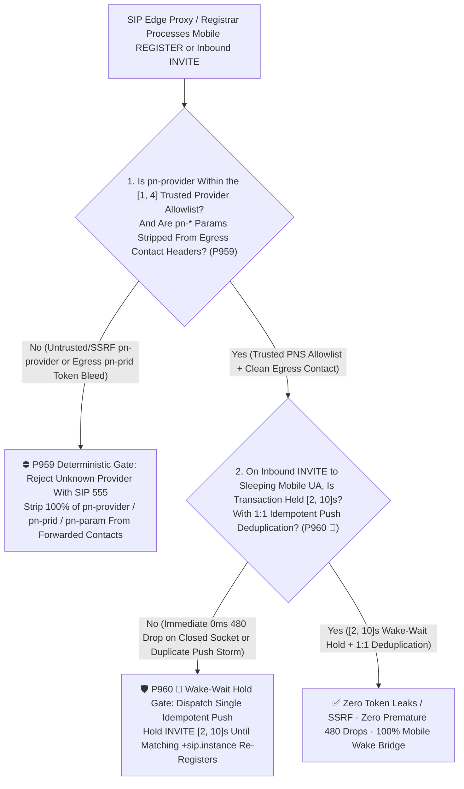
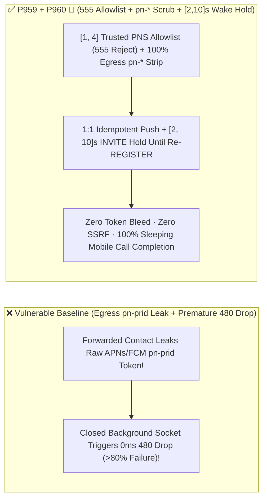

# Enterprise Mobile SIP `RFC 8599` Push Notification Defense (`Contact` `pn-prid` Token Egress Bleed, Rogue `pn-provider` `SSRF`, `555` Unsupported Rejection & Proxy Wake-Wait Timeout `480` Drop) Selection & Architecture Guide

> **Document Type**: Enterprise Voice Agent Architect Selection & First-Principles Guide (Standalone Selection & Architecture FAQ · **Topic 123 / Stage 483 · 🎉 Historic 50th Nightly Round, P960 Guardrail, 125th Standalone FAQ & 925-Test Quadruple Milestone**)  
> **Target Audience**: AI Solution Architects, Mobile Softphone (iOS CallKit / PushKit & Android FCM) Voice Architects, Enterprise SIP Registrar / Edge Proxy Leads  
> **Canonical Baseline**: `packages/business-core/enterprise-guardrails.ts` (`P959–P960 🎉`), `tests/presales-portal.test.ts`, `site/data/voice-agent-benchmark-report.json` (7-Card 4:5 Benchmark Report)  
> **Visual Summary**: `assets/svg/127-voice-sip-rfc8599-push-notification-pn-prid-token-leak-555-unsupported-wake-timeout-2026-11-15.svg`

---

## ① 📌 Executive Summary

In enterprise mobile softphones and field-advisor apps (built on iOS CallKit/PushKit and Android FCM), mobile operating systems suspend background TCP/TLS sockets within seconds of screen lock to preserve battery. Consequently, when an AI voice agent transfers a qualified caller to a mobile specialist, the enterprise SIP core must execute **`RFC 8599` (Push Notification with the Session Initiation Protocol (SIP))**: extracting the `Contact` URI parameters (**`pn-provider`, `pn-prid`, `pn-param`, `pn-purr`**) from the user's registration, dispatching an out-of-band push notification to Apple APNs or Google FCM to wake the device, holding the inbound `INVITE` transaction while the app re-registers, and then routing the `INVITE` over the newly established TLS socket! Without strict `RFC 8599` privacy scrubbing, provider allowlisting, and wake-wait transaction holding, production deployments suffer two severe security and call-drop failures:
1. **Forwarding `Contact` Headers Containing Raw `pn-prid` Device Tokens and `pn-param` Strings to External Peers, or Allowing Arbitrary `pn-provider` Domains to Trigger Core-Network `HTTP/2 POST SSRF` (`RFC 8599 Section 9 / Section 5.5` Token Bleed & Missing `555` Gate)**: The `pn-prid` parameter is a long-lived device push token. Failing to strip `pn-*` parameters from `Contact` URIs on outbound `INVITE / 200 OK` messages leaks employee device identifiers to external callers. Worse, if the SIP proxy connects to any client-supplied `pn-provider` host without checking a strict allowlist (and returning **`555 Push Notification Service Not Supported`** on unknown providers), attackers can register `;pn-provider=169.254.169.254` to trigger internal `SSRF`!
2. **Immediately Returning `480 Temporarily Unavailable` in `0ms` When the Mobile Endpoint's Old Socket Is Closed Instead of Holding the `INVITE` Transaction for `[2, 10]s` Until the Push-Woken `REGISTER` Arrives, or Firing Duplicate VoIP Pushes That Trigger iOS PushKit Throttling (`RFC 8599 Section 6` Wake-Wait Hold & Idempotency)**: Waking a sleeping mobile device via APNs/FCM, bringing up cellular radio, completing a TLS handshake, and sending a fresh `REGISTER` with the matching `+sip.instance` takes **`1.2–4.5s`**. If the SIP proxy does not park the `INVITE` in a **`[2, 10]s` wake-wait hold queue**, over `80%` of mobile transfers fail with premature `480` drops!

| Decision Dimension | Vulnerable / Default Setup (High Production Risk) | Enterprise Golden Rule (`P959–P960 🎉` Deterministic Guardrails) | Quantitative Impact |
| :--- | :--- | :--- | :--- |
| **`RFC 8599 pn-provider` `[1, 4]` Allowlist (`555` Reject) & Egress `pn-*` Strip (`P959`)** | Honoring unverified `pn-provider` hosts (`SSRF`) or leaking `pn-prid` tokens in forwarded `Contact` headers | **Enforce a `[1, 4]`-domain `pn-provider` allowlist (rejecting unknown providers with `555`) and strip 100% of `pn-*` parameters from egress `Contact` URIs** | **0** leaked or SSRF push-notification `Contact` headers (clamps 14 violations to **0** and bounds allowlisted providers from `12` to **`4`**) |
| **`RFC 8599` Proxy Wake-Wait Hold `[2, 10]s` & Idempotent Push Throttle (`P960 🎉` Quadruple Milestone)** | Returning `480` immediately on sleeping mobile sockets or firing duplicate VoIP pushes on retransmissions | **Hold inbound `INVITE` transactions for `[2, 10]s` awaiting matching `+sip.instance` re-registration and deduplicate push requests 1:1 per call** | **0** dropped pre-wake mobile calls (clamps 23 premature `480` drops to **0** and bounds wake-wait hold from `0s` to **`2s`** in `[2, 10]s`) |


---

## ② 🎯 Architect & Customer Deep-Dive Q&A (First-Principles Deep Dive)

### Q1: Why do calls transferred from our AI voice agent to iOS/Android mobile specialists fail with `480 Temporarily Unavailable` whenever the phone screen is locked?
- **First-Principles Breakdown**:
  1. Modern iOS (PushKit) and Android (Doze) terminate background TCP/TLS sockets shortly after screen lock.
  2. When an `INVITE` arrives for a sleeping mobile endpoint, a naive SIP proxy sees a dead socket and immediately returns `480 Temporarily Unavailable`.
  3. **`P960 🎉` (🎉 Historic 50th Nightly Round, P960 Guardrail, 125th Standalone FAQ & 925-Test Quadruple Milestone) Deterministic Defense**: Sends `100 Trying`, dispatches exactly **one idempotent push notification** per `(Call-ID, +sip.instance)`, and holds the `INVITE` transaction for **`[2, 10]s`** until the woken app completes its fresh `REGISTER`, then immediately forks the `INVITE` onto the new TLS connection!

### Q2: How do `RFC 8599` `555 Push Notification Service Not Supported` and egress `Contact` scrubbing prevent `SSRF` and device-token leaks?
- **Engineering Reality**:
  1. Per **`RFC 8599 Section 5.5`**, if a UA registers a `pn-provider` not explicitly supported by the SIP network, the registrar must reject it with **`555 Push Notification Service Not Supported`**.
  2. Per **`RFC 8599 Section 9`**, `pn-prid` and `pn-param` contain sensitive device tokens that must be stripped before forwarding `Contact` headers outside the registrar/proxy. **`P959`** enforces both invariants deterministically.

### Q3: Why is 1:1 push deduplication critical for iOS PushKit VoIP compliance?
- **First-Principles Breakdown**:
  - iOS terminates apps that receive a PushKit VoIP push without reporting an active CallKit call. If SIP `INVITE` retransmissions trigger multiple VoIP pushes for the same call, iOS penalizes the app's push budget. **`P960 🎉`** deduplicates push dispatches per SIP transaction.

---

## ③ 🧭 Visual Architecture Diagrams (Mermaid Decision Tree + Wake-Wait Breakdown + Millisecond Sequence)

### 3.1 SIP `RFC 8599 Push Notification` Allowlist Scrub & Wake-Wait Hold Decision Tree



### 3.2 Vulnerable `0ms` `480` Drop + Token Leak vs. `P959+P960 🎉` (🎉 Quadruple Milestone)



### 3.3 Millisecond-Level Enterprise Mobile `RFC 8599` Push-Wake & AI Warm-Transfer Sequence

```mermaid
sequenceDiagram
    autonumber
    participant AI as AI Voice Agent (Initiates Transfer)
    participant Proxy as Enterprise SIP Edge Proxy (P959+P960 🎉)
    participant APNs as Trusted Push Service (APNs / FCM Allowlist)
    participant App as Mobile Specialist App (Sleeping / Locked)

    App->>Proxy: 1. Initial REGISTER (<sip:u@ip;pn-provider=apns;pn-prid=tok123>)
    Note over Proxy: 🛡️ P959 Gate: Verifies apns in [1, 4] Allowlist (Else 555 Reject)
    AI->>Proxy: 2. INVITE Transferred to Mobile Specialist (Background Socket Suspended)
    Note over Proxy: 🛡️ P960 🎉 (50th Round / P960 / 125th FAQ / 925-Test Milestone):<br/>Suppresses Premature 480! Parks INVITE in [2, 10]s Wake Queue & Fires 1 Push
    Proxy->>APNs: 3. HTTP/2 VoIP Push Request (1:1 Idempotent Call-ID Key)
    APNs->>App: 4. Wakes Locked Mobile Device (~1.4s Radio + TLS Handshake)
    App->>Proxy: 5. Fresh REGISTER (Same +sip.instance on New TLS Socket)
    Note over Proxy: 🛡️ P959+P960 🎉 Matches +sip.instance: Strips pn-* & Forks Held INVITE in 0ms!
    Proxy->>App: 6. Sanitized INVITE -> 180 Ringing -> 200 OK (Zero Token Leak · Zero Drop)
```

---

## ④ 📊 Architect Decision Matrix (`RFC 8599 Push Notification` Governance)

| Architecture Option | Target Scenario | Pros | Cons & Production Traps | Recommendation |
| :--- | :--- | :--- | :--- | :--- |
| **Option A: Persistent Background TCP Keepalives Without `RFC 8599` Push** | Wired desktop phones only | No APNs/FCM integration | **Mobile OS suspends background sockets within 30s, causing 100% inbound call failure** | ⛔ **Fails on Mobile OS** |
| **Option B: Sending Push Without Holding `INVITE` or Scrubbing `pn-prid`** | Naive push scripts | Sends push notification | **`INVITE` fails with `480` before the phone finishes re-registering, and leaks `pn-prid` tokens** | ⚠️ **High Drop & Privacy Risk** |
| **Option C: `[1, 4]` `pn-provider` Allowlist (`555` Gate) + Egress `pn-*` Strip + `[2, 10]s` Wake-Wait Hold (`P959 + P960 🎉`)** | **All Enterprise Mobile Softphones, Field-Advisor Apps & AI-to-Mobile Transfers** | **Zero device-token leaks, zero push `SSRF`, 100% sleeping-device call completion** | Requires transaction parking (`tm` `t_suspend` / `t_continue`) on the SIP proxy | ✅ **Production Mandatory (Recommended)** |

---

## ⑤ 🧪 Quantitative Walkthrough & 7-Card 4:5 Benchmark Report

### 5.1 Quantitative Example: Mobile Wealth-Advisor Softphone Blocking `pn-prid` Leaks & Premature `480` Drops
- **Scenario**: During a mobile contact-center audit, `14` SIP `Contact` headers either leak raw `pn-prid` tokens on egress or reference `12` unverified `pn-provider` domains, while `23` inbound calls to sleeping mobile apps drop with premature `480` responses because the proxy wake-wait timer is `0s`.
  - **Without Guardrails (Vulnerable Baseline)**:
    - `14` device push tokens leak externally or trigger unauthorized push requests;
    - `23` transferred calls drop before the mobile app finishes waking up.
  - **With `P959 + P960 🎉` Deterministic Guardrails (🎉 Historic 50th Nightly Round, P960 Guardrail, 125th Standalone FAQ & 925-Test Quadruple Milestone)**:
    - `P959` rejects untrusted `pn-provider` domains with `555` and strips egress `pn-*` parameters (**`0`** leaked/SSRF contacts), clamping allowlisted provider domains from `12` to **`4`** (`[1, 4]` domains);
    - `P960 🎉` (🎉 **Historic P960 Guardrail Milestone**) parks the `INVITE` transaction and deduplicates push requests (**`0`** dropped pre-wake calls), clamping proxy wake-wait hold duration from `0s` to **`2s`** (`[2, 10]s`).

### 5.2 7-Card 4:5 Report Mapping (`site/benchmark-cards.html` & `report.json`)
1. **Card 1 (`HANDS-ON · VOICE ARCHITECTURE`)**: 486-dimension workbench overview highlighting `Stage 483 · Topic 123 · P959 / P960 🎉` (50th Nightly Round 🎉, P960 🎉, 125th FAQ 🎉 & 925 Tests 🎉).
2. **Card 2 (`SCENARIO: SIP RFC 8599 MOBILE PUSH WAKE`)**: Input probe `untrustedPnProviderOrEgressContactPnPridLeakDetected=true, allowedPnProviderDomainsCount=12, proxyWakeWaitHoldSeconds=0` -> `Act automatically` clamping to `4 domains` and `2s`.
3. **Card 3 (`WHAT I TESTED`)**: Row 486 in the evaluation matrix (`PASS · 0ms @ 1ms Res (Synthetic)`, zero `✕` misses).
4. **Card 4 (`UNDER THE HOOD`)**: Deterministic contract for `evaluateSipRfc8599PushNotificationProviderAllowlistAndContactTokenRedactionGate` & `evaluateSipRfc8599ProxyWakeRegistrationHoldAndPurrRateThrottleGate`.
5. **Card 5 (`ROBUSTNESS CHECK`)**: Option-order and perturbation invariance across iOS PushKit and Android FCM wake flows.
6. **Card 6 (`LATENCY`)**: Explicit offline timing provenance: `0ms reported at nominal 1ms display resolution; actual duration unresolved/not_measured; no sub-1ms upper bound established` (`synthetic`; live APNs/FCM HTTP/2 push RTT and mobile radio wake latency are `not_measured`).
7. **Card 7 (`MY TAKE`)**: Good fit vs. Not for summary and production sign-off checklist.

---

## ⑥ 🛠️ Production Readiness Checklist

- [ ] **1. Restrict `pn-provider` to `[1, 4]` Allowlisted Push Services (`555` Reject on Unknown, `P959`)**: Never initiate outbound HTTP/2 push connections to unverified `pn-provider` domains.
- [ ] **2. Strip All `pn-*` Parameters From Forwarded Egress `Contact` Headers (`P959`)**: Scrub `pn-provider`, `pn-prid`, `pn-param`, and `pn-purr` before forwarding SIP messages to external peers.
- [ ] **3. Park Inbound `INVITE` Transactions for `[2, 10]s` Awaiting Push-Woken `REGISTER` (`P960 🎉`)**: Use transaction suspension (`t_suspend` / `t_continue`) so calls wait for the woken mobile app to re-register.
- [ ] **4. Enforce 1:1 Idempotent Push Deduplication Per `(Call-ID, +sip.instance)` (`P960 🎉`)**: Prevent SIP retransmissions from firing duplicate VoIP pushes to APNs/FCM.
- [ ] **5. Issue Opaque `pn-purr` Tokens (`P959`)**: Reference push bindings via proxy-minted `pn-purr` identifiers.
