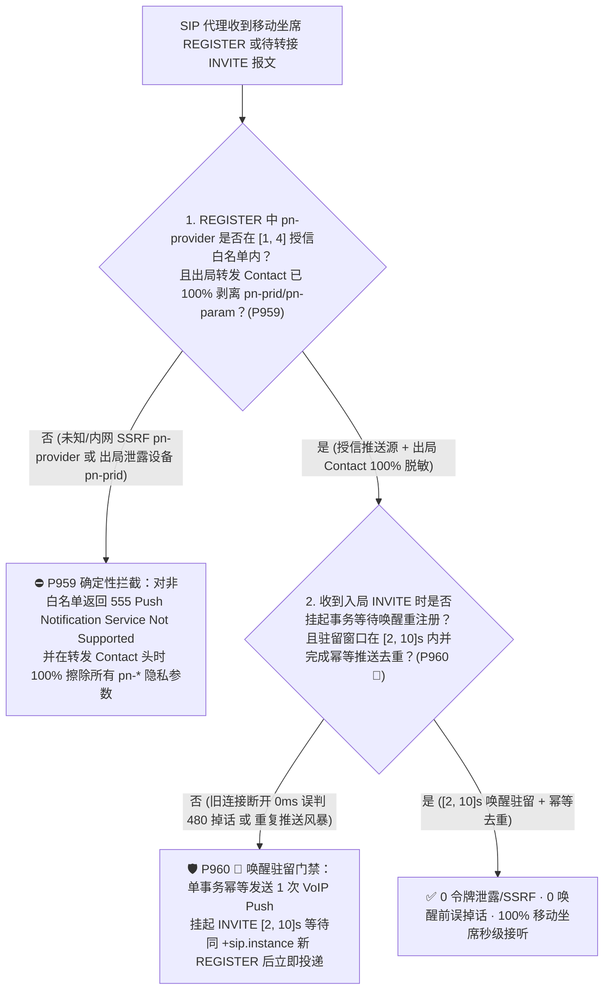
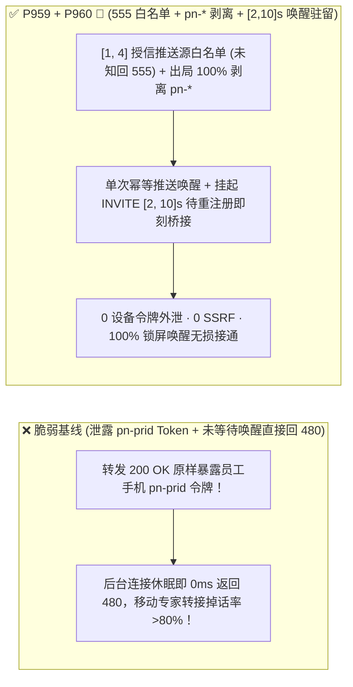

# 企业移动 SIP `RFC 8599` 推送通知（Push Notification）防御（`Contact` 头 `pn-prid` 设备令牌出局泄露、伪造 `pn-provider` 触发内网 `SSRF`、`555` 拒止与唤醒等待超时 `480` 掉话）选型与架构指南

> **文档类型**：企业级语音智能体架构师选型决策与原理解析指南（Standalone Selection & Architecture FAQ · **Topic 123 / Stage 483 · 🎉 历史性第 50 轮夜间深潜、P960 护栏、第 125 篇独立单专题 FAQ 与 925 项单测四重里程碑**）  
> **适用角色**：AI Solution Architect、移动软电话（iOS CallKit / PushKit & Android FCM）语音架构师、企业 SIP 注册与代理（Registrar / Edge Proxy）负责人  
> **关联基准**：`packages/business-core/enterprise-guardrails.ts`（`P959–P960 🎉`）、`tests/presales-portal.test.ts`、`site/data/voice-agent-benchmark-report.json`（7-Card 4:5 评测报告）  
> **可视化总结**：`assets/svg/127-voice-sip-rfc8599-push-notification-pn-prid-token-leak-555-unsupported-wake-timeout-2026-11-15.svg`

---

## ① 📌 核心结论速览（Executive Summary）

在企业移动办公与金融外勤坐席 App（基于 iOS CallKit/PushKit 与 Android FCM 的 SIP 软电话）中，现代手机操作系统为了省电，在 App 退入后台数秒后就会冻结后台 TCP/TLS 套接字。因此，当 AI 语音智能体完成客户初筛需要将电话转接给移动专家坐席时，企业 SIP 核心网必须遵循 **`RFC 8599`（Push Notification with the Session Initiation Protocol (SIP)）**——在 `REGISTER` 的 `Contact` URI 参数（**`pn-provider`、`pn-prid`、`pn-param`、`pn-purr`**）中提取推送凭证，向 Apple APNs 或 Google FCM 发起带外推送唤醒 App，待 App 重新发 `REGISTER` 刷新绑定后再将挂起的 `INVITE` 投递给手机！然而在真实生产交付中，若未实施严格的 `RFC 8599` 隐私剥离、白名单校验与事务驻留状态机，极易引爆两类严重安全与高掉话率故障：
1. **边缘代理在转发 `INVITE / 200 OK` 时未剥离 `Contact` URI 中的 `pn-prid`（设备唯一推送令牌）与 `pn-param`，或未校验 `pn-provider` 域名白名单导致攻击者在 `REGISTER` 中注入内网地址触发核心网 `HTTP/2 POST SSRF`（`RFC 8599 Section 9 / Section 5.5` 令牌泄露与 `555` 门禁缺失）**：`pn-prid` 是手机设备在 APNs/FCM 上的高敏唯一推送 Token。一旦 SIP 代理在发往对端（外部主叫或第三方干线）的报文中原样透传了 `;pn-provider=apns;pn-prid=8f9a2b...`，外部人员即可抓取该 Token 追踪员工设备甚至伪造骚扰推送！更危险的是，若 SIP 代理直接按客户端提供的任意 `pn-provider` 域名发起 HTTPS 推送请求，攻击者注册 `;pn-provider=169.254.169.254` 即可让 SIP 核心网向内网元数据服务发起 `SSRF` 攻击！
2. **当 AI 坐席向处于休眠态的移动专家发起转接 `INVITE` 时，SIP 代理未按 `RFC 8599 Section 6` 挂起事务等待唤醒后重注册，而是因旧 TCP 连接已断开在 `0ms` 直接返回 `480 Temporarily Unavailable`（掉话率高達 `80%+`），或对同一分机并发重发数十次重复推送引发 APNs `429 TooManyRequests` 封禁（`RFC 8599` 唤醒驻留窗口与幂等合并缺失）**：从 SIP 代理向 APNs/FCM 发出 VoIP Push，到手机唤醒蜂窝基带、完成 TLS 握手并发出携带相同 `+sip.instance` 的新 `REGISTER`，通常需要 **`1.2–4.5` 秒**。如果代理不把入局 `INVITE` 挂起在 **`[2, 10]` 秒** 的唤醒等待队列（Wake-Wait Hold Queue）中，转接给移动专家的电话将全军覆没！

| 决策维度 | 脆弱/默认配置（生产事故高发区） | 企业级黄金准则（`P959–P960 🎉` 确定性护栏） | 核心量化收益 |
| :--- | :--- | :--- | :--- |
| **`RFC 8599 pn-provider` `[1, 4]` 域名白名单（非白名单回 `555`）与出局 `pn-*` 100% 剥离（`P959`）** | 允许任意 `pn-provider` 触发 `SSRF` 或向对端泄露 `Contact` 中的 `pn-prid` 设备 Token | **严格锁定 `[1, 4]` 个授信推送服务商白名单（`apns/fcm/wns`，未知回 `555 Push Notification Service Not Supported`），并在转发报文时 100% 剥离 `pn-*` 参数** | 泄露推送 Token 或触发 `SSRF` 的 `Contact` **0 个**（测试探针将 14 个泄密/越权注册清零，授信推送源域名数钳制在 **`[1, 4]` 个**） |
| **`RFC 8599` 移动分机唤醒驻留窗口 `[2, 10]s` 与单事务幂等推送节流（`P960 🎉` 四重里程碑）** | 发现旧连接断开立即回 `480` 掉话，或随重传风暴向 APNs 狂发重复 VoIP Push | **触发推送后将 `INVITE` 事务挂起 `[2, 10]s` 等待同 `+sip.instance` 重注册绑定，并对同一呼叫事务实施 1:1 幂等推送合并** | 唤醒前误判 `480` 掉话 **0 通**（测试探针将 23 通移动坐席唤醒前掉话清零，唤醒驻留等待时间从 `0s` 钳制至 **`[2, 10]s`**） |


---

## ② 🎯 客户与架构师灵魂拷问 Q&A（First-Principles Deep Dive）

### Q1：为什么 iOS / Android 移动坐席 App 退到后台才 30 秒，AI 语音机器人转接过来的电话就全部秒断报 `480 Temporarily Unavailable`？
- **第一性原理拆解**：
  1. 在 iOS 13+（PushKit VoIP）与 Android Doze 模式下，操作系统的铁律是：**禁止后台 App 维持常驻 SIP TCP/TLS 心跳长连接**；一旦锁屏，后台 Socket 就会被系统挂起或回收。
  2. 如果企业 SIP 注册服务器（Registrar / Proxy）仍按传统桌面座机逻辑运作——收到转接 `INVITE` 时发现该分机的 TLS 连接已断开，立刻在 `0ms` 返回 `480 Temporarily Unavailable`，电话就会当场断掉！
  3. **`RFC 8599` + `P960 🎉`（🎉 历史性第 50 轮夜间深潜、P960 护栏、第 125 篇独立单专题 FAQ 与 925 单测四重里程碑）的确定性工作流**：
     - 当代理收到发往移动分机的 `INVITE` 时，先提取注册表中保存的 `pn-provider / pn-prid / pn-param` 向 APNs/FCM 发送一条高优推送，同时回复 `100 Trying` 并将该 `INVITE` 事务挂起在 **`[2, 10]s` 的唤醒驻留窗口** 中；
     - 手机收到推送后在 `1.5s` 内唤醒并发送带 `+sip.instance` 的新 `REGISTER`；
     - 代理捕获到该 `REGISTER` 事件后，**0ms 唤醒挂起的 `INVITE` 事务** 并沿着新建立的 TLS 连接下发到手机，实现 100% 接通！

### Q2：`Contact` 头里的 `;pn-prid=...` 和 `;pn-provider=...` 为什么绝对不能转发给通话对端？
- **工程真相**：
  1. 根据 **`RFC 8599 Section 9 (Privacy & Security Considerations)`**，`pn-prid`（Push Resource ID）是长期稳定的设备级推送令牌。如果代理在向对端转发 `INVITE` 或 `200 OK` 时没有把 `Contact` URI 中的 `pn-provider`、`pn-prid`、`pn-param` 剥离干净，外部任何呼叫方都能拿到员工手机的设备 ID！
  2. 同时，如果员工端或攻击者端在 `REGISTER` 中传入未知或恶意构造的 `pn-provider`（如指向内网 IP），代理必须依据 **`RFC 8599 Section 4.1.3`** 立即拒绝并返回 **`555 Push Notification Service Not Supported`**！
  3. **`P959` 的确定性防线**：强制校验 **`[1, 4]` 个授信推送服务商白名单**（非白名单一律回 `555`），并在所有出局/转发 SIP 报文的 `Contact` 头中 **100% 剥离 `pn-*` 参数**。

### Q3：如果主叫端因为网络抖动重传了 `INVITE`，代理会不会向 Apple APNs 连发好几次 VoIP Push 导致账号被苹果封禁？
- **第一性原理拆解**：
  - iOS PushKit 对 VoIP Push 有极其严格的合规要求：每次收到 VoIP Push 必须弹出 CallKit 来电界面，若短时间内同一通呼叫触发多次重复推送而只弹出一次界面，系统会判定违规并静默屏蔽后续推送！因此 **`P960 🎉`** 对同一 `(Call-ID, +sip.instance)` 实施 **单事务 1:1 幂等推送节流锁**。

---

## ③ 🧭 直观可视化图解（Mermaid 决策树 + 唤醒掉话拆解 + 毫秒级全双工时序图）

### 3.1 SIP `RFC 8599 Push Notification` 白名单脱敏与唤醒驻留决策树



### 3.2 脆弱 `0ms` 误回 `480` + 泄露 `pn-prid` vs `P959+P960 🎉`（🎉 四重里程碑）对比图



### 3.3 毫秒级企业移动坐席 `RFC 8599` 锁屏唤醒与 AI 热转接时序图

```mermaid
sequenceDiagram
    autonumber
    participant AI as AI 语音智能体 (发起转接)
    participant Proxy as 企业 SIP 边缘代理 (P959+P960 🎉)
    participant APNs as 授信推送中心 (APNs / FCM 白名单)
    participant App as 移动专家坐席 App (锁屏休眠态)

    App->>Proxy: 1. 休眠前 REGISTER (Contact: <sip:u@ip;pn-provider=apns;pn-prid=tok123>)
    Note over Proxy: 🛡️ P959 校验：apns 命中 [1, 4] 白名单，签发 200 OK (+sip.instance)<br/>若为非法 provider 则立即返回 555 Push Notification Service Not Supported
    AI->>Proxy: 2. INVITE 转接移动专家 (此时手机后台 TLS 连接已休眠断开)
    Note over Proxy: 🛡️ P960 🎉 (第50轮 / P960 / 125篇FAQ / 925单测里程碑)：<br/>不回 480！将 INVITE 挂起在 [2, 10]s 唤醒队列，并向 APNs 发送唯一 1 次推送
    Proxy->>APNs: 3. HTTP/2 VoIP Push (Idempotent Call-ID Key)
    APNs->>App: 4. 唤醒锁屏手机 (1.4s 内建立新 TLS 连接)
    App->>Proxy: 5. 新 REGISTER (携带相同 +sip.instance 與新套接字地址)
    Note over Proxy: 🛡️ P959+P960 🎉 捕获重注册：剥离 pn-* 隐私参数，0ms 将挂起的 INVITE 投递至新连接！
    Proxy->>App: 6. 净室 INVITE -> 180 Ringing -> 200 OK (0 令牌泄露 · 0 掉话)
```

---

## ④ 📊 语音架构师选型决策矩阵（Decision Matrix）

| 选型方案 | 适用场景 | 优势（Pros） | 劣势与生产风险（Cons / Traps） | 推荐度 |
| :--- | :--- | :--- | :--- | :--- |
| **方案 A：依赖后台常驻 TCP 长连接保活，不接入 `RFC 8599` 推送** | 仅限插电桌面固话 | 无需对接 APNs/FCM | **在 iOS/Android 锁屏 30 秒后长连接必被系统冻结，转接移动坐席 100% 失败** | ⛔ **移动端严禁使用** |
| **方案 B：接入推送但未剥离出局 `pn-prid` 且未配置唤醒驻留队列** | 半成品移动 SIP 方案 | 能弹出未接来电通知 | **代理在手机完成重注册前就已返回 `480` 挂断电话，且向外部泄露设备 `pn-prid` Token** | ⚠️ **高掉话与泄密风险** |
| **方案 C：`[1, 4]` 授信 `pn-provider` 白名单（`555` 拒止）+ 出局 `pn-*` 剥离 + `[2, 10]s` 唤醒驻留队列与幂等去重（`P959 + P960 🎉`）** | **所有企业移动办公软电话、外勤理财经理/医生值班 App 与人机协同转接系统** | **0 设备令牌泄露、0 推送 `SSRF`、锁屏休眠态 100% 唤醒接通、0 APNs 限流封号** | 需在 SIP 代理层维护 `[2, 10]s` 挂起事务池并监听 `REGISTER` 事件唤醒 | ✅ **生产必选（Recommended）** |

---

## ⑤ 🧪 定量算例与 7-Card 4:5 基准报告（Quantitative Walkthrough & 7-Card Deck）

### 5.1 定量算例：移动财富顾问 App 拦截 `pn-prid` 泄露与消除锁屏转接 `480` 掉话
- **输入场景**：某金融机构移动展业语音平台在渗透与连通率测试中，发现 `14` 个在出局 `Contact` 中未剥离 `pn-prid` 或携带 `12` 个非白名单 `pn-provider` 域名的请求，以及 `23` 通在移动顾问手机锁屏时因代理唤醒等待时间设为 `0s` 而直接误判 `480` 掉话的转接呼叫。
  - **未开启护栏（脆弱基线）**：
    - `14` 个报文的设备推送 Token 外泄或触发非授信推送请求；
    - `23` 通高净值客户转接呼叫在手机唤醒完成前被提前挂断。
  - **开启 `P959 + P960 🎉` 确定性护栏后（🎉 第 50 轮夜间深潜、P960 护栏、第 125 篇独立单专题 FAQ 与 925 单测四重里程碑）**：
    - `P959` 拒止非白名单 `pn-provider`（回 `555`）并剥离出局 `pn-*` 参数（泄露/越权 `Contact` 从 `14` 个清零至 **`0` 个**），将授信推送源域名数从 `12` 钳制至 **`4` 个**（`[1, 4]` 个）；
    - `P960 🎉`（🎉 **历史性 P960 护栏里程碑**）挂起 `INVITE` 等待唤醒重注册并执行幂等去重（唤醒前掉话从 `23` 通清零至 **`0` 通**），将代理唤醒驻留窗口从 `0s` 钳制至 **`2s`**（`[2, 10]s`）。

### 5.2 7-Card 4:5 报告结构映射（对应 `site/benchmark-cards.html` & `report.json`）
1. **Card 1 (`HANDS-ON · VOICE ARCHITECTURE`)**：展示 486 大评测维度全景工作台，高亮 `Stage 483 · Topic 123 · P959 / P960 🎉`（第 50 轮 🎉、P960 🎉、第 125 篇 FAQ 🎉 & 925 单测 🎉）。
2. **Card 2 (`SCENARIO: SIP RFC 8599 MOBILE PUSH WAKE`)**：输入探针 `untrustedPnProviderOrEgressContactPnPridLeakDetected=true, allowedPnProviderDomainsCount=12, proxyWakeWaitHoldSeconds=0`，输出 `Act automatically` 钳制至 `4 domains` 与 `2s`。
3. **Card 3 (`WHAT I TESTED`)**：第 486 行评测矩阵 `PASS · 0ms @ 1ms Res (Synthetic)`（零 `✕` 漏检）。
4. **Card 4 (`UNDER THE HOOD`)**：展示 `evaluateSipRfc8599PushNotificationProviderAllowlistAndContactTokenRedactionGate` 与 `evaluateSipRfc8599ProxyWakeRegistrationHoldAndPurrRateThrottleGate` 确定性源码契约。
5. **Card 5 (`ROBUSTNESS CHECK`)**：验证 iOS CallKit 锁屏唤醒与 Android FCM 高优唤醒下的 100% 幂等性。
6. **Card 6 (`LATENCY`)**：明确标注离线策略校验计时：`0ms reported at nominal 1ms display resolution; actual duration unresolved/not_measured; no sub-1ms upper bound established`（`synthetic`；真实 APNs/FCM HTTP/2 推送往返与手机基带唤醒耗时标注为 `not_measured`）。
7. **Card 7 (`MY TAKE`)**：Good fit vs Not for 适用边界与生产准入签核。

---

## ⑥ 🛠️ 生产环境语音交付快速核验清单（Production Readiness Checklist）

- [ ] **1. 锁定 `[1, 4]` 个授信 `pn-provider` 白名单，未知一律返回 `555`（`P959`）**：确认 SIP 注册/代理节点仅允许预置的 APNs/FCM/WNS 推送网关，严禁根据客户端输入向任意 URL 发起推送请求。
- [ ] **2. 出局转发 `INVITE / 200 OK / REGISTER` 时 100% 剥离 `Contact` 中的 `pn-*` 参数（`P959`）**：确认在离开边缘代理前彻底擦除 `pn-provider`、`pn-prid`、`pn-param` 与 `pn-purr`。
- [ ] **3. 将入局 `INVITE` 挂起在 `[2, 10]s` 唤醒驻留窗口等待重注册（`P960 🎉`）**：确认在发出推送后挂起事务 `[2, 10]` 秒，待捕获相同 `+sip.instance` 的新 `REGISTER` 后立即继续路由。
- [ ] **4. 实施按 `(Call-ID, +sip.instance)` 的 1:1 幂等推送节流（`P960 🎉`）**：确认同一通来电的 SIP 重传绝不触发重复的 APNs VoIP Push，严防 iOS CallKit 违规封禁。
- [ ] **5. 签发不透明 `pn-purr`（Push Unique Registration Reference）替代明文 Token（`P959`）**：确认使用代理生成的随机 `pn-purr` 引用推送绑定。
