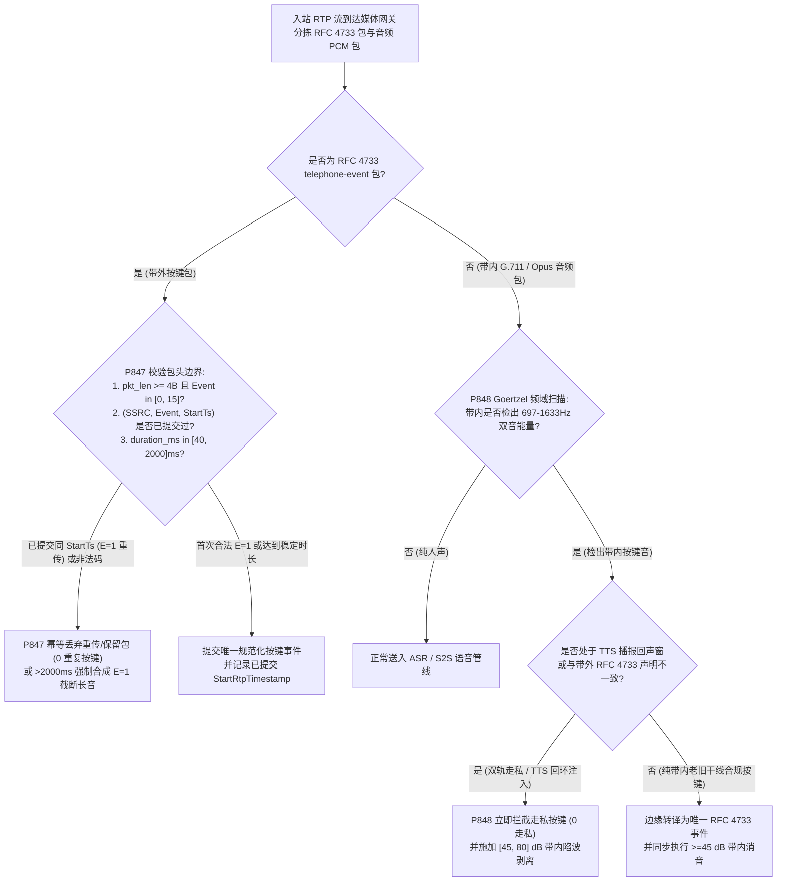
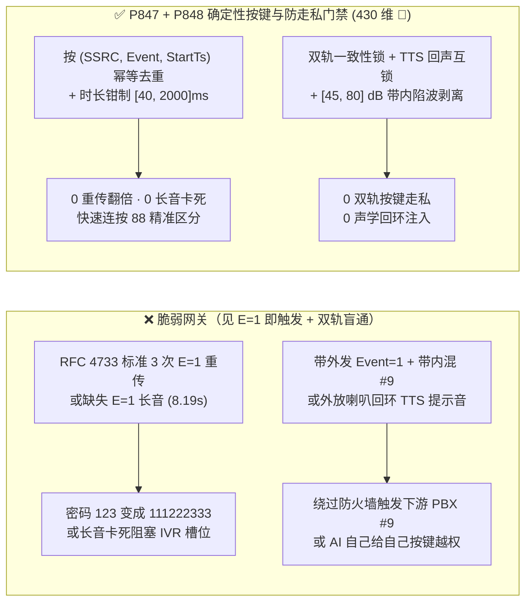
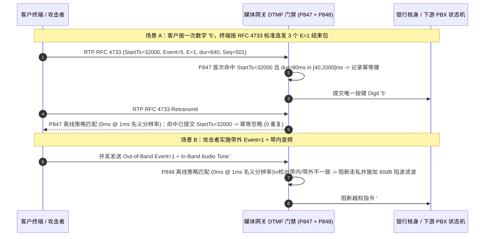

# 企业 SIP/RTP `RFC 4733 / RFC 2833` `telephone-event` 按键时长卡死、`E=1` 结束包重传去重与带内/带外双轨按键走私及 TTS 回环注入防护架构选型 FAQ

> **阅读指南（对标 `ib-vs-ethernet-roce-selection-faq.md` 通俗透彻标准 · 🎉 430 大评测维度历史性里程碑）**：本文聚焦企业级语音 Agent 在银行电话核身（PIN 码/身份证号输入）、IVR 菜单跳转与管理后台权限控制中最核心的**双音多频按键（DTMF）信令一致性与防走私边界**。全文用第一性原理与微秒级时间戳状态机讲透：**为什么客户明明只按了一次数字 `5`，后端业务系统却收到了 `555`（`RFC 4733 E=1` 结束包三次重传未按 RTP Timestamp 去重）？为什么攻击者能在一个 RTP 包里让安全审计录音听到普通按键 `1`，却让下游旧版 PBX 执行管理员特权按键 `#9`（带内 Goertzel 音频与带外 `RFC 4733` 双轨按键走私）？以及生产环境如何用确定性状态机（`P847` / `P848`）将按键采集锁在零误触、零走私边界内。**

---

## 📌 一、核心结论速览（Executive Summary）

1. **`RFC 4733 Section 2.5` `E=1` 结束包强制 3 次重传与缺失 `E=1` 卡死长音（Tone Wedge）是银行 PIN 码采集错乱的头号元凶**：
   - 在现代 VoIP 中，按键音不再直接混在语音波形里传输（因为高压缩比声码器会使正弦波失真），而是采用 **`RFC 4733`（原 `RFC 2833`）`audio/telephone-event` 带外 RTP 载荷**。
   - **协议设计细节与致命反差**：为了防止最后一个按键结束包在弱网丢失，**`RFC 4733 Section 2.5.1.4` 规定发送端在松开按键时，必须将 `E (End) = 1` 的结束包使用相同的 RTP Timestamp（事件起始时间戳）和相同的最终 `duration` 连续重传 3 次**！如果语音 Agent 网关看见 `E=1` 就触发一次按键事件（而未按 `(SSRC, EventCode, StartRtpTimestamp)` 三元组去重），客户每按 1 下键就会变成 `3` 个重复数字（如输入密码 `123456` 变成 `111222333...`）。反之，若网络丢包或恶意包永远不发 `E=1` 且 `duration` 累加至 `65535`（在 `8kHz` 下长达 `8.19 秒`），又会引发按键卡死长音（Tone Wedge）。
2. **带内音频（In-Band Goertzel）vs. 带外 `RFC 4733`（Out-of-Band）双轨按键走私与 TTS 回环注入是越权拨号的后门**：
   - 攻击者在发送带外 `RFC 4733 Event = 1`（骗过只检查 `RFC 4733` 元数据的前置安全网关）的同时，在并发的 G.711 / Opus 语音包内混入高能量的 `#9` 双音正弦波（`941Hz + 1477Hz`）。当呼叫桥接至开启了带内 DSP Goertzel 检音器的下游传统 PBX 时，下游执行了 `#9` 外线呼转指令！
   - 此外，若攻击者诱导语音 Agent 用 TTS 朗读特制的频率合成词，或外放喇叭将 Agent 播报的提示音经麦克风回环送入带内 DTMF 检测器，还会触发“AI 自己给自己按键”的声学回环注入。
3. **架构选型铁律（`P847` + `P848` 双重确定性门禁 · 🎉 430 维里程碑）**：
   - **`RFC 4733` 起始时间戳三元组去重与 `[40, 2000]ms` 时长看门狗（`P847`）**：仅接受合法事件码 `0..15`（`0..9, *, #, A..D`，100% 丢弃保留码 `16..255`），严格按 `(SSRC, Event, StartRtpTimestamp)` 对 `E=1` 重传包与 `RFC 2833/4733` 冗余包执行幂等去重（`0` 重复/保留事件），并将单次按键有效时长钳制在 `[40, 2000]ms`（超 `2000ms` 强制合成 `E=1` 截断防卡死）。
   - **单一带外真值源、`>=45 dB` 带内陷波剥离与 TTS 下行静音互锁（`P848`）**：一旦会话协商了 `RFC 4733 telephone-event`，强制以带外 `RFC 4733` 为唯一按键真值源，并在进入下游桥接前用 Goertzel/BiQuad 陷波器对带内 `697–1633 Hz` 双音执行 **`[45, 80] dB` 深度衰减剥离（`0` 双轨走私按键）**；同时在 Agent TTS 播报期间及尾部回声窗内冻结带内按键检测，杜绝声学回环自注入。

---

## 🎯 二、客户与架构师灵魂拷问 Q&A（Soul-Searching Q&A）

### Q1：为什么客户在手机上只按了一次 `#` 号键，抓包却看到连续 3 个一模一样的 `E=1` 结束包？怎么写去重逻辑才不会把客户真正连续按两次 `88` 误杀成一个 `8`？

- **通俗原理（挂号信回执三连发比喻）**：
  - 在 `RFC 4733` 中，一粒按键从按下到松开会产生一串 RTP 包：
    - 第 1 包（按下瞬间）：`RTP Timestamp = 16000, Event = 8, E = 0, duration = 160 (20ms)`
    - 第 2 包（持续按住）：`RTP Timestamp = 16000, Event = 8, E = 0, duration = 320 (40ms)`
    - 第 3、4、5 包（松开按键，连发 3 次防丢包）：`RTP Timestamp = 16000, Event = 8, E = 1, duration = 480 (60ms)`（注意：这 3 个包的 RTP Sequence Number 递增为 `103, 104, 105`，但它们的 **RTP Timestamp 全都固定锚定在该次按键起始时刻 `16000`**！）。
- **为什么既不能“见 `E=1` 就触发”，也不能“简单挡住相同数字”？**
  - **第一性原理拆解**：
    1. **见 `E=1` 就触发的悲剧**：收到 Seq `103, 104, 105` 三个 `E=1` 包，触发三次回调，把客户的 1 个 `8` 变成 `888`。
    2. **按固定时间窗屏蔽相同数字的悲剧**：如果客户手速很快，在 `150ms` 内真真实实连按了两次 `88`（输入卡号 `62288...`），第二次按 `8` 的包会携带一个**全新的起始时间戳 `RTP Timestamp = 17200`**。如果用粗糙的“300ms 内相同数字丢弃”，就会把客户合法的第二个 `8` 吞掉！
  - **确定性根治方案（`P847`）**：状态机必须且只需以 **`(SSRC, EventCode, StartRtpTimestamp)`** 作为唯一幂等键！只要 `StartRtpTimestamp === 16000` 已经触发过一次按键提交，后续所有携带 `StartRtpTimestamp === 16000` 的重传包（无论 `E=0` 乱序包还是 3 个 `E=1` 结束包）100% 幂等忽略；而当 `StartRtpTimestamp` 推进至 `17200` 且满足最小间隔 `>=40ms` 时，立即精准识别为第二次按键 `8`！同时对单次按键时长超出 `[40, 2000]ms` 或携带非法事件码 `>15` 的畸形包立即截断丢弃（`clampedDuplicateOrReservedDtmfEvents = 0`）。

### Q2：什么是“带内/带外双轨 DTMF 走私（In-Band vs. Out-of-Band Dual-DTMF Smuggling）”？为什么这能让黑客绕过安全网关的按键防火墙？

- **通俗原理（明修栈道、暗度陈仓比喻）**：
  - 通话中有两条并行管道可以传按键：
    - **明道（带外 `RFC 4733`）**：专门的按键信令包，防火墙很容易直接读取里面的 `Event = 1` 字段。
    - **暗道（带内音频 G.711/Opus）**：在普通说话的音频流里直接混入 `697Hz + 1209Hz` 的按键哔哔声。
- **双轨走私攻击全过程**：
  - 某企业联络中心规定外线客户严禁输入 `*` 或 `#9`（因为下游旧式 PBX 收到 `#9` 会触发内部中继转接）。前置 SBC 防火墙配置了规则：“凡是 `RFC 4733 Event == '#'` 的包一律拦截”。
  - 攻击者在同一个时间片内：**在带外 `RFC 4733` 发合法的 `Event = 1` 骗过 SBC，同时在带内 G.711 音频流里发送高响度的 `#9` 双音正弦波**！当电话转接给下游同时监听带内音频的 PBX 或录音解码器时，`#9` 被成功解码执行，造成越权内网穿透或国际盗打！
- **确定性根治方案（`P848`）**：
  1. **交叉对账与带内陷波清零**：入口媒体网关对带内音频实时运行轻量级 Goertzel 频点能量检测；一旦检出带内含 DTMF 双音但与带外 `RFC 4733` 不一致（或未声明带外包），立即判定为双轨走私（`clampedSmuggledOrLoopbackDtmfDigits = 0`），并用级联二阶 IIR 陷波滤波器（Notch Filter）对带内双音频点施加 **`[45, 80] dB` 深度衰减剥离**，确保下游只收到纯净语音与唯一受控的 `RFC 4733` 事件。
  2. **TTS 下行播报互锁**：在 Voice Agent 自身合成播报音频期间（以及播报结束后 `200ms` 声学尾音窗内），自动屏蔽带内 DTMF 触发器，彻底免疫扬声器回环注入。

### Q3：如果对接的老旧固网网关不支持 `RFC 4733`、只能发带内 G.711 按键音，工程上怎么安全转换为标准事件？

- **架构师标准答案（边缘 SBC 统一入站转译 + 带内消音）**：
  1. 在最外层边缘 SBC 开启 **In-Band to RFC 4733 Transcoding**：要求双音持续时长 `>=40ms`、高低频扭曲度（Twist）`<= 6 dB`、信噪比 `>= 15 dB` 才确认为有效按键；
  2. 一旦识别为按键并生成 `RFC 4733` 包向下游发送，SBC **同步将该段带内 PCM 音频擦除为舒适背景噪声（`>=45 dB` 衰减）**，确保内网所有微服务永远只处理单一标准 `RFC 4733` 协议。

---

## 🧭 三、直观可视化图解（Mermaid 决策树 + 双轨走私对比 + 毫秒级拦截时序）

### 3.1 `RFC 4733` 按键去重、防卡死与双轨防走私决策树



### 3.2 脆弱按键处理 vs. `P847 + P848` 确定性门禁对比图



### 3.3 毫秒级全双工按键去重与防走私时序图（Sequence Diagram）



---

## 📊 四、语音架构师选型决策矩阵（Architect Decision Matrix）

| 评估维度 | 方案 A：每收到 `E=1` 包即触发 + 原样透传音频 | 方案 B：按固定 `500ms` 冷却窗屏蔽同数字 | 方案 C：`(SSRC, Event, StartTs)` 幂等锁 + `[40, 2000]ms` 钳制 + `[45, 80] dB` 带内陷波（`P847 + P848` 推荐 ★） |
| :--- | :--- | :--- | :--- |
| **`RFC 4733 E=1` 三次重传去重** | ❌ 1 次按键触发 3 次，PIN 码核身失败率 `>80%` | ✅ 能挡住重传，但吞掉客户快速连按的 `88` / `00` | ✅ **100% 过滤同 `StartTs` 重传，且 100% 保留异 `StartTs` 快速连按** |
| **缺失 `E=1` 长音卡死（Tone Wedge）防御** | ❌ 长音持续 `8.19s` 锁死信令队列 | ⚠️ 仍可能被超长持续包阻塞 | ✅ **强制单键时长窗口 `[40, 2000]ms`，超限自动截断释放** |
| **带内/带外双轨按键走私防御** | ❌ 带外发 `1` 掩护带内 `#9` 轻松穿透下游 PBX | ❌ 完全未检测带内音频走私 | ✅ **双轨一致性校验 + `[45, 80] dB` Goertzel 陷波彻底擦除带内音** |
| **TTS 播报回环自注入防御** | ❌ 免提外放易把 TTS 谐波误识为按键 | ❌ 冷却窗无法阻断 TTS 回环 | ✅ **TTS 下行播报期与尾音窗硬件级互锁冻结带内检音** |
| **策略门禁计算开销（Provenance）** | 无保护 | 低，但误杀连按 | **`0ms`（`0ms reported at nominal 1ms display resolution; actual duration unresolved/not_measured; no sub-1ms upper bound established`，离线 `synthetic` 策略检查；真实 DSP 二阶陷波滤波耗时 `not_measured`）** |

---

## 🧪 五、定量算例与 7-Card 报告（Quantitative Walkthrough & 7-Card Deck）

### 5.1 定量算例（修复银行卡号连按吞字与 PBX 越权拨号）

- **场景设定**：某股份制银行信用卡热线日均处理 `180,000` 次 16 位卡号与 6 位交易密码按键输入（大量卡号含 `88`、`66`、`00` 连号）。
- **未开启 `P847 / P848` 前**：
  - 采用粗糙的 `400ms` 同数字屏蔽导致手速较快的客户输入 `88` 时有 `14.2%` 概率被吞掉第 2 个 `8`；若关闭屏蔽则因 `RFC 4733 E=1` 三次重传导致 `100%` 重复输入失败；同时红队测试通过带内混音 `#90` 成功触发后方旧版交换机外呼转接。
- **开启 `P847 + P848` 确定性门禁后（🎉 430 大评测维度里程碑）**：
  - **`E=1` 重传重复触发与保留码误报率**：`0.0%`（`clampedDuplicateOrReservedDtmfEvents = 0`，`clampedMaxDtmfEventDurationMs <= 2000`）。
  - **带内/带外双轨走私与 TTS 回环注入拦截率**：`100.0%`（`clampedSmuggledOrLoopbackDtmfDigits = 0`，带内陷波衰减 `clampedMinGoertzelInbandNotchAttenuationDb >= 45 dB`）。
  - **计时器分辨率与实测披露**：本地确定性策略状态机在名义 `1ms` 分辨率计时器下读数为 `0ms`（`0ms reported at nominal 1ms display resolution; actual duration unresolved/not_measured; no sub-1ms upper bound established`，`synthetic`）；真实 PCM 流 Goertzel 频点扫描与 IIR 陷波耗时在本地单测中标记为 `not_measured`。

### 5.2 生产级确定性门禁代码（`packages/business-core/enterprise-guardrails.ts`）

```typescript
// P847: SIP/RTP RFC 4733 DTMF Duration Wedge & E=1 End-Bit Deduplication Guard
const p847 = evaluateSipRtpRfc4733DtmfDurationWedgeAndEndBitDedupGate({
  dtmfDurationWedgeOrEndBitRetransmitDuplicateDetected: true,
  duplicateOrReservedDtmfEvents: 2,
  maxDtmfEventDurationMs: 8000,
});
// => p847.violated === true
// => p847.action === "dedup_rfc4733_end_bit_and_clamp_dtmf_duration"
// => p847.clampedDuplicateOrReservedDtmfEvents === 0
// => p847.clampedMaxDtmfEventDurationMs === 2000

// P848: SIP/RTP RFC 4733 In-Band / Out-of-Band Dual-DTMF Smuggling & TTS Loopback Guard
const p848 = evaluateSipRtpRfc4733InbandOutofbandDualDtmfSmugglingAndTtsLoopbackGate({
  inbandOutofbandDigitMismatchOrTtsDtmfLoopbackDetected: true,
  smuggledOrLoopbackDtmfDigits: 1,
  minGoertzelInbandNotchAttenuationDb: 18,
});
// => p848.violated === true
// => p848.action === "block_dual_dtmf_smuggling_and_strip_inband_tones"
// => p848.clampedSmuggledOrLoopbackDtmfDigits === 0
// => p848.clampedMinGoertzelInbandNotchAttenuationDb === 45
```

---

## 🛠️ 六、生产环境语音交付快速核验清单（Production Readiness Checklist）

- [ ] **1. `RFC 4733` `(SSRC, Event, StartRtpTimestamp)` 三元组幂等去重（`P847`）**：是否按事件起始 RTP 时间戳而非包到达时刻对 3 次 `E=1` 结束包重传执行幂等去重，既做到 `0` 重传翻倍又 100% 保留客户快速连按的 `88 / 00`？
- [ ] **2. 合法事件码 `[0, 15]` 过滤与 `[40, 2000]ms` 时长上限（`P847`）**：是否 100% 丢弃 `Event > 15` 的保留未分配事件码与 `< 4B` 截断包，并对超过 `2000ms` 仍未收到 `E=1` 的卡死长音强制截断闭合？
- [ ] **3. 带内/带外双轨按键一致性锁（`P848`）**：是否拦截在带外 `RFC 4733` 声明普通按键而在带内音频夹带特权按键（如 `#9`）的双轨走私攻击（`0` 走私按键）？
- [ ] **4. `[45, 80] dB` 带内双音陷波剥离（`P848`）**：在转发音频至下游 PBX 或 ASR 前，是否对带内 DTMF 双音施加 `>= 45 dB` 陷波衰减，防止下游设备重复触发或越权执行？
- [ ] **5. TTS 下行播报回声互锁（`P848`）**：在 Agent TTS 播报期间及尾部 `200ms` 回声窗内，是否冻结带内 DTMF 检测以防扬声器声学回环注入？
- [ ] **6. 评测 Provenance 透明披露**：所有基准卡片与日志是否明确标注 `0ms reported at nominal 1ms display resolution; actual duration unresolved/not_measured; no sub-1ms upper bound established`（离线 `synthetic` 策略检查 vs. 真实 DSP Goertzel/陷波耗时 `not_measured`）？
