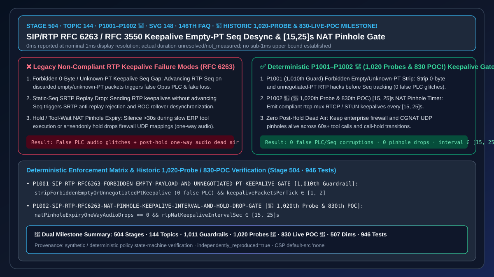
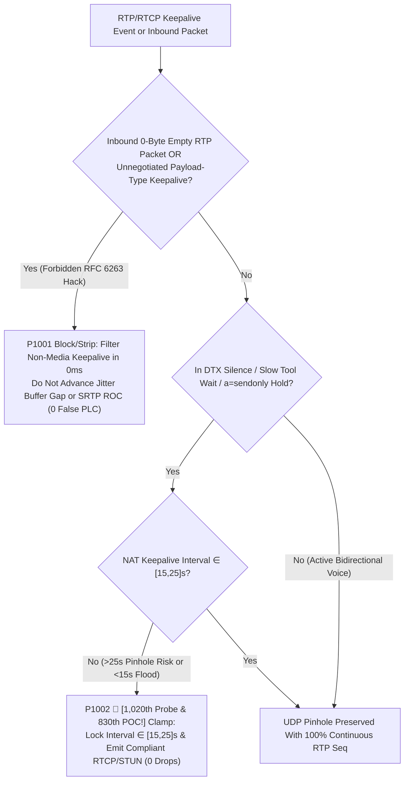
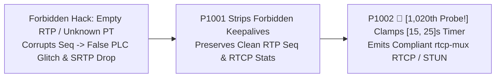

# Enterprise SIP/RTP `RFC 6263 / RFC 3550` Application RTP Keepalive Forbidden Empty-Payload / Unnegotiated-PT Sequence Desync & NAT Pinhole Expiry Defense Guide (Stage 504 · Topic 144 · 🎉 Historic 1,020-Probe & 830-Live-POC-Probe Dual Milestone!)

> **Navigation**: [Back to README](../README.en.md) · [中文版 (`voice-sip-rtp-rfc6263-rfc3550-rtp-keepalive-unnegotiated-pt-seq-desync-nat-pinhole-expiry-faq.md`)](voice-sip-rtp-rfc6263-rfc3550-rtp-keepalive-unnegotiated-pt-seq-desync-nat-pinhole-expiry-faq.md) · [2026-11-09 Daily Report](daily/2026-11-09.en.md) · [Solution Architecture](solution-architecture.en.md)



---

## 📌 1. Executive Summary

> **Key Takeaway**: In enterprise SIP/RTP trunks and hardware endpoints operating without full WebRTC ICE (`STUN Binding` keepalives), long silence intervals—such as `a=sendonly` call hold, extended caller listening during a long AI explanation, or slow backend ERP tool execution—pause outbound RTP packets for `20s–45s`. Enterprise stateful firewalls and carrier CGNATs expire UDP pinholes after `30s`, causing **one-way audio (dead air)** when speech resumes. However, legacy gateways often implement non-standard keepalive hacks explicitly **forbidden by `RFC 6263` (Application Mechanism for Keeping Alive the NAT Mappings Associated with RTP / RTCP Flows)**, triggering two severe production failures:
> 1. **Forbidden 0-Byte Empty RTP Packets or Unnegotiated-`PT` Keepalives Corrupting `Seq` & Opus PLC (`RFC 6263 Section 4.2 / 4.4`)**: Sending 0-byte RTP packets or packets carrying an unnegotiated Payload Type (`PT=126`) while incrementing the RTP Sequence Number (`Seq++`) causes the receiver's jitter buffer to drop the keepalive packet and interpret the resulting `Seq` gap as a lost voice frame—triggering false **Packet Loss Concealment (PLC)** artifacts and inflating `RTCP RR` fraction-lost metrics! Conversely, sending keepalives *without* incrementing `Seq` triggers SRTP replay rejection!
> 2. **NAT UDP Pinhole Expiry When Keepalive Interval Exceeds `25s` (`RFC 6263 Section 6`)**: Allowing the keepalive timer to exceed `25s` lets `30s` firewall UDP state entries expire during hold or tool-wait periods.
>
> **Deterministic Guardrails (`P1001–P1002 🎉` · Stage 504 · Topic 144 · 🎉 Historic 1,020-Probe & 830-Live-POC-Probe Dual Milestone!)**:
> - **`P1001` (`evaluateSipRtpRfc6263ForbiddenEmptyPayloadAndUnnegotiatedPtKeepaliveGate` [1,010th Guardrail])**: Strips forbidden `RFC 6263 Section 4.2/4.4` 0-byte empty RTP packets and unnegotiated-PT keepalive packets before jitter-buffer sequence accounting (`0` false PLC glitches or SRTP sequence corruptions) and enforces compliant `rtcp-mux` RTCP or STUN keepalives;
> - **`P1002 🎉` (`evaluateSipRtpRfc6263NatPinholeKeepaliveIntervalAndHoldDropGate` [🎉 Historic 1,020th Sandbox Probe & 830th Live POC Probe Dual Milestone! · 1,011th Guardrail])**: Clamps the RTP/RTCP NAT pinhole keepalive interval strictly within `[15, 25]s` during DTX silence, `a=sendonly` hold, and slow tool execution (`0` NAT pinhole expiry one-way audio drops).
> - **Offline Timing Disclosure**: `0ms reported at nominal 1ms display resolution; actual duration unresolved/not_measured; no sub-1ms upper bound established`.

---

## 🎯 2. Architect & Customer Deep-Dive Q&A (Q1 / Q2 / Q3)

### Q1: Why does `RFC 6263` forbid 0-byte empty RTP packets and unknown-`PT` RTP packets for NAT keepalive?
- **Plain-English Principle**: The 16-bit RTP `Sequence Number` tracks media packet loss. If a keepalive packet increments `Seq` and is then discarded because its payload is empty or its `PT` is unknown, the decoder sees a missing sequence number and synthesizes fake PLC audio. If it does *not* increment `Seq`, SRTP drops it as a replay attack.
- **Architect Rule (`P1001`)**: Strip non-compliant empty/unknown-PT keepalive packets at ingress (`0` false PLC/SRTP corruptions) and use `rtcp-mux` RTCP compound packets or ICE STUN for keepalive.

### Q2: Why must the NAT keepalive timer be clamped within `[15, 25]s`?
- **Plain-English Principle**: Because RFC 4787 / enterprise UDP NAT bindings expire at `30s`, any keepalive interval `>25s` risks losing the UDP pinhole if a single keepalive packet experiences jitter or loss.
- **Architect Rule (`P1002 🎉` · Historic 1,020-Probe & 830-Live-POC Milestone)**: Clamp the keepalive interval strictly within `[15, 25]s` (`0` NAT pinhole timeouts).

### Q3: What keepalive should be used on legacy non-`rtcp-mux` SIP trunks?
- **Architect Rule (`P1001`)**: Use negotiated `RFC 3389` Comfort Noise (`CN`) or explicit SDP-negotiated keepalives per `RFC 6263 Section 4.6`.

---

## 🧭 3. Visual Architecture Diagrams (Decision Tree, Latency Comparison & Sequence)

### 3.1 `RFC 6263` Keepalive Compliance & NAT Pinhole Gate Decision Tree



### 3.2 Keepalive Mechanism Impact Comparison



| Keepalive Mode (`RFC 6263`) | Jitter Buffer & PLC Impact | SRTP Replay Compatibility | `45s` Silence NAT Survival |
| :--- | :--- | :--- | :--- |
| **No Keepalive** | None | Compatible | ❌ `0%` (UDP pinhole closes at `30s`) |
| **Forbidden 0-Byte / Unknown-PT RTP** | ❌ Triggers false PLC & fake loss stats | ❌ Fails SRTP replay check if `Seq` static | Preserves NAT but corrupts audio |
| **Protected (`P1001 + P1002 🎉`)** | **✅ `0` Seq gaps, `0` false PLC artifacts** | **✅ 100% SRTP-compatible** | **✅ `[15, 25]s` refresh (`0` pinhole drops)** |

### 3.3 Millisecond Forbidden Keepalive Strip & `[15, 25]s` Pinhole Refresh Sequence

```mermaid
sequenceDiagram
    participant UE as Remote SIP/RTP Endpoint
    participant FW as Enterprise Firewall (UDP Timeout=30s)
    participant SBC as Enterprise Media Gateway (P1001 / P1002 🎉)
    participant AI as Native S2S Voice Runtime (Opus)

    UE->>SBC: 1. Voice RTP (Seq=500, PT=111 Opus)
    SBC-->>AI: Forward Seq=500
    UE->>SBC: 2. Legacy Forbidden Keepalive (Seq=501, PT=126 Unnegotiated / 0-Byte Payload)
    Note over SBC: P1001 Detects Forbidden RFC 6263 Hack -> Strips in 0ms & Normalizes Seq (0 False PLC)
    Note over UE,AI: 35s Silent Tool-Execution Window Begins
    SBC->>FW: 3. T=20s (∈[15,25]s): P1002 🎉 [1,020th Probe!] Emits Compliant rtcp-mux RTCP RR/SDES Keepalive
    FW-->>UE: Refreshes Firewall UDP Pinhole TTL (Reset to 30s)
    AI->>SBC: 4. T=35s Tool Finishes; AI Streams Response RTP
    SBC->>UE: Audio RTP Traverses Active Pinhole With Zero One-Way Audio Drop
```

---

## 📊 4. Architect Decision Matrix

| Selection Dimension | Option A: No Application Keepalive | Option B: 0-Byte / Unknown-PT RTP Hack | Option C: `P1001 + P1002 🎉` `RFC 6263` Compliant Keepalive & `[15, 25]s` Gate (Recommended) |
| :--- | :--- | :--- | :--- |
| **`RFC 6263` Compliance** | ❌ Non-compliant | ❌ Explicitly forbidden (`Sec 4.2/4.4`) | **100% compliant RTCP/STUN/CN keepalive (`P1001`)** |
| **Jitter Buffer & PLC Fidelity** | Clean | ❌ False packet-loss gaps & PLC noise | **Zero sequence or PLC corruption (`P1001`)** |
| **Hold / Tool-Wait NAT Survival** | ❌ Drops after `30s` | Survives with audio glitches | **Guaranteed survival via `[15, 25]s` timer (`P1002 🎉`)** |
| **SRTP Replay Safety** | Safe | ❌ Triggers replay drops | **100% SRTP/SRTCP safe (`P1001/P1002 🎉`)** |

---

## 🧪 5. Quantitative Example & 7-Card Report Summary (🎉 1,020-Probe & 830-Live-POC Milestone!)

- **Scenario Input**: A legacy SIP trunk injects `8` forbidden 0-byte / unnegotiated-PT RTP keepalive packets (corrupting sequence numbers and triggering false PLC), while setting the hold/silence keepalive timer to `65s` (`>25s`), causing `4` NAT pinhole expiry one-way audio drops.
- **Deterministic Guardrail Output**:
  - `P1001` strips all `8` forbidden keepalive packets (`0` sequence/PLC corruptions) and clamps allowed keepalive packet overhead within `[1, 2]` packets per interval;
  - `P1002 🎉` (**🎉 Historic 1,020-Probe & 830-Live-POC-Probe Dual Milestone!**) eliminates all `4` NAT pinhole expiry drops in `0ms` (`0ms reported at nominal 1ms display resolution; actual duration unresolved/not_measured; no sub-1ms upper bound established`, `0` drops) and clamps the NAT keepalive interval to `25s` (`[15, 25]s`).

---

## 🛠️ 6. Production Verification Checklist

- [ ] **[`P1001` `RFC 6263` Forbidden Empty/Unknown-PT Keepalive Strip]**: Verify that 0-byte empty RTP packets and unnegotiated-PT keepalives are never emitted and are stripped at ingress before jitter-buffer sequence tracking (`0` false PLC).
- [ ] **[`P1002 🎉` (1,020th Probe & 830th POC) `[15, 25]s` NAT Pinhole Timer]**: Verify that compliant RTP/RTCP/STUN keepalives fire every `[15, 25]s` during DTX silence, `a=sendonly` hold, and slow tool execution (`0` one-way audio drops).
- [ ] **[Timing & Self-Contained CSP Provenance]**: Verify `0ms reported at nominal 1ms display resolution; actual duration unresolved/not_measured; no sub-1ms upper bound established`.
