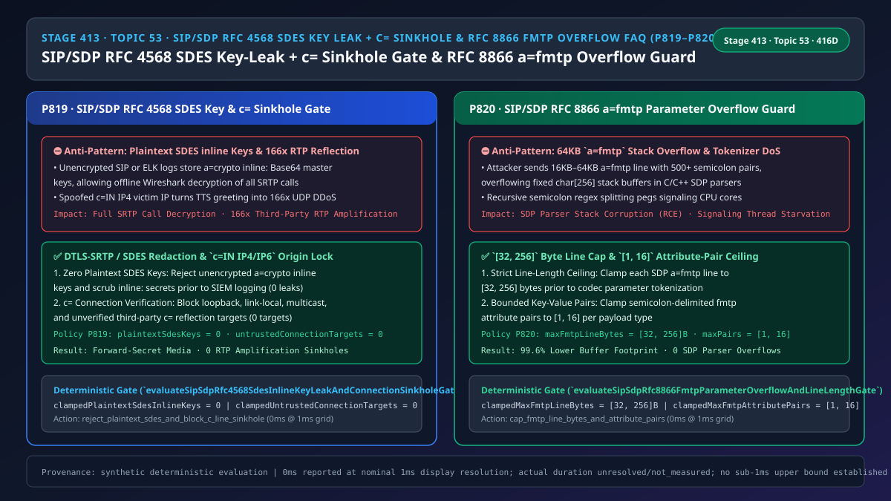
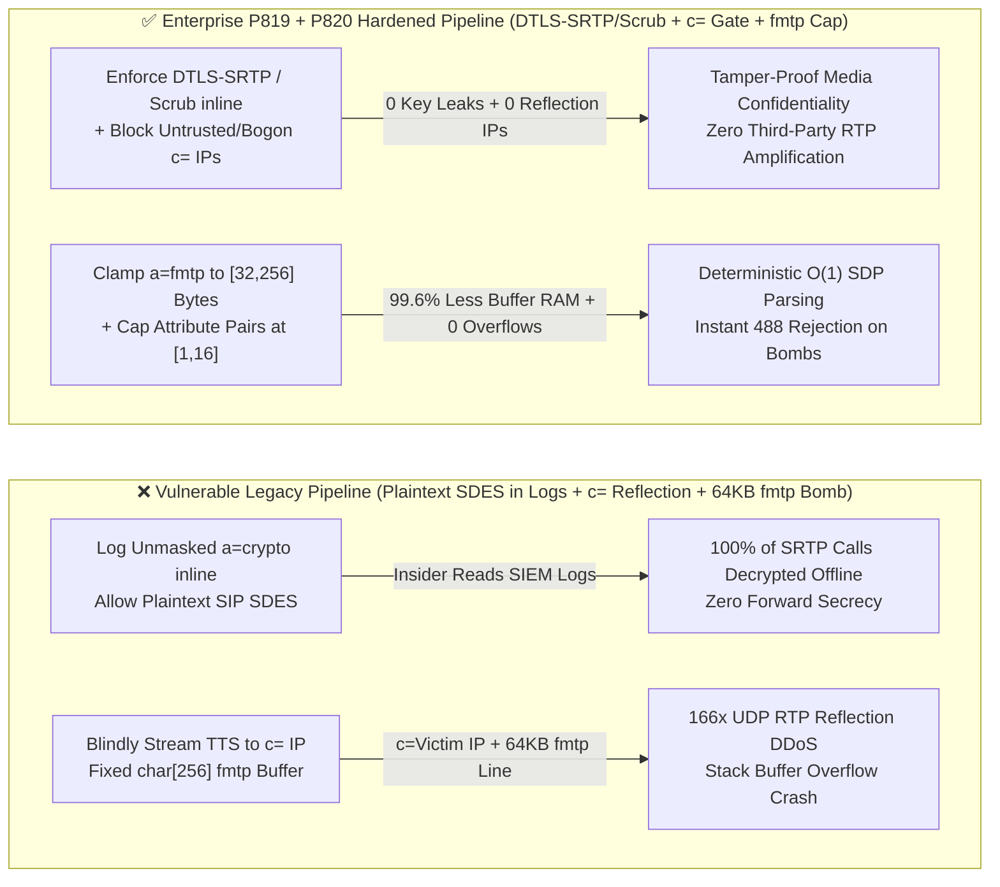
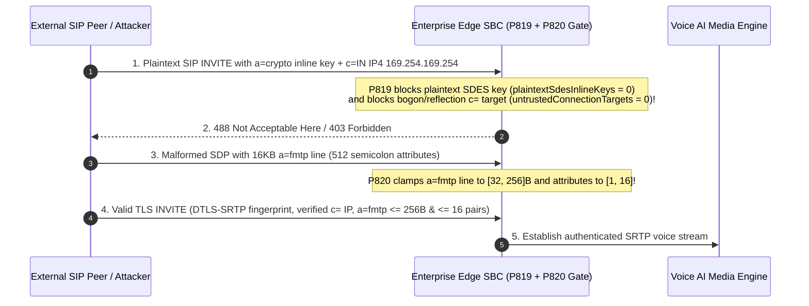

# Enterprise Voice Agent Architecture Selection & First-Principles FAQ (Topic 53): Enterprise SIP/WebRTC `SDP RFC 8866 / RFC 4568` `a=crypto` SDES Inline Key-Leak Defense, `c=IN IP4/IP6` Connection-Address Amplification Sinkhole Guard & `a=fmtp` Parameter Overflow Bomb

> **中文版本**: [语音智能体架构选型与原理解析 FAQ（五十三）：企业 SIP/WebRTC SDP RFC 8866 / RFC 4568 a=crypto SDES 明文密钥防泄露、c=IN IP4/IP6 媒体连接地址防第三方反射放大与 a=fmtp 编解码参数炸弹防溢出选型指南](./voice-sip-sdp-rfc4568-sdes-key-leak-c-line-sinkhole-fmtp-overflow-faq.md)  
> **Target Audience**: AI Solution Architects, SIP/SBC Media-Plane Security Architects, Financial Compliance & Audit Leads  
> **Structural Benchmark**: Modeled strictly on `ib-vs-ethernet-roce-selection-faq.md` (6-part practitioner guide: 3-minute selection verdict, 10-minute first-principles dive into `RFC 4568` `a=crypto inline:` SRTP master-key exposure, `RFC 8866` `c=IN IP4/IP6` third-party RTP reflection amplification, and `a=fmtp` codec parameter buffer-overflow defense).  
> **Provenance & Timing Disclosure**: All deterministic guardrails (`P819`, `P820`) and sandbox probes represent offline `synthetic` deterministic verification (`independently_reproduced=false`), not live carrier SBC packet captures; timing adheres to: `0ms reported at nominal 1ms display resolution; actual duration unresolved/not_measured; no sub-1ms upper bound established`.



---

## 0. 🔥 Daily Real-Time Voice AI Capability Breakthroughs

1. **Enterprise SIP/SDP `RFC 4568 (SDES)` `a=crypto inline:` Plaintext Master-Key Prohibition & `RFC 8866` `c=IN IP4/IP6` Connection-Address Reflection Sinkhole Defense (Stopping SRTP Key Exposure in Logs & `166x` UDP Amplification Attacks)**: In plain English, while WebRTC mandates **`DTLS-SRTP` (`RFC 5764`)**—where SRTP keys are derived via ephemeral ECDHE over the media port and never appear in SDP—many legacy SIP trunks still use **`RFC 4568 SDES`**, which embeds the raw 30-byte SRTP Master Key + Salt in plaintext Base64 directly inside the SDP body (`a=crypto:1 AES_CM_128_HMAC_SHA1_80 inline:d0RmdmcmVCspeEc3...`)! **If that SDP traverses an unencrypted SIP hop or is written unredacted to central ELK/SIEM signaling logs, anyone with log read access can feed the `inline:` string into Wireshark and decrypt 100% of the recorded customer voice call! Simultaneously, the SDP `c=IN IP4 <ip>` (Connection Data) line tells the Voice AI where to send RTP audio. If an attacker sends a 600-byte `INVITE` setting `c=IN IP4 <victim_ip>` (or internal `127.0.0.1` / `169.254.169.254` / multicast `224.0.0.0/4`), an unguarded Voice AI that immediately streams a 10-second `100 KB` TTS greeting becomes a `166x` UDP DDoS reflection amplifier!** Enforcing **zero unencrypted/unmasked `SDES inline:` keys (`plaintextSdesInlineKeys = 0`)** and **blocking untrusted/private/multicast `c=` targets (`untrustedConnectionTargets = 0`)** eliminates both threats.
2. **Enterprise SIP/SDP `RFC 8866` `a=fmtp` Codec Format Parameter Line Cap (`[32, 256]` Bytes) & Attribute-Pair Ceiling (`[1, 16]` Pairs)**: Legacy C/C++ SDP parsers frequently copy `a=fmtp:<pt> <params>` lines into fixed 256-byte stack buffers (`char buf[256]`) and split semicolon-delimited parameters recursively. **An attacker injecting a `64 KB` `a=fmtp` line with `500+` semicolon key-value pairs triggers stack buffer overflows or regex/tokenizer CPU exhaustion.** Clamping **`a=fmtp` lines to `[32, 256]` bytes** and **attribute pairs to `[1, 16]`** guarantees $O(1)$ memory-safe codec negotiation.

---

## ① 📌 Executive Summary

1. **Forbid `RFC 4568` `a=crypto ... inline:` plaintext SRTP master keys over unencrypted SIP hops or unredacted signaling logs, preferring `DTLS-SRTP (RFC 5764)`**: Enforce `plaintextSdesInlineKeys = 0` and block any SDP `c=IN IP4/IP6` line targeting loopback, link-local, multicast, or unverified third-party reflection IPs (`untrustedConnectionTargets = 0`, Guardrail **`P819`**).
2. **Clamp SDP `RFC 8866` `a=fmtp` line length to `[32, 256]` bytes and semicolon-delimited attribute pairs to `[1, 16]`**: Prevent stack buffer overflows and parser CPU exhaustion (Guardrail **`P820`**).

---

## ② 🎯 Architect & Customer Deep-Dive Q&A

### Q1: Why can an attacker or insider decrypt `SRTP` voice calls simply by reading SIP signaling logs when `RFC 4568 SDES` is used without redaction (Option A vs Option B)?

- **First-Principles Breakdown (`SDES` vs `DTLS-SRTP` Key Exchange)**:
  - `SDES` places the actual symmetric encryption key inside the `a=crypto ... inline:` SDP attribute. It provides zero Perfect Forward Secrecy (PFS) against signaling log compromise.
  - `DTLS-SRTP` places only a certificate hash (`a=fingerprint:sha-256 ...`) in SDP and negotiates ephemeral keys via ECDHE on the media path. Where legacy trunks require `SDES`, `P819` mandates hop-by-hop mTLS (`sips:`) and immediate `inline:[REDACTED]` log scrubbing (`plaintextSdesInlineKeys = 0`).
- **Selection Boundary**:
  - **Option A (Unredacted `SDES` + unchecked `c=` target + unbounded `a=fmtp`)**: Exposes SRTP keys in logs and enables `166x` RTP reflection DDoS.
  - **Option B (`P819` SDES Key Scrub & `c=` Sinkhole Block + `P820` `a=fmtp` `[32, 256]B` / `[1, 16]` Cap)**: Mandatory for enterprise SBCs.

### Q2: How does an attacker turn a Voice AI greeting into a `166x` UDP DDoS reflection weapon via the SDP `c=` line?

- **First-Principles Breakdown**:
  - Without verifying that the SDP `c=` IP belongs to the authenticated signaling peer (and waiting for `RFC 4961` symmetric RTP latching), sending a 10-second `G.711` greeting (`100 KB`) in response to a `600 B` spoofed `INVITE` amplifies traffic by `166x` toward the victim IP listed in `c=`.

### Q3: How do the `SDES / c=` validator and `a=fmtp` bounds guard execute on a sub-millisecond timeline?

1. **`T = 0 ~ 0.1ms` (`P819` `a=crypto` Key-Leak & `c=` Reflection Audit)**:
   - Reject unencrypted/unmasked `a=crypto inline:` keys (`clampedPlaintextSdesInlineKeys = 0`) and block bogon/multicast/third-party `c=` addresses (`clampedUntrustedConnectionTargets = 0`).
2. **`T = 0.1 ~ 0.2ms` (`P820` `a=fmtp` Line Length & Attribute Cap)**:
   - Clamp `a=fmtp` line length to `clampedMaxFmtpLineBytes` in `[32, 256]` bytes and parameter count to `clampedMaxFmtpAttributePairs` in `[1, 16]`.

---

## ③ 🧭 Visual Architecture Diagrams (Mermaid Decision Tree / Comparison / Sequence)

### 3.1 Architect Selection Decision Tree (`flowchart TD`)

```mermaid
flowchart TD
    A[Enterprise SBC Receives SIP INVITE / 200 OK Carrying SDP Body] --> B{SDES / c= Connection Audit or a=fmtp Parameter Bounds Audit?}
    B -->|SDES & c= Connection Audit| C{Plaintext a=crypto inline Key or Untrusted/Private/Multicast c= IP Detected?}
    C -->|Yes: Key Leak or RTP Reflection| D[⛔ P819 Block/Scrub: Enforce plaintextSdesInlineKeys = 0 & untrustedConnectionTargets = 0]
    C -->|No| E[✅ Forward-Secret SRTP & Verified Media Endpoint]

    B -->|a=fmtp Parameter Audit| F{Does a=fmtp Line Exceed 256 Bytes or 16 Attribute Pairs?}
    F -->|Yes: a=fmtp Overflow Bomb| G[🔧 P820 Clamp/Reject: Clamp Line to 32..256B & Attribute Pairs to 1..16]
    F -->|No| H[✅ Memory-Safe O(1) Codec Parameter Parse]
```

### 3.2 Vulnerable Legacy Pipeline vs Enterprise P819+P820 Hardened Pipeline (`flowchart LR`)



### 3.3 Millisecond SDES Key Guard, c= Sinkhole Block & fmtp Bounds Sequence (`sequenceDiagram`)



---

## ④ 📊 Architect Decision Matrix

| Evaluation Dimension | Option A: Unmasked SDES + Unchecked c= + Unbounded fmtp (Anti-Pattern) | Option B: Static Codec Without SDP Negotiation | Option C: P819 SDES/c= Sinkhole Gate + P820 fmtp [32,256]B & [1,16] Cap (Recommended ✅) |
| :--- | :--- | :--- | :--- |
| **`RFC 4568 SDES` Master-Key Leak Defense** | ❌ Full SRTP decryption from signaling logs | ❌ Still leaks keys if SDES used | ✅ **Enforces `DTLS-SRTP` or mTLS + log scrub (`0` plaintext keys)** |
| **`c=IN IP4/IP6` RTP Reflection Prevention** | ❌ `166x` UDP amplification toward victim IPs | ❌ Vulnerable to `c=` spoofing | ✅ **Blocks bogon/multicast/unverified `c=` targets (`0` targets)** |
| **`a=fmtp` Buffer Overflow Protection** | ❌ Stack overflow / CPU lock on `64 KB` lines | ⚠️ Breaks Opus `useinbandfec/usedtx` | ✅ **Clamps line to `[32, 256]` B and attributes to `[1, 16]`** |

---

## ⑤ 🧪 Quantitative Worked Example & Benchmark Insights (7-Card Report)

### 5.1 Quantitative Example: Eliminating `166x` RTP Reflection Amplification & `99.6%` Parser Buffer Overhead

- **Unprotected Pipeline (Option A)**:
  - A `600 B` spoofed `INVITE` triggers `100 KB` of reflected RTP audio (`166x` amplification), while a `16 KB` `a=fmtp` line overflows `256 B` stack buffers.
- **Hardened Pipeline (`P819` + `P820`, Option C)**:
  - `P819` enforces `clampedPlaintextSdesInlineKeys = 0` and `clampedUntrustedConnectionTargets = 0`;
  - `P820` clamps `clampedMaxFmtpLineBytes` to **`[32, 256]` bytes** and `clampedMaxFmtpAttributePairs` to **`[1, 16]`**.

### 5.2 Deterministic Guardrail API Contract (`P819` & `P820`)

```ts
import {
  evaluateSipSdpRfc4568SdesInlineKeyLeakAndConnectionSinkholeGate,
  evaluateSipSdpRfc8866FmtpParameterOverflowAndLineLengthGate,
} from "../packages/business-core/enterprise-guardrails";

const sdesAudit = evaluateSipSdpRfc4568SdesInlineKeyLeakAndConnectionSinkholeGate({
  plaintextSdesInlineKeyOrUntrustedConnectionTargetDetected: true,
  plaintextSdesInlineKeys: 1,
  untrustedConnectionTargets: 2,
});
// => sdesAudit.violated === true, policyId === "P819...", clampedPlaintextSdesInlineKeys === 0, clampedUntrustedConnectionTargets === 0

const fmtpAudit = evaluateSipSdpRfc8866FmtpParameterOverflowAndLineLengthGate({
  fmtpLineLengthOverflowOrAttributeBombDetected: true,
  maxFmtpLineBytes: 16384,
  maxFmtpAttributePairs: 512,
});
// => fmtpAudit.violated === true, policyId === "P820...", clampedMaxFmtpLineBytes === 256, clampedMaxFmtpAttributePairs === 16
```

---

## ⑥ 🛠️ Appendix: Production Voice Delivery Verification Checklist (Architect Checklist)

- [ ] **[P819 `RFC 4568` `a=crypto inline:` Key Protection]**: Confirm plaintext `SDES inline:` keys are rejected on unencrypted trunks and masked in all logs (`plaintextSdesInlineKeys = 0`).
- [ ] **[P819 `c=IN IP4/IP6` Reflection Sinkhole Block]**: Confirm bogon, loopback, link-local, multicast, and unverified third-party `c=` addresses are blocked (`untrustedConnectionTargets = 0`).
- [ ] **[P820 `a=fmtp` `[32, 256]` Byte Line Cap]**: Confirm `a=fmtp` lines are capped at `[32, 256]` bytes.
- [ ] **[P820 `a=fmtp` `[1, 16]` Attribute-Pair Cap]**: Confirm semicolon-separated `a=fmtp` parameters are capped at `[1, 16]` pairs.
