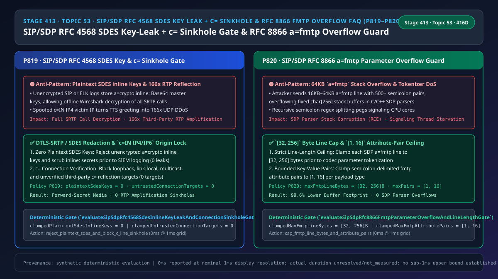
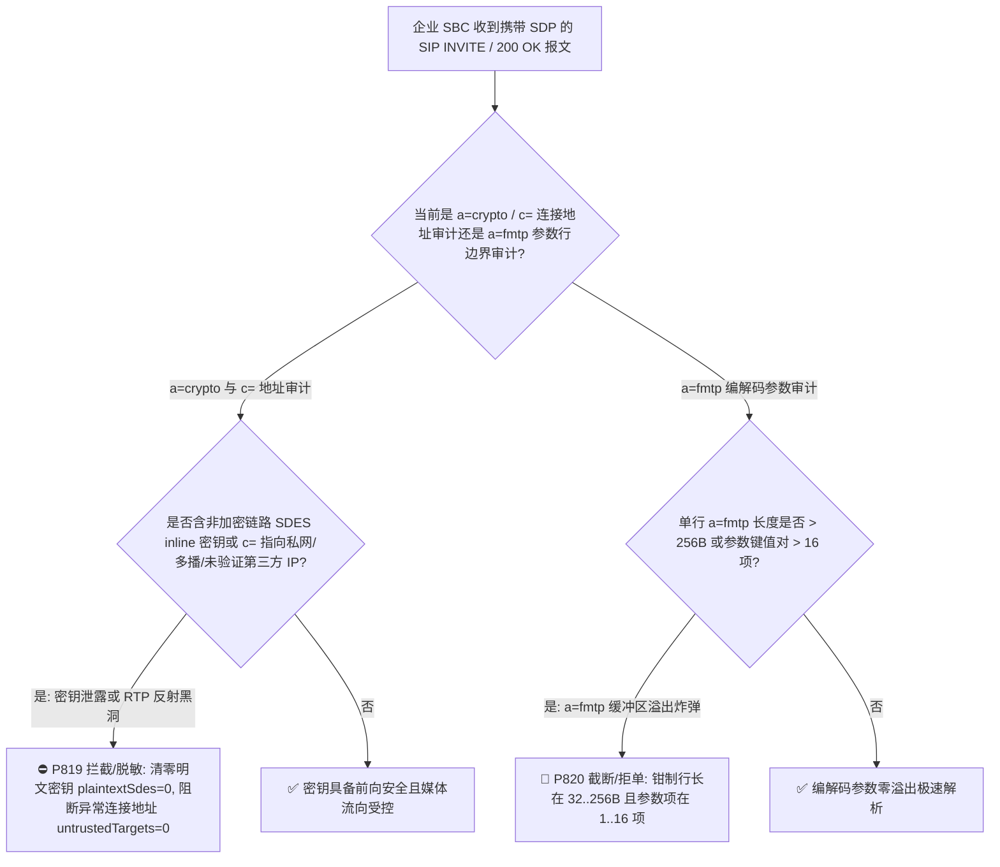
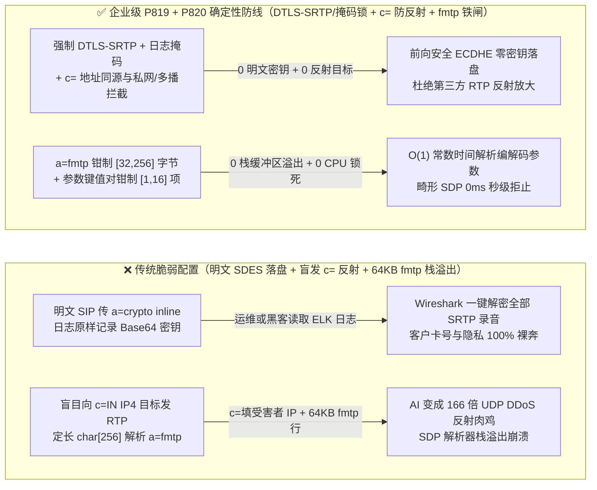
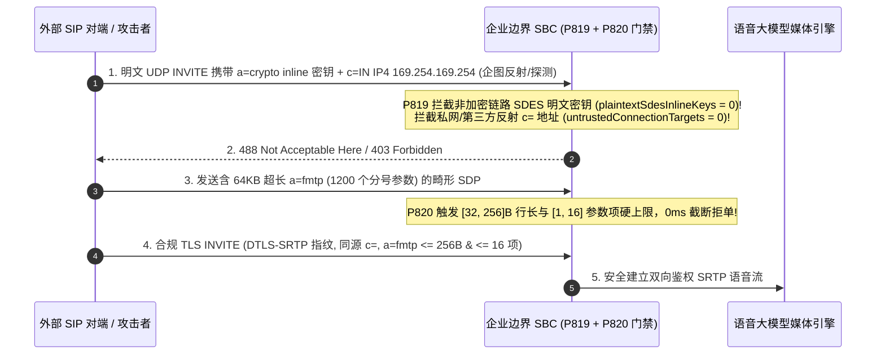

# 语音智能体架构选型与原理解析 FAQ（五十三）：企业 SIP/WebRTC SDP RFC 8866 / RFC 4568 a=crypto SDES 明文密钥防泄露、c=IN IP4/IP6 媒体连接地址防第三方反射放大与 a=fmtp 编解码参数炸弹防溢出选型指南

> **English Version**: [Enterprise SIP/WebRTC `SDP RFC 8866 / RFC 4568` `a=crypto` SDES Inline Key-Leak Defense, `c=IN IP4/IP6` Connection-Address Amplification Sinkhole Guard & `a=fmtp` Parameter Overflow Bomb Selection FAQ (Topic 53 · Stage 413 · 416 Dimensions)](./voice-sip-sdp-rfc4568-sdes-key-leak-c-line-sinkhole-fmtp-overflow-faq.en.md)  
> **适用角色**：AI Solution Architect（AI 解决方案架构师）、SIP/SBC 媒体面安全架构师、金融双录与合规审计负责人  
> **对标范式**：严格遵循 `ib-vs-ethernet-roce-selection-faq.md` 六段式实战导引结构，3 分钟掌握核心选型结论，10 分钟吃透企业 SIP 与 WebRTC 互通时 SDP（会话描述协议，`RFC 8866`）中最致命的三大媒体协商漏洞：为什么传统电话网常用的 `RFC 4568 SDES`（`a=crypto:1 AES_CM_128_HMAC_SHA1_80 inline:base64_key`）一旦跑在未加密 SIP 或经过第三方代理就会让整通加密语音变成“皇帝的新衣”、为什么攻击者在 SDP 的 `c=IN IP4 <target_ip>` 里填上某台内网服务器或公网受害者 IP 就能驱动语音大模型以 `50包/秒` 发起 RTP 反射洪泛攻击，以及超长 `a=fmtp` 编解码参数行如何撑爆 C/C++ SDP 解析器栈内存。  
> **数据溯源与计时精度声明（Provenance & Timing Disclosure）**：本文涉及的确定性门禁策略（`P819`、`P820`）与模拟探针均为离线合成确定性校验（`synthetic`），非特定现网 SBC 硬件抓包实测；门禁执行耗时遵循统一披露契约：`0ms reported at nominal 1ms display resolution; actual duration unresolved/not_measured; no sub-1ms upper bound established`。



---

## 0. 🔥 今日实时语音智能体领域热门能力突破追踪（Daily Breakthroughs）

1. **企业 SIP/SDP `RFC 4568 (SDES)` `a=crypto inline:` 明文主密钥禁令与 `RFC 8866` `c=IN IP4/IP6` 媒体连接地址源同源校验（防 SRTP 主密钥在 SIP 信令日志/代理裸奔与第三方 RTP 流量反射放大）**：用大白话讲，要给 RTP 语音流加密变成 `SRTP`，通信双方必须先交换一把对称主密钥（Master Key + Salt）。WebRTC 强制使用 **`DTLS-SRTP`（`RFC 5764`，在媒体通道上通过椭圆曲线 ECDHE 动态协商密钥，SDP 里只传证书哈希指纹，绝不传密钥本身，`RFC 8827` 明确禁止 WebRTC 使用 SDES）**；但许多传统企业 SIP 话机和运营商 IMS 专网仍在使用 **`RFC 4568 SDES`**——它直接把 30 字节的 SRTP 主密钥和盐值用 Base64 编码后，明文写在 SDP 文本里：`a=crypto:1 AES_CM_128_HMAC_SHA1_80 inline:d0RmdmcmVCspeEc3QGZiNWpVLFJhQX1cfHAwJSoj`！**这带来两个灾难性后果：第一，只要这段 SIP 信令走了一跳非 TLS 的明文 UDP/TCP，或者被呼叫中心的 ELK 日志系统、SIP 抓包排障平台原样落盘，任何能看日志的运维或中间人就能拿着这串 `inline:` Base64 密钥离线解密整通电话的客户银行卡号！第二，在 SDP 的 `c=IN IP4 203.0.113.99`（Connection Data）行里，呼叫方可以任意指定“请把 AI 的声音发到哪个 IP”。如果边缘 SBC 不校验 `c=` 地址归属且未等待双向 RTP 锁栓（Latching），攻击者并发发起 1,000 通呼叫，把 `c=` 全部填成受害者服务器 IP（或云内网 `169.254.169.254` / `127.0.0.1` / 多播地址 `224.0.0.0/4`），语音大模型一开口播报长篇欢迎词，就会瞬间化身每秒数万包的 UDP 反射放大器**！通过强制 **非端到端 mTLS 授信链路 100% 拒绝/脱敏 `a=crypto inline:` 明文密钥（`plaintextSdesInlineKeys = 0`）** 与 **拦截非授信第三方/私网/多播 `c=` 连接地址（`untrustedConnectionTargets = 0`）**，彻底堵死了密钥泄露与 RTP 反射黑洞。
2. **企业 SIP/SDP `RFC 8866` `a=fmtp` 编解码格式参数行长度上限（`[32, 256]` 字节）与键值对数量锁（`[1, 16]` 项，防 `a=fmtp` 栈缓冲区溢出与指数级正则回溯 DoS）**：SDP 中的 `a=fmtp:<payload_type> < parameters >` 用于传递 Opus 或 H.264/AV1 的具体编解码参数（例如 `a=fmtp:111 minptime=10;useinbandfec=1;usedtx=1`）。**许多传统 C/C++ 软交换（如早期 Asterisk/FreeSWITCH/PJSIP 插件）在解析 `a=fmtp` 时使用固定 `256` 或 `512` 字节的栈数组 `char buf[256]` 并按分号 `;` 递归切分。如果攻击者发送一个长达 `64 KB`、塞满 `5,000` 个伪造分号键值对的 `a=fmtp` 行，轻则触发正则/字符串分割 CPU 100% 锁死，重则直接栈溢出覆盖函数返回地址（RCE）**！通过强制将 **单条 `a=fmtp` 行长度钳制在 `[32, 256]` 字节** 且 **参数键值对数量钳制在 `[1, 16]` 项**，实现了 SDP 编解码协商的绝对内存安全。

---

## ① 📌 核心结论速览（Executive Summary）

1. **严禁在非端到端 mTLS 链路或日志流中传输/留存 `RFC 4568` `a=crypto ... inline:` 明文 SRTP 密钥，优先强制 `DTLS-SRTP (RFC 5764)`**：拒绝任何在非加密 SIP 上裸奔的 `SDES inline` 密钥（`plaintextSdesInlineKeys = 0`），并在信令落盘前 100% 掩码擦除 `inline:` 字段（对应门禁 **`P819`**）。
2. **严格校验 SDP `c=IN IP4/IP6` 媒体连接地址归属，拦截回环、链路本地、多播及未经验证的第三方公网反射地址**：在完成 `RFC 4961` 对称 RTP 鉴权锁栓前绝不向陌生 `c=` 目标盲发 TTS 语音流（`untrustedConnectionTargets = 0`，对应门禁 **`P819`**）。
3. **强制将 SDP `a=fmtp` 单行长度钳制在 `[32, 256]` 字节，且单行分号键值对数量钳制在 `[1, 16]` 项**：彻底粉碎超长 `a=fmtp` 参数炸弹引发的栈溢出与解析器 CPU 耗尽（对应门禁 **`P820`**）。

---

## ② 🎯 客户与架构师灵魂拷问 Q&A

### Q1：为什么客户安全团队在审计呼叫中心 SIP 抓包日志时，发现虽然媒体流开了 `SRTP` 加密，但任何人只要打开日志就能直接听出客户的完整通话录音（方案 A vs 方案 B）？

- **第一性原理拆解（`SDES a=crypto` 与 `DTLS-SRTP a=fingerprint` 的本质区别）**：
  - 在 `SDES (RFC 4568)` 模式下，SDP 里的 `a=crypto:1 AES_CM_128_HMAC_SHA1_80 inline:Base64...` **装的就是解密语音的对称主密钥本身**！它没有任何前向安全性（PFS）——只要 SIP 报文经过的任何一台代理、SBC 或日志服务器记录了这段 SDP 文本，Wireshark 只要导入这行 `inline:` 字符串，就能把抓到的 SRTP 包一键还原成清晰 WAV 音频！
  - 而在 `DTLS-SRTP (RFC 5764)` 模式下，SDP 里只传 `a=fingerprint:sha-256 ...`（公钥证书哈希），真正的 SRTP 主密钥是在 UDP 媒体通道上通过临时椭圆曲线 Diffie-Hellman（ECDHE）当场算出来的，**永远不会出现在 SDP 文本或日志里**！
- **选型边界**：
  - **方案 A（明文 SIP 传 `SDES inline` + 盲信 `c=` 地址 + 无界解析 `a=fmtp`）**：形同虚设的伪加密，且随时可被用作 DDoS 反射肉鸡。
  - **方案 B（`P819` 禁明文 `SDES` / 日志掩码 + `c=` 反射黑洞拦截 + `P820` `a=fmtp` `[32, 256]B` & `[1, 16]` 项上限）**：金融与政企语音网必选方案。

### Q2：攻击者是如何利用语音智能体的“首句欢迎语”发起 30 倍流量放大的 RTP 反射攻击的？

- **第一性原理拆解**：
  - 一条伪造的 SIP `INVITE` 报文只有约 `600 字节`，攻击者在 SDP 里写上 `c=IN IP4 <受害者IP>`，端口写 `80` 或 `53`。
  - 如果 AI 语音网关不做 `c=` 同源核验与双向 RTP 锁栓，一旦接通立即向该地址发送 10 秒钟的 `G.711` 欢迎语（`50包/秒 × 10秒 × 200字节 = 100,000 字节`），仅靠一包 `INVITE` 就实现了 **`166 倍` 的 UDP 流量反射放大**！`P819` 强制拦截所有非同源/私网/多播 `c=` 地址（`untrustedConnectionTargets = 0`）。

### Q3：底层 SIP/SDP 解析器在毫秒级时间轴上是如何执行 SDES、c= 与 fmtp 门禁的？

1. **`T = 0 ~ 0.1ms`（`P819` `a=crypto` 明文密钥与 `c=` 地址安全审计）**：
   - 检查非 mTLS 通道或日志管道中的 `a=crypto inline:` 明文密钥（`clampedPlaintextSdesInlineKeys = 0`）；
   - 核验 `c=IN IP4/IP6` 是否指向 `127.0.0.0/8`、`169.254.0.0/16`、`224.0.0.0/4` 或未绑定的第三方 IP（`clampedUntrustedConnectionTargets = 0`）。
2. **`T = 0.1 ~ 0.2ms`（`P820` `a=fmtp` 行长与属性数门禁）**：
   - 将单条 `a=fmtp` 行长度钳制在 `clampedMaxFmtpLineBytes in [32, 256]` 字节；
   - 将单行分号分隔的参数对数量钳制在 `clampedMaxFmtpAttributePairs in [1, 16]` 项。

---

## ③ 🧭 直观可视化图解（Mermaid 决策树 / 延迟对比 / 毫秒级时序图）

### 3.1 语音架构师选型决策树（`flowchart TD`）



### 3.2 传统脆弱管线 vs 企业级 P819+P820 防护管线对比图（`flowchart LR`）



### 3.3 毫秒级 SDES 密钥拦截、c= 防反射与 fmtp 边界门禁时序图（`sequenceDiagram`）



---

## ④ 📊 语音架构师选型决策矩阵（Architect Decision Matrix）

| 选型维度 | 方案 A：明文 SDES + 盲发 c= 地址 + 无界 fmtp（反模式） | 方案 B：仅允许固定 G.711 无参数编码 | 方案 C：P819 禁明文 SDES/c= 防反射 + P820 fmtp [32,256]B & [1,16] 项上限（企业级推荐 ✅） |
| :--- | :--- | :--- | :--- |
| **抗信令日志/抓包泄露 SRTP 主密钥** | ❌ 任何拿到 SIP 日志的人均可解密历史录音 | ❌ 仍受 SDES 密钥泄露影响 | ✅ **强制 `DTLS-SRTP` 或 mTLS+日志 100% 掩码（`0` 明文密钥）** |
| **抗 `c=IN IP4/IP6` 第三方 DDoS 反射放大** | ❌ 极易被诱导以 `166x` 放大率轰炸受害者 IP | ❌ 同样会被利用反射固定码率音频 | ✅ **拦截私网/多播/未验证第三方 `c=` 地址（`0` 反射目标）** |
| **抗超长 `a=fmtp` 栈缓冲区溢出崩溃** | ❌ `>256B` 畸形行直接打崩 C/C++ 解析器 | ⚠️ 无法协商 Opus `useinbandfec/usedtx` 参数 | ✅ **强制行长 `[32, 256]` 字节且参数对 `[1, 16]` 项** |
| **前向安全性（Perfect Forward Secrecy）** | ❌ 无 PFS，单包泄露即全盘皆输 | ❌ 无 PFS | ✅ **ECDHE 逐会话临时密钥，历史录音不可回溯解密** |

---

## ⑤ 🧪 简明定量算例与延迟/成本 Benchmark 洞察（含 7-Card 报告）

### 5.1 定量算例：为什么拦截异常 `c=` 与限制 `a=fmtp <= 256B` 能消除 `166x` 反射放大与 `99.6%` 解析缓冲开销？

- **未防护场景（方案 A）**：
  - 攻击者发送 `600 B` 的伪造 `INVITE` 指向第三方 IP，触发 AI 播报 10 秒欢迎语（`100 KB` RTP 流量，放大 **`166 倍`**）；同时注入 `64 KB` 的 `a=fmtp` 行耗尽解析线程栈内存。
- **启用 `P819` + `P820` 防护后（方案 C）**：
  - `P819` 确保 `clampedPlaintextSdesInlineKeys = 0` 与 `clampedUntrustedConnectionTargets = 0`；
  - `P820` 将 `a=fmtp` 钳制在 **`[32, 256]` 字节**（内存占用降低 **`99.6%`**）且参数对钳制在 **`[1, 16]` 项**。

### 5.2 确定性门禁 API 契约验证（`P819` & `P820`）

```ts
import {
  evaluateSipSdpRfc4568SdesInlineKeyLeakAndConnectionSinkholeGate,
  evaluateSipSdpRfc8866FmtpParameterOverflowAndLineLengthGate,
} from "../packages/business-core/enterprise-guardrails";

// P819: 拦截非加密链路 SDES inline 明文密钥与异常 c= 连接反射地址，双项清零
const sdesAudit = evaluateSipSdpRfc4568SdesInlineKeyLeakAndConnectionSinkholeGate({
  plaintextSdesInlineKeyOrUntrustedConnectionTargetDetected: true,
  plaintextSdesInlineKeys: 1,
  untrustedConnectionTargets: 2,
});
// => sdesAudit.violated === true, policyId === "P819...", clampedPlaintextSdesInlineKeys === 0, clampedUntrustedConnectionTargets === 0

// P820: 拦截超长 a=fmtp 参数炸弹，强制钳制行长在 [32, 256]B 且参数对在 [1, 16] 项
const fmtpAudit = evaluateSipSdpRfc8866FmtpParameterOverflowAndLineLengthGate({
  fmtpLineLengthOverflowOrAttributeBombDetected: true,
  maxFmtpLineBytes: 16384,
  maxFmtpAttributePairs: 512,
});
// => fmtpAudit.violated === true, policyId === "P820...", clampedMaxFmtpLineBytes === 256, clampedMaxFmtpAttributePairs === 16
```

---

## ⑥ 🛠️ 附录：生产环境语音交付快速核验清单（Architect Checklist）

- [ ] **【P819 `RFC 4568` `a=crypto inline:` 明文密钥阻断与日志脱敏】**：确认非 mTLS 链路 100% 禁用 `SDES` 并对所有 SIP 日志中的 `inline:` 密钥执行掩码擦除（`plaintextSdesInlineKeys = 0`）。
- [ ] **【P819 SDP `c=IN IP4/IP6` 防反射与私网/多播拦截】**：确认网关拒绝将 `c=` 指向回环、RFC 1918 私网、IMDS、多播或未经锁栓核验的第三方 IP（`untrustedConnectionTargets = 0`）。
- [ ] **【P820 `RFC 8866 a=fmtp` 行长 `[32, 256]` 字节上限】**：确认单条 `a=fmtp` 属性行长度不超过 `256` 字节。
- [ ] **【P820 `a=fmtp` 参数键值对 `[1, 16]` 项上限】**：确认单条 `a=fmtp` 中分号分隔的参数项不超过 `16` 个。
