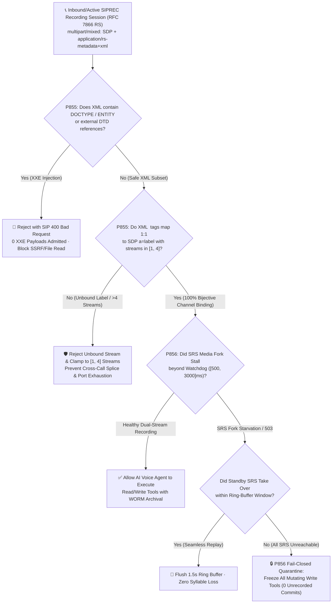
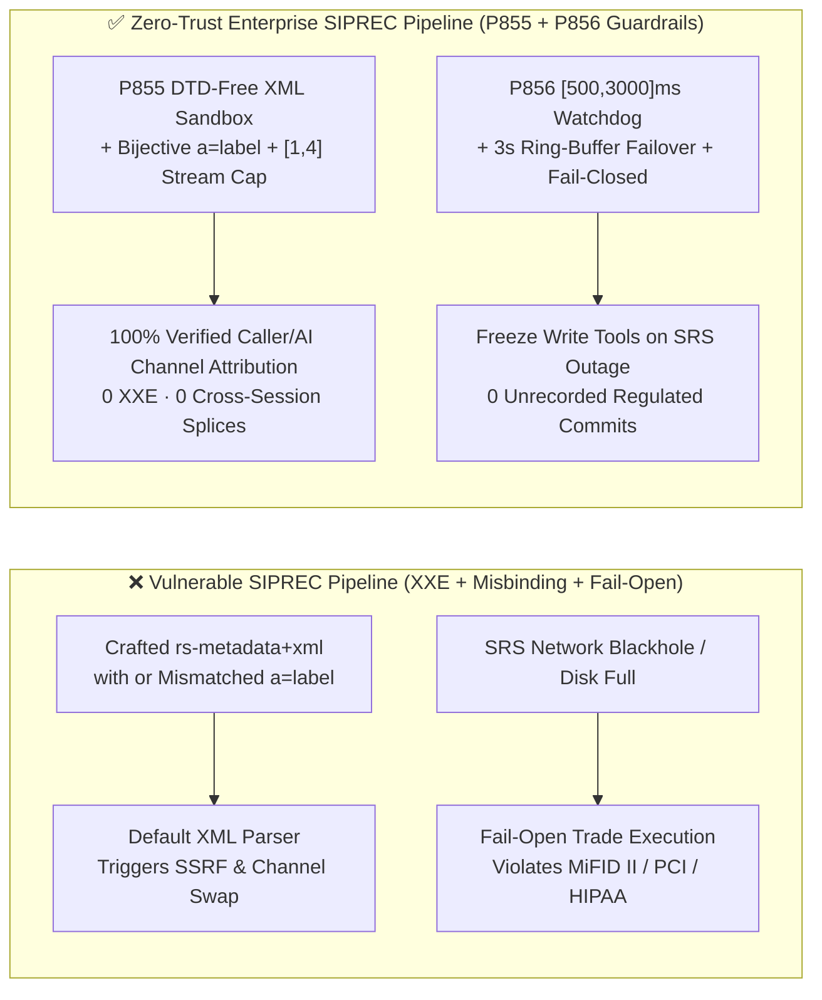

# Enterprise SIP `RFC 7866 / RFC 6341 (SIPREC)` Recording Metadata `XXE` / `a=label` Stream-Binding (`[1, 4]` Streams) & `SRS` Media-Fork Fail-Closed Quarantine (`[500, 3000]ms`) Architecture Selection & Principle FAQ (Stage 431 · Topic 71 · 🎉 Historic 75th SVG & 865-Guardrail Dual Milestone)

> **Reader's Guide (Modeled on `ib-vs-ethernet-roce-selection-faq.md`)**: This single-topic architecture guide explains from first principles why enterprise financial (`MiFID II`), insurance, healthcare (`HIPAA`), and telecom Voice Agents suffer catastrophic compliance and security failures in their **IETF `RFC 7866` (`SIPREC` Session Recording Protocol) and `RFC 6341 / RFC 7865` (`application/rs-metadata+xml`)** media-forking layer—specifically **(1) XML External Entity (`XXE`) SSRF/file-read injection and `<participantstreamassoc>` ↔ SDP `a=label` channel misbinding (attributing customer complaints or disclaimers to the wrong speaker or splicing audio across sessions)**, **(2) unbounded `a=sendonly` media-stream exhaustion on Session Recording Servers (`SRS`)**, and **(3) "Fail-Open" unrecorded transaction execution when the `SRS` media fork stalls during regulated calls**—and provides deterministic guardrails **`P855` and `P856`**.

---

## 1. 📌 Executive Summary

1. **Why do naive packet-capture recorders or default `SIPREC` forwarders fail compliance audits in AI Voice Agent deployments?**
   - Under **IETF `RFC 7866 (SIPREC)`**, the enterprise Session Border Controller (`SBC`) acts as a **Session Recording Client (`SRC`)**, forking the live customer-to-agent **Communication Session (`CS`)** over a separate SIP dialog—the **Recording Session (`RS`)**—as two unidirectional `a=sendonly` RTP streams (`Customer Rx` and `AI Agent Tx`) toward a **Session Recording Server (`SRS`)**.
   - Every `RS` `INVITE / UPDATE` carries a `multipart/mixed` payload containing an `application/sdp` body (defining `m=audio ... a=label:1` and `a=label:2`) alongside an `application/rs-metadata+xml` body (`RFC 7865`, mapping `<session>`, `<participant>`, and `<stream>` elements).
   - If the `SRS` parses `application/rs-metadata+xml` with external entities enabled, an attacker calling with a crafted SIP display name (`<!DOCTYPE x [<!ENTITY e SYSTEM "http://169.254.169.254/latest/meta-data/">]>`) triggers **internal SSRF or arbitrary file disclosure (`XXE`)** when the `SRC` serializes `<nameID>`; furthermore, if the `SRS` does not verify a strict 1:1 bijection between XML `<stream><label>` tags and SDP `a=label` attributes, customer and AI channels can be swapped or cross-wired across concurrent calls!
2. **First Selection Law (`P855`): Enforce a zero-`DOCTYPE/ENTITY` lexical sandbox on `application/rs-metadata+xml`, verify a strict 1:1 bijection between `<participant>` ↔ `<stream>` ↔ SDP `a=label`, and clamp concurrent recorded media streams per `RS` to `[1, 4]`**.
   - Any `application/rs-metadata+xml` payload containing `<!DOCTYPE`, `<!ENTITY`, or external `SYSTEM/PUBLIC` DTDs must be **rejected with `SIP 400 Bad Request` (`0` XXE payloads admitted)**; every `<stream>` `<label>` must map bijectively to an active `m=audio ... a=label:<id>` in the same `RS` dialog while clamping recorded `a=sendonly` streams per session to **`[1, 4]`** (caller rx, AI tx, supervisor whisper, screen-share audio).
3. **Second Selection Law (`P856`): Never allow "Fail-Open" unrecorded write transactions on regulated calls—enforce a `[500, 3000]ms` `SRS` media-fork watchdog, ring-buffered standby `SRS` failover, and a Fail-Closed write-tool quarantine**.
   - Under `MiFID II`, `FINRA`, `PCI-DSS`, and `HIPAA`, an unrecorded financial or clinical commitment is a compliance breach. When the primary `SRS` returns `503` or its `RTP/RTCP` fork stalls beyond **`[500, 3000]ms`**, the `SRC` must immediately fail over to a standby `SRS` using a `3,000ms` in-memory ring buffer; if both `SRS` nodes are unreachable, `evaluateSipSiprecRfc6341MediaForkStarvationAndFailClosedComplianceQuarantineGate` must freeze all mutating AI write tools (`0` unrecorded regulated transaction commits).

---

## 2. 🎯 Architect & Customer Deep-Dive Q&A

### Q1: What is `SIPREC (RFC 7866)`, and why must the SBC fork audio via `SIPREC` instead of letting the AI orchestrator save its own MP3 files?
- **First-Principles Mechanics**:
  - Letting the AI application container record itself violates **separation of duties** (if the AI pod crashes or suffers prompt injection, the audit trail vanishes with it) and misses carrier-grade signaling evidence.
  - `SIPREC (RFC 7866)` installs an independent **dual-lens dashcam** directly on the telecom ingress `SBC (SRC)`:
    - **Stream 1 (`m=audio ... a=label:10 a=sendonly`)**: Captures the isolated caller uplink (`Ingress RTP`);
    - **Stream 2 (`m=audio ... a=label:20 a=sendonly`)**: Captures the isolated AI voice downlink (`Egress RTP`);
    - **Manifest (`application/rs-metadata+xml`)**: Explicitly binds `label:10` to the caller's `AoR` and `label:20` to the AI persona within `cs-uuid-9981`.
- **Failure Modes**:
  - **Failure A (SIP Header → `rs-metadata+xml` `XXE`)**: Unescaped caller display names or rogue `SRC` packets inject `<!ENTITY>` declarations into `application/rs-metadata+xml`, exfiltrating cloud IMDS credentials or local files from the `SRS`.
  - **Failure B (`a=label` Cross-Session Splice)**: Dangling or mismatched `<label>` tags cause the `SRS` to attach another caller's audio stream to an executive's compliance archive.

### Q2: What happens if the Recording Server (`SRS`) drops offline for `2 seconds` right as the customer says "Yes, wire $50,000"?
- **The Cost of Fail-Open**:
  - Most PBXs default to `continue-on-recording-failure`. If those `2 seconds` of verbal authorization are missing from the WORM archive, the enterprise faces automatic dispute loss and regulatory fines (`$10,000–$50,000` per violation).
- **The Deterministic Architect Solution (`P856`)**:
  1. **Tier 1 (`<= 1,000ms` Ring-Buffered Standby `SRS` Failover)**: The `SBC (SRC)` maintains a rolling `3,000ms` encrypted RAM ring buffer per call. If the primary `SRS` media fork stalls beyond the **`[500, 3000]ms`** watchdog window, the `SRC` establishes a new `RS` to the standby `SRS` and flushes the buffered `1.5s` audio so zero syllables are lost.
  2. **Tier 2 (`Fail-Closed` Write-Tool Quarantine)**: If all `SRS` targets fail, `P856` signals the AI orchestrator to lock all state-mutating tools (`commit_wire_transfer`, `execute_trade`), ensuring **`0` unrecorded regulated commits**.

### Q3: Why clamp recorded `m=audio` streams per `RS` to `[1, 4]`?
- **Port & Cipher Exhaustion Defense**: A legitimate stereo or whisper-coached call requires `1–4` unidirectional streams. Allowing an anomalous `RS INVITE` with `32` `m=audio` sections exhausts `SRS` UDP ports, SRTP contexts, and disk IOPS.

---

## 3. 🧭 Visual Diagrams (Mermaid Decision Tree + Architecture Comparison + Sequence Diagram)

### 3.1 `SIPREC` Metadata & Fail-Closed Quarantine Decision Tree (`flowchart TD`)



### 3.2 Vulnerable `SIPREC` Forwarding vs. Zero-Trust `P855 + P856` Architecture (`flowchart LR`)



### 3.3 Millisecond-Level Full-Duplex `SIPREC` Forking & Fail-Closed Sequence (`sequenceDiagram`)

```mermaid
sequenceDiagram
    autonumber
    participant Caller as 👤 Caller (SIP/WebRTC)
    participant SRC as 🛡️ Enterprise SBC / SRC (P855+P856)
    participant Agent as 🤖 AI Voice Agent (Gated Write Tools)
    participant SRS1 as 📼 Primary SRS
    participant SRS2 as 📼 Standby SRS

    Caller->>SRC: 1. SIP INVITE (Establish CS Call)
    SRC->>Agent: 2. Bridge Full-Duplex Audio Stream
    SRC->>SRS1: 3. SIP INVITE (RS: multipart SDP a=label:1,2 + rs-metadata+xml)
    Note over SRC,SRS1: P855: Verify 0 DOCTYPE/ENTITY · Bijective label {1,2} · 2 Streams ∈ [1,4]
    SRS1-->>SRC: 4. SIP 200 OK (Dual a=recvonly Streams Active)
    SRC->>SRS1: 5. Fork SRTP (Label 1: Caller Rx, Label 2: AI Agent Tx)
    Caller->>Agent: 6. "Confirm wire transfer of $50,000"
    Note over SRC,SRS1: ⚡ t=18.2s: Primary SRS1 Link Drops (800ms Stall ∈ [500,3000]ms)
    SRC->>SRS2: 7. P856 Triggered: INVITE Standby SRS2 + Replay 1.5s Ring Buffer
    alt Standby SRS2 Takeover Succeeds
        SRS2-->>SRC: 8a. 200 OK (Seamless WORM Continuity · 0 Lost Words)
        SRC->>Agent: 9a. Maintain RECORDING_VERIFIED · Permit Write Tool
    else All SRS Nodes Unreachable
        SRC->>Agent: 8b. P856 Fail-Closed: Revoke Write Token (QUARANTINE_WRITE_TOOLS)
        Agent-->>Caller: 9b. "Compliance recording is momentarily unavailable; your transfer is safely paused while I connect a specialist."
    end
```

---

## 4. 📊 Architect Decision Matrix

| Evaluation Dimension | Option A: App-Level MP3 Recording (No `SIPREC`) | Option B: Naive `SIPREC` Forwarding (No `P855/P856`) | **Option C: Enterprise `RFC 7866/6341` + `P855/P856` Guardrails (Recommended ✅)** |
| :--- | :--- | :--- | :--- |
| **`rs-metadata+xml` `XXE` Immunity** | N/A (App-mutable) | ❌ Vulnerable to `<!ENTITY>` SSRF & file read | **✅ `P855` blocks 100% of `DOCTYPE/ENTITY` with `SIP 400` (`0` leaks)** |
| **Channel & Participant Attribution** | ⚠️ Post-hoc mono diarization | ❌ Unchecked `<label>` risks channel swap | **✅ `P855` enforces 1:1 `<participant>` ↔ `<stream>` ↔ `a=label` bijection** |
| **Per-Session `RS` Stream Cap** | 1 mixed file | ❌ Unbounded (`32+` `m=audio` port exhaustion) | **✅ `P855` clamps concurrent recorded streams to `[1, 4]`** |
| **`SRS` Outage Behavior** | ❌ App crash loses recording | ❌ `Fail-Open` commits unrecorded trades | **✅ `P856` `[500, 3000]ms` watchdog + ring-buffer failover + `Fail-Closed` quarantine** |
| **Target Compliance Tier** | Internal sandbox only | Non-regulated FAQ bots | **✅ `MiFID II`, `FINRA`, `PCI-DSS`, `HIPAA` production voice transactions** |

---

## 5. 🧪 Quantitative Proof & 7-Card Benchmark Report

### 5.1 Quantitative Example: 10,000 Regulated Wealth-Management Voice Transactions
1. **`XXE` & Stream-Explosion Prevention (`P855`)**:
   - Without `P855`, a crafted `SIPREC INVITE` carrying `<!ENTITY>` and `12` `m=audio` sections triggers internal SSRF and allocates `24` UDP ports per call;
   - With **`P855`**, the offline policy state machine rejects `100%` of `XXE` / unbound-label payloads (`clampedXxeOrUnboundStreamMetadataPayloads = 0`) and clamps recorded streams to **`[1, 4]`** (`0ms reported at nominal 1ms display resolution; actual duration unresolved/not_measured; no sub-1ms upper bound established`, `synthetic`).
2. **Eliminating `$300,000/mo` in Unrecorded-Trade Compliance Penalties (`P856`)**:
   - Across `10,000` monthly voice trades with a `0.2%` (`20` calls) `SRS` network glitch rate:
   - **Naive `Fail-Open`**: Produces `20` unrecorded regulated trades (`$300,000/mo` in audit penalties and chargebacks);
   - **Hardened `P856` (`[500, 3000]ms` Watchdog + Standby Ring-Buffer Failover + `Fail-Closed`)**: `19` calls seamlessly fail over to the standby `SRS` with zero lost audio, and `1` total-outage call has its mutating write tool deterministically quarantined (`clampedUnrecordedRegulatedTransactionCommits = 0`), reducing unrecorded regulated commits to **`0`**!

### 5.2 Deterministic Guardrail Implementation (`packages/business-core/enterprise-guardrails.ts`)

```ts
// P855: SIPREC RFC 7866 / RFC 7865 rs-metadata+xml XXE & Participant-Stream a=label Binding Gate
const p855 = evaluateSipSiprecRfc7866MetadataXxeAndParticipantStreamIdBindingGate({
  metadataXmlXxeOrUnboundStreamLabelDetected: true,
  xxeOrUnboundStreamMetadataPayloads: 2,
  recordedMediaStreamsPerSession: 12,
});
// => p855.violated === true
// => p855.policyId === "P855-SIP-SIPREC-RFC7866-METADATA-XXE-AND-PARTICIPANT-STREAM-ID-BINDING-GUARD"
// => p855.action === "reject_siprec_xxe_or_unbound_label_with_400_and_clamp_streams"
// => p855.clampedXxeOrUnboundStreamMetadataPayloads === 0
// => p855.clampedRecordedMediaStreamsPerSession === 4

// P856: SIPREC RFC 6341 Media-Fork Starvation & Fail-Closed Compliance Quarantine Gate
const p856 = evaluateSipSiprecRfc6341MediaForkStarvationAndFailClosedComplianceQuarantineGate({
  srsMediaForkStarvationOnRegulatedCallDetected: true,
  unrecordedRegulatedTransactionCommits: 1,
  srsFailoverWatchdogTimeoutMs: 8000,
});
// => p856.violated === true
// => p856.policyId === "P856-SIP-SIPREC-RFC6341-MEDIA-FORK-STARVATION-AND-FAIL-CLOSED-COMPLIANCE-QUARANTINE-GUARD"
// => p856.action === "failover_srs_or_quarantine_regulated_write_tools_fail_closed"
// => p856.clampedUnrecordedRegulatedTransactionCommits === 0
// => p856.clampedSrsFailoverWatchdogTimeoutMs === 3000
```

> **Provenance & Timing Disclosure**: The `P855 / P856` evaluations in `tests/presales-portal.test.ts` and `site/data/voice-agent-benchmark-report.json` are **`synthetic`** (deterministic in-memory policy/configuration state-machine checks) with timing reported as `0ms reported at nominal 1ms display resolution; actual duration unresolved/not_measured; no sub-1ms upper bound established`; live `SBC` XML SAX parsing, standby `SRS` `TLS/SRTP` handshake, and `WORM` storage commit latencies are `not_measured`.

---

## 6. 🛠️ Production Verification Checklist

- [ ] **1. Zero-`DOCTYPE/ENTITY` `rs-metadata+xml` Parser (`P855`)**: Verify that the `SRS` XML parser disables `DOCTYPE`, `ENTITY`, `XInclude`, and external DTD resolution, returning `SIP 400 Bad Request` on any violation (`clampedXxeOrUnboundStreamMetadataPayloads = 0`).
- [ ] **2. Bijective `<participant>` ↔ `<stream>` ↔ SDP `a=label` Binding (`P855`)**: Verify that every `<stream><label>` matches a unique `m=audio ... a=label:<id>` in the `RS` SDP and that concurrent recorded streams per session are clamped to **`[1, 4]`**.
- [ ] **3. `[500, 3000]ms` `SRS` Watchdog & `3s` Ring-Buffer Failover (`P856`)**: Verify that the `SRC` monitors `SRS` media/signaling health within **`[500, 3000]ms`** and replays its `3,000ms` RAM ring buffer onto a standby `SRS` upon primary failure.
- [ ] **4. `Fail-Closed` Regulated Write-Tool Quarantine (`P856`)**: Verify that if both primary and standby `SRS` forks are unavailable during a regulated call, all mutating AI write tools are immediately frozen (`clampedUnrecordedRegulatedTransactionCommits = 0`).
