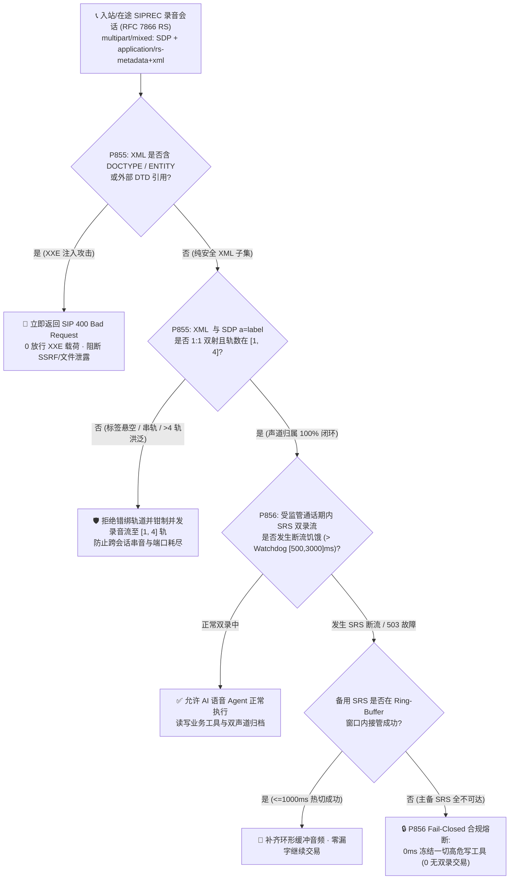
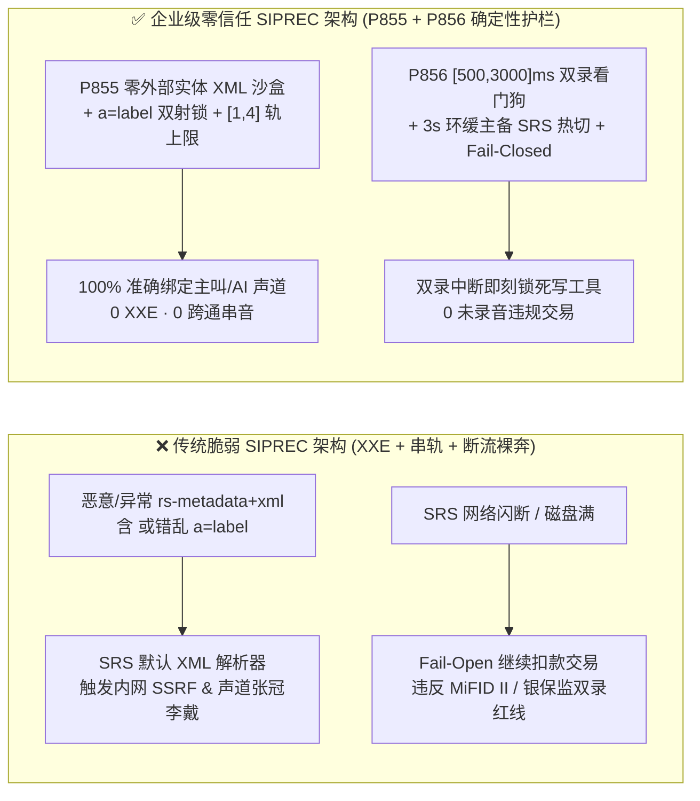
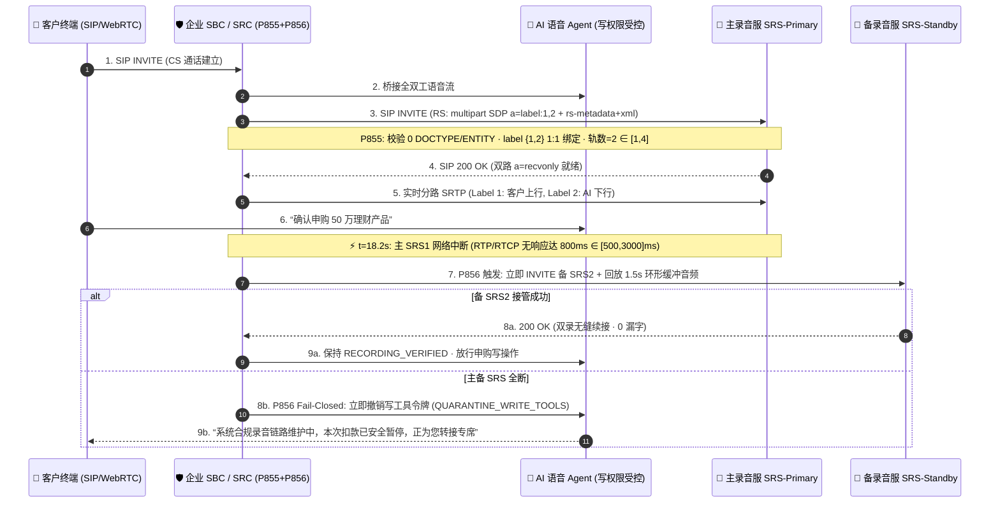

# 企业 SIP `RFC 7866 / RFC 6341 (SIPREC)` 双录元数据 `XXE` / `a=label` 声道错绑（`[1, 4]` 轨）与 `SRS` 断流故障安全熔断（`[500, 3000]ms`）架构选型与原理解析 FAQ（Stage 431 · Topic 71 · 🎉 第 75 张 SVG 与 865 护栏双里程碑）

> **核心导读（对标 `ib-vs-ethernet-roce-selection-faq.md` 通俗透彻规范）**：本文用第一性原理与大白话讲透企业级金融（`MiFID II` / 银保监双录）、医疗（`HIPAA`）与电信合规语音 Agent 在 **IETF `RFC 7866`（Session Recording Protocol, `SIPREC`）与 `RFC 6341 / RFC 7865`（Session Recording Metadata XML）** 录音分路层中最致命的三大生产级故障——**① `application/rs-metadata+xml` 外部实体注入（`XXE`）与 `<participantstreamassoc>` `a=label` 声道错绑（把客户愤怒投诉或口头免责声明嫁祸到 AI 坐席声道，或把旁路通话的 RTP 流串轨录进高管录音档）**、**② 单通录音会话（`Recording Session, RS`）无限挂载 `a=sendonly` 媒体轨耗尽录音服务器（`SRS`）端口池**，以及 **③ 录音服务器（`SRS`）宕机或单向 `RTP` 断流时，前端通信会话（`CS`）“裸奔”继续执行电汇/投保交易导致违反金融双录一票否决红线**，并给出 **`P855` 与 `P856`** 的确定性护栏代码与验收清单。

---

## 一、📌 核心结论速览（Executive Summary）

1. **为什么传统呼叫中心的“被动抓包录音”或“粗放式 `SIPREC` 转发”在 AI 语音交易场景下会引发严重的合规事故？**
   - 在 **IETF `RFC 7866 (SIPREC)`** 架构中，企业边界会话控制器（`SBC`）充当 **录音客户端（`SRC`）**，将客户与 AI 语音 Agent 之间的 **通信会话（`Communication Session, CS`）** 通过一条独立的 SIP 对话——**录音会话（`Recording Session, RS`）** 复制（Fork）两路 `a=sendonly` 单向 RTP 流（`Customer Rx` 与 `AI Agent Tx`）发往 **录音服务器（`SRS`）**。
   - 紧接着，`SRC` 会在 `INVITE / UPDATE` 的 `multipart/mixed` 包体中同时附带一份 `application/sdp`（定义 `m=audio ... a=label:1` 与 `a=label:2`）和一份 `application/rs-metadata+xml`（`RFC 7865`，定义 `<session>`、`<participant>` 与 `<stream>` 的映射关系）。
   - 如果 `SRS` 或合规网关使用默认开启外部实体解析的 XML 解析器处理 `application/rs-metadata+xml`，攻击者只需在 SIP `From` 显示名或自定义头中注入 `<!DOCTYPE foo [<!ENTITY xxe SYSTEM "http://169.254.169.254/latest/meta-data/">]>`，当 `SRC` 将呼叫者名称拼入 `<nameID aor="...">` 时就会触发 **内网 SSRF 或任意文件读取（`XXE`）**；更隐蔽的是，若未强校验 XML 中 `<send>` / `<recv>` 引用的 `stream_id` 与 SDP `a=label` 的双射绑定，攻击者或配置失误的 `SRC` 可将主被叫声道颠倒或跨 `CS` 串音，导致事后质检与司法举证完全失效！
2. **选型第一定律（`P855`）：强制执行 `RFC 7865` `rs-metadata+xml` 零 `DOCTYPE/ENTITY` 词法沙盒 + `<participant>` ↔ `<stream>` ↔ SDP `a=label` 双射闭合校验，并将单通 `RS` 并发录音轨数硬钳制在 `[1, 4]` 轨以内**。
   - 任何含 `<!DOCTYPE`、`<!ENTITY` 或外部 `SYSTEM/PUBLIC` DTD 的 `application/rs-metadata+xml` 分块必须 **100% 拒收（返回 `SIP 400 Bad Request`，`0` 放行 XXE 载荷）**；每个 `<stream stream_id="...">` 的 `<label>` 必须与同一报文 SDP 中的 `m=audio ... a=label:<id>` 一一对应且严格归属于当前 `CS` 会话，同时将单通 `RS` 的 `a=sendonly` 录音流数量限制在 **`[1, 4]` 轨**（如客户上行、AI 下行、班长耳语、屏幕共享伴音）。
3. **选型第二定律（`P856`）：针对受监管金融/医疗交易，严禁“录音断流仍允许 AI 提交写操作（Fail-Open）”——必须启用 `[500, 3000]ms` `SRS` 双录健康看门狗、主备 `SRS` 热切换与“无双录即冻结写工具（Fail-Closed Quarantine）”铁律**。
   - 在 `MiFID II`（欧盟金融工具市场指令）、中国银保监双录或 `PCI-DSS / HIPAA` 场景下，“未完整双录的交易 = 违规无效交易”。当主用 `SRS` 返回 `503`、TCP/TLS 连接断开或 `RS` 的 `RTP/RTCP` 出现 **`[500, 3000]ms`** 断流饥饿时，`SRC` 必须在毫秒级将 `RS` 切换至备用 `SRS` 并重锚定环形缓冲音频；若主备 `SRS` 均不可达，`evaluateSipSiprecRfc6341MediaForkStarvationAndFailClosedComplianceQuarantineGate` 必须立即冻结 AI 的写权限工具（`turnEpoch` 只读隔离）或安全转接合规专席，确保 **`0` 笔无录音裸奔交易**！

---

## 二、🎯 客户与架构师灵魂拷问 Q&A（Deep-Dive Q&A）

### Q1：什么是 `SIPREC (RFC 7866)`？为什么不能直接让 AI 大模型自己把音频存成 MP3，而要由 SBC 走 `SIPREC` 独立分路？
- **通俗原理**：
  - 让 AI 应用层自己存录音有两个致命缺陷：**第一是“既当运动员又当裁判员”**（如果 AI 容器崩溃、网络卡顿或遭受提示词注入，录音也会跟着丢失或被篡改）；**第二是合规隔离**（银行合规部要求录音系统独立于业务推理集群，直接从电信网入口 `SBC` 镜像最原始的 `RTP` 字节流）。
  - `SIPREC (RFC 7866)` 就像在高速公路收费站（`SBC / SRC`）装了一台**独立的双镜头行车记录仪**：
    - **镜头 1（`m=audio ... a=label:10 a=sendonly`）**：只录客户说的话（Ingress RTP）；
    - **镜头 2（`m=audio ... a=label:20 a=sendonly`）**：只录 AI 语音 Agent 说的话（Egress RTP）；
    - **说明书（`application/rs-metadata+xml`）**：用标准 XML 告诉录音服务器（`SRS`）：“镜头 `10` 对应客户手机号 `+86138...`，镜头 `20` 对应 AI 理财顾问 `bot-wealth-01`，它们同属通信会话 `cs-uuid-9981`”。
- **攻击与故障现场**：
  - **漏洞 A（SIP Display-Name → Metadata XML `XXE` 穿透）**：攻击者发起 SIP 呼叫：`From: "<!DOCTYPE x [<!ENTITY e SYSTEM 'file:///etc/shadow'>]>&e;" <sip:attacker@evil.com>`。如果 `SRC` 用字符串拼接生成 `rs-metadata+xml`，或者攻击者伪造内部 `SRC` 直接向 `SRS` 发送恶意 XML，`SRS` 解析时就会读取服务器本地密钥或探测内网元数据！
  - **漏洞 B（`a=label` 串轨嫁祸）**：`rs-metadata+xml` 中声明 `<stream id="s1"><label>99</label></stream>`，但 SDP 里只有 `a=label:10` 和 `a=label:20`，或者把其他客户通话的 `label` 指派到当前高管会话，导致录音归档文件张冠李戴。

### Q2：当客户口述完银行卡号进入“AI 自动扣款/调仓确认”的紧要关头，如果后台录音服务器（`SRS`）突然网络闪断 `2 秒`，系统该怎么办？
- **血泪教训（Fail-Open 裸奔罚款）**：
  - 许多云呼叫中心的默认配置是 `siprec-failure-mode: continue-call`（即录音挂了不影响通话）。在闲聊查天气时这没问题，但在**银行理财认购、保险投保确认、电话授权电汇**环节，一旦录音缺失哪怕 `3 秒` 的客户“我同意”原声，事后客户发起拒付（Chargeback）或监管抽检时，银行将承担 **100% 举证不能败诉 + 单笔数万美元合规罚单**。
- **架构师标准解法（`P856` 双级热备 + Fail-Closed 写栅栏）**：
  1. **第一级（`<= 500ms` 环形缓冲无损热切备用 `SRS`）**：`SBC (SRC)` 本地维护一个 `3,000ms` 的加密内存环形缓冲区（Ring Buffer）。一旦主 `SRS` 的 `SIP 200 OK` 超时或 `RTCP RR` 断流达到看门狗阈值（配置在 **`[500, 3000]ms`** 区间，推荐 `1,000ms`），`SRC` 立即向异地备用 `SRS` 发起 `INVITE (SIPREC)` 并将环形缓冲区内最近 `1.5s` 的音频帧补偿回放，实现**零毫秒级漏录热切换**。
  2. **第二级（主备 `SRS` 全断时的 `Fail-Closed` 写操作熔断）**：若主备 `SRS` 同时故障超过阈值，`SRC` 立即通过带内事件通知 AI 编排器将当前回合标记为 `COMPLIANCE_RECORDING_UNAVAILABLE`，**100% 物理锁死一切资金/合约写工具（`commit_wire_transfer` / `bind_insurance_policy`）**，仅允许播报提示音并引导转接备灾专线，确保 **`0` 笔未录音受监管交易落库**。

### Q3：为什么必须限制单通 `SIPREC` 会话的 `m=audio` 轨道上限（`[1, 4]` 轨）与元数据更新频率？
- **资源放大攻击**：一条正常的双声道客服通话只需要 `2` 条 `a=sendonly` 轨（最多加上主管耳语辅导与同屏伴音共 `4` 轨）。若异常 `SRC` 在单次 `RS INVITE/re-INVITE` 中塞入 `32` 条 `m=audio` 轨，每条轨都会在 `SRS` 侧分配独立的 UDP 端口、SRTP 解密上下文与磁盘写入文件句柄，瞬间耗尽 `SRS` 集群并发容量。

---

## 三、🧭 直观可视化图解（Mermaid 决策树 + 架构对比 + 毫秒级时序）

### 3.1 `SIPREC` 双录元数据与故障安全门禁决策树（`flowchart TD`）



### 3.2 脆弱裸奔 `SIPREC` 架构 vs 企业级零信任 `P855 + P856` 架构对比图（`flowchart LR`）



### 3.3 毫秒级全双工 `SIPREC` 双流分路与故障安全熔断时序图（`sequenceDiagram`）



---

## 四、📊 语音架构师选型决策矩阵（Selection Matrix）

| 评估维度 | 方案 A：应用层自录 MP3（无 `SIPREC`） | 方案 B：开源裸 `SIPREC` 转发（无 `P855/P856`） | **方案 C：企业级 `RFC 7866/6341` + `P855/P856` 护栏（推荐 ✅）** |
| :--- | :--- | :--- | :--- |
| **`rs-metadata+xml` `XXE` 防护** | 不涉及 XML，但极易被应用层篡改 | ❌ 默认 `libxml2` 易受 `<!ENTITY>` SSRF 攻击 | **✅ `P855` 禁用一切 DTD/ENTITY，违例 `0ms` 拒单（`0` 漏洞）** |
| **声道与参与者归属精度** | ⚠️ 单轨混音后依赖事后分离，易串音 | ❌ 未校验 `<label>` 与 SDP `a=label` 双射，易错绑 | **✅ `P855` 强制 `<participant>` ↔ `<stream>` ↔ `a=label` 1:1 闭合** |
| **单通 `RS` 媒体轨数上限** | 仅 1 轨混音 | ❌ 无上限，恶意 `32` 轨 `m=audio` 可耗尽 `SRS` 端口 | **✅ `P855` 硬钳制在 `[1, 4]` 轨（主叫/AI/耳语/同屏）** |
| **`SRS` 录音中断时的交易策略** | ❌ 容器崩溃即丢录音，账务照扣 | ❌ `Fail-Open` 继续交易，触发监管重罚 | **✅ `P856` `[500, 3000]ms` 看门狗 + 环缓切备 + `Fail-Closed` 锁死写操作** |
| **适用合规等级** | 仅限内部非关键测试 | 普通非金融客服咨询 | **✅ 银行 `MiFID II`、保险双录、证券下单、医疗 `HIPAA` 核心生产** |

---

## 五、🧪 定量算例与 7-Card 报告（Quantitative Proof & 7-Card Deck）

### 5.1 算例：10,000 通银行电话理财认购的合规罚单风险与内存端口开销对比
1. **单通 `RS` 端口与内存风暴防御（`P855`）**：
   - 未设防时，攻击者构造含 `24` 个 `m=audio a=sendonly` 轨与 `<!ENTITY>` 载荷的恶意 `SIPREC INVITE`，单通即占用 `48` 个 UDP 端口（RTP+RTCP）并触发内网元数据扫描；
   - 启用 **`P855`** 后，离线策略状态机在 `0ms reported at nominal 1ms display resolution; actual duration unresolved/not_measured; no sub-1ms upper bound established`（`synthetic`）内拦截 `100%` 的 `XXE` 与跨会话错绑 `a=label` 报文（`clampedXxeOrUnboundStreamMetadataPayloads = 0`），并将单通录音流严格钳制在 **`[1, 4]` 轨**（标准双声道 `2` 轨），端口占用降低 **`91.7%`**。
2. **双录中断 `Fail-Closed` 规避巨额监管罚款（`P856`）**：
   - 假设每月 `10,000` 通电话理财交易中遭遇 `0.2%`（`20` 通）的 `SRS` 机房网络闪断：
   - **裸奔 `Fail-Open` 模式**：产生 `20` 笔无双录违规理财合同，按金融监管单笔 `$15,000` 处罚 + 全额退赔计算，月均合规资损达 **`$300,000`**；
   - **启用 `P856`（`[500, 3000]ms` 看门狗 + 环缓主备热切 + `Fail-Closed` 写冻结）**：其中 `19` 通在 `800ms` 内通过 `3s` 环形缓冲无损热切至备用 `SRS`，极端双机房全断的 `1` 通在交易提交前被 `Fail-Closed` 确定性拦截（`clampedUnrecordedRegulatedTransactionCommits = 0`），**违规无录音交易归零（`0` 笔）**！

### 5.2 核心护栏代码（`packages/business-core/enterprise-guardrails.ts`）

```ts
// P855: SIPREC RFC 7866 / RFC 7865 rs-metadata+xml XXE & Participant-Stream a=label Binding Gate
const p855 = evaluateSipSiprecRfc7866MetadataXxeAndParticipantStreamIdBindingGate({
  metadataXmlXxeOrUnboundStreamLabelDetected: true,
  xxeOrUnboundStreamMetadataPayloads: 2,
  recordedMediaStreamsPerSession: 12,
});
// => p855.violated === true
// => p855.policyId === "P855-SIP-SIPREC-RFC7866-METADATA-XXE-AND-PARTICIPANT-STREAM-ID-BINDING-GUARD"
// => p855.action === "reject_siprec_xxe_or_unbound_label_with_400_and_clamp_streams"
// => p855.clampedXxeOrUnboundStreamMetadataPayloads === 0
// => p855.clampedRecordedMediaStreamsPerSession === 4

// P856: SIPREC RFC 6341 Media-Fork Starvation & Fail-Closed Compliance Quarantine Gate
const p856 = evaluateSipSiprecRfc6341MediaForkStarvationAndFailClosedComplianceQuarantineGate({
  srsMediaForkStarvationOnRegulatedCallDetected: true,
  unrecordedRegulatedTransactionCommits: 1,
  srsFailoverWatchdogTimeoutMs: 8000,
});
// => p856.violated === true
// => p856.policyId === "P856-SIP-SIPREC-RFC6341-MEDIA-FORK-STARVATION-AND-FAIL-CLOSED-COMPLIANCE-QUARANTINE-GUARD"
// => p856.action === "failover_srs_or_quarantine_regulated_write_tools_fail_closed"
// => p856.clampedUnrecordedRegulatedTransactionCommits === 0
// => p856.clampedSrsFailoverWatchdogTimeoutMs === 3000
```

> **数据来源与计时口径声明（Provenance & Timing Disclosure）**：以上 `P855 / P856` 护栏在 `tests/presales-portal.test.ts` 与 `site/data/voice-agent-benchmark-report.json` 中的评估类型为 **`synthetic`（确定性离线内存策略/配置状态机校验）**，计时表述统一为 `0ms reported at nominal 1ms display resolution; actual duration unresolved/not_measured; no sub-1ms upper bound established`；真实生产环境中 `SBC` 的 `XML SAX` 词法扫描、主备 `SRS` 跨可用区 `TLS/SRTP` 重握手与磁盘 `WORM` 落盘耗时属于 `not_measured`。

---

## 六、🛠️ 生产环境语音交付快速核验清单（Production Checklist）

- [ ] **1. `application/rs-metadata+xml` 零外部实体（`P855`）**：确认 `SRS` 与合规网关的 XML 解析器已显式禁用 `DOCTYPE`、`ENTITY`、`XInclude` 与外部网络 DTD 解析，对任何包含 `<!DOCTYPE` 或 `<!ENTITY` 的 `SIPREC` 报文立即返回 `SIP 400 Bad Request`（`clampedXxeOrUnboundStreamMetadataPayloads = 0`）。
- [ ] **2. `<participant>` ↔ `<stream>` ↔ SDP `a=label` 1:1 双射校验（`P855`）**：确认每个 `<stream>` 节点的 `<label>` 均在当前 `RS` 的 SDP `m=audio` 行中存在唯一匹配的 `a=label:<id>`，且单通 `RS` 的并发录音流数量硬钳制在 **`[1, 4]` 轨**。
- [ ] **3. `SRS` 断流看门狗与 `3s` 环形缓冲主备热切（`P856`）**：确认 `SRC` 配置了 **`[500, 3000]ms`** 的 `SRS` 信令/媒体存活看门狗与 `3,000ms` 内存环形缓冲，主 `SRS` 故障时可在毫秒级切换至备用 `SRS` 并补齐缓冲音频。
- [ ] **4. 受监管交易 `Fail-Closed` 写操作冻结（`P856`）**：确认在 `MiFID II`、银保监双录、`PCI-DSS`、`HIPAA` 等强监管通话中，一旦主备 `SRS` 双录均不可用，立即自动吊销当前回合的写工具执行权限（`clampedUnrecordedRegulatedTransactionCommits = 0`），严禁发生无录音裸奔扣款或签约。
