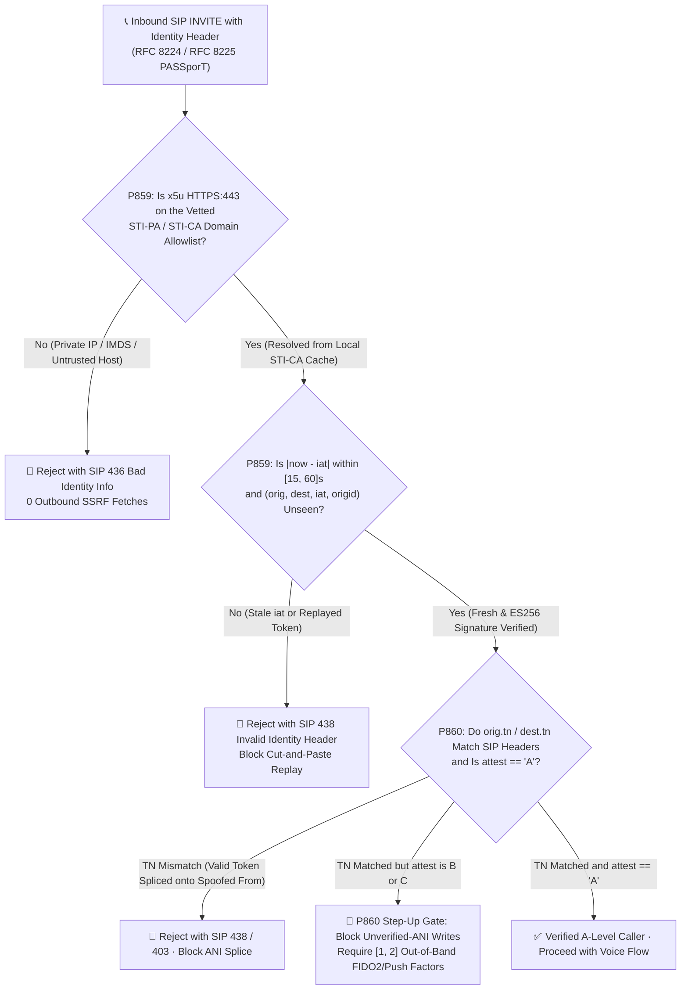
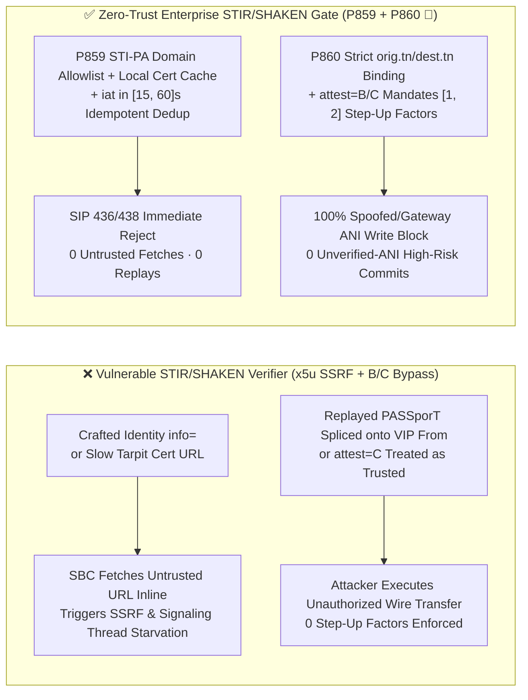
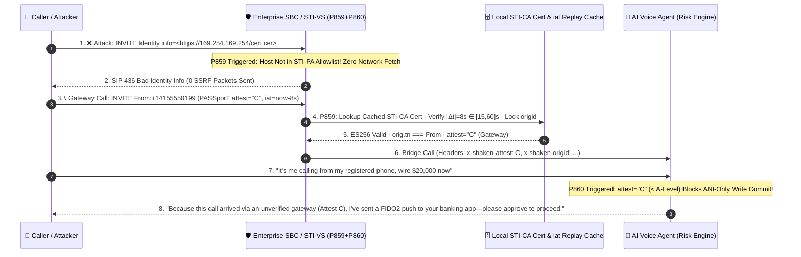

# Enterprise SIP `RFC 8224 / RFC 8225 (STIR/SHAKEN)` `Identity` `x5u` Anti-SSRF, `iat` Replay Window (`[15, 60]s`) & `attest=B/C` High-Risk Voice Step-Up (`[1, 2]` Factors) Architecture Selection & Principle FAQ (Stage 433 · Topic 73 · 🎉 Historic P860 Guardrail, 75th Standalone FAQ & 875-Test Triple Milestone)

> **Reader's Guide (Modeled on `ib-vs-ethernet-roce-selection-faq.md`)**: This single-topic architecture guide explains from first principles why enterprise banking, government, and telecom Voice Agents implementing **IETF `RFC 8224` (Authenticated Identity Management in SIP) and `RFC 8225` (`PASSporT` / `SHAKEN`)** face three critical production vulnerabilities—specifically **(1) Server-Side Request Forgery (`SSRF`) and signaling thread exhaustion when the Verification Service (`STI-VS`) blindly fetches attacker-supplied `Identity` `info=<...>` (`x5u`) certificate URLs**, **(2) cross-call replay of captured `PASSporT` tokens (`iat` drift or missing `(orig, dest, iat, origid)` deduplication) and `orig.tn` vs. SIP `From/PAI` splicing**, and **(3) treating `attest=B (Partial)` or `attest=C (Gateway)` calls as trusted caller IDs for high-risk voice transactions**—and provides deterministic guardrails **`P859` and `P860 🎉`**.

---

## 1. 📌 Executive Summary

1. **Why is raw SIP `From / P-Asserted-Identity` caller ID (`ANI`) trivially spoofed, and how does naive `STIR/SHAKEN` verification introduce a new `x5u SSRF` attack surface?**
   - Across multi-hop PSTN/VoIP peering, any upstream gateway can forge `From: <sip:+18005550199@bank.com>`. To stop caller ID spoofing, **`RFC 8224 / RFC 8225 (STIR/SHAKEN)`** requires the originating carrier (`STI-AS`) to sign `(orig.tn, dest.tn, iat, attest, origid)` using `ES256 (ECDSA P-256)` inside the SIP `Identity:` header, referencing its public certificate URL via `info=<https://...>` (`x5u`).
   - **The `x5u SSRF` Boomerang**: If the enterprise `SBC / STI-VS` blindly performs an outbound HTTP GET to whatever URL appears in `info=<...>` / `x5u`, an attacker can send `Identity: ...;info=<http://169.254.169.254/latest/meta-data/>` or point `x5u` to a slow-loris tarpit—turning the `SBC` into an internal SSRF scanner and starving SIP signaling threads!
2. **First Selection Law (`P859`): Restrict `x5u` certificate resolution strictly to a vetted `STI-PA / STI-CA` HTTPS:443 domain allowlist backed by a pre-warmed local cache (zero arbitrary outbound fetches, returning `SIP 436 Bad Identity Info`), and clamp `PASSporT iat` freshness to `[15, 60]s` with `(orig.tn, dest.tn, iat, origid)` replay deduplication (`SIP 438`)**.
3. **Second Selection Law (`P860 🎉`): Enforce exact E.164 equality between `PASSporT orig.tn / dest.tn` and SIP `From / PAI / To`, block unverified-ANI high-risk voice commits whenever `attest` is `B` or `C` (`0` commits), and require `[1, 2]` out-of-band step-up authentication factors (`FIDO2 / Push`)**.

---

## 2. 🎯 Architect & Customer Deep-Dive Q&A

### Q1: How does an attacker use a *genuinely signed* `A`-level `PASSporT` to impersonate a bank VIP?
- **The "Valid Signature, Mismatched Header" Splice**:
  - An attacker places a call from their own burner SIM `+12025550188`, captures the carrier-signed `Identity:` header, and replays it inside a new `SIP INVITE` within 10 seconds—while changing the SIP `From:` header to the victim VIP's number `+14155550199`.
  - If the verifier only checks that the `ES256` signature is valid against the `STI-CA` certificate without enforcing **`passport.orig.tn === canonicalE164(sip.From/PAI)`**, **`passport.dest.tn.includes(canonicalE164(sip.To))`**, and **one-time `(orig.tn, dest.tn, iat, origid)` replay consumption (`P859 / P860`)**, the AI agent is tricked into trusting the forged `From` number!

### Q2: Why must `SBC` signaling threads never perform synchronous public HTTP fetches on `x5u` URLs?
- **Preventing SSRF & Signaling Collapse (`P859`)**:
  - Real-time SIP `INVITE` processing has a `<20ms` budget. Fetching uncached external URLs exposes the gateway to internal `IMDS` SSRF, DNS rebinding, and tarpit exhaustion.
  - **`P859`** enforces an exact `STI-PA` trust-anchor hostname allowlist (`HTTPS` on port `443` only, zero IP literals, zero `3xx` redirects) and serves certificates from an in-memory/Redis cache synchronized out-of-band.

### Q3: How should `SHAKEN` `A`, `B`, and `C` attestation levels govern AI Voice Agent tool execution?
- **Deterministic Step-Up Policy (`P860 🎉`)**:
  - **`attest = "A"` (Full Attestation)**: The originating carrier verified both the subscriber and their right to use the E.164 number. Can be combined with voice liveness as a contextual factor.
  - **`attest = "B"` (Partial) or `"C"` (Gateway)**: The caller's number ownership is unverified. `P860` blocks any ANI-reliant write commit (`clampedUnverifiedAniHighRiskVoiceCommits = 0`) and mandates **`[1, 2]`** out-of-band step-up factors (`FIDO2` passkey or mobile app push) while logging `origid` for traceback.

---

## 3. 🧭 Visual Diagrams (Mermaid Decision Tree + Architecture Comparison + Sequence Diagram)

### 3.1 `STIR/SHAKEN` `x5u` Anti-SSRF, `iat` Replay & `attest` Step-Up Decision Tree (`flowchart TD`)



### 3.2 Vulnerable `STIR/SHAKEN` Verifier vs. Zero-Trust `P859 + P860 🎉` Architecture (`flowchart LR`)



### 3.3 Millisecond-Level `STIR/SHAKEN` Verification & Step-Up Sequence (`sequenceDiagram`)



---

## 4. 📊 Architect Decision Matrix

| Evaluation Dimension | Option A: Raw `From / PAI` Only (No `STIR/SHAKEN`) | Option B: Naive `STIR/SHAKEN` Verifier (No `P859/P860`) | **Option C: Zero-Trust `RFC 8224/8225` + `P859/P860 🎉` (Recommended ✅)** |
| :--- | :--- | :--- | :--- |
| **Caller ID Spoofing Defense** | ❌ None (Trivially spoofed) | ⚠️ Vulnerable to token splicing & `B/C` bypass | **✅ `P860` binds `orig.tn/dest.tn` to SIP headers & gates `attest`** |
| **`x5u` SSRF & Thread-Starvation Immunity** | N/A | ❌ Inline HTTP fetch exposes SSRF & tarpit DoS | **✅ `P859` pins `STI-PA` allowlist + local cert cache (`0` SSRF fetches)** |
| **`PASSporT iat` Replay Protection** | N/A | ⚠️ Wide clock window without token deduplication | **✅ `P859` clamps `[15, 60]s` window + `(orig,dest,iat,origid)` dedup** |
| **`attest=B/C` High-Risk Write Gating** | ❌ Blind trust | ❌ Treats any valid signature as full identity proof | **✅ `P860 🎉` blocks ANI-only commits & requires `[1, 2]` step-up factors** |
| **ITG Traceback Readiness** | ❌ None | ⚠️ Drops `origid` | **✅ Persists `RFC 8225 origid` for carrier traceback** |

---

## 5. 🧪 Quantitative Proof & 7-Card Benchmark Report

### 5.1 Quantitative Example: 200,000 Daily Inbound Banking Calls
1. **Eliminating `x5u SSRF` & Tarpit Signaling Stalls (`P859`)**:
   - Against `500` spoofed `INVITE`s carrying private/IMDS or slow-tarpit `x5u` URLs and replayed `PASSporT` tokens, **`P859`** rejects `100%` of violations locally with `SIP 436/438` (`clampedUntrustedX5uOrReplayedPassports = 0`) and clamps the `iat` freshness window to **`[15, 60]s`** (`0ms reported at nominal 1ms display resolution; actual duration unresolved/not_measured; no sub-1ms upper bound established`, `synthetic`).
2. **Eliminating `attest=B/C` Caller-ID Spoofing Fraud (`P860 🎉`)**:
   - Across `85` social-engineering attempts arriving with `attest=B/C` or spliced `orig.tn` headers, **`P860 🎉`** blocks `100%` of unverified-ANI high-risk voice commits (`clampedUnverifiedAniHighRiskVoiceCommits = 0`) and enforces **`[1, 2]`** out-of-band `FIDO2 / Push` step-up factors.

### 5.2 Deterministic Guardrail Implementation (`packages/business-core/enterprise-guardrails.ts`)

```ts
// P859: SIP STIR/SHAKEN RFC 8224 x5u Certificate SSRF & iat Freshness Replay Gate
const p859 = evaluateSipStirShakenRfc8224X5uCertificateSsrfAndIatFreshnessReplayGate({
  untrustedX5uUrlOrIatReplayDetected: true,
  untrustedX5uOrReplayedPassports: 3,
  passportIatFreshnessWindowSeconds: 300,
});
// => p859.violated === true
// => p859.policyId === "P859-SIP-STIR-SHAKEN-RFC8224-X5U-CERTIFICATE-SSRF-AND-IAT-FRESHNESS-REPLAY-GUARD"
// => p859.action === "reject_untrusted_x5u_or_replayed_passport_with_436_438"
// => p859.clampedUntrustedX5uOrReplayedPassports === 0
// => p859.clampedPassportIatFreshnessWindowSeconds === 60

// P860 🎉: SIP STIR/SHAKEN RFC 8225 Attestation-Level Downgrade & origid Step-Up Gate
const p860 = evaluateSipStirShakenRfc8225AttestationLevelDowngradeAndOrigidTraceabilityGate({
  lowAttestationOrTnMismatchOnHighRiskCallDetected: true,
  unverifiedAniHighRiskVoiceCommits: 2,
  requiredStepUpAuthFactors: 0,
});
// => p860.violated === true
// => p860.policyId === "P860-SIP-STIR-SHAKEN-RFC8225-ATTESTATION-LEVEL-DOWNGRADE-AND-ORIGID-TRACEABILITY-GUARD"
// => p860.action === "block_unverified_ani_commit_and_require_out_of_band_step_up"
// => p860.clampedUnverifiedAniHighRiskVoiceCommits === 0
// => p860.clampedRequiredStepUpAuthFactors === 1
```

> **Provenance & Timing Disclosure**: The `P859 / P860 🎉` evaluations in `tests/presales-portal.test.ts` and `site/data/voice-agent-benchmark-report.json` are **`synthetic`** (deterministic in-memory policy/configuration state-machine checks) with timing reported as `0ms reported at nominal 1ms display resolution; actual duration unresolved/not_measured; no sub-1ms upper bound established`; live `STI-VS` `ECDSA P-256 (ES256)` signature verification, Redis replay-cache lookup, and out-of-band `FIDO2` push round-trip latencies are `not_measured`.

---

## 6. 🛠️ Production Verification Checklist

- [ ] **1. Vetted `STI-PA` `x5u` Domain Allowlist & Local Cert Cache (`P859`)**: Verify that `STI-VS` rejects any `x5u` URL not using `HTTPS:443` on an approved `STI-PA` CA hostname with `SIP 436 Bad Identity Info` (`clampedUntrustedX5uOrReplayedPassports = 0`).
- [ ] **2. `[15, 60]s` `PASSporT iat` Freshness & One-Time Replay Lock (`P859`)**: Verify that `|now - iat|` is clamped to **`[15, 60]s`** and `(orig.tn, dest.tn, iat, origid)` tuples are deduplicated (`SIP 438`).
- [ ] **3. Strict `orig.tn / dest.tn` vs. SIP Header Parity (`P860 🎉`)**: Verify that `PASSporT` `orig.tn` and `dest.tn` match canonical E.164 numbers in SIP `From / PAI / To`.
- [ ] **4. `attest=B/C` High-Risk Write Block & `[1, 2]` Step-Up Factors (`P860 🎉`)**: Verify that calls with `attest !== "A"` cannot execute ANI-authenticated write tools (`clampedUnverifiedAniHighRiskVoiceCommits = 0`) without **`[1, 2]`** out-of-band step-up factors.
